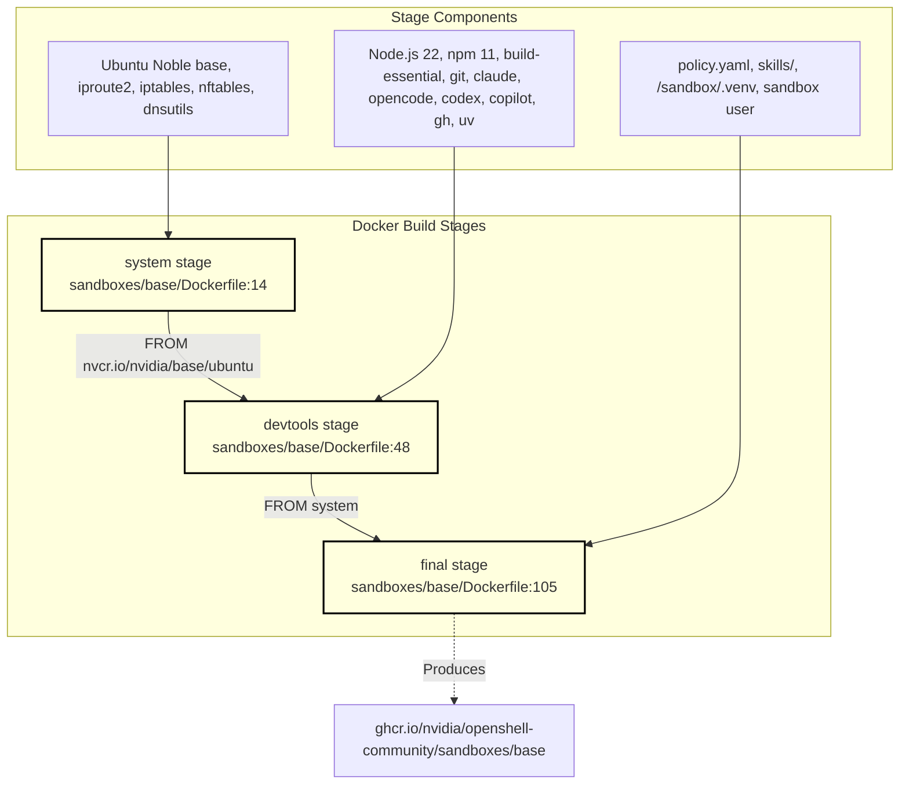
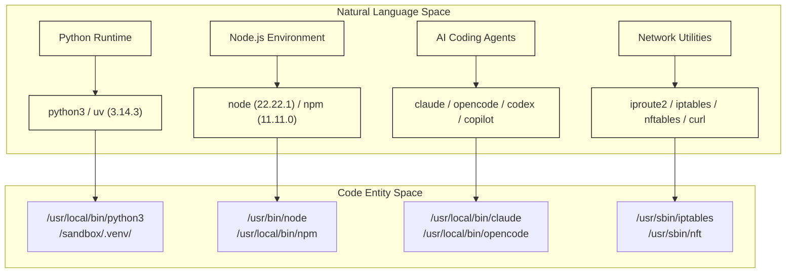

<!-- source: DeepWiki mcp.deepwiki.com · repo NVIDIA/OpenShell-Community · page 2.1 Base Sandbox Image · fetched 2026-10-26 -->

# Base Sandbox Image

Relevant source files

The following files were used as context for generating this wiki page:

- [sandboxes/base/Dockerfile](sandboxes/base/Dockerfile)
- [sandboxes/base/README.md](sandboxes/base/README.md)

## Purpose and Scope

The base sandbox image provides the foundational operating system layer, core developer runtimes, networking diagnostics, and agent command-line interfaces used across the OpenShell-Community ecosystem [sandboxes/base/Dockerfile:6-10](), [sandboxes/base/README.md:1-3](). All specialized community sandboxes inherit from this base image, ensuring a consistent execution environment for AI coding agents and isolated tasks [sandboxes/base/README.md:3]().

This is a parent page. High-level concepts such as the multi-stage build architecture, pre-installed toolchains, and agent CLIs are summarized below. For deep-dive details on user privileges, home directory layout, virtual environments, and shell initialization, see [Users, Filesystem Layout and Shell Environment](#2.1.1).

---

## Multi-Stage Build Architecture

The base sandbox image is constructed using a three-stage Docker build pipeline inside `sandboxes/base/Dockerfile`: `system`, `devtools`, and `final`. This separation ensures that heavy compilation toolchains and intermediate setup scripts are cleanly isolated from the runtime environment.

### 1. System Stage (`system`)
The `system` stage initializes from the NVIDIA Ubuntu image (`nvcr.io/nvidia/base/ubuntu:noble-20251013`) [sandboxes/base/Dockerfile:14](). It configures non-interactive apt options, sets the working directory to `/sandbox`, and installs core networking and diagnostic packages such as `iproute2`, `iptables`, `nftables`, `dnsutils`, `curl`, and `procps` [sandboxes/base/Dockerfile:16-41](). It also establishes the unprivileged `sandbox` user and privileged `supervisor` user groups [sandboxes/base/Dockerfile:43-45]().

### 2. Developer Tools Stage (`devtools`)
The `devtools` stage inherits from `system` and layers on development runtimes [sandboxes/base/Dockerfile:48](). It installs Node.js 22, upgrades `npm` to version 11, and pulls in compilation essentials (`build-essential`, `git`) [sandboxes/base/Dockerfile:59-67](). Global AI agent CLIs (`opencode-ai`, `@openai/codex`, `@github/copilot`) and security-pinned packages are installed globally via `npm` [sandboxes/base/Dockerfile:75-80](). Additionally, the GitHub CLI (`gh`) and the native Claude CLI installer are integrated [sandboxes/base/Dockerfile:83-93](). Python is managed entirely through `uv` (version 0.10.8), installing Python 3.14.3 into an isolated toolchain directory [sandboxes/base/Dockerfile:95-102]().

### 3. Final Stage (`final`)
The `final` stage builds upon `devtools` to produce the distributable image [sandboxes/base/Dockerfile:105](). It copies runtime security policies (`policy.yaml`) and agent skills, configures the writable Python virtual environment (`/sandbox/.venv`), sets up shell initialization files (`.bashrc`, `.profile`), and switches execution context to the unprivileged `sandbox` user [sandboxes/base/Dockerfile:111-149]().

Sources: `sandboxes/base/Dockerfile:1-150`, `sandboxes/base/README.md:1-46`

---

## Runtimes, Package Managers, and Agent CLIs

The base image bundles a robust developer toolchain tailored for AI agents and coding automation workflows. Rather than relying on system-managed Python packages, Python execution is orchestrated via `uv` using a dedicated virtual environment [sandboxes/base/Dockerfile:95-128]().

### Included Tool Summary

| Category | Tools & Versions | Code References |
| :--- | :--- | :--- |
| **Operating System** | Ubuntu Noble (24.04 equivalent) | `sandboxes/base/Dockerfile:14` |
| **Languages** | Python 3.14.3, Node.js 22.22.1 | `sandboxes/base/Dockerfile:63`, `sandboxes/base/Dockerfile:99` |
| **Package Managers** | `npm` (11.11.0), `uv` (0.10.8), `pip` | `sandboxes/base/Dockerfile:67`, `sandboxes/base/Dockerfile:97`, `sandboxes/base/Dockerfile:128` |
| **Coding Agent CLIs** | `claude`, `opencode`, `codex`, `copilot`, `gh` | `sandboxes/base/Dockerfile:78-93` |
| **Networking** | `ping`, `dig`, `nslookup`, `nc`, `traceroute`, `iptables`, `nftables` | `sandboxes/base/Dockerfile:28-40` |

Sources: `sandboxes/base/Dockerfile:1-150`, `sandboxes/base/README.md:5-15`

---

## Users, Filesystem Layout and Shell Environment

The sandbox runtime divides responsibilities between two system users: the privileged `supervisor` process manager and the unprivileged `sandbox` execution user [sandboxes/base/Dockerfile:43-45](), [sandboxes/base/README.md:16-22](). The filesystem is structured around `/sandbox` as the primary home directory, containing writable virtual environments (`.venv`), agent configurations, and skill discovery paths [sandboxes/base/Dockerfile:111-145](), [sandboxes/base/README.md:23-31]().

For detailed coverage of user definitions, permission models, directory layouts, and shell initialization variables (`PATH`, `VIRTUAL_ENV`, `.bashrc`, `.profile`), see [Users, Filesystem Layout and Shell Environment](#2.1.1).

Sources: `sandboxes/base/Dockerfile:43-46`, `sandboxes/base/Dockerfile:111-149`, `sandboxes/base/README.md:16-31`

---

