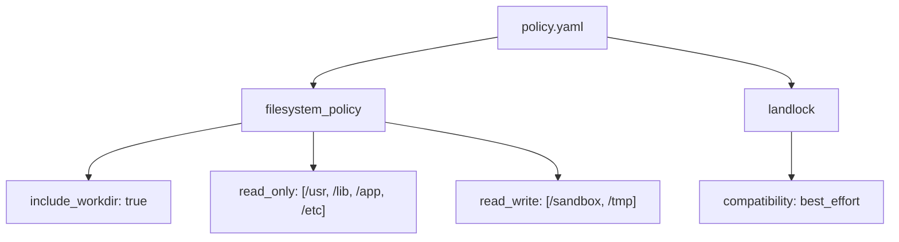
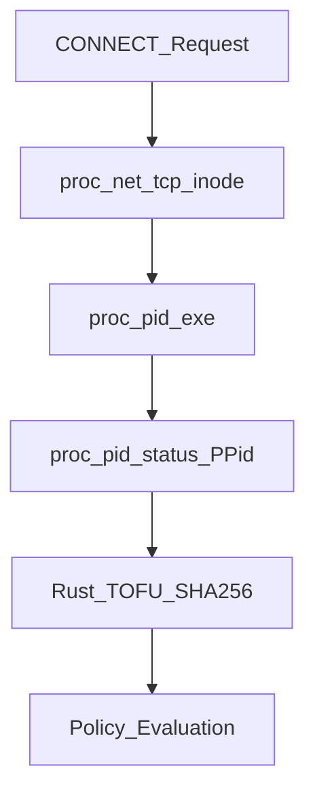

<!-- source: DeepWiki mcp.deepwiki.com · repo NVIDIA/OpenShell-Community · page 2.2 Policy Engine and policy.yaml · fetched 2026-10-26 -->

# Policy Engine and policy.yaml

Relevant source files

The following files were used as context for generating this wiki page:

- [sandboxes/base/policy.yaml](sandboxes/base/policy.yaml)
- [sandboxes/base/skills/github/SKILL.md](sandboxes/base/skills/github/SKILL.md)
- [sandboxes/pi/Dockerfile](sandboxes/pi/Dockerfile)
- [sandboxes/pi/README.md](sandboxes/pi/README.md)
- [sandboxes/pi/policy.yaml](sandboxes/pi/policy.yaml)

## Purpose and Scope

This page provides a high-level architectural overview of the OpenShell Policy Engine and the configuration schema defined in `policy.yaml`. The policy engine enforces sandbox boundaries at startup and runtime by controlling filesystem mounts, process privileges, Landlock kernel sandboxing, binary identity verification, and network egress connections. 

For deep technical breakdowns of specific named network policies across various agent environments, see [Network Egress Policies by Agent](#2.2.1).

---

## Filesystem Policy and Landlock Integration

The policy engine establishes a declarative filesystem boundary queried at container startup (`sandboxes/base/policy.yaml:6-25`). The `filesystem_policy` block configures working directory inclusion (`include_workdir: true`), explicit read-only mount points (`/usr`, `/lib`, `/proc`, `/app`, `/etc`, etc.), and writable scratch paths (`/sandbox`, `/tmp`, `/dev/null`) (`sandboxes/base/policy.yaml:8-21`). 

In addition, the `landlock` block specifies kernel-level unprivileged access control (`sandboxes/base/policy.yaml:23-25`). By setting `compatibility: best_effort`, the runtime leverages Linux Landlock restrictions where supported by the underlying host kernel to restrict filesystem operations independently of container namespace isolation.

Sources: `sandboxes/base/policy.yaml:1-25`

---

## Process Context

To prevent privilege escalation within sandboxed environments, the policy engine enforces a strict process execution context (`sandboxes/base/policy.yaml:26-29`). The `process` block drops root privileges by default, forcing all commands and agent loops to execute under a restricted unprivileged user account and group (`run_as_user: sandbox`, `run_as_group: sandbox`) (`sandboxes/base/policy.yaml:27-28`).

Sources: `sandboxes/base/policy.yaml:26-29`

---

## Binary Identity Resolution and Trust-On-First-Use (TOFU)

Network egress filtering in OpenShell relies on strict binary identity verification rather than merely inspecting network sockets or source ports (`sandboxes/base/policy.yaml:30-36`). When a process initiates an outbound connection, the policy engine resolves the calling binary using runtime kernel telemetry and procfs inspection.

As detailed in policy annotations, binary identity resolution occurs via `/proc/net/tcp` inode lookup mapped to `/proc/{pid}/exe`, combined with an ancestor tree walk (`/proc/{pid}/status` `PPid` walk) and command-line path matching (`sandboxes/base/policy.yaml:33-34`). Cryptographic integrity (SHA256) for binaries is enforced in the underlying Rust runtime using a trust-on-first-use (TOFU) model (`sandboxes/base/policy.yaml:35`).

Sources: `sandboxes/base/policy.yaml:30-36`

---

## Network Policies Overview

Network egress filtering is partitioned into named network policies (`network_policies`) that map specific allowed binary paths to allowed network endpoints, communication protocols, and access modes (`sandboxes/base/policy.yaml:37-195`). 

Because this parent page serves as a high-level overview, detailed comparisons of network egress policies across specific developer agents and tools (such as `claude_code`, `github_rest_api`, `pypi`, `npm`, `vscode`, `cursor`, and Bring-Your-Own-Key providers) are maintained separately.

For comprehensive details on specific egress rules, see [Network Egress Policies by Agent](#2.2.1).

Sources: `sandboxes/base/policy.yaml:37-195`

---

