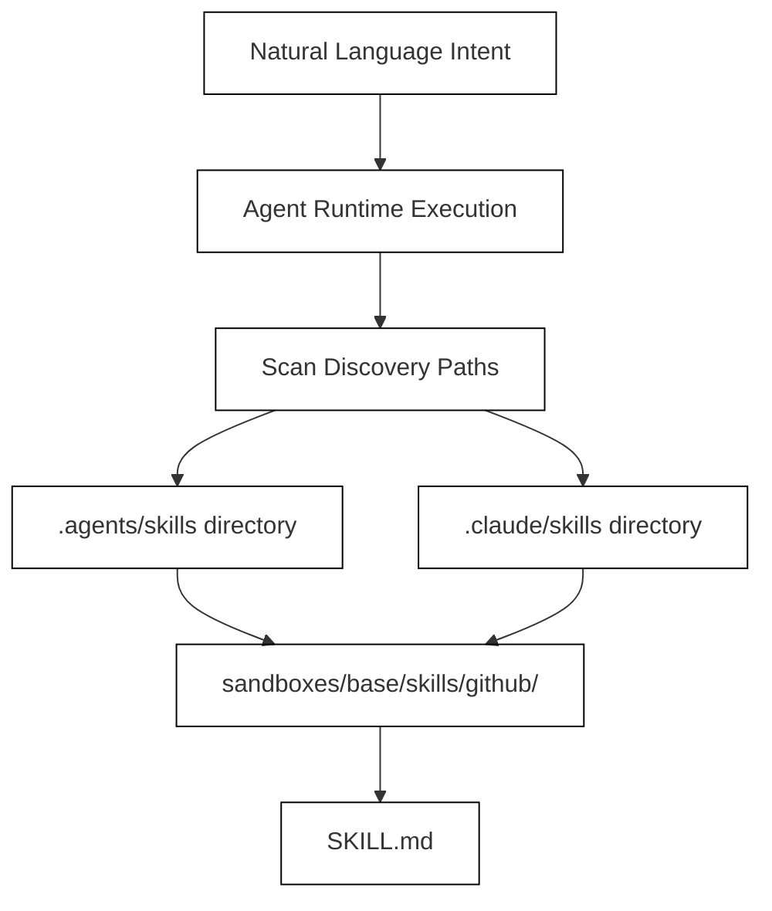

<!-- source: DeepWiki mcp.deepwiki.com · repo NVIDIA/OpenShell-Community · page 2.3 Agent Skills · fetched 2026-10-26 -->

# Agent Skills

<details>
<summary>Relevant source files</summary>

The following files were used as context for generating this wiki page:

- [CONTRIBUTING.md](CONTRIBUTING.md)
- [sandboxes/base/policy.yaml](sandboxes/base/policy.yaml)
- [sandboxes/base/skills/github/SKILL.md](sandboxes/base/skills/github/SKILL.md)

</details>


The purpose of this page is to document the agent skills architecture within OpenShell-Community. It details how agent capabilities are defined, discovered via `.agents/skills` and `.claude/skills`, structured using the `SKILL.md` format, and enforced through network egress policies such as the built-in `github` REST-only skill.

Sources: `CONTRIBUTING.md:59-64`, `sandboxes/base/skills/github/SKILL.md:1-4`

---

## 1. Skill Discovery and Directory Layout

OpenShell-Community sandboxes provision specialized capabilities to coding agents through modular skill directories. When an agent environment initializes within a sandbox, it scans specific well-known paths for skill definitions. 

Skills are located within individual sandbox directories or inherited from the base image structure under local `.agents/skills` and `.claude/skills` search paths [CONTRIBUTING.md:59-65](). Each skill resides in its own isolated subdirectory containing a mandatory configuration manifest and supporting execution scripts [CONTRIBUTING.md:59-65]().


*Figure 1: Skill Discovery Architecture from Discovery Paths to `SKILL.md`.*

Sources: `CONTRIBUTING.md:59-65`

---

## 2. The `SKILL.md` Format

Every skill must provide a `SKILL.md` file that acts as the primary control block for the agent [CONTRIBUTING.md:59-65](). The file begins with a YAML frontmatter block defining metadata (such as `name` and `description`), followed by structured markdown instructions detailing execution constraints, required shell permissions, and command templates [sandboxes/base/skills/github/SKILL.md:1-15]().

For example, the frontmatter defines trigger keywords and operational intent, while the markdown body provides explicit rules on tool usage (e.g., preferring specific command-line flags or restricting specific API call types) [sandboxes/base/skills/github/SKILL.md:1-15]().

Sources: `CONTRIBUTING.md:59-65`, `sandboxes/base/skills/github/SKILL.md:1-15`

---

## 3. Built-In GitHub REST-Only Skill

The built-in `github` skill (`sandboxes/base/skills/github/SKILL.md`) instructs agents on interacting with GitHub exclusively through REST API endpoints rather than GraphQL [sandboxes/base/skills/github/SKILL.md:1-11](). This restriction is required because sandbox network egress policies block the GraphQL endpoint (`api.github.com/graphql`) while permitting REST paths (`api.github.com/repos/...`) [sandboxes/base/policy.yaml:84-97](), [sandboxes/base/skills/github/SKILL.md:16-22]().

### Policy Enforcement and Tool Routing

The policy engine configured in `sandboxes/base/policy.yaml` defines the `github_rest_api` network policy, binding the `/usr/bin/gh` binary and `/usr/local/bin/claude` to `api.github.com` on port `443` with `read-only` access restrictions [sandboxes/base/policy.yaml:84-97]().

```mermaid
graph TD
    AgentCmd[""Agent Command: gh api repos/{owner}/{repo}""] --> BinaryExec[""Binary Execution: /usr/bin/gh""]
    BinaryExec --> NetworkConnect[""TCP Connect: api.github.com:443""]
    NetworkConnect --> PolicyEngine[""Policy Evaluation: policy.yaml""]
    PolicyEngine --> CheckPolicy[""Match Policy: github_rest_api""]
    CheckPolicy --> RestAllowed[""Allow REST Path: /repos/... (Status: Allowed)""]
    CheckPolicy --> GqlBlocked[""Block Endpoint: /graphql (Status: Blocked)""]

    classDef default fill:none,stroke:black,stroke-width:1px;
```
*Figure 2: Natural Language Space to Code Entity Space mapping execution of `gh` through `policy.yaml` routing rules.*

### REST-Safe Commands vs. GraphQL-Prone Commands

The `github` skill explicitly categorizes subcommands to prevent runtime failures [sandboxes/base/skills/github/SKILL.md:25-42]():

- **Avoid (GraphQL-dependent)**: `gh pr list`, `gh issue list`, `gh project`, `gh search` [sandboxes/base/skills/github/SKILL.md:25-31]().
- **Preferred (REST-safe)**: `gh api <REST-path>`, `gh pr create`, `gh pr merge`, `gh release *`, `gh run *`, `gh workflow *` [sandboxes/base/skills/github/SKILL.md:33-42]().

Sources: `sandboxes/base/policy.yaml:84-97`, `sandboxes/base/skills/github/SKILL.md:1-43`

---

