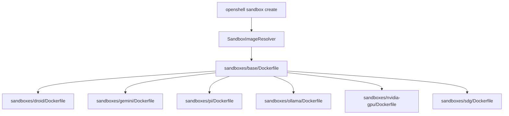
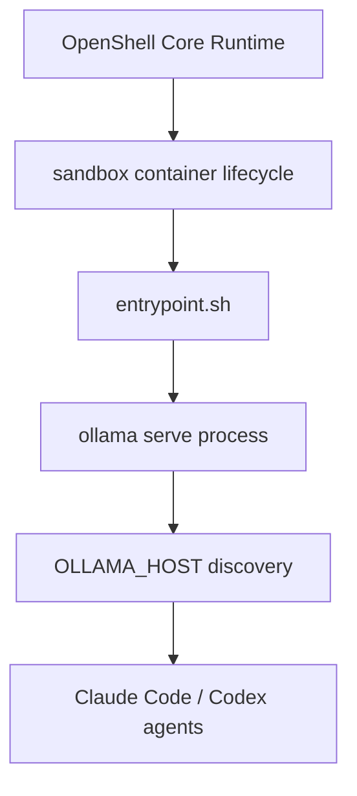

<!-- source: DeepWiki mcp.deepwiki.com · repo NVIDIA/OpenShell-Community · page 3 Sandbox Catalog · fetched 2026-10-26 -->

# Sandbox Catalog

Relevant source files

The following files were used as context for generating this wiki page:

- [README.md](README.md)

The Sandbox Catalog indexes pre-built domain-specific container environments provided by the `OpenShell-Community` repository. Each sandbox inherits from the foundational base layer and provides tailored tooling, runtime dependencies, configuration profiles, and pre-installed agent frameworks. These images are instantiated via the OpenShell CLI command `openshell sandbox create --from <sandbox>` [README.md:43-43].

Sources: [README.md:1-72]()

---

## Sandbox Index

The community repository organizes sandboxes by workload type under the `sandboxes/` directory [README.md:16-19]. The following table summarizes the available sandbox images:

| Sandbox Image | Directory Path | Target Workload / Description |
| --- | --- | --- |
| `base` | `sandboxes/base/` [README.md:24-24]() | Foundational system tools, users, and base developer environment. |
| `droid` | `sandboxes/droid/` [README.md:25-25]() | Android automation, mobile testing workflows, and Factory Droid binaries. |
| `gemini` | `sandboxes/gemini/` [README.md:26-26]() | Google Gemini CLI workflows and associated agent configurations. |
| `nvidia-gpu` | `sandboxes/nvidia-gpu/` [README.md:27-27]() | GPU-accelerated VM sandbox with NVIDIA userspace tooling and drivers. |
| `ollama` | `sandboxes/ollama/` [README.md:28-28]() | Local LLM hosting via `ollama serve` with Claude Code, Codex, and OpenCode. |
| `pi` | `sandboxes/pi/` [README.md:29-29]() | Pre-installed [Pi](https://pi.dev) agent environment [README.md:29-29]. |
| `sdg` | `sandboxes/sdg/` [README.md:30-30]() | Synthetic data generation pipelines and workloads. |

*Sources: [README.md:14-31]()*

---

## 3.1 Coding Agent Sandboxes (droid, gemini, pi)

The coding agent sandboxes provide specialized runtimes for specific agent CLIs, including Factory Droid, Gemini CLI, and the Pi agent [README.md:25-29]. These images package pinned agent binary versions, custom shell configurations, and isolated policy definitions within their respective subdirectories (`sandboxes/droid/`, `sandboxes/gemini/`, `sandboxes/pi/`) [README.md:16-29].

For deep technical details regarding Dockerfiles, pinned versions, configuration directories, and security policies, see [Coding Agent Sandboxes (droid, gemini, pi)](#3.1).

Sources: [README.md:24-30]()

---

## 3.2 Ollama Sandbox

The Ollama sandbox provisions a local and cloud LLM execution environment [README.md:28-51]. It includes an automated entrypoint script (`entrypoint.sh`) that initializes the local model server, configures `OLLAMA_HOST` discovery for agents, supports model updates via `update-ollama.sh`, and bundles pre-installed coding assistants such as Claude Code and Codex [README.md:28-50].

*Sources: [README.md:28-51]()*

For comprehensive instructions on automated startup scripts, environment variable bindings, and egress filtering policies, see [Ollama Sandbox](#3.2).

Sources: [README.md:28-51]()

---

## 3.3 NVIDIA GPU Sandbox

The NVIDIA GPU sandbox image (`sandboxes/nvidia-gpu/`) supplies GPU-accelerated computing capabilities for autonomous agent verification and synthetic data generation [README.md:8-27]. It manages the separation between host kernel driver versions and containerized userspace libraries, utilizing version coupling mechanisms declared in `versions.env` to maintain compatibility across multi-architecture builds.

For architectural breakdowns of the userspace-to-kernel driver split, version pinning conventions, multi-arch build pipelines, and troubleshooting instructions, see [NVIDIA GPU Sandbox](#3.3).

Sources: [README.md:8-27]()

---

