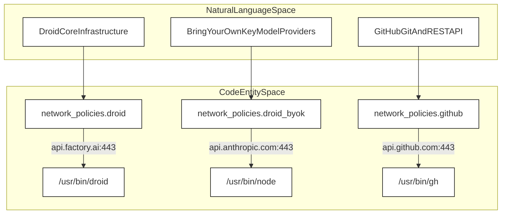
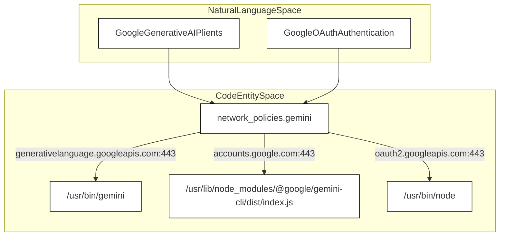
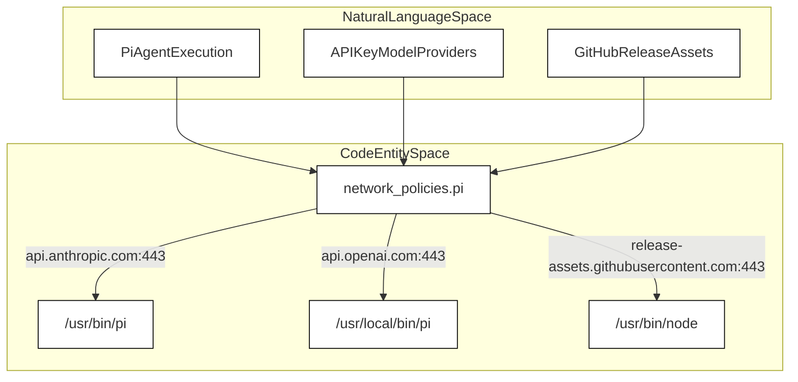

<!-- source: DeepWiki mcp.deepwiki.com · repo NVIDIA/OpenShell-Community · page 3.1 Coding Agent Sandboxes (droid, gemini, pi) · fetched 2026-10-26 -->

# Coding Agent Sandboxes (droid, gemini, pi)

<details>
<summary>Relevant source files</summary>

The following files were used as context for generating this wiki page:

- [sandboxes/droid/Dockerfile](sandboxes/droid/Dockerfile)
- [sandboxes/droid/README.md](sandboxes/droid/README.md)
- [sandboxes/droid/policy.yaml](sandboxes/droid/policy.yaml)
- [sandboxes/gemini/Dockerfile](sandboxes/gemini/Dockerfile)
- [sandboxes/gemini/README.md](sandboxes/gemini/README.md)
- [sandboxes/gemini/policy.yaml](sandboxes/gemini/policy.yaml)
- [sandboxes/pi/Dockerfile](sandboxes/pi/Dockerfile)
- [sandboxes/pi/README.md](sandboxes/pi/README.md)
- [sandboxes/pi/policy.yaml](sandboxes/pi/policy.yaml)

</details>


## Purpose and Scope
This document covers the technical implementation, container specifications, configuration directories, and security policies for the three primary coding agent sandboxes provided by OpenShell-Community: **Factory Droid** (`droid`), **Gemini CLI** (`gemini`), and **Pi Coding Agent** (`pi`). Each sandbox inherits from the OpenShell base runtime image, layers a specific AI coding assistant CLI with pinned versioning, establishes specialized configuration persistence paths, and defines granular network/filesystem security constraints via `policy.yaml`.

---

## 1. Factory Droid Sandbox (`droid`)

The Factory Droid sandbox packages the Factory Droid CLI (`droid`) inside an isolated execution environment. It is defined by `sandboxes/droid/Dockerfile` [sandboxes/droid/Dockerfile:1-29]() and managed via `sandboxes/droid/README.md` [sandboxes/droid/README.md:1-28]().

### Dockerfile and Version Pinning
The build process accepts a base image argument (`BASE_IMAGE`) and installs the `droid` package pinned to version `0.90.0` globally via npm [sandboxes/droid/Dockerfile:12-18](). It provisions the runtime configuration directory `/sandbox/.factory` and assigns ownership to the unprivileged `sandbox` user [sandboxes/droid/Dockerfile:23-26]().

```dockerfile
ARG BASE_IMAGE=ghcr.io/nvidia/openshell-community/sandboxes/base:latest
FROM ${BASE_IMAGE}

USER root

# Install Droid CLI (pinned for reproducibility)
RUN npm install -g droid@0.90.0

# Copy sandbox policy
COPY policy.yaml /etc/openshell/policy.yaml

# Create Droid config directory
RUN mkdir -p /sandbox/.factory && \
    chown sandbox:sandbox /sandbox/.factory

USER sandbox
ENTRYPOINT ["/bin/bash"]
```
*Sources: [sandboxes/droid/Dockerfile:1-29](), [sandboxes/droid/README.md:1-29]*

### Security Policies (`policy.yaml`)
The filesystem policy configures system directories (`/usr`, `/lib`, `/proc`, `/app`, `/etc`) as read-only while allocating read-write access to `/sandbox`, `/tmp`, and `/dev/null` [sandboxes/droid/policy.yaml:8-22](). Landlock compatibility is set to `best_effort`, enforcing process execution under the `sandbox` user and group [sandboxes/droid/policy.yaml:23-28]().

The network policy defines named endpoints for the core Droid infrastructure (`droid`), Bring-Your-Own-Key model providers (`droid_byok`), GitHub operations (`github`), npm registry (`npm`), and PyPI (`pypi`) [sandboxes/droid/policy.yaml:37-141]().


*Title: Droid Sandbox Policy to Code Entity Mapping*
*Sources: [sandboxes/droid/policy.yaml:1-142]*

---

## 2. Gemini CLI Sandbox (`gemini`)

The Gemini CLI sandbox provides an isolated execution context for Google’s Gemini AI coding assistant. It is defined in `sandboxes/gemini/Dockerfile` [sandboxes/gemini/Dockerfile:1-29]() and documented in `sandboxes/gemini/README.md` [sandboxes/gemini/README.md:1-28]().

### Dockerfile and Version Pinning
The build inherits from the community base image and installs `@google/gemini-cli` pinned to version `0.35.0` via npm [sandboxes/gemini/Dockerfile:12-18](). It initializes the configuration persistence directory at `/sandbox/.gemini` for user credentials and state [sandboxes/gemini/Dockerfile:23-26]().

```dockerfile
ARG BASE_IMAGE=ghcr.io/nvidia/openshell-community/sandboxes/base:latest
FROM ${BASE_IMAGE}

USER root

# Install Gemini CLI (pinned for reproducibility)
RUN npm install -g @google/gemini-cli@0.35.0

# Copy sandbox policy
COPY policy.yaml /etc/openshell/policy.yaml

# Create Gemini config directory
RUN mkdir -p /sandbox/.gemini && \
    chown sandbox:sandbox /sandbox/.gemini

USER sandbox
ENTRYPOINT ["/bin/bash"]
```
*Sources: [sandboxes/gemini/Dockerfile:1-29](), [sandboxes/gemini/README.md:1-29]*

### Security Policies (`policy.yaml`)
The Gemini policy defines access rules for Google AI APIs, OAuth authentication endpoints, and supporting tool integrations [sandboxes/gemini/policy.yaml:185-198](). In addition to the `gemini` policy, it embeds auxiliary policies for Claude Code (`claude_code`), OpenCode (`opencode`), GitHub Copilot (`copilot`), and standard package managers [sandboxes/gemini/policy.yaml:38-198]().


*Title: Gemini Policy Binding and Endpoint Routing*
*Sources: [sandboxes/gemini/policy.yaml:185-199]*

---

## 3. Pi Coding Agent Sandbox (`pi`)

The Pi Coding Agent sandbox integrates the minimal terminal coding harness `pi` [sandboxes/pi/README.md:1-34](). It is built via `sandboxes/pi/Dockerfile` [sandboxes/pi/Dockerfile:1-25]().

### Dockerfile and Package Setup
Unlike Droid and Gemini, the Pi Dockerfile installs `@earendil-works/pi-coding-agent` via global npm without an explicit version tag in the `RUN` instruction, copying the companion `policy.yaml` to `/etc/openshell/policy.yaml` [sandboxes/pi/Dockerfile:17-21]().

```dockerfile
ARG BASE_IMAGE=ghcr.io/nvidia/openshell-community/sandboxes/base:latest
FROM ${BASE_IMAGE}

USER root

# Install pi
RUN npm install -g @earendil-works/pi-coding-agent

# Copy sandbox policy
COPY policy.yaml /etc/openshell/policy.yaml

USER sandbox
ENTRYPOINT ["/bin/bash"]
```
*Sources: [sandboxes/pi/Dockerfile:1-25](), [sandboxes/pi/README.md:1-35]*

### Security Policies (`policy.yaml`)
The `pi` network policy permits outbound connections to a broad catalog of API-key model providers (Anthropic, OpenAI, DeepSeek, Google, Mistral, Groq, Cerebras, xAI, OpenRouter, Together, etc.), cloud providers (AWS Bedrock, Cloudflare), and token refresh endpoints [sandboxes/pi/policy.yaml:38-87](). It explicitly associates these endpoints with binary execution paths for `pi` and `node` [sandboxes/pi/policy.yaml:88-95]().


*Title: Pi Sandbox Network Policy Mapping*
*Sources: [sandboxes/pi/policy.yaml:37-95]*

---

## 4. Cross-Sandbox Architecture & Common Patterns

All three coding agent sandboxes rely on identical foundational security settings defined in their respective `policy.yaml` files. The filesystem policy, Landlock configuration, and user isolation parameters are shared across `droid`, `gemini`, and `pi`.

| Parameter | Configuration Value | Target Scope |
| :--- | :--- | :--- |
| `filesystem_policy.read_only` | `/usr`, `/lib`, `/proc`, `/dev/urandom`, `/app`, `/etc`, `/var/log` | System-wide protection |
| `filesystem_policy.read_write` | `/sandbox`, `/tmp`, `/dev/null` | Scratch space & persistence |
| `landlock.compatibility` | `best_effort` | Kernel sandboxing fallback |
| `process.run_as_user` | `sandbox` | Unprivileged execution |
| `process.run_as_group` | `sandbox` | Unprivileged group context |

*Sources: [sandboxes/droid/policy.yaml:8-28](), [sandboxes/gemini/policy.yaml:8-28](), [sandboxes/pi/policy.yaml:8-28]*

---

