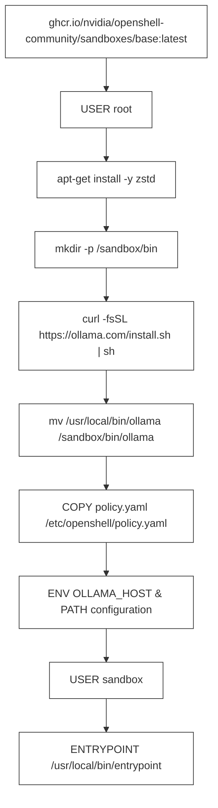
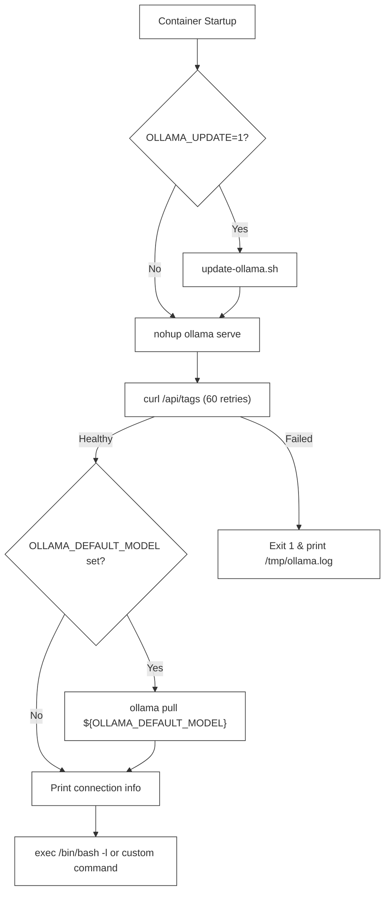
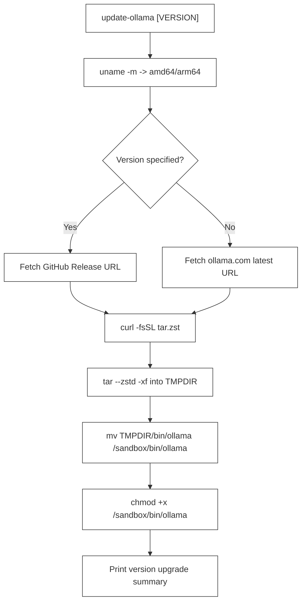
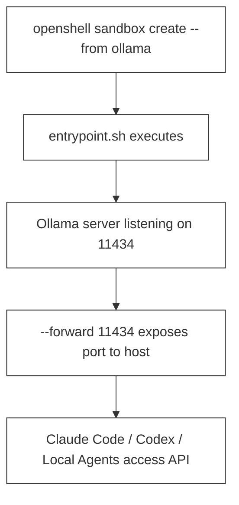

<!-- source: DeepWiki mcp.deepwiki.com · repo NVIDIA/OpenShell-Community · page 3.2 Ollama Sandbox · fetched 2026-10-26 -->

# Ollama Sandbox

<details>
<summary>Relevant source files</summary>

The following files were used as context for generating this wiki page:

- [sandboxes/ollama/Dockerfile](sandboxes/ollama/Dockerfile)
- [sandboxes/ollama/README.md](sandboxes/ollama/README.md)
- [sandboxes/ollama/entrypoint.sh](sandboxes/ollama/entrypoint.sh)
- [sandboxes/ollama/policy.yaml](sandboxes/ollama/policy.yaml)
- [sandboxes/ollama/update-ollama.sh](sandboxes/ollama/update-ollama.sh)

</details>


## Purpose and Scope
The Ollama Sandbox is a specialized OpenShell container environment (`sandboxes/ollama/Dockerfile`) designed to run local Large Language Models (LLMs) via [Ollama](https://ollama.com) while adhering to strict security boundaries. Because the OpenShell runtime enforces a read-only `/usr` filesystem policy, the Ollama binary and npm global modules are redirected to writable paths under `/sandbox` [sandboxes/ollama/Dockerfile:20-21, sandboxes/ollama/Dockerfile:41-42](). 

This page documents the image build structure, runtime initialization via `entrypoint.sh`, dynamic updates via `update-ollama.sh`, network egress enforcement via `policy.yaml`, and usage workflows.

---

## 1. Dockerfile & Image Build Architecture

The Ollama sandbox inherits from the OpenShell base community image (`openshell-base` or `ghcr.io/nvidia/openshell-community/sandboxes/base:latest`) [sandboxes/ollama/Dockerfile:11-12](). 

Key build steps implemented in `sandboxes/ollama/Dockerfile`:
- **Zstandard Installation**: Installs `zstd` (`apt-get install -y --no-install-recommends zstd`), which is required to decompress Ollama release archives [sandboxes/ollama/Dockerfile:16-18]().
- **Writable Binary Path**: Creates `/sandbox/bin`, downloads and extracts Ollama via the official install script, and relocates the executable from `/usr/local/bin/ollama` to `/sandbox/bin/ollama` to allow runtime updates under a read-only root policy [sandboxes/ollama/Dockerfile:20-25]().
- **Environment Discovery**: Sets `OLLAMA_HOST=http://127.0.0.1:11434` and prioritizes `/sandbox/bin` in the `PATH` [sandboxes/ollama/Dockerfile:35-39]().
- **NPM Configuration**: Configures `NPM_CONFIG_PREFIX=/sandbox/.npm-global` to ensure Node.js global packages can be installed without violating filesystem constraints [sandboxes/ollama/Dockerfile:38, sandboxes/ollama/Dockerfile:41-44]().
- **Interactive Shell Defaults**: Appends environment exports to `/sandbox/.bashrc` [sandboxes/ollama/Dockerfile:46-50]().


*Sources: [sandboxes/ollama/Dockerfile:1-55]()*

---

## 2. Runtime Entrypoint & Auto-Start Workflow

When a sandbox container starts, execution passes to `/usr/local/bin/entrypoint` (`sandboxes/ollama/entrypoint.sh`). This script manages automatic updates, server daemonization, and default model provisioning.

### Initialization Sequence
1. **Environment Export**: Ensures `OLLAMA_HOST` is available, defaulting to `http://127.0.0.1:11434` [sandboxes/ollama/entrypoint.sh:9-10]().
2. **Conditional Self-Update**: If `OLLAMA_UPDATE=1` is set in the environment, `update-ollama` is invoked immediately [sandboxes/ollama/entrypoint.sh:12-16]().
3. **Daemon Startup**: Launches the Ollama server in the background via `nohup ollama serve > /tmp/ollama.log 2>&1 &` and records its PID [sandboxes/ollama/entrypoint.sh:18-21]().
4. **Health Polling**: Polls `http://127.0.0.1:11434/api/tags` using `curl` for up to 60 seconds. If the process dies or fails to respond, it aborts [sandboxes/ollama/entrypoint.sh:23-35]().
5. **Default Model Pulling**: If `OLLAMA_DEFAULT_MODEL` is specified and missing from the local registry, it executes `ollama pull` [sandboxes/ollama/entrypoint.sh:37-44]().
6. **Command Execution**: Executes the provided command arguments, or defaults to an interactive login shell (`/bin/bash -l`) [sandboxes/ollama/entrypoint.sh:59-64]().


*Sources: [sandboxes/ollama/entrypoint.sh:1-64]()*

---

## 3. Dynamic Updates via update-ollama.sh

The script `sandboxes/ollama/update-ollama.sh` allows updating the Ollama binary inside the sandbox without rebuilding the container image [sandboxes/ollama/update-ollama.sh:1-9]().

### Execution Flow
- **Architecture Detection**: Maps host architecture (`uname -m`) to Ollama release conventions (`amd64` or `arm64`) [sandboxes/ollama/update-ollama.sh:13-20]().
- **Version Resolution**: Determines the current version via `$OLLAMA_BIN --version` [sandboxes/ollama/update-ollama.sh:22](). If a version argument is passed, it targets `https://github.com/ollama/ollama/releases/download/v${VERSION}/...` [sandboxes/ollama/update-ollama.sh:24-25](); otherwise, it downloads the latest build from `https://ollama.com/download/ollama-linux-${ARCH}.tar.zst` [sandboxes/ollama/update-ollama.sh:29]().
- **Extraction & Replacement**: Downloads the Zstandard archive into a temporary directory, extracts it using `tar --zstd`, and replaces the binary at `/sandbox/bin/ollama` with appropriate permissions [sandboxes/ollama/update-ollama.sh:34-41]().


*Sources: [sandboxes/ollama/update-ollama.sh:1-47]()*

---

## 4. Security & Egress Policies (policy.yaml)

The sandbox policy file (`sandboxes/ollama/policy.yaml`) defines filesystem mounts, user context, and Landlock-compatible network egress restrictions [sandboxes/ollama/policy.yaml:1-35]().

### Filesystem Policy
- **Read-Only Mounts**: `/usr`, `/lib`, `/proc`, `/dev/urandom`, `/app`, `/etc`, `/var/log` [sandboxes/ollama/policy.yaml:7-16]().
- **Read-Write Mounts**: `/sandbox`, `/tmp`, `/dev/null` [sandboxes/ollama/policy.yaml:17-20]().
- **Process Context**: Executes under the non-root user and group `sandbox` [sandboxes/ollama/policy.yaml:25-27]().

### Network Egress Policies
The policy defines named network rules (`ollama`, `claude_code`, `npm`, `github`, `github_rest_api`, `nvidia`, `nvidia_web`) [sandboxes/ollama/policy.yaml:36-135](). Specifically, the `ollama` network policy permits execution paths like `/sandbox/bin/ollama`, `/usr/bin/curl`, and `/bin/bash` to communicate with update endpoints, model registries, and storage buckets:

```yaml
network_policies:
  ollama:
    name: ollama
    endpoints:
      - { host: ollama.com, port: 443 }
      - { host: www.ollama.com, port: 443 }
      - { host: registry.ollama.com, port: 443 }
      - { host: registry.ollama.ai, port: 443 }
      - { host: "*.r2.cloudflarestorage.com", port: 443 }
      - { host: github.com, port: 443 }
      - { host: objects.githubusercontent.com, port: 443 }
      - { host: raw.githubusercontent.com, port: 443 }
      - { host: release-assets.githubusercontent.com, port: 443 }
    binaries:
      - { path: /usr/bin/curl }
      - { path: /bin/bash }
      - { path: /usr/bin/sh }
      - { path: /sandbox/bin/ollama }
      - { path: /usr/local/bin/ollama }
      - { path: /usr/bin/ollama }
```
*Sources: [sandboxes/ollama/policy.yaml:1-56]()*

---

## 5. Usage & Interaction

Building and running the Ollama sandbox is managed through standard OpenShell CLI workflows or direct Docker invocations [sandboxes/ollama/README.md:15-39]().

### Common Commands
- **Build Image Locally**:
  ```bash
  docker build -t openshell-ollama .
  ```
  [sandboxes/ollama/README.md:15-19]()

- **Create Sandbox with Port Forwarding**:
  ```bash
  openshell sandbox create --from ollama --forward 11434
  ```
  [sandboxes/ollama/README.md:23-27]()

- **Update Ollama Interactively**:
  ```bash
  update-ollama
  ```
  [sandboxes/ollama/README.md:29-33]()

- **Auto-Update on Startup**:
  ```bash
  openshell sandbox create --from ollama -e OLLAMA_UPDATE=1
  ```
  [sandboxes/ollama/README.md:35-39]()


*Sources: [sandboxes/ollama/README.md:1-40]()*

---

