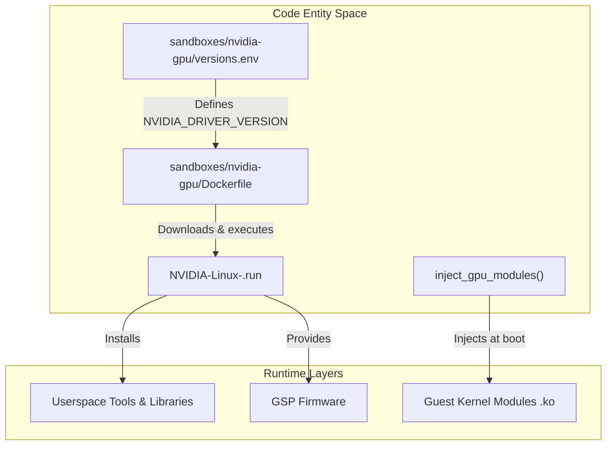
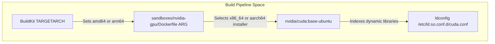

<!-- source: DeepWiki mcp.deepwiki.com · repo NVIDIA/OpenShell-Community · page 3.3 NVIDIA GPU Sandbox · fetched 2026-10-26 -->

# NVIDIA GPU Sandbox

Relevant source files

The following files were used as context for generating this wiki page:

- [sandboxes/nvidia-gpu/Dockerfile](sandboxes/nvidia-gpu/Dockerfile)
- [sandboxes/nvidia-gpu/README.md](sandboxes/nvidia-gpu/README.md)
- [sandboxes/nvidia-gpu/versions.env](sandboxes/nvidia-gpu/versions.env)

## Purpose and Scope

The NVIDIA GPU Sandbox provides GPU-accelerated execution environments for the OpenShell VM driver. It packages NVIDIA userspace drivers, CUDA support libraries, and system utilities on top of an Ubuntu base image `[sandboxes/nvidia-gpu/Dockerfile:6-11]`. Because hardware virtualization isolates the guest kernel from the host, this sandbox implements a strict separation of concerns between container-image-supplied userspace binaries and VM-driver-injected kernel modules `[sandboxes/nvidia-gpu/README.md:12-25]`. This page documents the architecture, version coupling mechanisms (`versions.env`), multi-architecture build pipelines, and operational troubleshooting strategies.

Sources: `sandboxes/nvidia-gpu/Dockerfile:6-11`, `sandboxes/nvidia-gpu/README.md:12-25`

---

## Architecture: Userspace vs. Kernel Module Split

The GPU sandbox splits responsibility across build-time container layers and runtime VM driver orchestration `[sandboxes/nvidia-gpu/README.md:12-25]`:
- **Userspace (Docker Image):** Contains NVIDIA management tools (`nvidia-smi`), driver libraries (`libcuda.so`, `libnvidia-ml.so`), and runtime dependencies (`kmod`, `iproute2`, `busybox-static`) installed via the official NVIDIA `.run` installer with `--no-kernel-module` `[sandboxes/nvidia-gpu/Dockerfile:38-77]`, `[sandboxes/nvidia-gpu/README.md:19]`.
- **Kernel Modules (VM Driver Injection):** Kernel modules (`nvidia.ko`, `nvidia_uvm.ko`, `nvidia_modeset.ko`) are built separately against the exact guest kernel version (`libkrunfw`) and injected into the sandbox rootfs at creation time via `inject_gpu_modules()` `[sandboxes/nvidia-gpu/README.md:20-25]`.
- **GSP Firmware:** GPU System Processor firmware (`.bin`) is bundled by the `.run` installer inside `sandboxes/nvidia-gpu/Dockerfile`, preventing firmware version skew relative to the host `[sandboxes/nvidia-gpu/Dockerfile:65-77]`, `[sandboxes/nvidia-gpu/README.md:21]`.

Sources: `sandboxes/nvidia-gpu/Dockerfile:38-77`, `sandboxes/nvidia-gpu/README.md:12-25`

---

## Version Coupling and `versions.env`

Maintaining ABI compatibility between the guest userspace libraries and kernel modules requires strict version synchronization `[sandboxes/nvidia-gpu/README.md:51-64]`. The NVIDIA driver version is declared in `sandboxes/nvidia-gpu/versions.env` and mirrored as a build argument in the container definition `[sandboxes/nvidia-gpu/Dockerfile:32-34]`, `[sandboxes/nvidia-gpu/versions.env:1-5]`.

| Component | Identifier / Variable | Source File |
|-----------|----------------------|-------------|
| Driver Version Reference | `NVIDIA_DRIVER_VERSION` | `sandboxes/nvidia-gpu/versions.env:4` |
| Dockerfile Build Argument | `NVIDIA_DRIVER_VERSION` | `sandboxes/nvidia-gpu/Dockerfile:34` |
| OpenShell Core Module Build | `NVIDIA_OPEN_VERSION` | OpenShell core module build configuration |

If these versions diverge, `modprobe` encounters "version magic" validation errors or `nvidia-smi` throws driver/library mismatch faults at boot time `[sandboxes/nvidia-gpu/README.md:62-64]`.

Sources: `sandboxes/nvidia-gpu/Dockerfile:32-34`, `sandboxes/nvidia-gpu/README.md:51-64`, `sandboxes/nvidia-gpu/versions.env:1-5`

---

## Multi-Architecture Builds and Base Image Layer

The GPU sandbox builds multi-architecture container images supporting both `linux/amd64` and `linux/arm64` targets `[sandboxes/nvidia-gpu/README.md:9-10]`. 

During the Docker build phase, `ARG TARGETARCH` is evaluated to determine the correct NVIDIA driver installer package architecture (`x86_64` vs `aarch64`) `[sandboxes/nvidia-gpu/Dockerfile:23-64]`. The base image utilizes official NVIDIA CUDA runtime images tagged with configurable CUDA and Ubuntu versions `[sandboxes/nvidia-gpu/Dockerfile:25-28]`.

Sources: `sandboxes/nvidia-gpu/Dockerfile:23-88`, `sandboxes/nvidia-gpu/README.md:9-10`

---

## Troubleshooting and Operational Guidelines

When provisioning or executing GPU sandboxes, several common integration failures can occur due to environment or version mismatches `[sandboxes/nvidia-gpu/README.md:97-105]`.

| Symptom | Root Cause | Remediation |
|---|---|---|
| `"No GPU kernel modules found"` | Modules have not been compiled for the target guest kernel | Execute `mise run vm:nvidia-modules` in the OpenShell core repository `[sandboxes/nvidia-gpu/README.md:42,101]` |
| `"kmod not found in rootfs"` | Container image lacks essential module management tools | Ensure `kmod` is included in the `apt-get install` instruction in `sandboxes/nvidia-gpu/Dockerfile` `[sandboxes/nvidia-gpu/Dockerfile:45,102]` |
| `modprobe nvidia` failure | Guest kernel version mismatch between `libkrunfw` and compiled modules | Rebuild guest kernel modules after executing `mise run vm:setup` `[sandboxes/nvidia-gpu/README.md:39,103]` |
| `nvidia-smi` "driver/library mismatch" | Version skew between container userspace libraries and kernel modules | Synchronize `versions.env` with `NVIDIA_OPEN_VERSION` and rebuild `[sandboxes/nvidia-gpu/README.md:51-64,104]` |
| `"kernel version mismatch: expected X, got Y"` | The underlying guest kernel was modified or rebuilt | Regenerate modules via `mise run vm:nvidia-modules` `[sandboxes/nvidia-gpu/README.md:105]` |

Sources: `sandboxes/nvidia-gpu/Dockerfile:38-47`, `sandboxes/nvidia-gpu/README.md:97-105`

---

