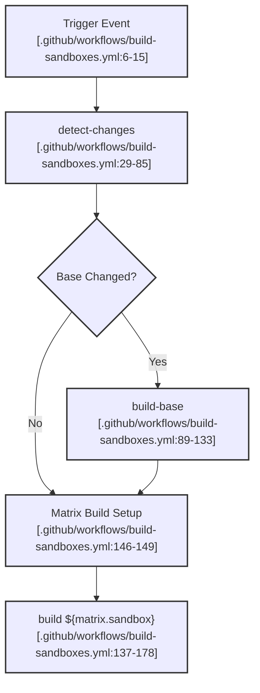
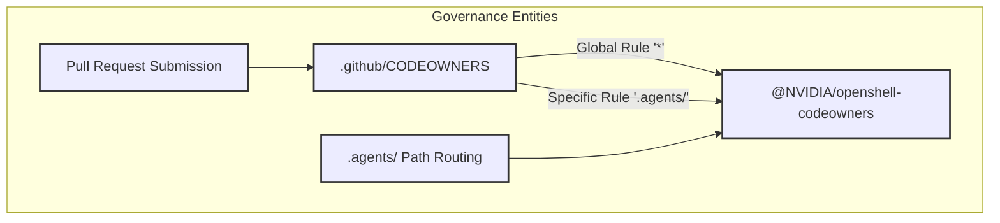

<!-- source: DeepWiki mcp.deepwiki.com · repo NVIDIA/OpenShell-Community · page 4 CI/CD and Governance · fetched 2026-10-26 -->

# CI/CD and Governance

Relevant source files

The following files were used as context for generating this wiki page:

- [.github/CODEOWNERS](.github/CODEOWNERS)
- [.github/workflows/build-sandboxes.yml](.github/workflows/build-sandboxes.yml)

## Purpose and Scope

This section provides an overview of the automation, compliance checks, and project governance frameworks established in the OpenShell-Community repository. The repository leverages GitHub Actions for continuous integration, multi-architecture image builds, Developer Certificate of Origin (DCO) verification, and automated license header checks. 

As a parent page, this document outlines the high-level architecture of these systems. For detailed technical breakdowns, refer to the child pages:
- Image Build Pipeline: [Image Build Pipeline](#4.1)
- Compliance Checks: [Compliance Checks: DCO and License Headers](#4.2)
- Contributing & Security: [Contributing and Security Reporting](#4.3)

---

## 4.1 Image Build Pipeline

The OpenShell-Community project automates the construction, tagging, and publication of sandbox images using GitHub Actions. Defined in [.github/workflows/build-sandboxes.yml](), the pipeline uses an intelligent change-detection job to determine which sandbox Dockerfiles have been modified during pull requests or pushes to the `main` branch [.github/workflows/build-sandboxes.yml:29-85]().

The pipeline is split into distinct phases:
1. **Change Detection**: Analyzes git diffs to identify modifications under `sandboxes/`. If the base sandbox image (`sandboxes/base/`) changes, all dependent sandboxes are flagged for rebuild [.github/workflows/build-sandboxes.yml:61-68]().
2. **Base Build**: Builds and pushes `sandboxes/base` for multi-architecture targets (`linux/amd64`, `linux/arm64`) using Docker Buildx and QEMU [.github/workflows/build-sandboxes.yml:89-133]().
3. **Matrix Builds**: Dynamically spawns parallel build jobs for each changed sandbox using a matrix strategy [.github/workflows/build-sandboxes.yml:137-150](). On pull requests, a local registry is spun up to handle image dependencies cleanly [.github/workflows/build-sandboxes.yml:163-166]().

*Figure 1: CI/CD Build Pipeline Flow bridging GitHub Action jobs to workflow definitions.*

For a deep dive into change detection logic, local registry setups for pull requests, and GHCR multi-arch publishing details, see [Image Build Pipeline](#4.1).

Sources: [.github/workflows/build-sandboxes.yml:1-190]()

---

## 4.2 Compliance Checks: DCO and License Headers

To maintain legal clarity and compliance across the OpenShell-Community codebase, automated checks enforce Developer Certificate of Origin (DCO) sign-offs on commits and verify that all source files contain the required Apache-2.0 license headers.

- **DCO Enforcement**: Pull requests and commits are validated to ensure contributors sign off on their work, establishing clear provenance for all code contributions.
- **License Header Validation**: Scripts verify that source files include the appropriate copyright and license identifier markers (e.g., `SPDX-License-Identifier: Apache-2.0`).

For details on workflow configurations, automated scripts, and third-party notice handling, see [Compliance Checks: DCO and License Headers](#4.2).

Sources: [.github/workflows/build-sandboxes.yml:1-2]()

---

## 4.3 Contributing and Security Reporting

Project governance, code ownership, and contribution guidelines ensure high code quality and secure handling of vulnerability disclosures. 

Review routing is managed programmatically via `.github/CODEOWNERS`, which designates core maintainers to review broad repository changes as well as sensitive agent infrastructure paths [.github/CODEOWNERS:1-6]().

*Figure 2: Review routing governance mapping PR paths to code owner teams.*

For complete documentation on the pull request expectations, contribution workflows, and vulnerability disclosure policies, see [Contributing and Security Reporting](#4.3).

Sources: [.github/CODEOWNERS:1-6]()

---

