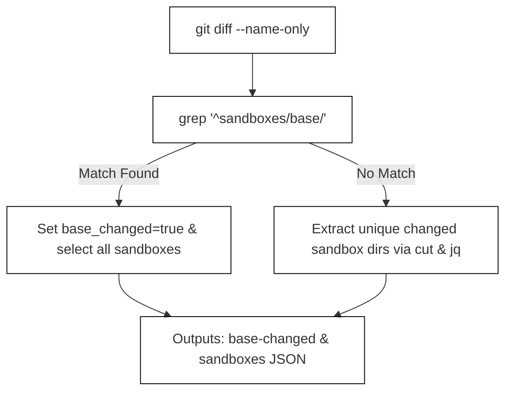

<!-- source: DeepWiki mcp.deepwiki.com · repo NVIDIA/OpenShell-Community · page 4.1 Image Build Pipeline · fetched 2026-10-26 -->

# Image Build Pipeline

<details>
<summary>Relevant source files</summary>

The following files were used as context for generating this wiki page:

- [.github/workflows/build-sandboxes.yml](.github/workflows/build-sandboxes.yml)

</details>


## Purpose and Scope

The Image Build Pipeline provides automated, multi-architecture container image builds, change detection, and publishing for OpenShell-Community sandboxes. Defined in `.github/workflows/build-sandboxes.yml`, the pipeline optimizes CI resource consumption by selectively building only modified sandboxes or triggering full rebuilds when the foundational base image changes. It targets GitHub Container Registry (`ghcr.io`) for production releases and utilizes a local container registry during pull requests to handle cross-container dependencies safely under Docker Buildx isolation.

Sources: [.github/workflows/build-sandboxes.yml:1-24]()

---

## Pipeline Architecture and Workflow Overview

The pipeline is triggered on pushes to the `main` branch, pull requests affecting paths under `sandboxes/**`, or manually via workflow dispatch [.github/workflows/build-sandboxes.yml:6-16](). It consists of three primary sequential and matrix-driven jobs:

1. `detect-changes`: Inspects git history to evaluate which sandbox directories or base image files have been modified [.github/workflows/build-sandboxes.yml:29-35]().
2. `build-base`: Conditionally builds and pushes the multi-architecture base image (`sandboxes/base`) if changes are detected [.github/workflows/build-sandboxes.yml:89-93]().
3. `build`: Evaluates a dynamic matrix of changed sandboxes, handling local registry bridging for pull requests and compiling final target images [.github/workflows/build-sandboxes.yml:137-149]().

```mermaid
graph TD
    Trigger[""GitHub Workflow Triggers""] -->|push/pr/dispatch| DetectChanges[""detect-changes Job""]
    DetectChanges -->|"base-changed == true"| BuildBase[""build-base Job""]
    DetectChanges -->|sandboxes output json| BuildMatrix[""build Job (Matrix)""]
    BuildBase -->|ghcr.io base image| BuildMatrix
    BuildMatrix -->|builds sandbox images| Publish[""GHCR / Local Registry""]

    classDef default stroke:#000,fill:none;
```
*Figure 1: High-level pipeline execution mapping natural language workflow phases to GitHub Actions job identifiers.*

Sources: [.github/workflows/build-sandboxes.yml:6-190]()

---

## Change Detection Job (`detect-changes`)

The `detect-changes` job executes on `ubuntu-latest` to determine the minimal set of build targets [.$github/workflows/build-sandboxes.yml:29-31](). It configures git with a full history fetch (`fetch-depth: 0`) to accurately compare file modifications [.$github/workflows/build-sandboxes.yml:36-38]().

- **Manual Triggers (`workflow_dispatch`)**: Bypasses git diff evaluations and marks `BASE_CHANGED="true"`, discovering all directories under `sandboxes/` containing a `Dockerfile` (excluding `base`) [.$github/workflows/build-sandboxes.yml:45-51]().
- **Pull Requests and Pushes**: Identifies the base commit SHA (`github.event.pull_request.base.sha` or `github.event.before`) and runs `git diff --name-only` against `github.sha` restricted to the `sandboxes/` path [.$github/workflows/build-sandboxes.yml:53-59]().
- **Base Cascade**: If modifications affect `sandboxes/base/`, `BASE_CHANGED` is set to `true`, forcing a rebuild of all non-base sandboxes [.$github/workflows/build-sandboxes.yml:61-68](). Otherwise, individual changed directories containing a `Dockerfile` are parsed into a JSON array via `jq` [.$github/workflows/build-sandboxes.yml:71-78]().


*Figure 2: Change detection logic mapping repository git state evaluation to job outputs.*

Sources: [.github/workflows/build-sandboxes.yml:29-85]()

---

## Base Sandbox Image Build (`build-base`)

The `build-base` job depends on `detect-changes` and executes only when `needs.detect-changes.outputs.base-changed == 'true'` [.$github/workflows/build-sandboxes.yml:89-92](). 

- **Environment & Multi-Arch Setup**: Normalizes the GitHub repository namespace to lowercase [.$github/workflows/build-sandboxes.yml:97-99]() and configures QEMU (`docker/setup-qemu-action`) and Docker Buildx (`docker/setup-buildx-action`) to compile images targeting both `linux/amd64` and `linux/arm64` [.$github/workflows/build-sandboxes.yml:101-106]().
- **Authentication & Metadata**: Authenticates against GitHub Container Registry (`ghcr.io`) using `GITHUB_TOKEN` [.$github/workflows/build-sandboxes.yml:107-112]() and applies `docker/metadata-action` to tag builds with git commit SHAs and `latest` (when on the default branch) [.$github/workflows/build-sandboxes.yml:114-122]().
- **Execution & Caching**: Invokes `docker/build-push-action` using `sandboxes/base` as the build context [.$github/workflows/build-sandboxes.yml:123-126](). It leverages GitHub Actions cache (`type=gha,scope=base`) to speed up subsequent compilation steps [.$github/workflows/build-sandboxes.yml:131-132](). Images are pushed to the registry only when the reference points to the main branch [.$github/workflows/build-sandboxes.yml:128]().

Sources: [.github/workflows/build-sandboxes.yml:89-133]()

---

## Matrix Sandbox Builds and PR Local Registry (`build`)

The `build` job runs concurrently via a dynamic matrix populated by the JSON array output of `detect-changes` (`needs.detect-changes.outputs.sandboxes`) [.$github/workflows/build-sandboxes.yml:137-149]().

- **PR Local Registry Isolation**: Because the Docker Buildx `docker-container` driver isolates build kits from the host docker daemon, base images built within preceding pipeline jobs are not automatically visible to PR builds. To resolve this, pull requests spin up a temporary local registry container (`registry:2` on port `5000`) and configure Buildx with `network=host` [.$github/workflows/build-sandboxes.yml:163-170]().
- **Parent Sandbox Resolution**: Parses target Dockerfiles (`sandboxes/${{ matrix.sandbox }}/Dockerfile`) to inspect `ARG BASE_IMAGE=` directives, ensuring proper inheritance tracking prior to compilation [.$github/workflows/build-sandboxes.yml:179-190]().

Sources: [.github/workflows/build-sandboxes.yml:137-190]()

---

