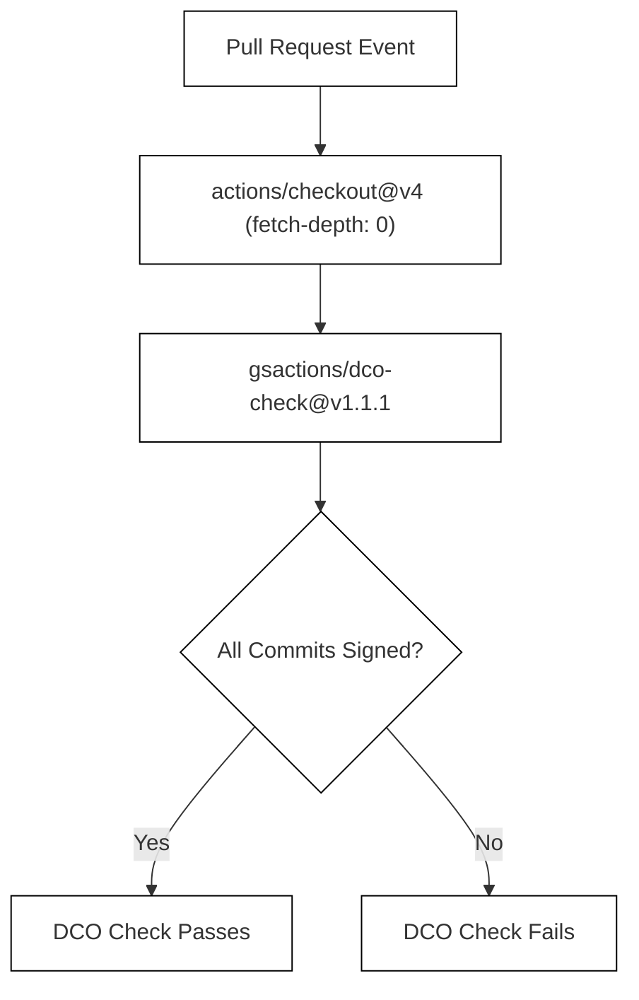
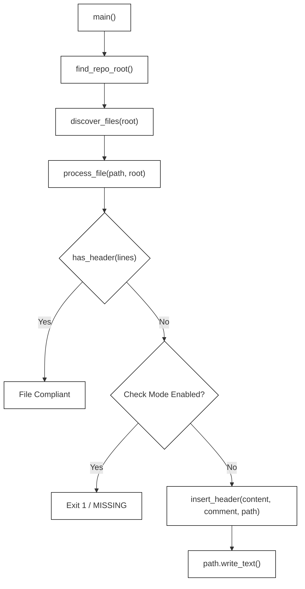

<!-- source: DeepWiki mcp.deepwiki.com · repo NVIDIA/OpenShell-Community · page 4.2 Compliance Checks: DCO and License Headers · fetched 2026-10-26 -->

# Compliance Checks: DCO and License Headers

<details>
<summary>Relevant source files</summary>

The following files were used as context for generating this wiki page:

- [.github/workflows/dco.yml](.github/workflows/dco.yml)
- [.github/workflows/license-check.yml](.github/workflows/license-check.yml)
- [LICENSE](LICENSE)
- [THIRD-PARTY-NOTICES](THIRD-PARTY-NOTICES)
- [scripts/check_license_headers.py](scripts/check_license_headers.py)

</details>


The purpose of this page is to detail the compliance automation, validation scripts, and legal artifacts utilized in the OpenShell-Community codebase. This subsystem enforces Developer Certificate of Origin (DCO) compliance on pull requests and validates that all source files carry the required SPDX license headers.

---

## 1. Developer Certificate of Origin (DCO) Workflow

To legally ensure that contributors have the right to submit their code to the project, OpenShell-Community requires a Developer Certificate of Origin (DCO) sign-off on every commit. This is enforced automatically via a GitHub Actions workflow defined in `.github/workflows/dco.yml`.

The workflow triggers on pull requests targeting the `main` branch and runs `gsactions/dco-check@v1.1.1` with a full git history fetch (`fetch-depth: 0`) to verify that all commits include a valid `Signed-off-by` trailer.


*Figure 1: DCO verification data flow mapping GitHub workflow triggers to execution steps.*

Sources: [.github/workflows/dco.yml:1-20]()

---

## 2. Automated License Header Enforcement

Every source file must contain the standard NVIDIA copyright and SPDX license identifier. Compliance is checked via `.github/workflows/license-check.yml` [.github/workflows/license-check.yml:1-27]() and managed programmatically by `scripts/check_license_headers.py` [scripts/check_license_headers.py:1-232]().

### Workflow Integration

The CI pipeline runs on pushes and pull requests to `main`, setting up Python 3.12 and executing the license checker in check mode:

```yaml
python scripts/check_license_headers.py --check
```

Sources: [.github/workflows/license-check.yml:1-27]()

### Script Implementation (`scripts/check_license_headers.py`)

The script traverses the repository to verify or inject SPDX headers. Key programmatic constructs include:

- **`COPYRIGHT_TEXT` and `LICENSE_ID`**: Constants defining the mandated copyright holder (`Copyright (c) 2025-2026 NVIDIA CORPORATION & AFFILIATES. All rights reserved.`) and license (`Apache-2.0`) [scripts/check_license_headers.py:30-33]().
- **`COMMENT_STYLES`**: Maps file extensions (`.py`, `.sh`, `.yaml`, `.yml`, `.toml`) and Dockerfile variants to their respective line comment prefixes [scripts/check_license_headers.py:36-42](), [scripts/check_license_headers.py:98-108]().
- **`EXCLUDE_DIRS` and `EXCLUDE_FILES`**: Sets directories (e.g., `.git`, `.venv`, `__pycache__`) and files (`.gitkeep`) excluded from header validation [scripts/check_license_headers.py:44-54]().
- **`make_header(comment)`**: Constructs the two-line SPDX header [scripts/check_license_headers.py:61-66]().
- **`discover_files(root)`**: Walks the directory tree while respecting exclusions to locate target files [scripts/check_license_headers.py:110-126]().
- **`process_file(path, root, *, check, verbose)`**: Inspects individual files via `has_header()` [scripts/check_license_headers.py:136-141]() and inserts headers using `insert_header()` [scripts/check_license_headers.py:160-174]() if `--check` is omitted [scripts/check_license_headers.py:181-205]().


*Figure 2: Execution flow of `scripts/check_license_headers.py` detailing validation and auto-injection pathways.*

Sources: [scripts/check_license_headers.py:1-232](), [.github/workflows/license-check.yml:1-27]()

---

## 3. Legal Artifacts: LICENSE and THIRD-PARTY-NOTICES

OpenShell-Community incorporates governing legal documentation at the repository root:

- **`LICENSE`**: The primary project license text, implementing the Apache License, Version 2.0 [LICENSE:1-125](). It governs the terms of use, reproduction, distribution, and patent grants.
- **`THIRD-PARTY-NOTICES`**: Explicitly catalogs third-party software packages, Docker base images, system packages (APT via Ubuntu 24.04), GitHub Actions, and CI runtime images utilized across the environment along with their corresponding licenses and reference URLs [THIRD-PARTY-NOTICES:1-140]().

| Category | Component / Image / Package | License |
| :--- | :--- | :--- |
| **Docker Base Image** | `ubuntu:24.04` | Various [THIRD-PARTY-NOTICES:10-11]() |
| **Docker Base Image** | `ghcr.io/astral-sh/uv:latest` | Apache-2.0 OR MIT [THIRD-PARTY-NOTICES:14-15]() |
| **System Package** | `build-essential` | GPL-2.0+ [THIRD-PARTY-NOTICES:30-31]() |
| **System Package** | `python3` | PSF-2.0 [THIRD-PARTY-NOTICES:78-79]() |
| **GitHub Action** | `actions/checkout@v4` | MIT [THIRD-PARTY-NOTICES:102-103]() |
| **CI Runtime Image** | `registry:2` | Apache-2.0 [THIRD-PARTY-NOTICES:138-139]() |

Sources: [LICENSE:1-125](), [THIRD-PARTY-NOTICES:1-140]()

---

