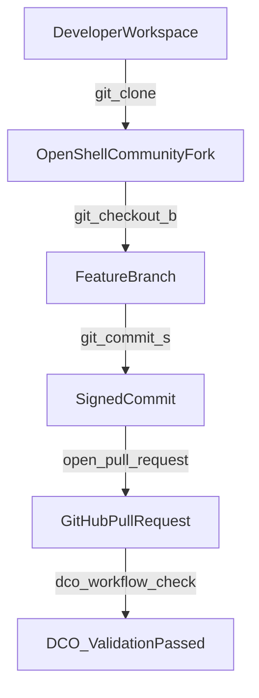
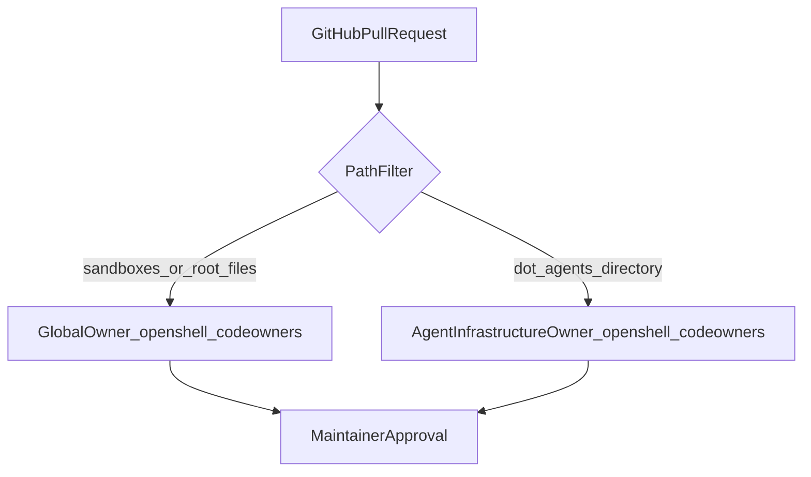

<!-- source: DeepWiki mcp.deepwiki.com · repo NVIDIA/OpenShell-Community · page 4.3 Contributing and Security Reporting · fetched 2026-10-26 -->

# Contributing and Security Reporting

<details>
<summary>Relevant source files</summary>

The following files were used as context for generating this wiki page:

- [.github/CODEOWNERS](.github/CODEOWNERS)
- [CONTRIBUTING.md](CONTRIBUTING.md)
- [SECURITY.md](SECURITY.md)

</details>


This page details the contribution lifecycle, pull request expectations, code ownership review routing, and the security vulnerability disclosure process for the OpenShell-Community repository.

Sources: [`CONTRIBUTING.md:1-91`](), [`.github/CODEOWNERS:1-7`](), [`SECURITY.md:1-25`]()

---

## Contribution Workflow and Developer Certificate of Origin (DCO)

To contribute to OpenShell-Community, developers fork the repository, clone their fork, and create dedicated feature branches from `main` [CONTRIBUTING.md:31-41]. All contributions must comply with the Developer Certificate of Origin (DCO) [CONTRIBUTING.md:13-16]. 

Every commit must include a `Signed-off-by` line indicating agreement with the project's Apache 2.0 license terms [CONTRIBUTING.md:13-15, 90]. Developers append this signature automatically using `git commit -s`:

```bash
git commit -s -m "Add new sandbox image"
```

A automated DCO check validates every incoming pull request and fails if any commit lacks the required sign-off [CONTRIBUTING.md:29].


*Figure 1: Contribution pipeline mapping developer actions to DCO validation gates.*

Sources: [`CONTRIBUTING.md:13-41`](), [`CONTRIBUTING.md:90`]()

---

## PR Expectations and Directory Structure Guidelines

Contributions typically fall into sandbox additions, skill definitions, bug fixes, or documentation enhancements [CONTRIBUTING.md:5-11]. When submitting a pull request, maintainers expect focused, small changes that address a single feature or fix [CONTRIBUTING.md:66-77].

New sandboxes must be placed in isolated directories under `sandboxes/` containing a clean-building `Dockerfile` and a descriptive `README.md` [CONTRIBUTING.md:43-57]. Agent skills reside within their parent sandbox's `skills/` directory (e.g., `sandboxes/my-sandbox/skills/my-skill/`) and require a `SKILL.md` file along with usage examples [CONTRIBUTING.md:59-64].

Sources: [`CONTRIBUTING.md:43-79`]()

---

## Review Routing and Code Ownership

To ensure quality and security across agent infrastructure and community tooling, review routing is enforced via repository ownership configurations [`.github/CODEOWNERS:1-7`].

The `.github/CODEOWNERS` file assigns broad ownership of the entire repository (`*`) to the core maintainer team (`@NVIDIA/openshell-codeowners`) [`.github/CODEOWNERS:1-2`]. Furthermore, sensitive areas containing agent logic and definitions (`.agents/` and `AGENTS.md`) are explicitly routed to the same core team for tighter review [`.github/CODEOWNERS:4-6`].


*Figure 2: Code ownership review routing mapping pull request file paths to `openshell-codeowners` review teams.*

Sources: [`.github/CODEOWNERS:1-7`]()

---

## Security Reporting and Vulnerability Disclosure

NVIDIA maintains strict policies for handling security vulnerabilities across all source code repositories [SECURITY.md:1-3]. 

Public disclosure of security issues through GitHub issues or pull requests is prohibited [SECURITY.md:5]. If a potential security vulnerability is inadvertently posted publicly, maintainers will limit public discussion and redirect the reporter to private disclosure channels [SECURITY.md:5].

### Private Disclosure Channels

Security vulnerabilities should be reported directly to NVIDIA rather than via GitHub [SECURITY.md:5]:
* **Web Form:** [Security Vulnerability Submission Form](https://www.nvidia.com/object/submit-security-vulnerability.html) [SECURITY.md:10]
* **Email:** `psirt@nvidia.com` (encrypted communication is encouraged using the NVIDIA public PGP key) [SECURITY.md:11-12]

Reports submitted to PSIRT must include:
* Product or driver name and version/branch containing the vulnerability [SECURITY.md:13-14].
* Vulnerability classification (e.g., code execution, denial of service, buffer overflow) [SECURITY.md:15].
* Detailed reproduction instructions and a proof-of-concept or exploit code [SECURITY.md:16-17].
* Potential impact analysis and exploitation vectors [SECURITY.md:18].

Valid external reports addressed under coordinated vulnerability disclosure policies receive public acknowledgment, though NVIDIA does not currently operate a bug bounty program [SECURITY.md:20].

Sources: [`SECURITY.md:1-25`]()

---

