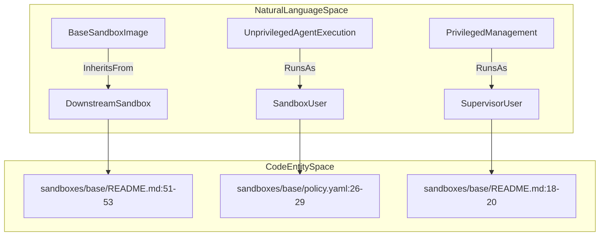
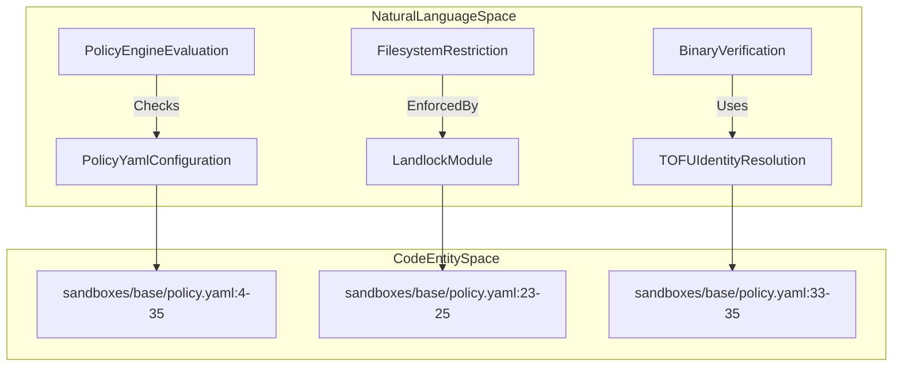

<!-- source: DeepWiki mcp.deepwiki.com · repo NVIDIA/OpenShell-Community · page 5 Glossary · fetched 2026-10-26 -->

# Glossary

Relevant source files

The following files were used as context for generating this wiki page:

- [README.md](README.md)
- [sandboxes/base/README.md](sandboxes/base/README.md)
- [sandboxes/base/policy.yaml](sandboxes/base/policy.yaml)
- [sandboxes/base/skills/github/SKILL.md](sandboxes/base/skills/github/SKILL.md)

## Purpose and Scope

This page defines repo-specific terminology, architectural components, security primitives, and governance concepts used across the OpenShell Community codebase. Each term includes technical implementation details, behavioral roles, and explicit file pointers to aid code navigation and system understanding.

Sources: [README.md:8-10](), [sandboxes/base/README.md:1-4]()

---

## Architectural Terms

### Sandbox
An isolated container or VM execution environment managed by the OpenShell runtime where autonomous agents execute tasks, generate synthetic data, and run developer tooling. Sandboxes are organized under the `sandboxes/` directory, with each subdirectory providing domain-specific runtimes, toolchains, and security configurations.
* **Implementation:** Defined by directory layouts containing a `Dockerfile`, a `policy.yaml` file, and an optional `README.md`.
* **Code Reference:** [README.md:16-19](), [README.md:40-46]()

### Base Image Inheritance
The foundational mechanism by which all specialized domain sandboxes (`droid`, `ollama`, `nvidia-gpu`, etc.) inherit core operating system packages, developer binaries, multi-stage build layers, and default user structures from the base image.
* **Implementation:** Declared in downstream Dockerfiles using build arguments and `FROM` statements referencing `sandboxes/base/Dockerfile`.
* **Code Reference:** [sandboxes/base/README.md:3-4](), [sandboxes/base/README.md:51-53]()

### Supervisor User vs. Sandbox User
A strict privilege split maintained within sandbox containers. The `supervisor` user is a privileged process management account configured with a `nologin` shell, whereas the `sandbox` user is an unprivileged runtime account under which agent workloads and developer CLIs execute by default.
* **Implementation:** Defined in system user creation steps and referenced in filesystem permission rules and process execution contexts.
* **Code Reference:** [sandboxes/base/README.md:16-21](), [sandboxes/base/policy.yaml:26-29]()

*Sources: [README.md:16-31](), [sandboxes/base/README.md:16-21](), [sandboxes/base/policy.yaml:26-29]()*, [sandboxes/base/README.md:51-53]()*

---

## Security and Policy Terms

### Policy Engine & `policy.yaml`
The security governance component that evaluates filesystem access restrictions, process execution contexts, and per-CONNECT network egress permissions. Policies are defined declaratively in `policy.yaml` files within each sandbox.
* **Implementation:** The policy file structures configuration into `filesystem_policy`, `landlock`, `process`, and `network_policies` blocks. Binary identity is resolved via `/proc/net/tcp` inode lookups coupled with `/proc/{pid}/exe` paths.
* **Code Reference:** [sandboxes/base/policy.yaml:4-35]()

### Landlock
A Linux Security Module (LSM) sandbox mechanism used to restrict filesystem access operations (such as opening files, creating directories, and making nodes) from unprivileged processes.
* **Implementation:** Configured within the policy engine block with compatibility set to `best_effort`.
* **Code Reference:** [sandboxes/base/policy.yaml:23-25]()

### TOFU (Trust-On-First-Use)
An integrity verification strategy used to authenticate binary identities on first execution.
* **Implementation:** While binary paths and arguments are declared in `policy.yaml`, cryptographic SHA256 integrity enforcement for binaries is evaluated directly in the Rust core engine via trust-on-first-use routines.
* **Code Reference:** [sandboxes/base/policy.yaml:35]()

### BYOK (Bring Your Own Key)
A configuration pattern enabling sandboxed coding agents and runtimes to route requests through authorized proprietary model providers (such as OpenAI, Anthropic, or NVIDIA Inference endpoints) by supplying external API tokens or configuring named network policies.
* **Implementation:** Configured through named endpoints and allowed binary paths in `network_policies`.
* **Code Reference:** [sandboxes/base/policy.yaml:37-83](), [sandboxes/base/policy.yaml:187-195]()

*Sources: [sandboxes/base/policy.yaml:4-35](), [sandboxes/base/policy.yaml:23-25](), [sandboxes/base/policy.yaml:33-35]()

---

## Extensibility and Ecosystem Terms

### Skill & `SKILL.md`
A modular capability package that extends an agent's instructions, tool usage guidelines, and workflow patterns. Skills are parsed from markdown documentation adhering to frontmatter specifications.
* **Implementation:** Discovered through `.agents/skills/` and `.claude/skills/` directory structures inside the sandbox home directory. Each skill features a `SKILL.md` file detailing permitted CLI commands, token constraints, and execution rules (e.g., restricted REST-only GitHub operations).
* **Code Reference:** [README.md:29-30](), [sandboxes/base/skills/github/SKILL.md:1-15]()

### GHCR (GitHub Container Registry)
The container artifact registry where multi-architecture OpenShell Community sandbox images are published and distributed.
* **Implementation:** Referenced in build pipelines and documentation as the upstream container host (`ghcr.io/nvidia/openshell-community/...`).
* **Code Reference:** [sandboxes/base/README.md:52]()

*Sources: [README.md:29-30](), [sandboxes/base/README.md:52](), [sandboxes/base/skills/github/SKILL.md:1-15]()*

---

## Governance and Workflow Terms

### DCO (Developer Certificate of Origin)
A compliance mechanism ensuring that all contributions to the repository are certified by their authors under an appropriate developer sign-off process.
* **Implementation:** Automated via dedicated GitHub Actions workflow checks (`dco.yml`) requiring commit sign-offs on pull requests.
* **Code Reference:** [README.md:62-64]() (Referencing project contribution workflows).

*Sources: [README.md:62-64]()