# Page: Overview

# Overview

<details>
<summary>Relevant source files</summary>

The following files were used as context for generating this wiki page:

- [.gitignore](.gitignore)
- [CONTRIBUTING.md](CONTRIBUTING.md)
- [README.md](README.md)

</details>


OpenShell-Community serves as the ecosystem hub for the OpenShell core runtime, hosting contributed sandbox images, agent skills, and workflow integrations [README.md:1-10](). While the core engine provides the runtime environment, policy enforcement, privacy router, and CLI [README.md:8](), this repository acts as a collaborative space for domain-specific environments and extensibility [README.md:10]().

## Relationship to OpenShell Core Runtime

[OpenShell](https://github.com/NVIDIA/OpenShell) provides the underlying infrastructure and execution runtime for autonomous agents [README.md:8](). The core engine handles sandbox isolation, network gateways, and host integration [README.md:8](). The `OpenShell-Community` repository builds upon this foundation by defining specialized container environments (such as Ollama, Android automation, and GPU-accelerated environments) and reusable agent capabilities [README.md:8-30]().

```mermaid
graph TD
    title "Core Runtime to Community Ecosystem Mapping"
    OpenShellCore["OpenShell Core Runtime Engine"] -->|Provides CLI & Runtime| OpenShellCLI["openshell CLI"]
    OpenShellCLI -->|Reads Sandbox Definitions| CommunityRepo["OpenShell-Community Repository"]
    CommunityRepo --> BaseImg["sandboxes/base/Dockerfile"]
    CommunityRepo --> OllamaImg["sandboxes/ollama/Dockerfile"]
    CommunityRepo --> DroidImg["sandboxes/droid/Dockerfile"]
    CommunityRepo --> GPUImg["sandboxes/nvidia-gpu/Dockerfile"]
```
Sources: [README.md:8-30]()

## Repository Structure Overview

The repository is organized around domain-specific sandboxes, supporting skills, and community contributions [README.md:14-30](). Each sandbox container image bundles required runtime dependencies, pre-installed toolchains, and security policy templates [README.md:18-30]().

```mermaid
graph LR
    title "Community Repository Entity Mapping"
    User["Developer / Agent"] -->|Runs Command| CLI["openshell sandbox create"]
    CLI -->|Discovers Image| SandboxDir["sandboxes/ Directory"]
    SandboxDir --> Dockerfile["Dockerfile"]
    SandboxDir --> Policy["policy.yaml Configuration"]
    SandboxDir --> Skills["skills/ SKILL.md"]
```
Sources: [README.md:40-46](), [CONTRIBUTING.md:43-64]()

## Child Pages

For detailed information on getting started and repository conventions, refer to the child pages:

- **[Getting Started](#1.1)** — Instructions for installing the `openshell` CLI, launching sandboxes with `openshell sandbox create --from <sandbox>`, and building images locally with Docker [README.md:32-60]().
- **[Repository Layout and Conventions](#1.2)** — Directory structure breakdowns (`sandboxes/`, `skills/`, `.github/`) and per-sandbox file layout guidelines (`Dockerfile`, `policy.yaml`, `README.md`) [README.md:14-30](), [CONTRIBUTING.md:43-65]().

Sources: [README.md:1-72](), [CONTRIBUTING.md:1-90]()

---

# Page: Getting Started

# Getting Started

<details>
<summary>Relevant source files</summary>

The following files were used as context for generating this wiki page:

- [README.md](README.md)
- [sandboxes/base/README.md](sandboxes/base/README.md)

</details>


## Purpose and Scope

This page provides technical guidance for setting up the OpenShell environment, installing the OpenShell CLI, provisioning isolated execution environments via `openshell sandbox create --from <sandbox>`, and building custom or base sandbox container images locally with Docker. 

---

## Prerequisites

Before interacting with OpenShell community sandboxes, ensure your local host environment meets the following requirements:

* **OpenShell CLI**: Installed via Python package management (`uv pip install openshell`) [README.md:36]().
* **Container Runtime**: Docker or a compatible OCI container runtime [README.md:37]().
* **Hardware Accelerators**: NVIDIA GPU with appropriate drivers installed on the host (required exclusively for hardware-accelerated images like `nvidia-gpu`) [README.md:38]().

```bash
# Install the OpenShell CLI
uv pip install openshell
```

Sources: [README.md:34-39]()

---

## Using the OpenShell CLI

The primary interface for provisioning environments is the OpenShell CLI. The `openshell sandbox create` command initializes isolated runtime instances based on target specifications [README.md:43]().

### The `--from` Flag

The `--from` flag specifies the image source. It accepts:
1. A community sandbox identifier corresponding to directories under `sandboxes/` (e.g., `ollama`, `sdg`, `droid`, `gemini`, `pi`, `nvidia-gpu`) [README.md:18-30]().
2. A direct local filesystem path to a Docker context or custom Dockerfile.
3. A remote container image reference (e.g., `ghcr.io/nvidia/openshell-community/sandboxes/base:latest`) [sandboxes/base/README.md:52]().

```bash
# Create and enter an Ollama sandbox instance
openshell sandbox create --from ollama

# Verify local LLM service availability inside the sandbox
curl http://127.0.0.1:11434/api/tags
```

### CLI Provisioning Architecture

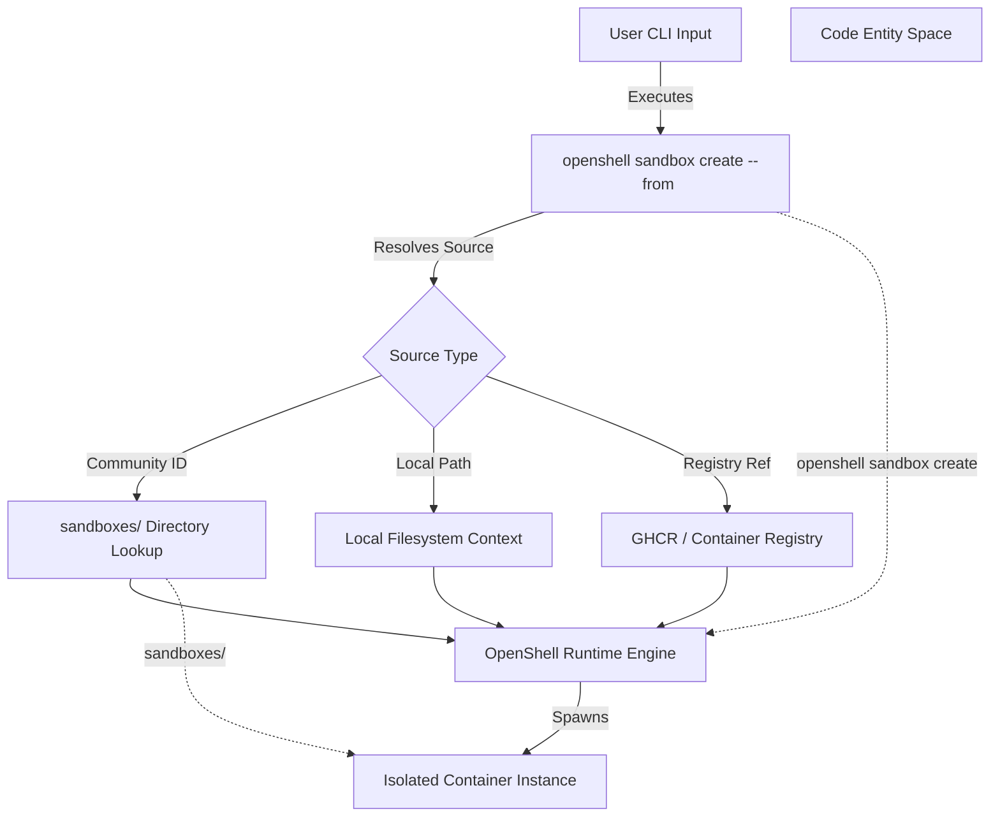
*Figure 1: Data flow and resolution mechanism for `openshell sandbox create`.*

Sources: [README.md:18-58](), [sandboxes/base/README.md:52]()

---

## Building Images Locally with Docker

All community sandboxes inherit foundational tools, security configurations, and unprivileged user mappings from the base sandbox image located at `sandboxes/base/` [sandboxes/base/README.md:1-3]().

### Building the Base Image

To build the foundational base image locally:

```bash
cd sandboxes/base/
docker build -t openshell-base .
```

This builds an Ubuntu 24.04 environment containing pre-configured runtimes (`python3`, `node`), package managers (`npm`, `uv`, `pip`), coding agents (`claude`, `opencode`, `codex`, `copilot`), and system network diagnostic utilities [sandboxes/base/README.md:9-14]().

### Building Custom Sandboxes on Top

Child sandboxes extend the base image by defining a `Dockerfile` referencing the shared base artifact:

```dockerfile
ARG BASE_IMAGE=ghcr.io/nvidia/openshell-community/sandboxes/base:latest
FROM ${BASE_IMAGE}

# Add your sandbox-specific toolchains or configuration layers here
```

### Local Build Pipeline

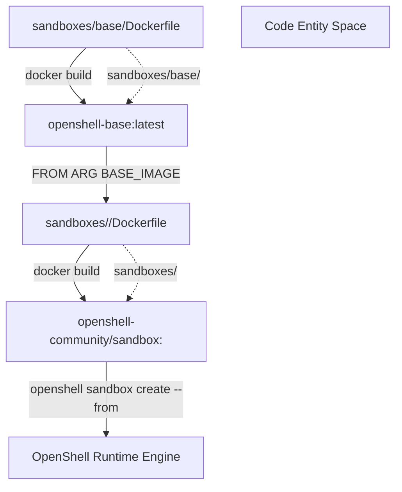
*Figure 2: Hierarchical image build pipeline from base layers to instantiated runtimes.*

Sources: [sandboxes/base/README.md:41-58]()

---

# Page: Repository Layout and Conventions

# Repository Layout and Conventions

<details>
<summary>Relevant source files</summary>

The following files were used as context for generating this wiki page:

- [CONTRIBUTING.md](CONTRIBUTING.md)
- [sandboxes/sdg/.gitkeep](sandboxes/sdg/.gitkeep)

</details>


## Purpose and Scope
This page details the structural organization of the `OpenShell-Community` repository and the file conventions enforced across sandbox environments, automation scripts, and workflow configurations. A standardized layout ensures consistent image builds, policy enforcement, and skill integration across all community-contributed runtimes.

Sources: [CONTRIBUTING.md:1-11](), [CONTRIBUTING.md:43-65]()

---

## Top-Level Directory Layout

The repository is organized into distinct functional directories that separate sandbox definitions, reusable agent skills, utility scripts, and GitHub Actions automation.

```
OpenShell-Community/
├── .github/          # CI/CD workflows, issue templates, and governance configs
├── sandboxes/        # Domain-specific sandbox environments and base definitions
├── scripts/          # Compliance checking, license validation, and build helpers
└── CONTRIBUTING.md   # Contribution workflow, DCO requirements, and guidelines
```

- **`sandboxes/`**: Houses all isolated execution environments. Each sandbox resides in its own isolated subdirectory [CONTRIBUTING.md:43-52]().
- **`skills/`**: Embedded within individual sandboxes (`sandboxes/<name>/skills/`), containing agent tool definitions and metadata [CONTRIBUTING.md:59-65]().
- **`scripts/`**: Contains tooling for repository compliance, such as header validation and build orchestration.
- **`.github/`**: Houses pipeline definitions, security policies, and pull request workflows.

Sources: [CONTRIBUTING.md:43-65](), [sandboxes/sdg/.gitkeep:1-3]()

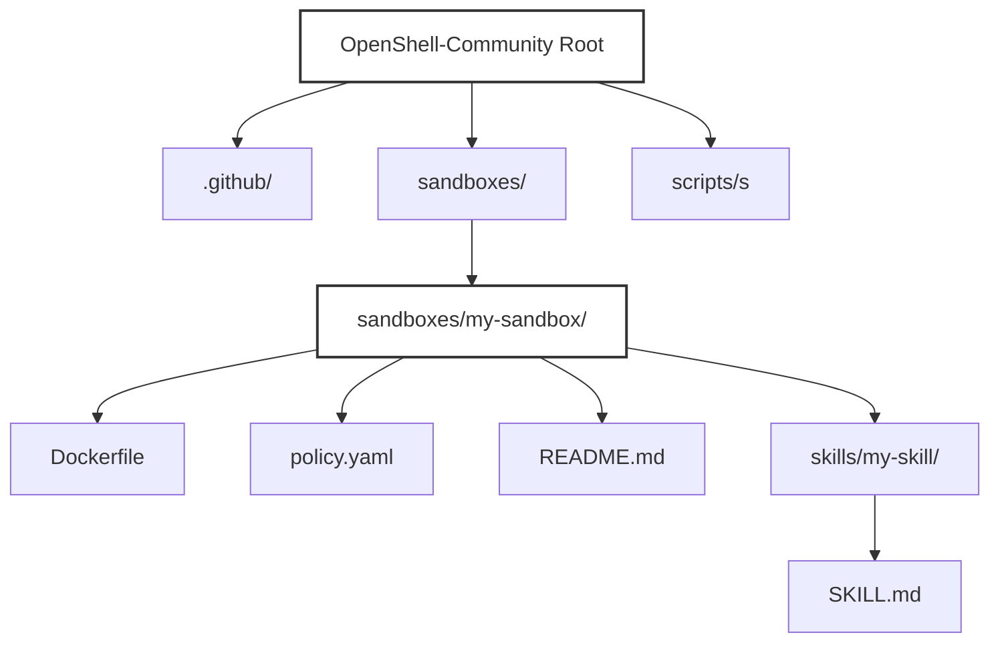
*Figure 1: Top-level repository layout bridging natural language concepts to concrete filesystem paths.*

Sources: [CONTRIBUTING.md:43-65](), [sandboxes/sdg/.gitkeep:1-3]()

---

## Per-Sandbox File Conventions

Every sandbox directory under `sandboxes/` must adhere to strict file conventions to integrate properly with the OpenShell build pipeline and policy engine.

| File / Directory | Mandatory | Description |
| :--- | :--- | :--- |
| `Dockerfile` | Yes | Multi-stage or flat build instructions for the sandbox image [CONTRIBUTING.md:54-55](). |
| `policy.yaml` | Yes | Defines Landlock rules, filesystem mounts, process contexts, and network egress policies. |
| `README.md` | Yes | Documentation detailing sandbox purpose, usage, prerequisites, and operational notes [CONTRIBUTING.md:56](). |
| `skills/` | No | Containerized agent skill definitions (`SKILL.md` and auxiliary execution scripts) [CONTRIBUTING.md:59-65](). |

### 1. `Dockerfile` Requirements
Sandboxes must keep images minimal, bundling only what is strictly required for the target workload [CONTRIBUTING.md:57](). Base images should inherit from the core OpenShell runtime or established base layers.

### 2. `policy.yaml` Conventions
The policy configuration file governs sandbox isolation constraints. It defines runtime security boundaries, restricting file access, system calls, and network destinations.

### 3. `README.md` Specifications
Each sandbox must provide clear instructions covering its intended use case, configuration parameters, and local testing procedures [CONTRIBUTING.md:56]().

Sources: [CONTRIBUTING.md:43-65]()

```mermaid
graph TD
    Sub[Configuring "sandboxes/my-sandbox/"] --> D[Dockerfile]
    Sub --> P[policy.yaml]
    Sub --> R[README.md]
    Sub --> S[skills/]

    D -->|"Build Image"| Img["Docker Image Runtime"]
    P -->|"Enforce Security"| Engine["OpenShell Policy Engine"]
    R -->|"Document Usage"| User["Developer Documentation"]
    S -->|"Register Tools"| Agent["AI Agent CLI"]

    style Sub fill:none,stroke:#333,stroke-width:2px
    style Img fill:none,stroke:#333,stroke-width:2px
```
*Figure 2: Data flow mapping per-sandbox artifacts to their respective runtime and documentation subsystems.*

Sources: [CONTRIBUTING.md:43-65]()

---

# Page: Sandbox Architecture

# Sandbox Architecture

<details>
<summary>Relevant source files</summary>

The following files were used as context for generating this wiki page:

- [sandboxes/base/README.md](sandboxes/base/README.md)
- [sandboxes/base/policy.yaml](sandboxes/base/policy.yaml)
- [sandboxes/base/skills/github/SKILL.md](sandboxes/base/skills/github/SKILL.md)

</details>


This page provides a high-level overview of how OpenShell-Community sandbox images are structured, inherited, and secured. OpenShell sandboxes combine containerized runtimes with fine-grained filesystem and network isolation to safely host autonomous coding agents. 

For complete technical deep dives, refer to the child pages:
- [Base Sandbox Image](#2.1)
- [Policy Engine and policy.yaml](#2.2)
- [Agent Skills](#2.3)

---

## 2.1 Base Sandbox Image

The foundational image (`sandboxes/base/Dockerfile`) serves as the base layer for all OpenShell Community sandboxes [sandboxes/base/README.md:3-3](). Built on Ubuntu 24.04, it bundles essential language runtimes (`python3` 3.14.3, `node` 22.22.1), package managers (`npm`, `uv`, `pip`), developer utilities (`gh`, `git`, `vim`, `nc`), and popular coding agents (`claude`, `opencode`, `codex`, `copilot`) [sandboxes/base/README.md:9-14](). 

The image establishes a dual-user model separating privileged process management from unprivileged agent execution [sandboxes/base/README.md:16-21](), alongside a structured home layout under `/sandbox` containing virtual environments and discovery paths [sandboxes/base/README.md:23-31]().

For details, see [Base Sandbox Image](#2.1).

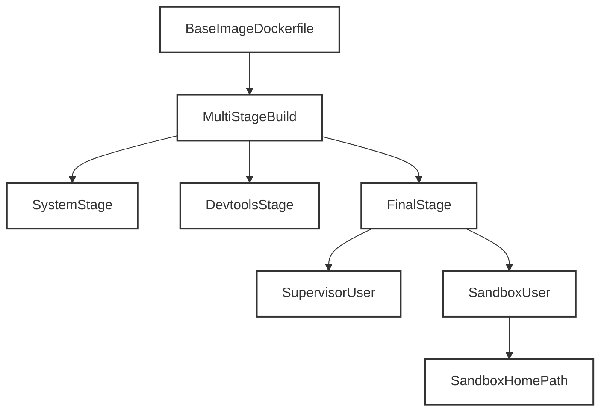
Sources: `sandboxes/base/README.md:3-57`

---

## 2.2 Policy Engine and policy.yaml

Security isolation within OpenShell is governed by declarations in `policy.yaml` [sandboxes/base/policy.yaml:4-195](). The configuration defines static filesystem boundaries (`filesystem_policy` specifying read-only vs read-write paths), kernel-level restrictions (`landlock` compatibility), and process execution contexts (`run_as_user`) [sandboxes/base/policy.yaml:8-29]().

Dynamic network security is enforced per connection via named `network_policies` (such as `claude_code`, `github_rest_api`, `pypi`, and `copilot`) [sandboxes/base/policy.yaml:37-120](). Binary identity is resolved using process inspection (`/proc/net/tcp` inode lookups combined with `/proc/{pid}/exe`), while cryptographic integrity is managed via Rust-based Trust-On-First-Use (TOFU) [sandboxes/base/policy.yaml:33-35]().

For details, see [Policy Engine and policy.yaml](#2.2).

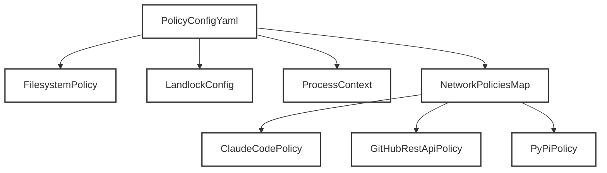
Sources: `sandboxes/base/policy.yaml:4-143`

---

## 2.3 Agent Skills

OpenShell sandboxes support dynamic capability discovery through structured agent skills located in `.agents/skills` and symlinked to `.claude/skills` [sandboxes/base/README.md:29-30](). Each skill defines its operational parameters and trigger keywords inside a standardized `SKILL.md` format [sandboxes/base/skills/github/SKILL.md:2-4]().

The base image includes a built-in `github` skill designed specifically for sandboxed constraints [sandboxes/base/README.md:37-40]()—instructing agents to bypass GraphQL endpoints (which are restricted by network policies) in favor of REST-only `gh api` workflows [sandboxes/base/skills/github/SKILL.md:6-11]().

For details, see [Agent Skills](#2.3).

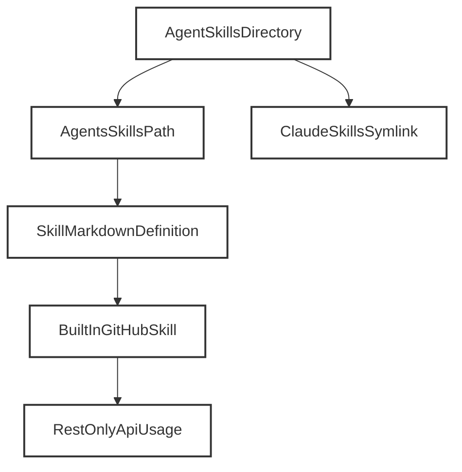
Sources: `sandboxes/base/README.md:23-40`, `sandboxes/base/skills/github/SKILL.md:1-11`

---

# Page: Base Sandbox Image

# Base Sandbox Image

<details>
<summary>Relevant source files</summary>

The following files were used as context for generating this wiki page:

- [sandboxes/base/Dockerfile](sandboxes/base/Dockerfile)
- [sandboxes/base/README.md](sandboxes/base/README.md)

</details>


## Purpose and Scope

The base sandbox image provides the foundational operating system layer, core developer runtimes, networking diagnostics, and agent command-line interfaces used across the OpenShell-Community ecosystem [sandboxes/base/Dockerfile:6-10](), [sandboxes/base/README.md:1-3](). All specialized community sandboxes inherit from this base image, ensuring a consistent execution environment for AI coding agents and isolated tasks [sandboxes/base/README.md:3]().

This is a parent page. High-level concepts such as the multi-stage build architecture, pre-installed toolchains, and agent CLIs are summarized below. For deep-dive details on user privileges, home directory layout, virtual environments, and shell initialization, see [Users, Filesystem Layout and Shell Environment](#2.1.1).

---

## Multi-Stage Build Architecture

The base sandbox image is constructed using a three-stage Docker build pipeline inside `sandboxes/base/Dockerfile`: `system`, `devtools`, and `final`. This separation ensures that heavy compilation toolchains and intermediate setup scripts are cleanly isolated from the runtime environment.

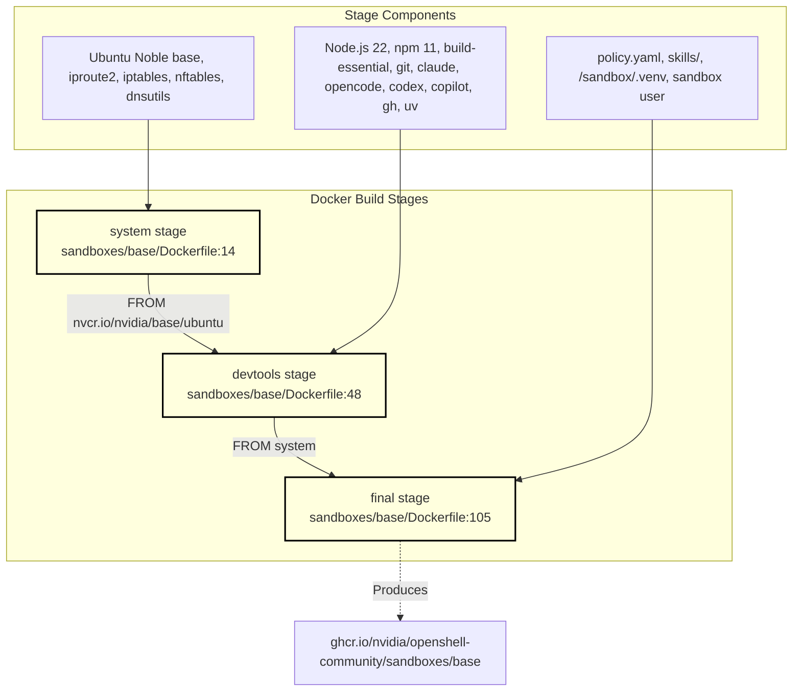

### 1. System Stage (`system`)
The `system` stage initializes from the NVIDIA Ubuntu image (`nvcr.io/nvidia/base/ubuntu:noble-20251013`) [sandboxes/base/Dockerfile:14](). It configures non-interactive apt options, sets the working directory to `/sandbox`, and installs core networking and diagnostic packages such as `iproute2`, `iptables`, `nftables`, `dnsutils`, `curl`, and `procps` [sandboxes/base/Dockerfile:16-41](). It also establishes the unprivileged `sandbox` user and privileged `supervisor` user groups [sandboxes/base/Dockerfile:43-45]().

### 2. Developer Tools Stage (`devtools`)
The `devtools` stage inherits from `system` and layers on development runtimes [sandboxes/base/Dockerfile:48](). It installs Node.js 22, upgrades `npm` to version 11, and pulls in compilation essentials (`build-essential`, `git`) [sandboxes/base/Dockerfile:59-67](). Global AI agent CLIs (`opencode-ai`, `@openai/codex`, `@github/copilot`) and security-pinned packages are installed globally via `npm` [sandboxes/base/Dockerfile:75-80](). Additionally, the GitHub CLI (`gh`) and the native Claude CLI installer are integrated [sandboxes/base/Dockerfile:83-93](). Python is managed entirely through `uv` (version 0.10.8), installing Python 3.14.3 into an isolated toolchain directory [sandboxes/base/Dockerfile:95-102]().

### 3. Final Stage (`final`)
The `final` stage builds upon `devtools` to produce the distributable image [sandboxes/base/Dockerfile:105](). It copies runtime security policies (`policy.yaml`) and agent skills, configures the writable Python virtual environment (`/sandbox/.venv`), sets up shell initialization files (`.bashrc`, `.profile`), and switches execution context to the unprivileged `sandbox` user [sandboxes/base/Dockerfile:111-149]().

Sources: `sandboxes/base/Dockerfile:1-150`, `sandboxes/base/README.md:1-46`

---

## Runtimes, Package Managers, and Agent CLIs

The base image bundles a robust developer toolchain tailored for AI agents and coding automation workflows. Rather than relying on system-managed Python packages, Python execution is orchestrated via `uv` using a dedicated virtual environment [sandboxes/base/Dockerfile:95-128]().

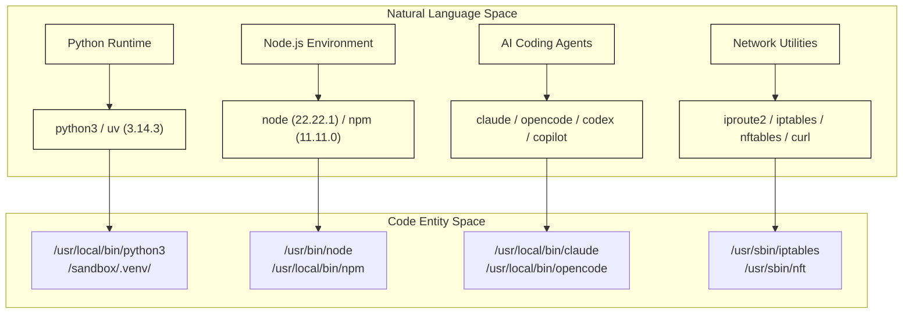

### Included Tool Summary

| Category | Tools & Versions | Code References |
| :--- | :--- | :--- |
| **Operating System** | Ubuntu Noble (24.04 equivalent) | `sandboxes/base/Dockerfile:14` |
| **Languages** | Python 3.14.3, Node.js 22.22.1 | `sandboxes/base/Dockerfile:63`, `sandboxes/base/Dockerfile:99` |
| **Package Managers** | `npm` (11.11.0), `uv` (0.10.8), `pip` | `sandboxes/base/Dockerfile:67`, `sandboxes/base/Dockerfile:97`, `sandboxes/base/Dockerfile:128` |
| **Coding Agent CLIs** | `claude`, `opencode`, `codex`, `copilot`, `gh` | `sandboxes/base/Dockerfile:78-93` |
| **Networking** | `ping`, `dig`, `nslookup`, `nc`, `traceroute`, `iptables`, `nftables` | `sandboxes/base/Dockerfile:28-40` |

Sources: `sandboxes/base/Dockerfile:1-150`, `sandboxes/base/README.md:5-15`

---

## Users, Filesystem Layout and Shell Environment

The sandbox runtime divides responsibilities between two system users: the privileged `supervisor` process manager and the unprivileged `sandbox` execution user [sandboxes/base/Dockerfile:43-45](), [sandboxes/base/README.md:16-22](). The filesystem is structured around `/sandbox` as the primary home directory, containing writable virtual environments (`.venv`), agent configurations, and skill discovery paths [sandboxes/base/Dockerfile:111-145](), [sandboxes/base/README.md:23-31]().

For detailed coverage of user definitions, permission models, directory layouts, and shell initialization variables (`PATH`, `VIRTUAL_ENV`, `.bashrc`, `.profile`), see [Users, Filesystem Layout and Shell Environment](#2.1.1).

Sources: `sandboxes/base/Dockerfile:43-46`, `sandboxes/base/Dockerfile:111-149`, `sandboxes/base/README.md:16-31`

---

# Page: Users, Filesystem Layout and Shell Environment

# Users, Filesystem Layout and Shell Environment

<details>
<summary>Relevant source files</summary>

The following files were used as context for generating this wiki page:

- [sandboxes/base/Dockerfile](sandboxes/base/Dockerfile)
- [sandboxes/base/README.md](sandboxes/base/README.md)

</details>


This page details the user privilege model, directory structure, Python virtual environment configuration, and shell environment initialization used across the OpenShell Community base sandbox image. These components provide a secure, isolated, and reproducible execution context for AI coding agents and developer workflows.

---

## 1. User and Privilege Separation (`supervisor` vs `sandbox`)

The base sandbox image defines two distinct system users to enforce security boundaries between container management tasks and agent execution workloads:

*   **`supervisor`**: A privileged system user (`-r -g supervisor`) configured with a non-login shell (`/usr/sbin/nologin`). This user is utilized by the OpenShell core runtime to manage container processes, monitor health, and handle lifecycle operations without exposing an interactive shell.
*   **`sandbox`**: An unprivileged user (`-r -g sandbox`) with home directory `/sandbox` and a standard bash shell (`/bin/bash`). All interactive agent workloads, shell sessions, and tool executions run under the security context of this user.

User and group initialization is executed during the system setup stage:

```dockerfile
groupadd -r supervisor && useradd -r -g supervisor -s /usr/sbin/nologin supervisor && \
groupadd -r sandbox && useradd -r -g sandbox -d /sandbox -s /bin/bash sandbox
```[sandboxes/base/Dockerfile:43-46]()

### User Privilege Mapping

| User | Group | Default Shell | Home Directory | Role |
| :--- | :--- | :--- | :--- | :--- |
| `supervisor` | `supervisor` | `/usr/sbin/nologin` | N/A | Process management and runtime supervision |
| `sandbox` | `sandbox` | `/bin/bash` | `/sandbox` | Unprivileged agent workload execution |

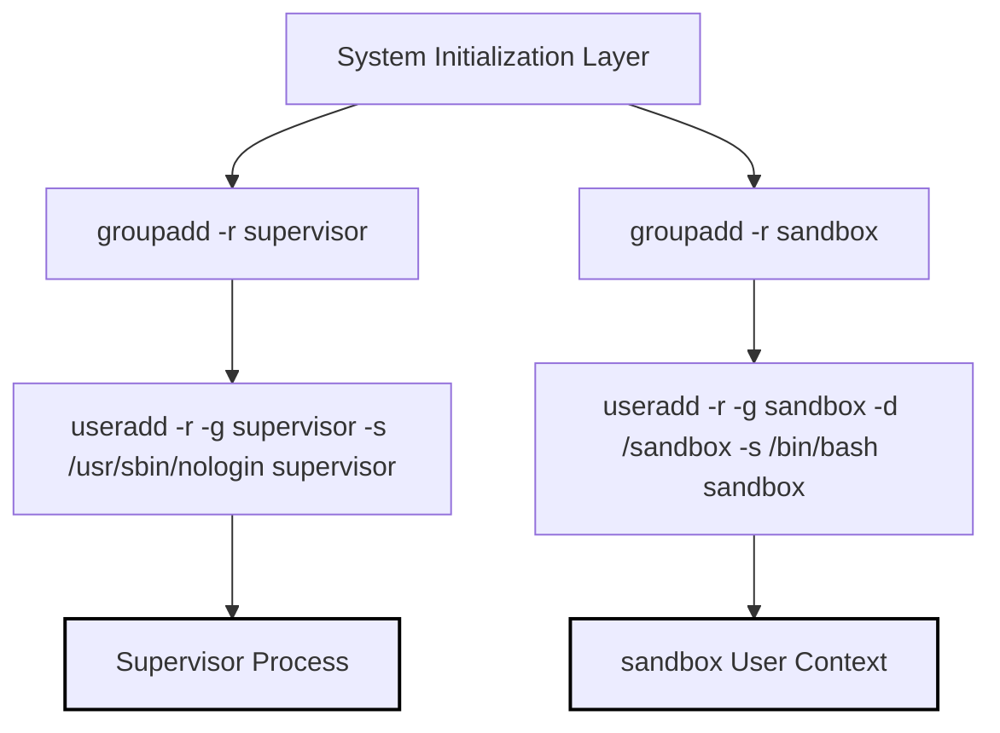
*Sources: [sandboxes/base/Dockerfile:43-46](), [sandboxes/base/README.md:16-22]*

---

## 2. Filesystem Layout (`/sandbox`)

The working directory and home directory for the unprivileged `sandbox` user is set to `/sandbox` [sandboxes/base/Dockerfile:20](), [sandboxes/base/Dockerfile:45](). The filesystem layout is structured to support writable user packages, persistent shell configurations, and multi-agent skill discovery mechanisms.

### Directory Structure Tree

```text
/sandbox/                  # Home directory (sandbox user)
  ├── .bashrc              # Shell initialization and PATH definitions
  ├── .profile             # Sources .bashrc for login shells
  ├── .venv/               # Writable Python venv (pip install, uv pip install)
  ├── .agents/skills/      # Centralized agent skill storage
  └── .claude/skills/      # Symlinked skills for Claude CLI discovery
```[sandboxes/base/README.md:25-31]()

During the container build process, the virtual environment, configuration files, and skill directories are explicitly assigned ownership to the `sandbox` user to ensure write permissions during runtime:

```dockerfile
chown -R sandbox:sandbox /sandbox/.venv && \
chown sandbox:sandbox /sandbox/.bashrc /sandbox/.profile && \
chown -R sandbox:sandbox /sandbox/.claude /sandbox/.agents /sandbox
```[sandboxes/base/Dockerfile:131-145]()

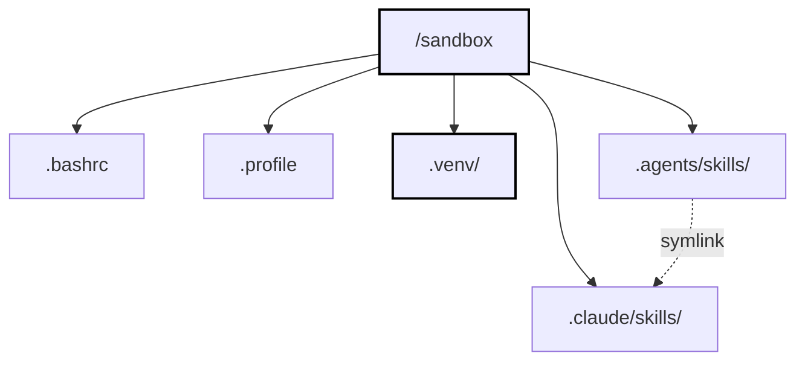
*Sources: [sandboxes/base/Dockerfile:20](), [sandboxes/base/Dockerfile:123-145](), [sandboxes/base/README.md:23-31]*

---

## 3. Python Environment and Package Management (`.venv`, `uv`)

Python package management is handled entirely by `uv` (Astral's fast Python package installer) [sandboxes/base/Dockerfile:27](), [sandboxes/base/Dockerfile:95-96](). System Python packages are avoided in favor of an isolated virtual environment located at `/sandbox/.venv` [sandboxes/base/Dockerfile:107](), [sandboxes/base/Dockerfile:128]().

### Python Toolchain Flow
1. **Python Installation**: `uv` installs Python 3.14.3 into a controlled directory (`UV_PYTHON_INSTALL_DIR="/sandbox/.uv/python"`) [sandboxes/base/Dockerfile:98-99]().
2. **Virtual Environment Creation**: A clean virtual environment is initialized with seed packages and `cloudpickle` [sandboxes/base/Dockerfile:128-129]():
   ```bash
   uv venv --python 3.14.3 --seed /sandbox/.venv
   uv pip install --python /sandbox/.venv/bin/python cloudpickle
   ```
3. **User Modifiability**: Because `/sandbox/.venv` resides inside the user home directory and is owned by `sandbox`, agents and users can execute `uv pip install` or `pip install` dynamically without requiring root privileges or modifying system-level layers [sandboxes/base/Dockerfile:125-131]().

*Sources: [sandboxes/base/Dockerfile:27](), [sandboxes/base/Dockerfile:95-103](), [sandboxes/base/Dockerfile:125-131]*

---

## 4. Shell Environment (`PATH`, `.bashrc`, `.profile`)

To guarantee that interactive and non-interactive shell executions (such as those invoked by SSH, remote IDE extensions, or agent execution harnesses) receive a consistent environment, critical path variables and environment settings are exported directly in `/sandbox/.bashrc` [sandboxes/base/Dockerfile:109-110](), [sandboxes/base/Dockerfile:132-137]().

### Environment Variables

*   `PATH`: Prioritizes the local virtual environment binary directory over system paths:
    `"/sandbox/.venv/bin:/usr/local/bin:/usr/bin:/bin"` [sandboxes/base/Dockerfile:111]()
*   `VIRTUAL_ENV`: Points to `/sandbox/.venv` [sandboxes/base/Dockerfile:112]()
*   `UV_PYTHON_INSTALL_DIR`: Set to `/sandbox/.uv/python` [sandboxes/base/Dockerfile:98]()
*   `PS1`: Configured explicitly as `"\\u@\\h:\\w\\$ "` [sandboxes/base/Dockerfile:136]()

### Shell Initialization Files

The base image generates `.bashrc` and `.profile` during the final build step [sandboxes/base/Dockerfile:136-139]():

```bash
printf 'export PATH="/sandbox/.venv/bin:/usr/local/bin:/usr/bin:/bin"\nexport VIRTUAL_ENV="/sandbox/.venv"\nexport UV_PYTHON_INSTALL_DIR="/sandbox/.uv/python"\nexport PS1="\\u@\\h:\\w\\$ "\n' \
    > /sandbox/.bashrc && \
printf '[ -f ~/.bashrc ] && . ~/.bashrc\n' > /sandbox/.profile
```[sandboxes/base/Dockerfile:136-138]()

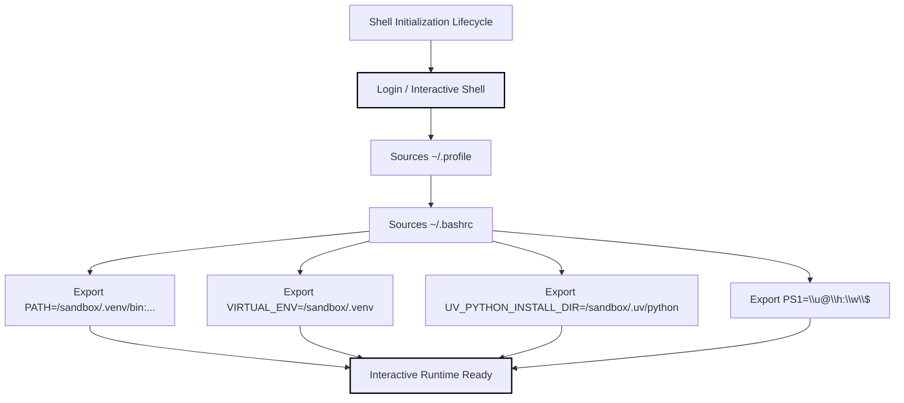
*Sources: [sandboxes/base/Dockerfile:107-112](), [sandboxes/base/Dockerfile:136-139]*

---

# Page: Policy Engine and policy.yaml

# Policy Engine and policy.yaml

<details>
<summary>Relevant source files</summary>

The following files were used as context for generating this wiki page:

- [sandboxes/base/policy.yaml](sandboxes/base/policy.yaml)
- [sandboxes/base/skills/github/SKILL.md](sandboxes/base/skills/github/SKILL.md)
- [sandboxes/pi/Dockerfile](sandboxes/pi/Dockerfile)
- [sandboxes/pi/README.md](sandboxes/pi/README.md)
- [sandboxes/pi/policy.yaml](sandboxes/pi/policy.yaml)

</details>


## Purpose and Scope

This page provides a high-level architectural overview of the OpenShell Policy Engine and the configuration schema defined in `policy.yaml`. The policy engine enforces sandbox boundaries at startup and runtime by controlling filesystem mounts, process privileges, Landlock kernel sandboxing, binary identity verification, and network egress connections. 

For deep technical breakdowns of specific named network policies across various agent environments, see [Network Egress Policies by Agent](#2.2.1).

---

## Filesystem Policy and Landlock Integration

The policy engine establishes a declarative filesystem boundary queried at container startup (`sandboxes/base/policy.yaml:6-25`). The `filesystem_policy` block configures working directory inclusion (`include_workdir: true`), explicit read-only mount points (`/usr`, `/lib`, `/proc`, `/app`, `/etc`, etc.), and writable scratch paths (`/sandbox`, `/tmp`, `/dev/null`) (`sandboxes/base/policy.yaml:8-21`). 

In addition, the `landlock` block specifies kernel-level unprivileged access control (`sandboxes/base/policy.yaml:23-25`). By setting `compatibility: best_effort`, the runtime leverages Linux Landlock restrictions where supported by the underlying host kernel to restrict filesystem operations independently of container namespace isolation.

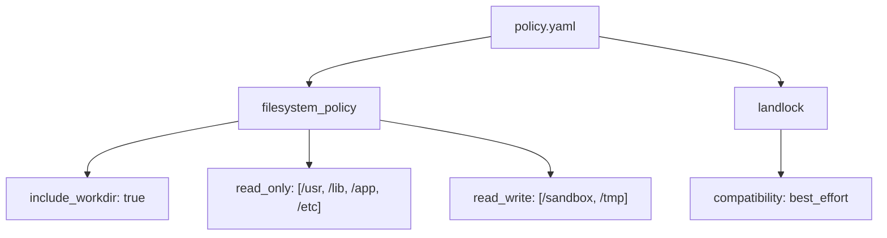

Sources: `sandboxes/base/policy.yaml:1-25`

---

## Process Context

To prevent privilege escalation within sandboxed environments, the policy engine enforces a strict process execution context (`sandboxes/base/policy.yaml:26-29`). The `process` block drops root privileges by default, forcing all commands and agent loops to execute under a restricted unprivileged user account and group (`run_as_user: sandbox`, `run_as_group: sandbox`) (`sandboxes/base/policy.yaml:27-28`).

Sources: `sandboxes/base/policy.yaml:26-29`

---

## Binary Identity Resolution and Trust-On-First-Use (TOFU)

Network egress filtering in OpenShell relies on strict binary identity verification rather than merely inspecting network sockets or source ports (`sandboxes/base/policy.yaml:30-36`). When a process initiates an outbound connection, the policy engine resolves the calling binary using runtime kernel telemetry and procfs inspection.

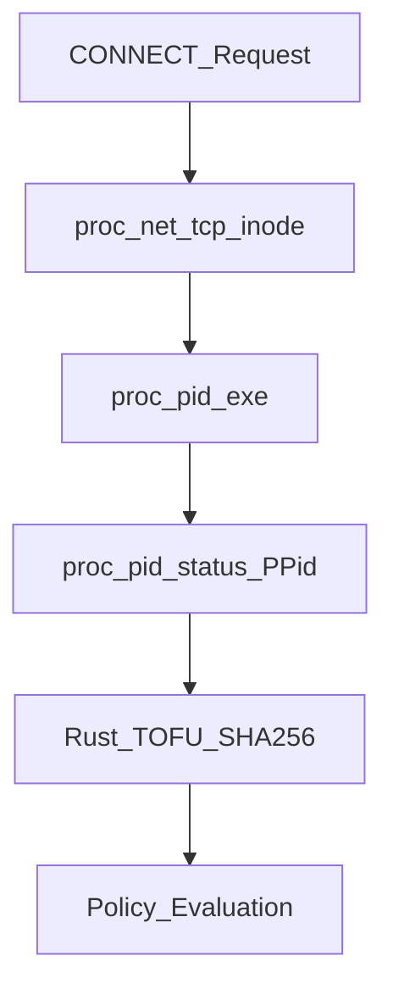

As detailed in policy annotations, binary identity resolution occurs via `/proc/net/tcp` inode lookup mapped to `/proc/{pid}/exe`, combined with an ancestor tree walk (`/proc/{pid}/status` `PPid` walk) and command-line path matching (`sandboxes/base/policy.yaml:33-34`). Cryptographic integrity (SHA256) for binaries is enforced in the underlying Rust runtime using a trust-on-first-use (TOFU) model (`sandboxes/base/policy.yaml:35`).

Sources: `sandboxes/base/policy.yaml:30-36`

---

## Network Policies Overview

Network egress filtering is partitioned into named network policies (`network_policies`) that map specific allowed binary paths to allowed network endpoints, communication protocols, and access modes (`sandboxes/base/policy.yaml:37-195`). 

Because this parent page serves as a high-level overview, detailed comparisons of network egress policies across specific developer agents and tools (such as `claude_code`, `github_rest_api`, `pypi`, `npm`, `vscode`, `cursor`, and Bring-Your-Own-Key providers) are maintained separately.

For comprehensive details on specific egress rules, see [Network Egress Policies by Agent](#2.2.1).

Sources: `sandboxes/base/policy.yaml:37-195`

---

# Page: Network Egress Policies by Agent

# Network Egress Policies by Agent

<details>
<summary>Relevant source files</summary>

The following files were used as context for generating this wiki page:

- [sandboxes/base/policy.yaml](sandboxes/base/policy.yaml)
- [sandboxes/base/skills/github/SKILL.md](sandboxes/base/skills/github/SKILL.md)
- [sandboxes/droid/Dockerfile](sandboxes/droid/Dockerfile)
- [sandboxes/droid/README.md](sandboxes/droid/README.md)
- [sandboxes/droid/policy.yaml](sandboxes/droid/policy.yaml)
- [sandboxes/gemini/Dockerfile](sandboxes/gemini/Dockerfile)
- [sandboxes/gemini/README.md](sandboxes/gemini/README.md)
- [sandboxes/gemini/policy.yaml](sandboxes/gemini/policy.yaml)
- [sandboxes/ollama/policy.yaml](sandboxes/ollama/policy.yaml)

</details>


## Purpose and Scope

This document provides a technical deep dive into the network egress policies defined across OpenShell sandbox environments (`sandboxes/base/policy.yaml`, `sandboxes/droid/policy.yaml`, `sandboxes/gemini/policy.yaml`, and `sandboxes/ollama/policy.yaml`). It covers how named network policies enforce strict layer-7 and transport-layer constraints for specific agent runtimes (`claude_code`, `github_rest_api`, `pypi`, `npm`, `vscode`/`cursor`, and Bring-Your-Own-Key [BYOK] providers). 

Targeting system engineers and security operators, this page outlines how the OpenShell runtime resolves binary identities against process descriptors to authorize outbound TCP and TLS connections.

Sources: [`sandboxes/base/policy.yaml:1-197`](), [`sandboxes/droid/policy.yaml:30-142`](), [`sandboxes/gemini/policy.yaml:30-199`](), [`sandboxes/ollama/policy.yaml:29-136`]()

---

## 1. Policy Engine Architecture and Binary Identity Resolution

OpenShell network policies are declared in `policy.yaml` under the root `network_policies` key. Each named policy maps a collection of authorized network `endpoints` (hosts, ports, protocols, and HTTP routing rules) to authorized process `binaries` (filesystem paths). 

When a sandbox process initiates an outbound network connection, the OpenShell runtime intercepts the connection via container-level network namespacing and proxying. The policy engine performs runtime identity resolution using Linux procfs:
1. **Inode Mapping**: The socket's socket inode is correlated via `/proc/net/tcp` to the owning process ID (`pid`).
2. **Binary Path Resolution**: The executable path is retrieved via `/proc/{pid}/exe`.
3. **Ancestor Walk**: Process ancestry is verified by walking `/proc/{pid}/status` parent process IDs (`PPid`).
4. **Command-Line Verification**: The command line arguments and working directories are validated against permitted paths.
5. **Integrity Enforcement**: SHA256 integrity and trust-on-first-use (TOFU) are enforced by the underlying Rust supervision daemon rather than within the static YAML configuration.

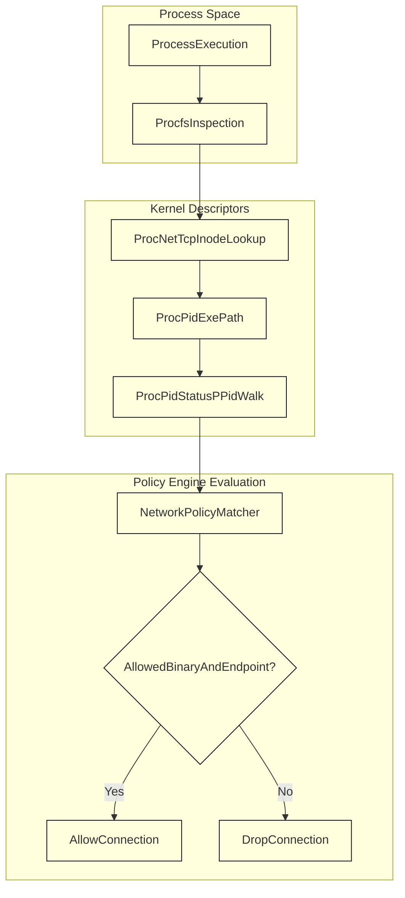
*Figure 1: Network policy enforcement and binary identity resolution flow.*

Sources: [`sandboxes/base/policy.yaml:30-36`](), [`sandboxes/ollama/policy.yaml:29-35`]()

---

## 2. Comparative Analysis of Core Agent Egress Policies

OpenShell base and specialized sandboxes define a modular set of standard network policies. Different agents mount or inherit these policies to restrict outbound traffic to minimal necessary domains.

### 2.1 Claude Code Egress Policy (`claude_code`)
The `claude_code` policy authorizes Anthropic LLM API interaction along with required telemetry and model fallback endpoints. It locks down access strictly to `/usr/local/bin/claude` and `/usr/bin/node`.

* **Endpoints**:
  * `api.anthropic.com` (Port 443, REST protocol, enforced TLS termination, full access) [`sandboxes/base/policy.yaml:38-41`]()
  * `statsig.anthropic.com` (Port 443) [`sandboxes/base/policy.yaml:42-42`]()
  * `sentry.io` (Port 443) [`sandboxes/base/policy.yaml:43-43`]()
  * `raw.githubusercontent.com` (Port 443) [`sandboxes/base/policy.yaml:44-44`]()
  * `platform.claude.com` (Port 443) [`sandboxes/base/policy.yaml:45-45`]()
* **Authorized Binaries**:
  * `/usr/local/bin/claude` [`sandboxes/base/policy.yaml:47-47`]()
  * `/usr/bin/node` [`sandboxes/base/policy.yaml:48-48`]()

Sources: [`sandboxes/base/policy.yaml:37-49`]()

### 2.2 GitHub REST API Policy (`github_rest_api`)
To prevent data exfiltration and restrict abuse of GitHub integrations, the `github_rest_api` policy enforces **read-only** interaction with GitHub's REST endpoints, explicitly disabling GraphQL access (which is often exploited or restricted in sandboxed automation) as documented in agent skill requirements [`sandboxes/base/skills/github/SKILL.md:3-10`]().

* **Endpoints**:
  * `api.github.com` (Port 443, REST protocol, TLS termination, read-only access) [`sandboxes/base/policy.yaml:88-93`]()
* **Authorized Binaries**:
  * `/usr/local/bin/claude` [`sandboxes/base/policy.yaml:95-95`]()
  * `/usr/bin/gh` [`sandboxes/base/policy.yaml:96-96`]()

Sources: [`sandboxes/base/policy.yaml:84-97`](), [`sandboxes/base/skills/github/SKILL.md:1-24`]()

### 2.3 Package Management Egress (`pypi` and `npm`)
Sandboxes requiring dynamic dependency installation include explicit network policies for Python (`pypi`) and Node.js (`npm`) ecosystems.

* **`pypi` Policy**:
  * **Endpoints**: `pypi.org`, `files.pythonhosted.org`, `github.com`, `objects.githubusercontent.com`, `api.github.com`, `downloads.python.org` (all Port 443) to support `uv` python installation workflows and standalone runtime downloads [`sandboxes/base/policy.yaml:122-132`]()
  * **Binaries**: Virtual environment python/pip paths (`/sandbox/.venv/bin/python`, `/app/.venv/bin/python`), `/usr/local/bin/uv`, and managed Python paths (`/sandbox/.uv/python/**`) [`sandboxes/base/policy.yaml:133-143`]()
* **`npm` Policy**:
  * **Endpoints**: `registry.npmjs.org`, `npmjs.org` (Port 443) [`sandboxes/ollama/policy.yaml:69-74`]()
  * **Binaries**: `/usr/bin/npm`, `/usr/bin/node`, `/bin/bash`, `/usr/bin/curl` [`sandboxes/ollama/policy.yaml:75-79`]()

Sources: [`sandboxes/base/policy.yaml:122-143`](), [`sandboxes/ollama/policy.yaml:69-79`]()

### 2.4 IDE Server Egress (`vscode` and `cursor`)
Remote development agents and IDE extensions running inside sandboxes rely on dedicated telemetry, extension marketplace, and server download endpoints.

* **`vscode` Policy**:
  * **Endpoints**: `update.code.visualstudio.com`, `az764295.vo.msecnd.net`, `vscode.download.prss.microsoft.com`, `marketplace.visualstudio.com`, `gallerycdn.vsassets.io` (Port 443) [`sandboxes/base/policy.yaml:144-152`]()
  * **Binaries**: `/usr/bin/curl`, `/usr/bin/wget`, and remote server workspaces (`/sandbox/.vscode-server/**`, `/sandbox/.vscode-remote-containers/**`) [`sandboxes/base/policy.yaml:153-158`]()
* **`cursor` Policy**:
  * **Endpoints**: `cursor.blob.core.windows.net`, `api2.cursor.sh`, `repo.cursor.sh`, `download.cursor.sh`, `cursor.download.prss.microsoft.com` (Port 443) [`sandboxes/base/policy.yaml:159-167`]()
  * **Binaries**: `/usr/bin/curl`, `/usr/bin/wget`, and `/sandbox/.cursor-server/**` [`sandboxes/base/policy.yaml:168-172`]()

Sources: [`sandboxes/base/policy.yaml:144-172`]()

---

## 3. Bring-Your-Own-Key (BYOK) and Alternative Model Providers

Specialized sandbox images such as Factory Droid (`sandboxes/droid/policy.yaml`) and Gemini CLI (`sandboxes/gemini/policy.yaml`) incorporate provider-specific infrastructures alongside BYOK routing policies.

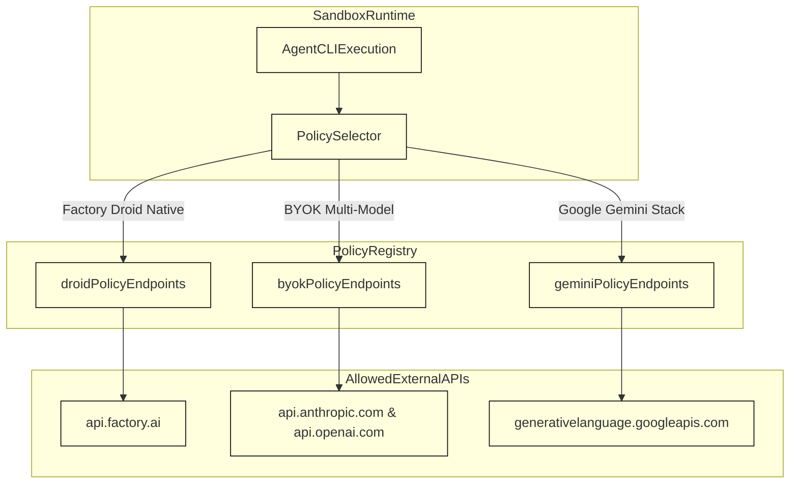
*Figure 2: Agent-specific policy selection routing across native and BYOK endpoints.*

### 3.1 Factory Droid and BYOK Policies (`droid` and `droid_byok`)
The Factory Droid sandbox splits traffic between core telemetry/relay infrastructure (`droid`) and direct multi-model inference providers (`droid_byok`).

* **`droid` Policy**:
  * Enforces connectivity to `api.factory.ai`, `app.factory.ai`, `api.workos.com`, `relay.factory.ai`, `downloads.factory.ai`, `docs.factory.ai`, `*.run.app`, and Sentry ingest endpoints [`sandboxes/droid/policy.yaml:40-59`]()
* **`droid_byok` Policy**:
  * Allows users supplying their own API keys to communicate directly with alternative upstream inference gateways: `api.anthropic.com`, `api.openai.com`, `generativelanguage.googleapis.com`, `*.googleapis.com`, `api.groq.com`, `api.fireworks.ai`, `api.deepinfra.com`, `openrouter.ai`, and `api-inference.huggingface.co` [`sandboxes/droid/policy.yaml:65-78`]()

Sources: [`sandboxes/droid/policy.yaml:37-82`]()

### 3.2 Google Gemini Policy (`gemini`)
The Gemini CLI sandbox configures strict Google Cloud AI platform egress rules to enable authentication, metadata discovery, and model inference.

* **Endpoints**:
  * `generativelanguage.googleapis.com` (Port 443) [`sandboxes/gemini/policy.yaml:188-188`]()
  * `*-aiplatform.googleapis.com` (Port 443) [`sandboxes/gemini/policy.yaml:189-189`]()
  * `cloudcode-pa.googleapis.com` (Port 443) [`sandboxes/gemini/policy.yaml:190-190`]()
  * `accounts.google.com`, `oauth2.googleapis.com`, `www.googleapis.com`, `iamcredentials.googleapis.com` (Port 443) [`sandboxes/gemini/policy.yaml:191-194`]()
* **Authorized Binaries**:
  * `/usr/bin/gemini` [`sandboxes/gemini/policy.yaml:196-196`]()
  * `/usr/lib/node_modules/@google/gemini-cli/dist/index.js` [`sandboxes/gemini/policy.yaml:197-197`]()
  * `/usr/bin/node` [`sandboxes/gemini/policy.yaml:198-198`]()

Sources: [`sandboxes/gemini/policy.yaml:185-199`]()

---

## 4. Policy Configuration Summary Table

The following table summarizes the primary named network egress policies, their target binaries, and core permitted endpoints across the OpenShell community catalog:

| Policy Name | Target Sandbox(es) | Key Authorized Binaries | Representative Endpoints |
| :--- | :--- | :--- | :--- |
| `claude_code` | Base, Ollama, Gemini | `/usr/local/bin/claude`, `/usr/bin/node` | `api.anthropic.com`, `statsig.anthropic.com`, `sentry.io` |
| `github_rest_api` | Base, Ollama, Droid, Gemini | `/usr/bin/gh`, `/usr/local/bin/claude` | `api.github.com` (REST subset) |
| `pypi` | Base, Droid, Gemini | `/sandbox/.venv/bin/python`, `/usr/local/bin/uv` | `pypi.org`, `files.pythonhosted.org`, `downloads.python.org` |
| `npm` | Ollama, Droid | `/usr/bin/npm`, `/usr/bin/node`, `/usr/bin/curl` | `registry.npmjs.org` |
| `vscode` / `cursor` | Base, Gemini | `/usr/bin/curl`, `/sandbox/.vscode-server/**` | `update.code.visualstudio.com`, `api2.cursor.sh` |
| `droid_byok` | Droid | `/usr/bin/droid`, `/usr/bin/node` | `api.openai.com`, `openrouter.ai`, `api.groq.com` |
| `gemini` | Gemini | `/usr/bin/gemini`, `/usr/bin/node` | `generativelanguage.googleapis.com`, `accounts.google.com` |

Sources: [`sandboxes/base/policy.yaml:37-172`](), [`sandboxes/droid/policy.yaml:40-82`](), [`sandboxes/gemini/policy.yaml:38-199`](), [`sandboxes/ollama/policy.yaml:37-120`]()

---

# Page: Agent Skills

# Agent Skills

<details>
<summary>Relevant source files</summary>

The following files were used as context for generating this wiki page:

- [CONTRIBUTING.md](CONTRIBUTING.md)
- [sandboxes/base/policy.yaml](sandboxes/base/policy.yaml)
- [sandboxes/base/skills/github/SKILL.md](sandboxes/base/skills/github/SKILL.md)

</details>


The purpose of this page is to document the agent skills architecture within OpenShell-Community. It details how agent capabilities are defined, discovered via `.agents/skills` and `.claude/skills`, structured using the `SKILL.md` format, and enforced through network egress policies such as the built-in `github` REST-only skill.

Sources: `CONTRIBUTING.md:59-64`, `sandboxes/base/skills/github/SKILL.md:1-4`

---

## 1. Skill Discovery and Directory Layout

OpenShell-Community sandboxes provision specialized capabilities to coding agents through modular skill directories. When an agent environment initializes within a sandbox, it scans specific well-known paths for skill definitions. 

Skills are located within individual sandbox directories or inherited from the base image structure under local `.agents/skills` and `.claude/skills` search paths [CONTRIBUTING.md:59-65](). Each skill resides in its own isolated subdirectory containing a mandatory configuration manifest and supporting execution scripts [CONTRIBUTING.md:59-65]().

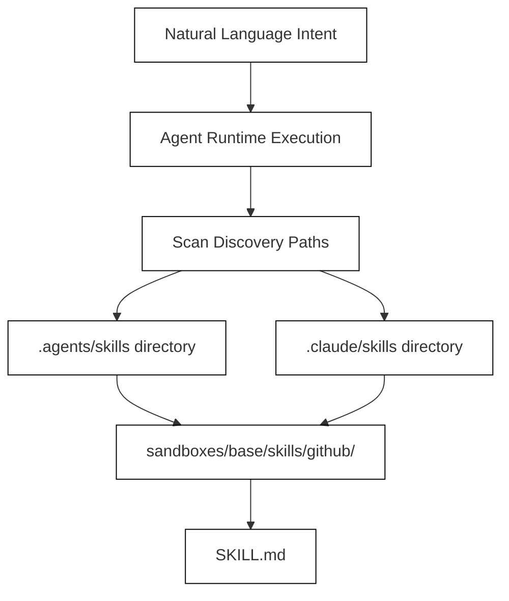
*Figure 1: Skill Discovery Architecture from Discovery Paths to `SKILL.md`.*

Sources: `CONTRIBUTING.md:59-65`

---

## 2. The `SKILL.md` Format

Every skill must provide a `SKILL.md` file that acts as the primary control block for the agent [CONTRIBUTING.md:59-65](). The file begins with a YAML frontmatter block defining metadata (such as `name` and `description`), followed by structured markdown instructions detailing execution constraints, required shell permissions, and command templates [sandboxes/base/skills/github/SKILL.md:1-15]().

For example, the frontmatter defines trigger keywords and operational intent, while the markdown body provides explicit rules on tool usage (e.g., preferring specific command-line flags or restricting specific API call types) [sandboxes/base/skills/github/SKILL.md:1-15]().

Sources: `CONTRIBUTING.md:59-65`, `sandboxes/base/skills/github/SKILL.md:1-15`

---

## 3. Built-In GitHub REST-Only Skill

The built-in `github` skill (`sandboxes/base/skills/github/SKILL.md`) instructs agents on interacting with GitHub exclusively through REST API endpoints rather than GraphQL [sandboxes/base/skills/github/SKILL.md:1-11](). This restriction is required because sandbox network egress policies block the GraphQL endpoint (`api.github.com/graphql`) while permitting REST paths (`api.github.com/repos/...`) [sandboxes/base/policy.yaml:84-97](), [sandboxes/base/skills/github/SKILL.md:16-22]().

### Policy Enforcement and Tool Routing

The policy engine configured in `sandboxes/base/policy.yaml` defines the `github_rest_api` network policy, binding the `/usr/bin/gh` binary and `/usr/local/bin/claude` to `api.github.com` on port `443` with `read-only` access restrictions [sandboxes/base/policy.yaml:84-97]().

```mermaid
graph TD
    AgentCmd[""Agent Command: gh api repos/{owner}/{repo}""] --> BinaryExec[""Binary Execution: /usr/bin/gh""]
    BinaryExec --> NetworkConnect[""TCP Connect: api.github.com:443""]
    NetworkConnect --> PolicyEngine[""Policy Evaluation: policy.yaml""]
    PolicyEngine --> CheckPolicy[""Match Policy: github_rest_api""]
    CheckPolicy --> RestAllowed[""Allow REST Path: /repos/... (Status: Allowed)""]
    CheckPolicy --> GqlBlocked[""Block Endpoint: /graphql (Status: Blocked)""]

    classDef default fill:none,stroke:black,stroke-width:1px;
```
*Figure 2: Natural Language Space to Code Entity Space mapping execution of `gh` through `policy.yaml` routing rules.*

### REST-Safe Commands vs. GraphQL-Prone Commands

The `github` skill explicitly categorizes subcommands to prevent runtime failures [sandboxes/base/skills/github/SKILL.md:25-42]():

- **Avoid (GraphQL-dependent)**: `gh pr list`, `gh issue list`, `gh project`, `gh search` [sandboxes/base/skills/github/SKILL.md:25-31]().
- **Preferred (REST-safe)**: `gh api <REST-path>`, `gh pr create`, `gh pr merge`, `gh release *`, `gh run *`, `gh workflow *` [sandboxes/base/skills/github/SKILL.md:33-42]().

Sources: `sandboxes/base/policy.yaml:84-97`, `sandboxes/base/skills/github/SKILL.md:1-43`

---

# Page: Sandbox Catalog

# Sandbox Catalog

<details>
<summary>Relevant source files</summary>

The following files were used as context for generating this wiki page:

- [README.md](README.md)

</details>


The Sandbox Catalog indexes pre-built domain-specific container environments provided by the `OpenShell-Community` repository. Each sandbox inherits from the foundational base layer and provides tailored tooling, runtime dependencies, configuration profiles, and pre-installed agent frameworks. These images are instantiated via the OpenShell CLI command `openshell sandbox create --from <sandbox>` [README.md:43-43].

Sources: [README.md:1-72]()

---

## Sandbox Index

The community repository organizes sandboxes by workload type under the `sandboxes/` directory [README.md:16-19]. The following table summarizes the available sandbox images:

| Sandbox Image | Directory Path | Target Workload / Description |
| --- | --- | --- |
| `base` | `sandboxes/base/` [README.md:24-24]() | Foundational system tools, users, and base developer environment. |
| `droid` | `sandboxes/droid/` [README.md:25-25]() | Android automation, mobile testing workflows, and Factory Droid binaries. |
| `gemini` | `sandboxes/gemini/` [README.md:26-26]() | Google Gemini CLI workflows and associated agent configurations. |
| `nvidia-gpu` | `sandboxes/nvidia-gpu/` [README.md:27-27]() | GPU-accelerated VM sandbox with NVIDIA userspace tooling and drivers. |
| `ollama` | `sandboxes/ollama/` [README.md:28-28]() | Local LLM hosting via `ollama serve` with Claude Code, Codex, and OpenCode. |
| `pi` | `sandboxes/pi/` [README.md:29-29]() | Pre-installed [Pi](https://pi.dev) agent environment [README.md:29-29]. |
| `sdg` | `sandboxes/sdg/` [README.md:30-30]() | Synthetic data generation pipelines and workloads. |

```mermaid
graph TD
    CLI["openshell sandbox create"] --> Resolver["SandboxImageResolver"]
    Resolver --> Base["sandboxes/base/Dockerfile"]
    Base --> Droid["sandboxes/droid/Dockerfile"]
    Base --> Gemini["sandboxes/gemini/Dockerfile"]
    Base --> Pi["sandboxes/pi/Dockerfile"]
    Base --> Ollama["sandboxes/ollama/Dockerfile"]
    Base --> GPU["sandboxes/nvidia-gpu/Dockerfile"]
    Base --> SDG["sandboxes/sdg/Dockerfile"]
```
*Sources: [README.md:14-31]()*

---

## 3.1 Coding Agent Sandboxes (droid, gemini, pi)

The coding agent sandboxes provide specialized runtimes for specific agent CLIs, including Factory Droid, Gemini CLI, and the Pi agent [README.md:25-29]. These images package pinned agent binary versions, custom shell configurations, and isolated policy definitions within their respective subdirectories (`sandboxes/droid/`, `sandboxes/gemini/`, `sandboxes/pi/`) [README.md:16-29].

For deep technical details regarding Dockerfiles, pinned versions, configuration directories, and security policies, see [Coding Agent Sandboxes (droid, gemini, pi)](#3.1).

Sources: [README.md:24-30]()

---

## 3.2 Ollama Sandbox

The Ollama sandbox provisions a local and cloud LLM execution environment [README.md:28-51]. It includes an automated entrypoint script (`entrypoint.sh`) that initializes the local model server, configures `OLLAMA_HOST` discovery for agents, supports model updates via `update-ollama.sh`, and bundles pre-installed coding assistants such as Claude Code and Codex [README.md:28-50].

```mermaid
graph TD
    Runtime["OpenShell Core Runtime"] --> Spawn["sandbox container lifecycle"]
    Spawn --> Entrypoint["entrypoint.sh"]
    Entrypoint --> OllamaServer["ollama serve process"]
    OllamaServer --> HostVar["OLLAMA_HOST discovery"]
    HostVar --> ClaudeAgent["Claude Code / Codex agents"]
```
*Sources: [README.md:28-51]()*

For comprehensive instructions on automated startup scripts, environment variable bindings, and egress filtering policies, see [Ollama Sandbox](#3.2).

Sources: [README.md:28-51]()

---

## 3.3 NVIDIA GPU Sandbox

The NVIDIA GPU sandbox image (`sandboxes/nvidia-gpu/`) supplies GPU-accelerated computing capabilities for autonomous agent verification and synthetic data generation [README.md:8-27]. It manages the separation between host kernel driver versions and containerized userspace libraries, utilizing version coupling mechanisms declared in `versions.env` to maintain compatibility across multi-architecture builds.

For architectural breakdowns of the userspace-to-kernel driver split, version pinning conventions, multi-arch build pipelines, and troubleshooting instructions, see [NVIDIA GPU Sandbox](#3.3).

Sources: [README.md:8-27]()

---

# Page: Coding Agent Sandboxes (droid, gemini, pi)

# Coding Agent Sandboxes (droid, gemini, pi)

<details>
<summary>Relevant source files</summary>

The following files were used as context for generating this wiki page:

- [sandboxes/droid/Dockerfile](sandboxes/droid/Dockerfile)
- [sandboxes/droid/README.md](sandboxes/droid/README.md)
- [sandboxes/droid/policy.yaml](sandboxes/droid/policy.yaml)
- [sandboxes/gemini/Dockerfile](sandboxes/gemini/Dockerfile)
- [sandboxes/gemini/README.md](sandboxes/gemini/README.md)
- [sandboxes/gemini/policy.yaml](sandboxes/gemini/policy.yaml)
- [sandboxes/pi/Dockerfile](sandboxes/pi/Dockerfile)
- [sandboxes/pi/README.md](sandboxes/pi/README.md)
- [sandboxes/pi/policy.yaml](sandboxes/pi/policy.yaml)

</details>


## Purpose and Scope
This document covers the technical implementation, container specifications, configuration directories, and security policies for the three primary coding agent sandboxes provided by OpenShell-Community: **Factory Droid** (`droid`), **Gemini CLI** (`gemini`), and **Pi Coding Agent** (`pi`). Each sandbox inherits from the OpenShell base runtime image, layers a specific AI coding assistant CLI with pinned versioning, establishes specialized configuration persistence paths, and defines granular network/filesystem security constraints via `policy.yaml`.

---

## 1. Factory Droid Sandbox (`droid`)

The Factory Droid sandbox packages the Factory Droid CLI (`droid`) inside an isolated execution environment. It is defined by `sandboxes/droid/Dockerfile` [sandboxes/droid/Dockerfile:1-29]() and managed via `sandboxes/droid/README.md` [sandboxes/droid/README.md:1-28]().

### Dockerfile and Version Pinning
The build process accepts a base image argument (`BASE_IMAGE`) and installs the `droid` package pinned to version `0.90.0` globally via npm [sandboxes/droid/Dockerfile:12-18](). It provisions the runtime configuration directory `/sandbox/.factory` and assigns ownership to the unprivileged `sandbox` user [sandboxes/droid/Dockerfile:23-26]().

```dockerfile
ARG BASE_IMAGE=ghcr.io/nvidia/openshell-community/sandboxes/base:latest
FROM ${BASE_IMAGE}

USER root

# Install Droid CLI (pinned for reproducibility)
RUN npm install -g droid@0.90.0

# Copy sandbox policy
COPY policy.yaml /etc/openshell/policy.yaml

# Create Droid config directory
RUN mkdir -p /sandbox/.factory && \
    chown sandbox:sandbox /sandbox/.factory

USER sandbox
ENTRYPOINT ["/bin/bash"]
```
*Sources: [sandboxes/droid/Dockerfile:1-29](), [sandboxes/droid/README.md:1-29]*

### Security Policies (`policy.yaml`)
The filesystem policy configures system directories (`/usr`, `/lib`, `/proc`, `/app`, `/etc`) as read-only while allocating read-write access to `/sandbox`, `/tmp`, and `/dev/null` [sandboxes/droid/policy.yaml:8-22](). Landlock compatibility is set to `best_effort`, enforcing process execution under the `sandbox` user and group [sandboxes/droid/policy.yaml:23-28]().

The network policy defines named endpoints for the core Droid infrastructure (`droid`), Bring-Your-Own-Key model providers (`droid_byok`), GitHub operations (`github`), npm registry (`npm`), and PyPI (`pypi`) [sandboxes/droid/policy.yaml:37-141]().

```mermaid
graph TD
    subgraph "NaturalLanguageSpace"
        A["DroidCoreInfrastructure"]
        B["BringYourOwnKeyModelProviders"]
        C["GitHubGitAndRESTAPI"]
    end

    subgraph "CodeEntitySpace"
        D["network_policies.droid"] -->|"api.factory.ai:443"| E["/usr/bin/droid"]
        F["network_policies.droid_byok"] -->|"api.anthropic.com:443"| G["/usr/bin/node"]
        H["network_policies.github"] -->|"api.github.com:443"| I["/usr/bin/gh"]
    end

    A --> D
    B --> F
    C --> H

    classDef default stroke:#000,fill:#fff;
```
*Title: Droid Sandbox Policy to Code Entity Mapping*
*Sources: [sandboxes/droid/policy.yaml:1-142]*

---

## 2. Gemini CLI Sandbox (`gemini`)

The Gemini CLI sandbox provides an isolated execution context for Google’s Gemini AI coding assistant. It is defined in `sandboxes/gemini/Dockerfile` [sandboxes/gemini/Dockerfile:1-29]() and documented in `sandboxes/gemini/README.md` [sandboxes/gemini/README.md:1-28]().

### Dockerfile and Version Pinning
The build inherits from the community base image and installs `@google/gemini-cli` pinned to version `0.35.0` via npm [sandboxes/gemini/Dockerfile:12-18](). It initializes the configuration persistence directory at `/sandbox/.gemini` for user credentials and state [sandboxes/gemini/Dockerfile:23-26]().

```dockerfile
ARG BASE_IMAGE=ghcr.io/nvidia/openshell-community/sandboxes/base:latest
FROM ${BASE_IMAGE}

USER root

# Install Gemini CLI (pinned for reproducibility)
RUN npm install -g @google/gemini-cli@0.35.0

# Copy sandbox policy
COPY policy.yaml /etc/openshell/policy.yaml

# Create Gemini config directory
RUN mkdir -p /sandbox/.gemini && \
    chown sandbox:sandbox /sandbox/.gemini

USER sandbox
ENTRYPOINT ["/bin/bash"]
```
*Sources: [sandboxes/gemini/Dockerfile:1-29](), [sandboxes/gemini/README.md:1-29]*

### Security Policies (`policy.yaml`)
The Gemini policy defines access rules for Google AI APIs, OAuth authentication endpoints, and supporting tool integrations [sandboxes/gemini/policy.yaml:185-198](). In addition to the `gemini` policy, it embeds auxiliary policies for Claude Code (`claude_code`), OpenCode (`opencode`), GitHub Copilot (`copilot`), and standard package managers [sandboxes/gemini/policy.yaml:38-198]().

```mermaid
graph TD
    subgraph "NaturalLanguageSpace"
        A["GoogleGenerativeAIPlients"]
        B["GoogleOAuthAuthentication"]
    end

    subgraph "CodeEntitySpace"
        C["network_policies.gemini"] -->|"generativelanguage.googleapis.com:443"| D["/usr/bin/gemini"]
        C -->|"accounts.google.com:443"| E["/usr/lib/node_modules/@google/gemini-cli/dist/index.js"]
        C -->|"oauth2.googleapis.com:443"| F["/usr/bin/node"]
    end

    A --> C
    B --> C

    classDef default stroke:#000,fill:#fff;
```
*Title: Gemini Policy Binding and Endpoint Routing*
*Sources: [sandboxes/gemini/policy.yaml:185-199]*

---

## 3. Pi Coding Agent Sandbox (`pi`)

The Pi Coding Agent sandbox integrates the minimal terminal coding harness `pi` [sandboxes/pi/README.md:1-34](). It is built via `sandboxes/pi/Dockerfile` [sandboxes/pi/Dockerfile:1-25]().

### Dockerfile and Package Setup
Unlike Droid and Gemini, the Pi Dockerfile installs `@earendil-works/pi-coding-agent` via global npm without an explicit version tag in the `RUN` instruction, copying the companion `policy.yaml` to `/etc/openshell/policy.yaml` [sandboxes/pi/Dockerfile:17-21]().

```dockerfile
ARG BASE_IMAGE=ghcr.io/nvidia/openshell-community/sandboxes/base:latest
FROM ${BASE_IMAGE}

USER root

# Install pi
RUN npm install -g @earendil-works/pi-coding-agent

# Copy sandbox policy
COPY policy.yaml /etc/openshell/policy.yaml

USER sandbox
ENTRYPOINT ["/bin/bash"]
```
*Sources: [sandboxes/pi/Dockerfile:1-25](), [sandboxes/pi/README.md:1-35]*

### Security Policies (`policy.yaml`)
The `pi` network policy permits outbound connections to a broad catalog of API-key model providers (Anthropic, OpenAI, DeepSeek, Google, Mistral, Groq, Cerebras, xAI, OpenRouter, Together, etc.), cloud providers (AWS Bedrock, Cloudflare), and token refresh endpoints [sandboxes/pi/policy.yaml:38-87](). It explicitly associates these endpoints with binary execution paths for `pi` and `node` [sandboxes/pi/policy.yaml:88-95]().

```mermaid
graph TD
    subgraph "NaturalLanguageSpace"
        A["PiAgentExecution"]
        B["APIKeyModelProviders"]
        C["GitHubReleaseAssets"]
    end

    subgraph "CodeEntitySpace"
        D["network_policies.pi"] -->|"api.anthropic.com:443"| E["/usr/bin/pi"]
        D -->|"api.openai.com:443"| F["/usr/local/bin/pi"]
        D -->|"release-assets.githubusercontent.com:443"| G["/usr/bin/node"]
    end

    A --> D
    B --> D
    C --> D

    classDef default stroke:#000,fill:#fff;
```
*Title: Pi Sandbox Network Policy Mapping*
*Sources: [sandboxes/pi/policy.yaml:37-95]*

---

## 4. Cross-Sandbox Architecture & Common Patterns

All three coding agent sandboxes rely on identical foundational security settings defined in their respective `policy.yaml` files. The filesystem policy, Landlock configuration, and user isolation parameters are shared across `droid`, `gemini`, and `pi`.

| Parameter | Configuration Value | Target Scope |
| :--- | :--- | :--- |
| `filesystem_policy.read_only` | `/usr`, `/lib`, `/proc`, `/dev/urandom`, `/app`, `/etc`, `/var/log` | System-wide protection |
| `filesystem_policy.read_write` | `/sandbox`, `/tmp`, `/dev/null` | Scratch space & persistence |
| `landlock.compatibility` | `best_effort` | Kernel sandboxing fallback |
| `process.run_as_user` | `sandbox` | Unprivileged execution |
| `process.run_as_group` | `sandbox` | Unprivileged group context |

*Sources: [sandboxes/droid/policy.yaml:8-28](), [sandboxes/gemini/policy.yaml:8-28](), [sandboxes/pi/policy.yaml:8-28]*

---

# Page: Ollama Sandbox

# Ollama Sandbox

<details>
<summary>Relevant source files</summary>

The following files were used as context for generating this wiki page:

- [sandboxes/ollama/Dockerfile](sandboxes/ollama/Dockerfile)
- [sandboxes/ollama/README.md](sandboxes/ollama/README.md)
- [sandboxes/ollama/entrypoint.sh](sandboxes/ollama/entrypoint.sh)
- [sandboxes/ollama/policy.yaml](sandboxes/ollama/policy.yaml)
- [sandboxes/ollama/update-ollama.sh](sandboxes/ollama/update-ollama.sh)

</details>


## Purpose and Scope
The Ollama Sandbox is a specialized OpenShell container environment (`sandboxes/ollama/Dockerfile`) designed to run local Large Language Models (LLMs) via [Ollama](https://ollama.com) while adhering to strict security boundaries. Because the OpenShell runtime enforces a read-only `/usr` filesystem policy, the Ollama binary and npm global modules are redirected to writable paths under `/sandbox` [sandboxes/ollama/Dockerfile:20-21, sandboxes/ollama/Dockerfile:41-42](). 

This page documents the image build structure, runtime initialization via `entrypoint.sh`, dynamic updates via `update-ollama.sh`, network egress enforcement via `policy.yaml`, and usage workflows.

---

## 1. Dockerfile & Image Build Architecture

The Ollama sandbox inherits from the OpenShell base community image (`openshell-base` or `ghcr.io/nvidia/openshell-community/sandboxes/base:latest`) [sandboxes/ollama/Dockerfile:11-12](). 

Key build steps implemented in `sandboxes/ollama/Dockerfile`:
- **Zstandard Installation**: Installs `zstd` (`apt-get install -y --no-install-recommends zstd`), which is required to decompress Ollama release archives [sandboxes/ollama/Dockerfile:16-18]().
- **Writable Binary Path**: Creates `/sandbox/bin`, downloads and extracts Ollama via the official install script, and relocates the executable from `/usr/local/bin/ollama` to `/sandbox/bin/ollama` to allow runtime updates under a read-only root policy [sandboxes/ollama/Dockerfile:20-25]().
- **Environment Discovery**: Sets `OLLAMA_HOST=http://127.0.0.1:11434` and prioritizes `/sandbox/bin` in the `PATH` [sandboxes/ollama/Dockerfile:35-39]().
- **NPM Configuration**: Configures `NPM_CONFIG_PREFIX=/sandbox/.npm-global` to ensure Node.js global packages can be installed without violating filesystem constraints [sandboxes/ollama/Dockerfile:38, sandboxes/ollama/Dockerfile:41-44]().
- **Interactive Shell Defaults**: Appends environment exports to `/sandbox/.bashrc` [sandboxes/ollama/Dockerfile:46-50]().

```mermaid
graph TD
    BaseImage["ghcr.io/nvidia/openshell-community/sandboxes/base:latest"] --> RootStage["USER root"]
    RootStage --> InstallZstd["apt-get install -y zstd"]
    InstallZstd --> SetupBin["mkdir -p /sandbox/bin"]
    SetupBin --> FetchOllama["curl -fsSL https://ollama.com/install.sh | sh"]
    FetchOllama --> MoveBin["mv /usr/local/bin/ollama /sandbox/bin/ollama"]
    MoveBin --> CopyFiles["COPY policy.yaml /etc/openshell/policy.yaml"]
    CopyFiles --> SetEnv["ENV OLLAMA_HOST & PATH configuration"]
    SetEnv --> DropPriv["USER sandbox"]
    DropPriv --> Entrypoint["ENTRYPOINT /usr/local/bin/entrypoint"]

    classDef default fill:#fff,stroke:#333,stroke-width:1px;
```
*Sources: [sandboxes/ollama/Dockerfile:1-55]()*

---

## 2. Runtime Entrypoint & Auto-Start Workflow

When a sandbox container starts, execution passes to `/usr/local/bin/entrypoint` (`sandboxes/ollama/entrypoint.sh`). This script manages automatic updates, server daemonization, and default model provisioning.

### Initialization Sequence
1. **Environment Export**: Ensures `OLLAMA_HOST` is available, defaulting to `http://127.0.0.1:11434` [sandboxes/ollama/entrypoint.sh:9-10]().
2. **Conditional Self-Update**: If `OLLAMA_UPDATE=1` is set in the environment, `update-ollama` is invoked immediately [sandboxes/ollama/entrypoint.sh:12-16]().
3. **Daemon Startup**: Launches the Ollama server in the background via `nohup ollama serve > /tmp/ollama.log 2>&1 &` and records its PID [sandboxes/ollama/entrypoint.sh:18-21]().
4. **Health Polling**: Polls `http://127.0.0.1:11434/api/tags` using `curl` for up to 60 seconds. If the process dies or fails to respond, it aborts [sandboxes/ollama/entrypoint.sh:23-35]().
5. **Default Model Pulling**: If `OLLAMA_DEFAULT_MODEL` is specified and missing from the local registry, it executes `ollama pull` [sandboxes/ollama/entrypoint.sh:37-44]().
6. **Command Execution**: Executes the provided command arguments, or defaults to an interactive login shell (`/bin/bash -l`) [sandboxes/ollama/entrypoint.sh:59-64]().

```mermaid
graph TD
    Start["Container Startup"] --> CheckUpdate{"OLLAMA_UPDATE=1?"}
    CheckUpdate -- Yes --> RunUpdate["update-ollama.sh"]
    CheckUpdate -- No --> StartServer["nohup ollama serve"]
    RunUpdate --> StartServer
    StartServer --> PollAPI["curl /api/tags (60 retries)"]
    PollAPI -- Healthy --> CheckModel{"OLLAMA_DEFAULT_MODEL set?"}
    PollAPI -- Failed --> Crash["Exit 1 & print /tmp/ollama.log"]
    CheckModel -- Yes --> PullModel["ollama pull ${OLLAMA_DEFAULT_MODEL}"]
    CheckModel -- No --> Ready["Print connection info"]
    PullModel --> Ready
    Ready --> ExecCmd["exec /bin/bash -l or custom command"]

    classDef default fill:#fff,stroke:#333,stroke-width:1px;
```
*Sources: [sandboxes/ollama/entrypoint.sh:1-64]()*

---

## 3. Dynamic Updates via update-ollama.sh

The script `sandboxes/ollama/update-ollama.sh` allows updating the Ollama binary inside the sandbox without rebuilding the container image [sandboxes/ollama/update-ollama.sh:1-9]().

### Execution Flow
- **Architecture Detection**: Maps host architecture (`uname -m`) to Ollama release conventions (`amd64` or `arm64`) [sandboxes/ollama/update-ollama.sh:13-20]().
- **Version Resolution**: Determines the current version via `$OLLAMA_BIN --version` [sandboxes/ollama/update-ollama.sh:22](). If a version argument is passed, it targets `https://github.com/ollama/ollama/releases/download/v${VERSION}/...` [sandboxes/ollama/update-ollama.sh:24-25](); otherwise, it downloads the latest build from `https://ollama.com/download/ollama-linux-${ARCH}.tar.zst` [sandboxes/ollama/update-ollama.sh:29]().
- **Extraction & Replacement**: Downloads the Zstandard archive into a temporary directory, extracts it using `tar --zstd`, and replaces the binary at `/sandbox/bin/ollama` with appropriate permissions [sandboxes/ollama/update-ollama.sh:34-41]().

```mermaid
graph TD
    Invoke["update-ollama [VERSION]"] --> DetectArch["uname -m -> amd64/arm64"]
    DetectArch --> BuildURL{"Version specified?"}
    BuildURL -- Yes --> GHRelease["Fetch GitHub Release URL"]
    BuildURL -- No --> LatestURL["Fetch ollama.com latest URL"]
    GHRelease --> FetchTar["curl -fsSL tar.zst"]
    LatestURL --> FetchTar
    FetchTar --> Unpack["tar --zstd -xf into TMPDIR"]
    Unpack --> ReplaceBin["mv TMPDIR/bin/ollama /sandbox/bin/ollama"]
    ReplaceBin --> SetPerm["chmod +x /sandbox/bin/ollama"]
    SetPerm --> PrintSuccess["Print version upgrade summary"]

    classDef default fill:#fff,stroke:#333,stroke-width:1px;
```
*Sources: [sandboxes/ollama/update-ollama.sh:1-47]()*

---

## 4. Security & Egress Policies (policy.yaml)

The sandbox policy file (`sandboxes/ollama/policy.yaml`) defines filesystem mounts, user context, and Landlock-compatible network egress restrictions [sandboxes/ollama/policy.yaml:1-35]().

### Filesystem Policy
- **Read-Only Mounts**: `/usr`, `/lib`, `/proc`, `/dev/urandom`, `/app`, `/etc`, `/var/log` [sandboxes/ollama/policy.yaml:7-16]().
- **Read-Write Mounts**: `/sandbox`, `/tmp`, `/dev/null` [sandboxes/ollama/policy.yaml:17-20]().
- **Process Context**: Executes under the non-root user and group `sandbox` [sandboxes/ollama/policy.yaml:25-27]().

### Network Egress Policies
The policy defines named network rules (`ollama`, `claude_code`, `npm`, `github`, `github_rest_api`, `nvidia`, `nvidia_web`) [sandboxes/ollama/policy.yaml:36-135](). Specifically, the `ollama` network policy permits execution paths like `/sandbox/bin/ollama`, `/usr/bin/curl`, and `/bin/bash` to communicate with update endpoints, model registries, and storage buckets:

```yaml
network_policies:
  ollama:
    name: ollama
    endpoints:
      - { host: ollama.com, port: 443 }
      - { host: www.ollama.com, port: 443 }
      - { host: registry.ollama.com, port: 443 }
      - { host: registry.ollama.ai, port: 443 }
      - { host: "*.r2.cloudflarestorage.com", port: 443 }
      - { host: github.com, port: 443 }
      - { host: objects.githubusercontent.com, port: 443 }
      - { host: raw.githubusercontent.com, port: 443 }
      - { host: release-assets.githubusercontent.com, port: 443 }
    binaries:
      - { path: /usr/bin/curl }
      - { path: /bin/bash }
      - { path: /usr/bin/sh }
      - { path: /sandbox/bin/ollama }
      - { path: /usr/local/bin/ollama }
      - { path: /usr/bin/ollama }
```
*Sources: [sandboxes/ollama/policy.yaml:1-56]()*

---

## 5. Usage & Interaction

Building and running the Ollama sandbox is managed through standard OpenShell CLI workflows or direct Docker invocations [sandboxes/ollama/README.md:15-39]().

### Common Commands
- **Build Image Locally**:
  ```bash
  docker build -t openshell-ollama .
  ```
  [sandboxes/ollama/README.md:15-19]()

- **Create Sandbox with Port Forwarding**:
  ```bash
  openshell sandbox create --from ollama --forward 11434
  ```
  [sandboxes/ollama/README.md:23-27]()

- **Update Ollama Interactively**:
  ```bash
  update-ollama
  ```
  [sandboxes/ollama/README.md:29-33]()

- **Auto-Update on Startup**:
  ```bash
  openshell sandbox create --from ollama -e OLLAMA_UPDATE=1
  ```
  [sandboxes/ollama/README.md:35-39]()

```mermaid
graph TD
    CLI["openshell sandbox create --from ollama"] --> ContainerInit["entrypoint.sh executes"]
    ContainerInit --> ServerRunning["Ollama server listening on 11434"]
    ServerRunning --> Forward["--forward 11434 exposes port to host"]
    Forward --> AgentUse["Claude Code / Codex / Local Agents access API"]

    classDef default fill:#fff,stroke:#333,stroke-width:1px;
```
*Sources: [sandboxes/ollama/README.md:1-40]()*

---

# Page: NVIDIA GPU Sandbox

# NVIDIA GPU Sandbox

<details>
<summary>Relevant source files</summary>

The following files were used as context for generating this wiki page:

- [sandboxes/nvidia-gpu/Dockerfile](sandboxes/nvidia-gpu/Dockerfile)
- [sandboxes/nvidia-gpu/README.md](sandboxes/nvidia-gpu/README.md)
- [sandboxes/nvidia-gpu/versions.env](sandboxes/nvidia-gpu/versions.env)

</details>


## Purpose and Scope

The NVIDIA GPU Sandbox provides GPU-accelerated execution environments for the OpenShell VM driver. It packages NVIDIA userspace drivers, CUDA support libraries, and system utilities on top of an Ubuntu base image `[sandboxes/nvidia-gpu/Dockerfile:6-11]`. Because hardware virtualization isolates the guest kernel from the host, this sandbox implements a strict separation of concerns between container-image-supplied userspace binaries and VM-driver-injected kernel modules `[sandboxes/nvidia-gpu/README.md:12-25]`. This page documents the architecture, version coupling mechanisms (`versions.env`), multi-architecture build pipelines, and operational troubleshooting strategies.

Sources: `sandboxes/nvidia-gpu/Dockerfile:6-11`, `sandboxes/nvidia-gpu/README.md:12-25`

---

## Architecture: Userspace vs. Kernel Module Split

The GPU sandbox splits responsibility across build-time container layers and runtime VM driver orchestration `[sandboxes/nvidia-gpu/README.md:12-25]`:
- **Userspace (Docker Image):** Contains NVIDIA management tools (`nvidia-smi`), driver libraries (`libcuda.so`, `libnvidia-ml.so`), and runtime dependencies (`kmod`, `iproute2`, `busybox-static`) installed via the official NVIDIA `.run` installer with `--no-kernel-module` `[sandboxes/nvidia-gpu/Dockerfile:38-77]`, `[sandboxes/nvidia-gpu/README.md:19]`.
- **Kernel Modules (VM Driver Injection):** Kernel modules (`nvidia.ko`, `nvidia_uvm.ko`, `nvidia_modeset.ko`) are built separately against the exact guest kernel version (`libkrunfw`) and injected into the sandbox rootfs at creation time via `inject_gpu_modules()` `[sandboxes/nvidia-gpu/README.md:20-25]`.
- **GSP Firmware:** GPU System Processor firmware (`.bin`) is bundled by the `.run` installer inside `sandboxes/nvidia-gpu/Dockerfile`, preventing firmware version skew relative to the host `[sandboxes/nvidia-gpu/Dockerfile:65-77]`, `[sandboxes/nvidia-gpu/README.md:21]`.

```mermaid
graph TD
    subgraph "Code Entity Space"
        Dockerfile["sandboxes/nvidia-gpu/Dockerfile"]
        VersionsEnv["sandboxes/nvidia-gpu/versions.env"]
        NvidiaRun["NVIDIA-Linux-.run"]
        KernelModules["inject_gpu_modules()"]
    end

    subgraph "Runtime Layers"
        Userspace["Userspace Tools & Libraries"]
        GSP["GSP Firmware"]
        Kmod["Guest Kernel Modules .ko"]
    end

    Dockerfile -->|"Downloads & executes"| NvidiaRun
    NvidiaRun -->|"Installs"| Userspace
    NvidiaRun -->|"Provides"| GSP
    VersionsEnv -->|"Defines NVIDIA_DRIVER_VERSION"| Dockerfile
    KernelModules -->|"Injects at boot"| Kmod
```

Sources: `sandboxes/nvidia-gpu/Dockerfile:38-77`, `sandboxes/nvidia-gpu/README.md:12-25`

---

## Version Coupling and `versions.env`

Maintaining ABI compatibility between the guest userspace libraries and kernel modules requires strict version synchronization `[sandboxes/nvidia-gpu/README.md:51-64]`. The NVIDIA driver version is declared in `sandboxes/nvidia-gpu/versions.env` and mirrored as a build argument in the container definition `[sandboxes/nvidia-gpu/Dockerfile:32-34]`, `[sandboxes/nvidia-gpu/versions.env:1-5]`.

| Component | Identifier / Variable | Source File |
|-----------|----------------------|-------------|
| Driver Version Reference | `NVIDIA_DRIVER_VERSION` | `sandboxes/nvidia-gpu/versions.env:4` |
| Dockerfile Build Argument | `NVIDIA_DRIVER_VERSION` | `sandboxes/nvidia-gpu/Dockerfile:34` |
| OpenShell Core Module Build | `NVIDIA_OPEN_VERSION` | OpenShell core module build configuration |

If these versions diverge, `modprobe` encounters "version magic" validation errors or `nvidia-smi` throws driver/library mismatch faults at boot time `[sandboxes/nvidia-gpu/README.md:62-64]`.

Sources: `sandboxes/nvidia-gpu/Dockerfile:32-34`, `sandboxes/nvidia-gpu/README.md:51-64`, `sandboxes/nvidia-gpu/versions.env:1-5`

---

## Multi-Architecture Builds and Base Image Layer

The GPU sandbox builds multi-architecture container images supporting both `linux/amd64` and `linux/arm64` targets `[sandboxes/nvidia-gpu/README.md:9-10]`. 

During the Docker build phase, `ARG TARGETARCH` is evaluated to determine the correct NVIDIA driver installer package architecture (`x86_64` vs `aarch64`) `[sandboxes/nvidia-gpu/Dockerfile:23-64]`. The base image utilizes official NVIDIA CUDA runtime images tagged with configurable CUDA and Ubuntu versions `[sandboxes/nvidia-gpu/Dockerfile:25-28]`.

```mermaid
graph TD
    subgraph "Build Pipeline Space"
        BuildKit["BuildKit TARGETARCH"]
        DockerfileArg["sandboxes/nvidia-gpu/Dockerfile ARG"]
        CudaBase["nvidia/cuda:base-ubuntu"]
        LdConfig["ldconfig /etc/ld.so.conf.d/cuda.conf"]
    end

    BuildKit -->|"Sets amd64 or arm64"| DockerfileArg
    DockerfileArg -->|"Selects x86_64 or aarch64 installer"| CudaBase
    CudaBase -->|"Indexes dynamic libraries"| LdConfig
```

Sources: `sandboxes/nvidia-gpu/Dockerfile:23-88`, `sandboxes/nvidia-gpu/README.md:9-10`

---

## Troubleshooting and Operational Guidelines

When provisioning or executing GPU sandboxes, several common integration failures can occur due to environment or version mismatches `[sandboxes/nvidia-gpu/README.md:97-105]`.

| Symptom | Root Cause | Remediation |
|---|---|---|
| `"No GPU kernel modules found"` | Modules have not been compiled for the target guest kernel | Execute `mise run vm:nvidia-modules` in the OpenShell core repository `[sandboxes/nvidia-gpu/README.md:42,101]` |
| `"kmod not found in rootfs"` | Container image lacks essential module management tools | Ensure `kmod` is included in the `apt-get install` instruction in `sandboxes/nvidia-gpu/Dockerfile` `[sandboxes/nvidia-gpu/Dockerfile:45,102]` |
| `modprobe nvidia` failure | Guest kernel version mismatch between `libkrunfw` and compiled modules | Rebuild guest kernel modules after executing `mise run vm:setup` `[sandboxes/nvidia-gpu/README.md:39,103]` |
| `nvidia-smi` "driver/library mismatch" | Version skew between container userspace libraries and kernel modules | Synchronize `versions.env` with `NVIDIA_OPEN_VERSION` and rebuild `[sandboxes/nvidia-gpu/README.md:51-64,104]` |
| `"kernel version mismatch: expected X, got Y"` | The underlying guest kernel was modified or rebuilt | Regenerate modules via `mise run vm:nvidia-modules` `[sandboxes/nvidia-gpu/README.md:105]` |

Sources: `sandboxes/nvidia-gpu/Dockerfile:38-47`, `sandboxes/nvidia-gpu/README.md:97-105`

---

# Page: CI/CD and Governance

# CI/CD and Governance

<details>
<summary>Relevant source files</summary>

The following files were used as context for generating this wiki page:

- [.github/CODEOWNERS](.github/CODEOWNERS)
- [.github/workflows/build-sandboxes.yml](.github/workflows/build-sandboxes.yml)

</details>


## Purpose and Scope

This section provides an overview of the automation, compliance checks, and project governance frameworks established in the OpenShell-Community repository. The repository leverages GitHub Actions for continuous integration, multi-architecture image builds, Developer Certificate of Origin (DCO) verification, and automated license header checks. 

As a parent page, this document outlines the high-level architecture of these systems. For detailed technical breakdowns, refer to the child pages:
- Image Build Pipeline: [Image Build Pipeline](#4.1)
- Compliance Checks: [Compliance Checks: DCO and License Headers](#4.2)
- Contributing & Security: [Contributing and Security Reporting](#4.3)

---

## 4.1 Image Build Pipeline

The OpenShell-Community project automates the construction, tagging, and publication of sandbox images using GitHub Actions. Defined in [.github/workflows/build-sandboxes.yml](), the pipeline uses an intelligent change-detection job to determine which sandbox Dockerfiles have been modified during pull requests or pushes to the `main` branch [.github/workflows/build-sandboxes.yml:29-85]().

The pipeline is split into distinct phases:
1. **Change Detection**: Analyzes git diffs to identify modifications under `sandboxes/`. If the base sandbox image (`sandboxes/base/`) changes, all dependent sandboxes are flagged for rebuild [.github/workflows/build-sandboxes.yml:61-68]().
2. **Base Build**: Builds and pushes `sandboxes/base` for multi-architecture targets (`linux/amd64`, `linux/arm64`) using Docker Buildx and QEMU [.github/workflows/build-sandboxes.yml:89-133]().
3. **Matrix Builds**: Dynamically spawns parallel build jobs for each changed sandbox using a matrix strategy [.github/workflows/build-sandboxes.yml:137-150](). On pull requests, a local registry is spun up to handle image dependencies cleanly [.github/workflows/build-sandboxes.yml:163-166]().

```mermaid
graph TD
    A["Trigger Event\n[.github/workflows/build-sandboxes.yml:6-15]"] --> B["detect-changes\n[.github/workflows/build-sandboxes.yml:29-85]"]
    B --> C{"Base Changed?"}
    C -->|Yes| D["build-base\n[.github/workflows/build-sandboxes.yml:89-133]"]
    C -->|No| E["Matrix Build Setup\n[.github/workflows/build-sandboxes.yml:146-149]"]
    D --> E
    E --> F["build ${matrix.sandbox}\n[.github/workflows/build-sandboxes.yml:137-178]"]

    style A fill:#none,stroke:#333,stroke-width:2px
    style B fill:#none,stroke:#333,stroke-width:2px
    style C fill:#none,stroke:#333,stroke-width:2px
    style D fill:#none,stroke:#333,stroke-width:2px
    style E fill:#none,stroke:#333,stroke-width:2px
    style F fill:#none,stroke:#333,stroke-width:2px
```

*Figure 1: CI/CD Build Pipeline Flow bridging GitHub Action jobs to workflow definitions.*

For a deep dive into change detection logic, local registry setups for pull requests, and GHCR multi-arch publishing details, see [Image Build Pipeline](#4.1).

Sources: [.github/workflows/build-sandboxes.yml:1-190]()

---

## 4.2 Compliance Checks: DCO and License Headers

To maintain legal clarity and compliance across the OpenShell-Community codebase, automated checks enforce Developer Certificate of Origin (DCO) sign-offs on commits and verify that all source files contain the required Apache-2.0 license headers.

- **DCO Enforcement**: Pull requests and commits are validated to ensure contributors sign off on their work, establishing clear provenance for all code contributions.
- **License Header Validation**: Scripts verify that source files include the appropriate copyright and license identifier markers (e.g., `SPDX-License-Identifier: Apache-2.0`).

For details on workflow configurations, automated scripts, and third-party notice handling, see [Compliance Checks: DCO and License Headers](#4.2).

Sources: [.github/workflows/build-sandboxes.yml:1-2]()

---

## 4.3 Contributing and Security Reporting

Project governance, code ownership, and contribution guidelines ensure high code quality and secure handling of vulnerability disclosures. 

Review routing is managed programmatically via `.github/CODEOWNERS`, which designates core maintainers to review broad repository changes as well as sensitive agent infrastructure paths [.github/CODEOWNERS:1-6]().

```mermaid
graph TD
    subgraph "Governance Entities"
        PR["Pull Request Submission"]
        CO[".github/CODEOWNERS"]
        TEAM["@NVIDIA/openshell-codeowners"]
        AGENTS[".agents/ Path Routing"]
    end

    PR --> CO
    CO -->|Global Rule '*'| TEAM
    CO -->|Specific Rule '.agents/'| TEAM
    AGENTS --> TEAM

    style PR fill:#none,stroke:#333,stroke-width:2px
    style CO fill:#none,stroke:#333,stroke-width:2px
    style TEAM fill:#none,stroke:#333,stroke-width:2px
    style AGENTS fill:#none,stroke:#333,stroke-width:2px
```

*Figure 2: Review routing governance mapping PR paths to code owner teams.*

For complete documentation on the pull request expectations, contribution workflows, and vulnerability disclosure policies, see [Contributing and Security Reporting](#4.3).

Sources: [.github/CODEOWNERS:1-6]()

---

# Page: Image Build Pipeline

# Image Build Pipeline

<details>
<summary>Relevant source files</summary>

The following files were used as context for generating this wiki page:

- [.github/workflows/build-sandboxes.yml](.github/workflows/build-sandboxes.yml)

</details>


## Purpose and Scope

The Image Build Pipeline provides automated, multi-architecture container image builds, change detection, and publishing for OpenShell-Community sandboxes. Defined in `.github/workflows/build-sandboxes.yml`, the pipeline optimizes CI resource consumption by selectively building only modified sandboxes or triggering full rebuilds when the foundational base image changes. It targets GitHub Container Registry (`ghcr.io`) for production releases and utilizes a local container registry during pull requests to handle cross-container dependencies safely under Docker Buildx isolation.

Sources: [.github/workflows/build-sandboxes.yml:1-24]()

---

## Pipeline Architecture and Workflow Overview

The pipeline is triggered on pushes to the `main` branch, pull requests affecting paths under `sandboxes/**`, or manually via workflow dispatch [.github/workflows/build-sandboxes.yml:6-16](). It consists of three primary sequential and matrix-driven jobs:

1. `detect-changes`: Inspects git history to evaluate which sandbox directories or base image files have been modified [.github/workflows/build-sandboxes.yml:29-35]().
2. `build-base`: Conditionally builds and pushes the multi-architecture base image (`sandboxes/base`) if changes are detected [.github/workflows/build-sandboxes.yml:89-93]().
3. `build`: Evaluates a dynamic matrix of changed sandboxes, handling local registry bridging for pull requests and compiling final target images [.github/workflows/build-sandboxes.yml:137-149]().

```mermaid
graph TD
    Trigger[""GitHub Workflow Triggers""] -->|push/pr/dispatch| DetectChanges[""detect-changes Job""]
    DetectChanges -->|"base-changed == true"| BuildBase[""build-base Job""]
    DetectChanges -->|sandboxes output json| BuildMatrix[""build Job (Matrix)""]
    BuildBase -->|ghcr.io base image| BuildMatrix
    BuildMatrix -->|builds sandbox images| Publish[""GHCR / Local Registry""]

    classDef default stroke:#000,fill:none;
```
*Figure 1: High-level pipeline execution mapping natural language workflow phases to GitHub Actions job identifiers.*

Sources: [.github/workflows/build-sandboxes.yml:6-190]()

---

## Change Detection Job (`detect-changes`)

The `detect-changes` job executes on `ubuntu-latest` to determine the minimal set of build targets [.$github/workflows/build-sandboxes.yml:29-31](). It configures git with a full history fetch (`fetch-depth: 0`) to accurately compare file modifications [.$github/workflows/build-sandboxes.yml:36-38]().

- **Manual Triggers (`workflow_dispatch`)**: Bypasses git diff evaluations and marks `BASE_CHANGED="true"`, discovering all directories under `sandboxes/` containing a `Dockerfile` (excluding `base`) [.$github/workflows/build-sandboxes.yml:45-51]().
- **Pull Requests and Pushes**: Identifies the base commit SHA (`github.event.pull_request.base.sha` or `github.event.before`) and runs `git diff --name-only` against `github.sha` restricted to the `sandboxes/` path [.$github/workflows/build-sandboxes.yml:53-59]().
- **Base Cascade**: If modifications affect `sandboxes/base/`, `BASE_CHANGED` is set to `true`, forcing a rebuild of all non-base sandboxes [.$github/workflows/build-sandboxes.yml:61-68](). Otherwise, individual changed directories containing a `Dockerfile` are parsed into a JSON array via `jq` [.$github/workflows/build-sandboxes.yml:71-78]().

```mermaid
graph TD
    GitDiff[""git diff --name-only""] --> CheckBase[""grep '^sandboxes/base/'""]
    CheckBase -->|Match Found| ForceAll[""Set base_changed=true & select all sandboxes""]
    CheckBase -->|No Match| SelectChanged[""Extract unique changed sandbox dirs via cut & jq""]
    ForceAll --> OutputJson[""Outputs: base-changed & sandboxes JSON""]
    SelectChanged --> OutputJson

    classDef default stroke:#000,fill:none;
```
*Figure 2: Change detection logic mapping repository git state evaluation to job outputs.*

Sources: [.github/workflows/build-sandboxes.yml:29-85]()

---

## Base Sandbox Image Build (`build-base`)

The `build-base` job depends on `detect-changes` and executes only when `needs.detect-changes.outputs.base-changed == 'true'` [.$github/workflows/build-sandboxes.yml:89-92](). 

- **Environment & Multi-Arch Setup**: Normalizes the GitHub repository namespace to lowercase [.$github/workflows/build-sandboxes.yml:97-99]() and configures QEMU (`docker/setup-qemu-action`) and Docker Buildx (`docker/setup-buildx-action`) to compile images targeting both `linux/amd64` and `linux/arm64` [.$github/workflows/build-sandboxes.yml:101-106]().
- **Authentication & Metadata**: Authenticates against GitHub Container Registry (`ghcr.io`) using `GITHUB_TOKEN` [.$github/workflows/build-sandboxes.yml:107-112]() and applies `docker/metadata-action` to tag builds with git commit SHAs and `latest` (when on the default branch) [.$github/workflows/build-sandboxes.yml:114-122]().
- **Execution & Caching**: Invokes `docker/build-push-action` using `sandboxes/base` as the build context [.$github/workflows/build-sandboxes.yml:123-126](). It leverages GitHub Actions cache (`type=gha,scope=base`) to speed up subsequent compilation steps [.$github/workflows/build-sandboxes.yml:131-132](). Images are pushed to the registry only when the reference points to the main branch [.$github/workflows/build-sandboxes.yml:128]().

Sources: [.github/workflows/build-sandboxes.yml:89-133]()

---

## Matrix Sandbox Builds and PR Local Registry (`build`)

The `build` job runs concurrently via a dynamic matrix populated by the JSON array output of `detect-changes` (`needs.detect-changes.outputs.sandboxes`) [.$github/workflows/build-sandboxes.yml:137-149]().

- **PR Local Registry Isolation**: Because the Docker Buildx `docker-container` driver isolates build kits from the host docker daemon, base images built within preceding pipeline jobs are not automatically visible to PR builds. To resolve this, pull requests spin up a temporary local registry container (`registry:2` on port `5000`) and configure Buildx with `network=host` [.$github/workflows/build-sandboxes.yml:163-170]().
- **Parent Sandbox Resolution**: Parses target Dockerfiles (`sandboxes/${{ matrix.sandbox }}/Dockerfile`) to inspect `ARG BASE_IMAGE=` directives, ensuring proper inheritance tracking prior to compilation [.$github/workflows/build-sandboxes.yml:179-190]().

Sources: [.github/workflows/build-sandboxes.yml:137-190]()

---

# Page: Compliance Checks: DCO and License Headers

# Compliance Checks: DCO and License Headers

<details>
<summary>Relevant source files</summary>

The following files were used as context for generating this wiki page:

- [.github/workflows/dco.yml](.github/workflows/dco.yml)
- [.github/workflows/license-check.yml](.github/workflows/license-check.yml)
- [LICENSE](LICENSE)
- [THIRD-PARTY-NOTICES](THIRD-PARTY-NOTICES)
- [scripts/check_license_headers.py](scripts/check_license_headers.py)

</details>


The purpose of this page is to detail the compliance automation, validation scripts, and legal artifacts utilized in the OpenShell-Community codebase. This subsystem enforces Developer Certificate of Origin (DCO) compliance on pull requests and validates that all source files carry the required SPDX license headers.

---

## 1. Developer Certificate of Origin (DCO) Workflow

To legally ensure that contributors have the right to submit their code to the project, OpenShell-Community requires a Developer Certificate of Origin (DCO) sign-off on every commit. This is enforced automatically via a GitHub Actions workflow defined in `.github/workflows/dco.yml`.

The workflow triggers on pull requests targeting the `main` branch and runs `gsactions/dco-check@v1.1.1` with a full git history fetch (`fetch-depth: 0`) to verify that all commits include a valid `Signed-off-by` trailer.

```mermaid
graph TD
  PullRequest["Pull Request Event"] --> CheckoutStep["actions/checkout@v4 (fetch-depth: 0)"]
  CheckoutStep --> DCOCheck["gsactions/dco-check@v1.1.1"]
  DCOCheck --> PassFail{"All Commits Signed?"}
  PassFail -->|Yes| Success["DCO Check Passes"]
  PassFail -->|No| Failure["DCO Check Fails"]

  classDef default fill:none,stroke:#000,stroke-width:1px;
```
*Figure 1: DCO verification data flow mapping GitHub workflow triggers to execution steps.*

Sources: [.github/workflows/dco.yml:1-20]()

---

## 2. Automated License Header Enforcement

Every source file must contain the standard NVIDIA copyright and SPDX license identifier. Compliance is checked via `.github/workflows/license-check.yml` [.github/workflows/license-check.yml:1-27]() and managed programmatically by `scripts/check_license_headers.py` [scripts/check_license_headers.py:1-232]().

### Workflow Integration

The CI pipeline runs on pushes and pull requests to `main`, setting up Python 3.12 and executing the license checker in check mode:

```yaml
python scripts/check_license_headers.py --check
```

Sources: [.github/workflows/license-check.yml:1-27]()

### Script Implementation (`scripts/check_license_headers.py`)

The script traverses the repository to verify or inject SPDX headers. Key programmatic constructs include:

- **`COPYRIGHT_TEXT` and `LICENSE_ID`**: Constants defining the mandated copyright holder (`Copyright (c) 2025-2026 NVIDIA CORPORATION & AFFILIATES. All rights reserved.`) and license (`Apache-2.0`) [scripts/check_license_headers.py:30-33]().
- **`COMMENT_STYLES`**: Maps file extensions (`.py`, `.sh`, `.yaml`, `.yml`, `.toml`) and Dockerfile variants to their respective line comment prefixes [scripts/check_license_headers.py:36-42](), [scripts/check_license_headers.py:98-108]().
- **`EXCLUDE_DIRS` and `EXCLUDE_FILES`**: Sets directories (e.g., `.git`, `.venv`, `__pycache__`) and files (`.gitkeep`) excluded from header validation [scripts/check_license_headers.py:44-54]().
- **`make_header(comment)`**: Constructs the two-line SPDX header [scripts/check_license_headers.py:61-66]().
- **`discover_files(root)`**: Walks the directory tree while respecting exclusions to locate target files [scripts/check_license_headers.py:110-126]().
- **`process_file(path, root, *, check, verbose)`**: Inspects individual files via `has_header()` [scripts/check_license_headers.py:136-141]() and inserts headers using `insert_header()` [scripts/check_license_headers.py:160-174]() if `--check` is omitted [scripts/check_license_headers.py:181-205]().

```mermaid
graph TD
  MainEntry["main()"] --> FindRoot["find_repo_root()"]
  FindRoot --> Discover["discover_files(root)"]
  Discover --> LoopFiles["process_file(path, root)"]
  LoopFiles --> HasH{"has_header(lines)"}
  HasH -->|Yes| Ok["File Compliant"]
  HasH -->|No| CheckMode{"Check Mode Enabled?"}
  CheckMode -->|Yes| Fail["Exit 1 / MISSING"]
  CheckMode -->|No| Insert["insert_header(content, comment, path)"]
  Insert --> Write["path.write_text()"]

  classDef default fill:none,stroke:#000,stroke-width:1px;
```
*Figure 2: Execution flow of `scripts/check_license_headers.py` detailing validation and auto-injection pathways.*

Sources: [scripts/check_license_headers.py:1-232](), [.github/workflows/license-check.yml:1-27]()

---

## 3. Legal Artifacts: LICENSE and THIRD-PARTY-NOTICES

OpenShell-Community incorporates governing legal documentation at the repository root:

- **`LICENSE`**: The primary project license text, implementing the Apache License, Version 2.0 [LICENSE:1-125](). It governs the terms of use, reproduction, distribution, and patent grants.
- **`THIRD-PARTY-NOTICES`**: Explicitly catalogs third-party software packages, Docker base images, system packages (APT via Ubuntu 24.04), GitHub Actions, and CI runtime images utilized across the environment along with their corresponding licenses and reference URLs [THIRD-PARTY-NOTICES:1-140]().

| Category | Component / Image / Package | License |
| :--- | :--- | :--- |
| **Docker Base Image** | `ubuntu:24.04` | Various [THIRD-PARTY-NOTICES:10-11]() |
| **Docker Base Image** | `ghcr.io/astral-sh/uv:latest` | Apache-2.0 OR MIT [THIRD-PARTY-NOTICES:14-15]() |
| **System Package** | `build-essential` | GPL-2.0+ [THIRD-PARTY-NOTICES:30-31]() |
| **System Package** | `python3` | PSF-2.0 [THIRD-PARTY-NOTICES:78-79]() |
| **GitHub Action** | `actions/checkout@v4` | MIT [THIRD-PARTY-NOTICES:102-103]() |
| **CI Runtime Image** | `registry:2` | Apache-2.0 [THIRD-PARTY-NOTICES:138-139]() |

Sources: [LICENSE:1-125](), [THIRD-PARTY-NOTICES:1-140]()

---

# Page: Contributing and Security Reporting

# Contributing and Security Reporting

<details>
<summary>Relevant source files</summary>

The following files were used as context for generating this wiki page:

- [.github/CODEOWNERS](.github/CODEOWNERS)
- [CONTRIBUTING.md](CONTRIBUTING.md)
- [SECURITY.md](SECURITY.md)

</details>


This page details the contribution lifecycle, pull request expectations, code ownership review routing, and the security vulnerability disclosure process for the OpenShell-Community repository.

Sources: [`CONTRIBUTING.md:1-91`](), [`.github/CODEOWNERS:1-7`](), [`SECURITY.md:1-25`]()

---

## Contribution Workflow and Developer Certificate of Origin (DCO)

To contribute to OpenShell-Community, developers fork the repository, clone their fork, and create dedicated feature branches from `main` [CONTRIBUTING.md:31-41]. All contributions must comply with the Developer Certificate of Origin (DCO) [CONTRIBUTING.md:13-16]. 

Every commit must include a `Signed-off-by` line indicating agreement with the project's Apache 2.0 license terms [CONTRIBUTING.md:13-15, 90]. Developers append this signature automatically using `git commit -s`:

```bash
git commit -s -m "Add new sandbox image"
```

A automated DCO check validates every incoming pull request and fails if any commit lacks the required sign-off [CONTRIBUTING.md:29].

```mermaid
graph TD
    A["DeveloperWorkspace"] -->|"git_clone"| B["OpenShellCommunityFork"]
    B -->|"git_checkout_b"| C["FeatureBranch"]
    C -->|"git_commit_s"| D["SignedCommit"]
    D -->|"open_pull_request"| E["GitHubPullRequest"]
    E -->|"dco_workflow_check"| F["DCO_ValidationPassed"]
```
*Figure 1: Contribution pipeline mapping developer actions to DCO validation gates.*

Sources: [`CONTRIBUTING.md:13-41`](), [`CONTRIBUTING.md:90`]()

---

## PR Expectations and Directory Structure Guidelines

Contributions typically fall into sandbox additions, skill definitions, bug fixes, or documentation enhancements [CONTRIBUTING.md:5-11]. When submitting a pull request, maintainers expect focused, small changes that address a single feature or fix [CONTRIBUTING.md:66-77].

New sandboxes must be placed in isolated directories under `sandboxes/` containing a clean-building `Dockerfile` and a descriptive `README.md` [CONTRIBUTING.md:43-57]. Agent skills reside within their parent sandbox's `skills/` directory (e.g., `sandboxes/my-sandbox/skills/my-skill/`) and require a `SKILL.md` file along with usage examples [CONTRIBUTING.md:59-64].

Sources: [`CONTRIBUTING.md:43-79`]()

---

## Review Routing and Code Ownership

To ensure quality and security across agent infrastructure and community tooling, review routing is enforced via repository ownership configurations [`.github/CODEOWNERS:1-7`].

The `.github/CODEOWNERS` file assigns broad ownership of the entire repository (`*`) to the core maintainer team (`@NVIDIA/openshell-codeowners`) [`.github/CODEOWNERS:1-2`]. Furthermore, sensitive areas containing agent logic and definitions (`.agents/` and `AGENTS.md`) are explicitly routed to the same core team for tighter review [`.github/CODEOWNERS:4-6`].

```mermaid
graph TD
    A["GitHubPullRequest"] --> B{"PathFilter"}
    B -->|"sandboxes_or_root_files"| C["GlobalOwner_openshell_codeowners"]
    B -->|"dot_agents_directory"| D["AgentInfrastructureOwner_openshell_codeowners"]
    C --> E["MaintainerApproval"]
    D --> E
```
*Figure 2: Code ownership review routing mapping pull request file paths to `openshell-codeowners` review teams.*

Sources: [`.github/CODEOWNERS:1-7`]()

---

## Security Reporting and Vulnerability Disclosure

NVIDIA maintains strict policies for handling security vulnerabilities across all source code repositories [SECURITY.md:1-3]. 

Public disclosure of security issues through GitHub issues or pull requests is prohibited [SECURITY.md:5]. If a potential security vulnerability is inadvertently posted publicly, maintainers will limit public discussion and redirect the reporter to private disclosure channels [SECURITY.md:5].

### Private Disclosure Channels

Security vulnerabilities should be reported directly to NVIDIA rather than via GitHub [SECURITY.md:5]:
* **Web Form:** [Security Vulnerability Submission Form](https://www.nvidia.com/object/submit-security-vulnerability.html) [SECURITY.md:10]
* **Email:** `psirt@nvidia.com` (encrypted communication is encouraged using the NVIDIA public PGP key) [SECURITY.md:11-12]

Reports submitted to PSIRT must include:
* Product or driver name and version/branch containing the vulnerability [SECURITY.md:13-14].
* Vulnerability classification (e.g., code execution, denial of service, buffer overflow) [SECURITY.md:15].
* Detailed reproduction instructions and a proof-of-concept or exploit code [SECURITY.md:16-17].
* Potential impact analysis and exploitation vectors [SECURITY.md:18].

Valid external reports addressed under coordinated vulnerability disclosure policies receive public acknowledgment, though NVIDIA does not currently operate a bug bounty program [SECURITY.md:20].

Sources: [`SECURITY.md:1-25`]()

---

# Page: Glossary

# Glossary

<details>
<summary>Relevant source files</summary>

The following files were used as context for generating this wiki page:

- [README.md](README.md)
- [sandboxes/base/README.md](sandboxes/base/README.md)
- [sandboxes/base/policy.yaml](sandboxes/base/policy.yaml)
- [sandboxes/base/skills/github/SKILL.md](sandboxes/base/skills/github/SKILL.md)

</details>


## Purpose and Scope

This page defines repo-specific terminology, architectural components, security primitives, and governance concepts used across the OpenShell Community codebase. Each term includes technical implementation details, behavioral roles, and explicit file pointers to aid code navigation and system understanding.

Sources: [README.md:8-10](), [sandboxes/base/README.md:1-4]()

---

## Architectural Terms

### Sandbox
An isolated container or VM execution environment managed by the OpenShell runtime where autonomous agents execute tasks, generate synthetic data, and run developer tooling. Sandboxes are organized under the `sandboxes/` directory, with each subdirectory providing domain-specific runtimes, toolchains, and security configurations.
* **Implementation:** Defined by directory layouts containing a `Dockerfile`, a `policy.yaml` file, and an optional `README.md`.
* **Code Reference:** [README.md:16-19](), [README.md:40-46]()

### Base Image Inheritance
The foundational mechanism by which all specialized domain sandboxes (`droid`, `ollama`, `nvidia-gpu`, etc.) inherit core operating system packages, developer binaries, multi-stage build layers, and default user structures from the base image.
* **Implementation:** Declared in downstream Dockerfiles using build arguments and `FROM` statements referencing `sandboxes/base/Dockerfile`.
* **Code Reference:** [sandboxes/base/README.md:3-4](), [sandboxes/base/README.md:51-53]()

### Supervisor User vs. Sandbox User
A strict privilege split maintained within sandbox containers. The `supervisor` user is a privileged process management account configured with a `nologin` shell, whereas the `sandbox` user is an unprivileged runtime account under which agent workloads and developer CLIs execute by default.
* **Implementation:** Defined in system user creation steps and referenced in filesystem permission rules and process execution contexts.
* **Code Reference:** [sandboxes/base/README.md:16-21](), [sandboxes/base/policy.yaml:26-29]()

```mermaid
graph TD
    subgraph "NaturalLanguageSpace"
        A["BaseSandboxImage"] -->|InheritsFrom| B["DownstreamSandbox"]
        C["UnprivilegedAgentExecution"] -->|RunsAs| D["SandboxUser"]
        E["PrivilegedManagement"] -->|RunsAs| F["SupervisorUser"]
    end
    subgraph "CodeEntitySpace"
        B --> G["sandboxes/base/README.md:51-53"]
        D --> H["sandboxes/base/policy.yaml:26-29"]
        F --> I["sandboxes/base/README.md:18-20"]
    end
```
*Sources: [README.md:16-31](), [sandboxes/base/README.md:16-21](), [sandboxes/base/policy.yaml:26-29]()*, [sandboxes/base/README.md:51-53]()*

---

## Security and Policy Terms

### Policy Engine & `policy.yaml`
The security governance component that evaluates filesystem access restrictions, process execution contexts, and per-CONNECT network egress permissions. Policies are defined declaratively in `policy.yaml` files within each sandbox.
* **Implementation:** The policy file structures configuration into `filesystem_policy`, `landlock`, `process`, and `network_policies` blocks. Binary identity is resolved via `/proc/net/tcp` inode lookups coupled with `/proc/{pid}/exe` paths.
* **Code Reference:** [sandboxes/base/policy.yaml:4-35]()

### Landlock
A Linux Security Module (LSM) sandbox mechanism used to restrict filesystem access operations (such as opening files, creating directories, and making nodes) from unprivileged processes.
* **Implementation:** Configured within the policy engine block with compatibility set to `best_effort`.
* **Code Reference:** [sandboxes/base/policy.yaml:23-25]()

### TOFU (Trust-On-First-Use)
An integrity verification strategy used to authenticate binary identities on first execution.
* **Implementation:** While binary paths and arguments are declared in `policy.yaml`, cryptographic SHA256 integrity enforcement for binaries is evaluated directly in the Rust core engine via trust-on-first-use routines.
* **Code Reference:** [sandboxes/base/policy.yaml:35]()

### BYOK (Bring Your Own Key)
A configuration pattern enabling sandboxed coding agents and runtimes to route requests through authorized proprietary model providers (such as OpenAI, Anthropic, or NVIDIA Inference endpoints) by supplying external API tokens or configuring named network policies.
* **Implementation:** Configured through named endpoints and allowed binary paths in `network_policies`.
* **Code Reference:** [sandboxes/base/policy.yaml:37-83](), [sandboxes/base/policy.yaml:187-195]()

```mermaid
graph TD
    subgraph "NaturalLanguageSpace"
        P["PolicyEngineEvaluation"] -->|Checks| Q["PolicyYamlConfiguration"]
        R["FilesystemRestriction"] -->|EnforcedBy| S["LandlockModule"]
        T["BinaryVerification"] -->|Uses| U["TOFUIdentityResolution"]
    end
    subgraph "CodeEntitySpace"
        Q --> V["sandboxes/base/policy.yaml:4-35"]
        S --> W["sandboxes/base/policy.yaml:23-25"]
        U --> X["sandboxes/base/policy.yaml:33-35"]
    end
```
*Sources: [sandboxes/base/policy.yaml:4-35](), [sandboxes/base/policy.yaml:23-25](), [sandboxes/base/policy.yaml:33-35]()

---

## Extensibility and Ecosystem Terms

### Skill & `SKILL.md`
A modular capability package that extends an agent's instructions, tool usage guidelines, and workflow patterns. Skills are parsed from markdown documentation adhering to frontmatter specifications.
* **Implementation:** Discovered through `.agents/skills/` and `.claude/skills/` directory structures inside the sandbox home directory. Each skill features a `SKILL.md` file detailing permitted CLI commands, token constraints, and execution rules (e.g., restricted REST-only GitHub operations).
* **Code Reference:** [README.md:29-30](), [sandboxes/base/skills/github/SKILL.md:1-15]()

### GHCR (GitHub Container Registry)
The container artifact registry where multi-architecture OpenShell Community sandbox images are published and distributed.
* **Implementation:** Referenced in build pipelines and documentation as the upstream container host (`ghcr.io/nvidia/openshell-community/...`).
* **Code Reference:** [sandboxes/base/README.md:52]()

*Sources: [README.md:29-30](), [sandboxes/base/README.md:52](), [sandboxes/base/skills/github/SKILL.md:1-15]()*

---

## Governance and Workflow Terms

### DCO (Developer Certificate of Origin)
A compliance mechanism ensuring that all contributions to the repository are certified by their authors under an appropriate developer sign-off process.
* **Implementation:** Automated via dedicated GitHub Actions workflow checks (`dco.yml`) requiring commit sign-offs on pull requests.
* **Code Reference:** [README.md:62-64]() (Referencing project contribution workflows).

*Sources: [README.md:62-64]()