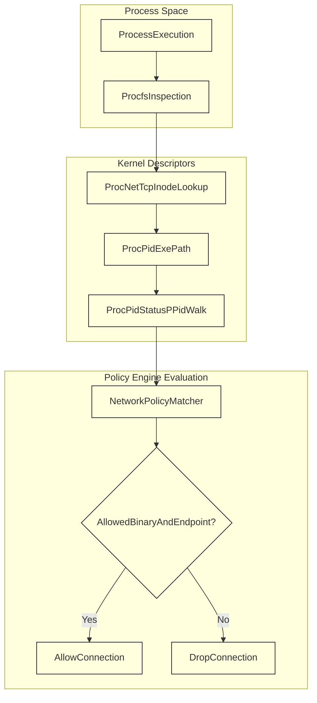
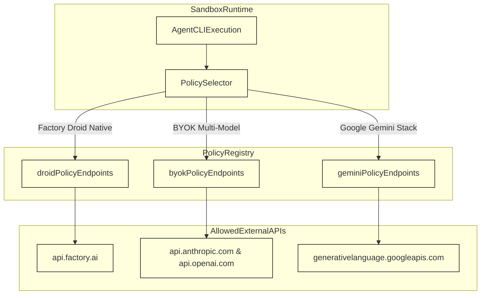

<!-- source: DeepWiki mcp.deepwiki.com · repo NVIDIA/OpenShell-Community · extra page Network Egress Policies by Agent · fetched 2026-10-26 -->

# Network Egress Policies by Agent

Relevant source files

The following files were used as context for generating this wiki page:

- [sandboxes/base/policy.yaml](sandboxes/base/policy.yaml)
- [sandboxes/base/skills/github/SKILL.md](sandboxes/base/skills/github/SKILL.md)
- [sandboxes/droid/Dockerfile](sandboxes/droid/Dockerfile)
- [sandboxes/droid/README.md](sandboxes/droid/README.md)
- [sandboxes/droid/policy.yaml](sandboxes/droid/policy.yaml)
- [sandboxes/gemini/Dockerfile](sandboxes/gemini/Dockerfile)
- [sandboxes/gemini/README.md](sandboxes/gemini/README.md)
- [sandboxes/gemini/policy.yaml](sandboxes/gemini/policy.yaml)
- [sandboxes/ollama/policy.yaml](sandboxes/ollama/policy.yaml)

## Purpose and Scope

This document provides a technical deep dive into the network egress policies defined across OpenShell sandbox environments (`sandboxes/base/policy.yaml`, `sandboxes/droid/policy.yaml`, `sandboxes/gemini/policy.yaml`, and `sandboxes/ollama/policy.yaml`). It covers how named network policies enforce strict layer-7 and transport-layer constraints for specific agent runtimes (`claude_code`, `github_rest_api`, `pypi`, `npm`, `vscode`/`cursor`, and Bring-Your-Own-Key [BYOK] providers). 

Targeting system engineers and security operators, this page outlines how the OpenShell runtime resolves binary identities against process descriptors to authorize outbound TCP and TLS connections.

Sources: [`sandboxes/base/policy.yaml:1-197`](), [`sandboxes/droid/policy.yaml:30-142`](), [`sandboxes/gemini/policy.yaml:30-199`](), [`sandboxes/ollama/policy.yaml:29-136`]()

---

## 1. Policy Engine Architecture and Binary Identity Resolution

OpenShell network policies are declared in `policy.yaml` under the root `network_policies` key. Each named policy maps a collection of authorized network `endpoints` (hosts, ports, protocols, and HTTP routing rules) to authorized process `binaries` (filesystem paths). 

When a sandbox process initiates an outbound network connection, the OpenShell runtime intercepts the connection via container-level network namespacing and proxying. The policy engine performs runtime identity resolution using Linux procfs:
1. **Inode Mapping**: The socket's socket inode is correlated via `/proc/net/tcp` to the owning process ID (`pid`).
2. **Binary Path Resolution**: The executable path is retrieved via `/proc/{pid}/exe`.
3. **Ancestor Walk**: Process ancestry is verified by walking `/proc/{pid}/status` parent process IDs (`PPid`).
4. **Command-Line Verification**: The command line arguments and working directories are validated against permitted paths.
5. **Integrity Enforcement**: SHA256 integrity and trust-on-first-use (TOFU) are enforced by the underlying Rust supervision daemon rather than within the static YAML configuration.

*Figure 1: Network policy enforcement and binary identity resolution flow.*

Sources: [`sandboxes/base/policy.yaml:30-36`](), [`sandboxes/ollama/policy.yaml:29-35`]()

---

## 2. Comparative Analysis of Core Agent Egress Policies

OpenShell base and specialized sandboxes define a modular set of standard network policies. Different agents mount or inherit these policies to restrict outbound traffic to minimal necessary domains.

### 2.1 Claude Code Egress Policy (`claude_code`)
The `claude_code` policy authorizes Anthropic LLM API interaction along with required telemetry and model fallback endpoints. It locks down access strictly to `/usr/local/bin/claude` and `/usr/bin/node`.

* **Endpoints**:
  * `api.anthropic.com` (Port 443, REST protocol, enforced TLS termination, full access) [`sandboxes/base/policy.yaml:38-41`]()
  * `statsig.anthropic.com` (Port 443) [`sandboxes/base/policy.yaml:42-42`]()
  * `sentry.io` (Port 443) [`sandboxes/base/policy.yaml:43-43`]()
  * `raw.githubusercontent.com` (Port 443) [`sandboxes/base/policy.yaml:44-44`]()
  * `platform.claude.com` (Port 443) [`sandboxes/base/policy.yaml:45-45`]()
* **Authorized Binaries**:
  * `/usr/local/bin/claude` [`sandboxes/base/policy.yaml:47-47`]()
  * `/usr/bin/node` [`sandboxes/base/policy.yaml:48-48`]()

Sources: [`sandboxes/base/policy.yaml:37-49`]()

### 2.2 GitHub REST API Policy (`github_rest_api`)
To prevent data exfiltration and restrict abuse of GitHub integrations, the `github_rest_api` policy enforces **read-only** interaction with GitHub's REST endpoints, explicitly disabling GraphQL access (which is often exploited or restricted in sandboxed automation) as documented in agent skill requirements [`sandboxes/base/skills/github/SKILL.md:3-10`]().

* **Endpoints**:
  * `api.github.com` (Port 443, REST protocol, TLS termination, read-only access) [`sandboxes/base/policy.yaml:88-93`]()
* **Authorized Binaries**:
  * `/usr/local/bin/claude` [`sandboxes/base/policy.yaml:95-95`]()
  * `/usr/bin/gh` [`sandboxes/base/policy.yaml:96-96`]()

Sources: [`sandboxes/base/policy.yaml:84-97`](), [`sandboxes/base/skills/github/SKILL.md:1-24`]()

### 2.3 Package Management Egress (`pypi` and `npm`)
Sandboxes requiring dynamic dependency installation include explicit network policies for Python (`pypi`) and Node.js (`npm`) ecosystems.

* **`pypi` Policy**:
  * **Endpoints**: `pypi.org`, `files.pythonhosted.org`, `github.com`, `objects.githubusercontent.com`, `api.github.com`, `downloads.python.org` (all Port 443) to support `uv` python installation workflows and standalone runtime downloads [`sandboxes/base/policy.yaml:122-132`]()
  * **Binaries**: Virtual environment python/pip paths (`/sandbox/.venv/bin/python`, `/app/.venv/bin/python`), `/usr/local/bin/uv`, and managed Python paths (`/sandbox/.uv/python/**`) [`sandboxes/base/policy.yaml:133-143`]()
* **`npm` Policy**:
  * **Endpoints**: `registry.npmjs.org`, `npmjs.org` (Port 443) [`sandboxes/ollama/policy.yaml:69-74`]()
  * **Binaries**: `/usr/bin/npm`, `/usr/bin/node`, `/bin/bash`, `/usr/bin/curl` [`sandboxes/ollama/policy.yaml:75-79`]()

Sources: [`sandboxes/base/policy.yaml:122-143`](), [`sandboxes/ollama/policy.yaml:69-79`]()

### 2.4 IDE Server Egress (`vscode` and `cursor`)
Remote development agents and IDE extensions running inside sandboxes rely on dedicated telemetry, extension marketplace, and server download endpoints.

* **`vscode` Policy**:
  * **Endpoints**: `update.code.visualstudio.com`, `az764295.vo.msecnd.net`, `vscode.download.prss.microsoft.com`, `marketplace.visualstudio.com`, `gallerycdn.vsassets.io` (Port 443) [`sandboxes/base/policy.yaml:144-152`]()
  * **Binaries**: `/usr/bin/curl`, `/usr/bin/wget`, and remote server workspaces (`/sandbox/.vscode-server/**`, `/sandbox/.vscode-remote-containers/**`) [`sandboxes/base/policy.yaml:153-158`]()
* **`cursor` Policy**:
  * **Endpoints**: `cursor.blob.core.windows.net`, `api2.cursor.sh`, `repo.cursor.sh`, `download.cursor.sh`, `cursor.download.prss.microsoft.com` (Port 443) [`sandboxes/base/policy.yaml:159-167`]()
  * **Binaries**: `/usr/bin/curl`, `/usr/bin/wget`, and `/sandbox/.cursor-server/**` [`sandboxes/base/policy.yaml:168-172`]()

Sources: [`sandboxes/base/policy.yaml:144-172`]()

---

## 3. Bring-Your-Own-Key (BYOK) and Alternative Model Providers

Specialized sandbox images such as Factory Droid (`sandboxes/droid/policy.yaml`) and Gemini CLI (`sandboxes/gemini/policy.yaml`) incorporate provider-specific infrastructures alongside BYOK routing policies.

*Figure 2: Agent-specific policy selection routing across native and BYOK endpoints.*

### 3.1 Factory Droid and BYOK Policies (`droid` and `droid_byok`)
The Factory Droid sandbox splits traffic between core telemetry/relay infrastructure (`droid`) and direct multi-model inference providers (`droid_byok`).

* **`droid` Policy**:
  * Enforces connectivity to `api.factory.ai`, `app.factory.ai`, `api.workos.com`, `relay.factory.ai`, `downloads.factory.ai`, `docs.factory.ai`, `*.run.app`, and Sentry ingest endpoints [`sandboxes/droid/policy.yaml:40-59`]()
* **`droid_byok` Policy**:
  * Allows users supplying their own API keys to communicate directly with alternative upstream inference gateways: `api.anthropic.com`, `api.openai.com`, `generativelanguage.googleapis.com`, `*.googleapis.com`, `api.groq.com`, `api.fireworks.ai`, `api.deepinfra.com`, `openrouter.ai`, and `api-inference.huggingface.co` [`sandboxes/droid/policy.yaml:65-78`]()

Sources: [`sandboxes/droid/policy.yaml:37-82`]()

### 3.2 Google Gemini Policy (`gemini`)
The Gemini CLI sandbox configures strict Google Cloud AI platform egress rules to enable authentication, metadata discovery, and model inference.

* **Endpoints**:
  * `generativelanguage.googleapis.com` (Port 443) [`sandboxes/gemini/policy.yaml:188-188`]()
  * `*-aiplatform.googleapis.com` (Port 443) [`sandboxes/gemini/policy.yaml:189-189`]()
  * `cloudcode-pa.googleapis.com` (Port 443) [`sandboxes/gemini/policy.yaml:190-190`]()
  * `accounts.google.com`, `oauth2.googleapis.com`, `www.googleapis.com`, `iamcredentials.googleapis.com` (Port 443) [`sandboxes/gemini/policy.yaml:191-194`]()
* **Authorized Binaries**:
  * `/usr/bin/gemini` [`sandboxes/gemini/policy.yaml:196-196`]()
  * `/usr/lib/node_modules/@google/gemini-cli/dist/index.js` [`sandboxes/gemini/policy.yaml:197-197`]()
  * `/usr/bin/node` [`sandboxes/gemini/policy.yaml:198-198`]()

Sources: [`sandboxes/gemini/policy.yaml:185-199`]()

---

## 4. Policy Configuration Summary Table

The following table summarizes the primary named network egress policies, their target binaries, and core permitted endpoints across the OpenShell community catalog:

| Policy Name | Target Sandbox(es) | Key Authorized Binaries | Representative Endpoints |
| :--- | :--- | :--- | :--- |
| `claude_code` | Base, Ollama, Gemini | `/usr/local/bin/claude`, `/usr/bin/node` | `api.anthropic.com`, `statsig.anthropic.com`, `sentry.io` |
| `github_rest_api` | Base, Ollama, Droid, Gemini | `/usr/bin/gh`, `/usr/local/bin/claude` | `api.github.com` (REST subset) |
| `pypi` | Base, Droid, Gemini | `/sandbox/.venv/bin/python`, `/usr/local/bin/uv` | `pypi.org`, `files.pythonhosted.org`, `downloads.python.org` |
| `npm` | Ollama, Droid | `/usr/bin/npm`, `/usr/bin/node`, `/usr/bin/curl` | `registry.npmjs.org` |
| `vscode` / `cursor` | Base, Gemini | `/usr/bin/curl`, `/sandbox/.vscode-server/**` | `update.code.visualstudio.com`, `api2.cursor.sh` |
| `droid_byok` | Droid | `/usr/bin/droid`, `/usr/bin/node` | `api.openai.com`, `openrouter.ai`, `api.groq.com` |
| `gemini` | Gemini | `/usr/bin/gemini`, `/usr/bin/node` | `generativelanguage.googleapis.com`, `accounts.google.com` |

Sources: [`sandboxes/base/policy.yaml:37-172`](), [`sandboxes/droid/policy.yaml:40-82`](), [`sandboxes/gemini/policy.yaml:38-199`](), [`sandboxes/ollama/policy.yaml:37-120`]()

---

