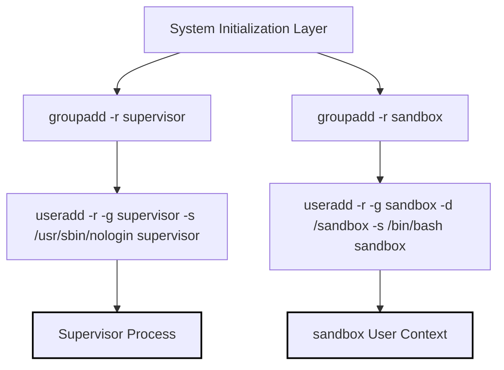
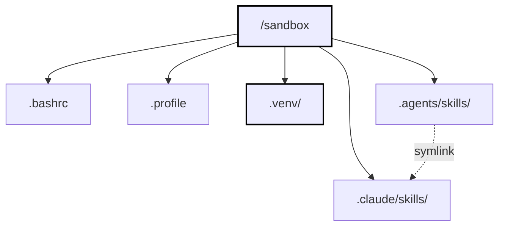
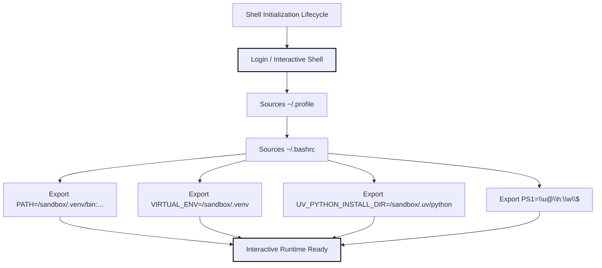

<!-- source: DeepWiki mcp.deepwiki.com · repo NVIDIA/OpenShell-Community · extra page Users, Filesystem Layout and Shell Environment · fetched 2026-10-26 -->

# Users, Filesystem Layout and Shell Environment

<details>
<summary>Relevant source files</summary>

The following files were used as context for generating this wiki page:

- [sandboxes/base/Dockerfile](sandboxes/base/Dockerfile)
- [sandboxes/base/README.md](sandboxes/base/README.md)

</details>


This page details the user privilege model, directory structure, Python virtual environment configuration, and shell environment initialization used across the OpenShell Community base sandbox image. These components provide a secure, isolated, and reproducible execution context for AI coding agents and developer workflows.

---

## 1. User and Privilege Separation (`supervisor` vs `sandbox`)

The base sandbox image defines two distinct system users to enforce security boundaries between container management tasks and agent execution workloads:

*   **`supervisor`**: A privileged system user (`-r -g supervisor`) configured with a non-login shell (`/usr/sbin/nologin`). This user is utilized by the OpenShell core runtime to manage container processes, monitor health, and handle lifecycle operations without exposing an interactive shell.
*   **`sandbox`**: An unprivileged user (`-r -g sandbox`) with home directory `/sandbox` and a standard bash shell (`/bin/bash`). All interactive agent workloads, shell sessions, and tool executions run under the security context of this user.

User and group initialization is executed during the system setup stage:

```dockerfile
groupadd -r supervisor && useradd -r -g supervisor -s /usr/sbin/nologin supervisor && \
groupadd -r sandbox && useradd -r -g sandbox -d /sandbox -s /bin/bash sandbox
```[sandboxes/base/Dockerfile:43-46]()

### User Privilege Mapping

| User | Group | Default Shell | Home Directory | Role |
| :--- | :--- | :--- | :--- | :--- |
| `supervisor` | `supervisor` | `/usr/sbin/nologin` | N/A | Process management and runtime supervision |
| `sandbox` | `sandbox` | `/bin/bash` | `/sandbox` | Unprivileged agent workload execution |


*Sources: [sandboxes/base/Dockerfile:43-46](), [sandboxes/base/README.md:16-22]*

---

## 2. Filesystem Layout (`/sandbox`)

The working directory and home directory for the unprivileged `sandbox` user is set to `/sandbox` [sandboxes/base/Dockerfile:20](), [sandboxes/base/Dockerfile:45](). The filesystem layout is structured to support writable user packages, persistent shell configurations, and multi-agent skill discovery mechanisms.

### Directory Structure Tree

```text
/sandbox/                  # Home directory (sandbox user)
  ├── .bashrc              # Shell initialization and PATH definitions
  ├── .profile             # Sources .bashrc for login shells
  ├── .venv/               # Writable Python venv (pip install, uv pip install)
  ├── .agents/skills/      # Centralized agent skill storage
  └── .claude/skills/      # Symlinked skills for Claude CLI discovery
```[sandboxes/base/README.md:25-31]()

During the container build process, the virtual environment, configuration files, and skill directories are explicitly assigned ownership to the `sandbox` user to ensure write permissions during runtime:

```dockerfile
chown -R sandbox:sandbox /sandbox/.venv && \
chown sandbox:sandbox /sandbox/.bashrc /sandbox/.profile && \
chown -R sandbox:sandbox /sandbox/.claude /sandbox/.agents /sandbox
```[sandboxes/base/Dockerfile:131-145]()


*Sources: [sandboxes/base/Dockerfile:20](), [sandboxes/base/Dockerfile:123-145](), [sandboxes/base/README.md:23-31]*

---

## 3. Python Environment and Package Management (`.venv`, `uv`)

Python package management is handled entirely by `uv` (Astral's fast Python package installer) [sandboxes/base/Dockerfile:27](), [sandboxes/base/Dockerfile:95-96](). System Python packages are avoided in favor of an isolated virtual environment located at `/sandbox/.venv` [sandboxes/base/Dockerfile:107](), [sandboxes/base/Dockerfile:128]().

### Python Toolchain Flow
1. **Python Installation**: `uv` installs Python 3.14.3 into a controlled directory (`UV_PYTHON_INSTALL_DIR="/sandbox/.uv/python"`) [sandboxes/base/Dockerfile:98-99]().
2. **Virtual Environment Creation**: A clean virtual environment is initialized with seed packages and `cloudpickle` [sandboxes/base/Dockerfile:128-129]():
   ```bash
   uv venv --python 3.14.3 --seed /sandbox/.venv
   uv pip install --python /sandbox/.venv/bin/python cloudpickle
   ```
3. **User Modifiability**: Because `/sandbox/.venv` resides inside the user home directory and is owned by `sandbox`, agents and users can execute `uv pip install` or `pip install` dynamically without requiring root privileges or modifying system-level layers [sandboxes/base/Dockerfile:125-131]().

*Sources: [sandboxes/base/Dockerfile:27](), [sandboxes/base/Dockerfile:95-103](), [sandboxes/base/Dockerfile:125-131]*

---

## 4. Shell Environment (`PATH`, `.bashrc`, `.profile`)

To guarantee that interactive and non-interactive shell executions (such as those invoked by SSH, remote IDE extensions, or agent execution harnesses) receive a consistent environment, critical path variables and environment settings are exported directly in `/sandbox/.bashrc` [sandboxes/base/Dockerfile:109-110](), [sandboxes/base/Dockerfile:132-137]().

### Environment Variables

*   `PATH`: Prioritizes the local virtual environment binary directory over system paths:
    `"/sandbox/.venv/bin:/usr/local/bin:/usr/bin:/bin"` [sandboxes/base/Dockerfile:111]()
*   `VIRTUAL_ENV`: Points to `/sandbox/.venv` [sandboxes/base/Dockerfile:112]()
*   `UV_PYTHON_INSTALL_DIR`: Set to `/sandbox/.uv/python` [sandboxes/base/Dockerfile:98]()
*   `PS1`: Configured explicitly as `"\\u@\\h:\\w\\$ "` [sandboxes/base/Dockerfile:136]()

### Shell Initialization Files

The base image generates `.bashrc` and `.profile` during the final build step [sandboxes/base/Dockerfile:136-139]():

```bash
printf 'export PATH="/sandbox/.venv/bin:/usr/local/bin:/usr/bin:/bin"\nexport VIRTUAL_ENV="/sandbox/.venv"\nexport UV_PYTHON_INSTALL_DIR="/sandbox/.uv/python"\nexport PS1="\\u@\\h:\\w\\$ "\n' \
    > /sandbox/.bashrc && \
printf '[ -f ~/.bashrc ] && . ~/.bashrc\n' > /sandbox/.profile
```[sandboxes/base/Dockerfile:136-138]()


*Sources: [sandboxes/base/Dockerfile:107-112](), [sandboxes/base/Dockerfile:136-139]*

---

