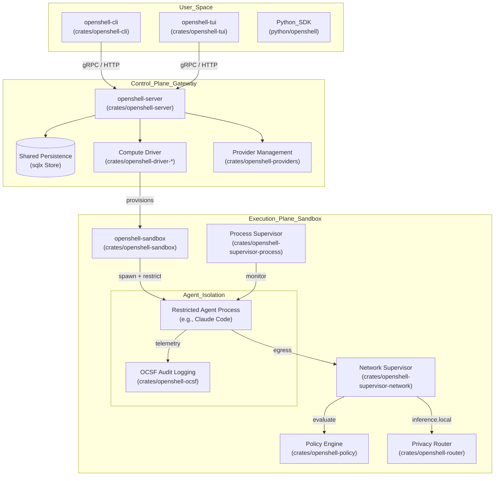
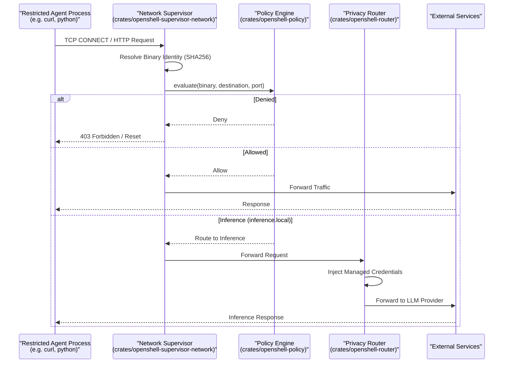

<!-- source: DeepWiki mcp.deepwiki.com · repo NVIDIA/OpenShell · page 1 OpenShell Overview · fetched 2026-10-26 -->

# OpenShell Overview

Relevant source files

The following files were used as context for generating this wiki page:

- [.agents/skills/build-from-issue/SKILL.md](.agents/skills/build-from-issue/SKILL.md)
- [.agents/skills/create-github-issue/SKILL.md](.agents/skills/create-github-issue/SKILL.md)
- [.agents/skills/create-github-pr/SKILL.md](.agents/skills/create-github-pr/SKILL.md)
- [.agents/skills/create-spike/SKILL.md](.agents/skills/create-spike/SKILL.md)
- [.agents/skills/fix-security-issue/SKILL.md](.agents/skills/fix-security-issue/SKILL.md)
- [.agents/skills/review-security-issue/SKILL.md](.agents/skills/review-security-issue/SKILL.md)
- [.agents/skills/sync-agent-infra/SKILL.md](.agents/skills/sync-agent-infra/SKILL.md)
- [.agents/skills/triage-issue/SKILL.md](.agents/skills/triage-issue/SKILL.md)
- [.github/ISSUE_TEMPLATE/bug_report.yml](.github/ISSUE_TEMPLATE/bug_report.yml)
- [.github/ISSUE_TEMPLATE/feature_request.yml](.github/ISSUE_TEMPLATE/feature_request.yml)
- [.github/PULL_REQUEST_TEMPLATE.md](.github/PULL_REQUEST_TEMPLATE.md)
- [AGENTS.md](AGENTS.md)
- [CONTRIBUTING.md](CONTRIBUTING.md)
- [README.md](README.md)
- [docs/about/architecture.mdx](docs/about/architecture.mdx)
- [docs/extensibility/gateway-interceptors.mdx](docs/extensibility/gateway-interceptors.mdx)
- [docs/extensibility/overview.mdx](docs/extensibility/overview.mdx)
- [docs/extensibility/supervisor-middleware/configure.mdx](docs/extensibility/supervisor-middleware/configure.mdx)
- [docs/extensibility/supervisor-middleware/index.mdx](docs/extensibility/supervisor-middleware/index.mdx)
- [docs/images/openshell-extension-points.svg](docs/images/openshell-extension-points.svg)
- [docs/images/openshell-isolation-backend.svg](docs/images/openshell-isolation-backend.svg)
- [docs/images/openshell-kubernetes-runtime.svg](docs/images/openshell-kubernetes-runtime.svg)
- [docs/images/openshell-sandbox-authentication.svg](docs/images/openshell-sandbox-authentication.svg)
- [docs/images/openshell-sandbox-enforcement.svg](docs/images/openshell-sandbox-enforcement.svg)
- [docs/images/openshell-system-architecture.svg](docs/images/openshell-system-architecture.svg)
- [telemetry/2026-07-08.md](telemetry/2026-07-08.md)
- [telemetry/2026-07-26.md](telemetry/2026-07-26.md)
- [telemetry/2026-08-10.md](telemetry/2026-08-10.md)
- [telemetry/README.md](telemetry/README.md)

OpenShell is the safe, private runtime for autonomous AI agents. It provides isolated execution environments that protect data, credentials, and infrastructure—governed by declarative YAML policies that prevent unauthorized file access, data exfiltration, and uncontrolled network activity [README.md:17-18]().

This page introduces the core architecture, components, and the "agent-first" philosophy that drives the project's development.

---

## Core Architecture

OpenShell is built around a secure runtime stack for AI agents, designed to provide rich capabilities such as file access, package installation, API calls, and credential use without compromising security or privacy. It achieves this through a multi-layered enforcement model that controls every system call, file access, and network connection at the kernel level, combined with formal policy verification before making any policy changes [README.md:19-26]().

The architecture is centered on a **Gateway / Supervisor / Sandbox** model:

- **Gateway**: The authenticated control-plane server that manages sandbox lifecycles, policies, and access credentials.
- **Supervisor**: The local sandbox-side component that enforces process identity, monitors system calls, and mediates network and process activity inside the sandbox.
- **Sandbox**: The restricted runtime environment where the agent processes execute with strictly limited capabilities.

This clearly separated structure ensures strong confinement and defense-in-depth: even if the sandboxed agent is compromised, the gateway and host environment remain protected [AGENTS.md:20-30]().

### Component Topology and Code Mapping

The diagram below maps OpenShell's natural system components to their corresponding codebase crates and directories. This bridging clarifies how the user-facing and internal subsystems correspond to concrete code entities for navigation and understanding.

**Diagram: OpenShell Component Topology and Code Mapping**

**Sources:** [AGENTS.md:37-70](), [README.md:93](), [crates/openshell-server/src/lib.rs:26-58]()

---

## Key Components

### 1. Gateway (`openshell-server`)

The gateway is the centralized control-plane API responsible for orchestrating sandboxes, enforcing policies, authenticating clients, and managing lifecycle states.

- **Durable State Management:** Holds records of sandboxes, policies, provider credentials, and runtime settings in a shared persistence layer backed by a `Store` abstraction supporting both SQLite and Postgres [crates/openshell-server/src/lib.rs:40-58]().
- **Compute Drivers:** Integrates various drivers for sandbox provisioning and lifecycle management, including Docker, Podman, Kubernetes, and VM-based runtimes. Drivers are registered and selected dynamically within the gateway environment [crates/openshell-core/src/config.rs:120-134](), [crates/openshell-server/src/lib.rs:12-24]().
- **Network Protocol Multiplexing:** Listens on a single service port, multiplexing gRPC and HTTP traffic using an in-house multiplex module for efficient API handling [crates/openshell-server/src/lib.rs:25-38]().
- **Authentication & Authorization:** Implements mTLS and OIDC client validation, issues JWT tokens for authorized sandbox sessions, and enforces access control on gateway RPCs [README.md:93]().

---

### 2. Sandbox Supervisor (`openshell-sandbox`)

A critical defense boundary within each sandbox:

- **Process Execution & Restriction:** Launches agent workloads ("restricted agent processes") under stringent security controls that enforce isolation primitives such as Landlock and seccomp at the kernel level, dropping all unnecessary privileges before agent execution [README.md:93]().
- **Policy Enforcement:** Implements runtime policy checks on file access, system calls, and network egress bound to the identity of executables, enabling nuanced least-privilege rules (e.g., restricting `curl` differently from `python`) [AGENTS.md:41]().
- **Gateway Coordination:** Connects back to the gateway for configuration, policy updates, and bi-directional streaming of logs and telemetry [architecture/gateway.md:58-67]().

---

### 3. Privacy Router (`openshell-router`)

Specialized for inference calls to `https://inference.local`:

- **Credential Injection & Routing:** Strips any direct credentials from agent requests and injects gateway-managed provider credentials when forwarding calls to external LLM endpoints, preserving privacy and policy compliance [README.md:93]().
- **Traffic Rerouting:** Provides transparent forwarding for inference API traffic while ensuring policy checks on destinations and endpoints [README.md:93,93]().

---

## Protection Layers

OpenShell enforces policy in four primary domains, each managed by specialized subcomponents that provide defense in depth:

| Layer         | Enforcement Component                | Purpose                            | Enforcement Model           |
|---------------|------------------------------------|----------------------------------|----------------------------|
| **Filesystem**| `openshell-supervisor-process`     | Prevent unauthorized file access | Static (sandbox creation)  |
| **Network**   | `openshell-supervisor-network`     | Enforce outbound network controls | Dynamic (hot reload)       |
| **Process**   | `openshell-supervisor-process`     | Control system call & process behavior | Static (sandbox creation)  |
| **Inference** | `openshell-router`                  | Reroute inference calls, inject creds | Dynamic (hot reload)       |

Each layer ensures that agents run with minimal access necessary, and that attempts to escalate privileges or exfiltrate data are blocked in real time [README.md:93](), [AGENTS.md:68-69]().

---

## Data Flow: Request Enforcement and Inference Routing

This sequence diagram models how an agent's outgoing network request is intercepted, evaluated for policy compliance, and then forwarded or denied. It highlights the major runtime components involved in real-time enforcement.

**Diagram: Request Enforcement and Inference Routing Flow**

**Sources:** [README.md:93](), [AGENTS.md:68-69](), [architecture/gateway.md:19-21]()

---

## Repository Layout

OpenShell's repository is organized to separate components, APIs, tools, and documentation clearly:

| Directory         | Description                                            |
|-------------------|--------------------------------------------------------|
| `crates/`         | Core Rust crates constituting the main OpenShell system, including gateway server, sandbox runtime, supervisor, drivers, policy engine, SDK, telemetry, and extensions [AGENTS.md:27-58]() |
| `proto/`          | Protobuf service and message definitions for gRPC APIs — gateway, sandbox, compute driver, inference, and supervisor middleware interfaces [AGENTS.md:64]() |
| `deploy/`         | Dockerfiles, Kubernetes manifests, Helm charts, and related deployment scripts for production and development environments |
| `sdk/`            | Language SDK implementations for Go, TypeScript, and Rust clients providing access to OpenShell APIs [README.md:69-71]() |
| `python/openshell`| Python SDK packaging and CLI wrappers [README.md:68]() |
| `e2e/`            | End-to-end integration test suites exercising gateway, sandbox, policy, and driver functionality |
| `tests/`          | Unit and integration tests across crates |
| `examples/`       | Sample policies, sandbox setups, and agent workflows illustrating concepts and advanced usage |
| `providers/`      | Credential provider implementations and YAML registries managing cloud credentials and API tokens |
| `telemetry/`      | Telemetry collection code and usage reporting supporting anonymous operational data to improve the project [README.md:83-85]() |

This modular structure supports the agent-first development model, enabling independent development, testing, and deployment of components.

**Sources:** [README.md:66-71](), [AGENTS.md:27-70]()

---

## Development Philosophy: Agent-First

OpenShell embraces an **agent-first** development approach: the project is built using autonomous AI agents to design, implement, and maintain the codebase, while human maintainers guide product direction and review [CONTRIBUTING.md:3]().

Key elements of this approach include:

- **Agent Skills:** Predefined agent workflows (`skills/` for public, `.agents/skills/` for contributors) automate tasks like triaging issues, debugging gateways, managing sandboxes, and helping with PR workflows.
- **Vouch System:** To maintain quality control amid AI-generated contributions, first-time contributors must be vouched by maintainers before their PRs are accepted [CONTRIBUTING.md:23-31]().
- **Workflow Chains:** Standardized sequences—for example, triage → spike → build-from-issue—systematically handle issue intake and code production.
- **Observability:** Optional anonymous telemetry collects aggregate operational data devoid of sensitive details, helping the community and maintainers improve security and usability [README.md:83-85]().

This rigorous, reproducible process ensures contributions are safe, high quality, and aligned with the overall vision.

**Sources:** [CONTRIBUTING.md:3-31](), [AGENTS.md:20-32](), [README.md:83-85]()

---

## Next Steps

Explore deeper into OpenShell through the following detailed areas:

- **Getting Started:** Installation, first sandbox setup, and system requirements.
- **Core Concepts:** Sandboxes, gateways, policies, and providers.
- **CLI Reference:** Comprehensive command-line interface usage.
- **Gateway Architecture & Deployment:** Server internals, configuration, authentication, and Kubernetes deployment.
- **Sandbox System:** Supervisor processes, isolation enforcement, and networking.
- **Policy System:** Language, enforcement, validation, and formal verification.
- **Compute Drivers:** Container, Kubernetes, VM, and Windows support.
- **APIs, SDKs, and Extensibility:** gRPC interfaces, SDK clients, extensions.
- **Advanced Features and Examples:** Inference routing, GPU support, and tutorials.
- **Development & Contributing:** Environment setup, workflows, and contribution guidelines.
- **Testing & Quality:** Testing strategy and suites.
- **Build & Release System:** CI/CD pipelines and versioning.
- **Glossary:** Terminology and concepts clearly defined.

Links to these topics are provided in the broader wiki and documentation structure.

---

This overview grounds users and contributors in OpenShell’s purpose, architecture, and code layout, enabling efficient navigation and understanding of this secure AI agent runtime system.

**Sources:** [README.md](), [AGENTS.md](), [CONTRIBUTING.md](), [crates/openshell-server/src/lib.rs]()

---

