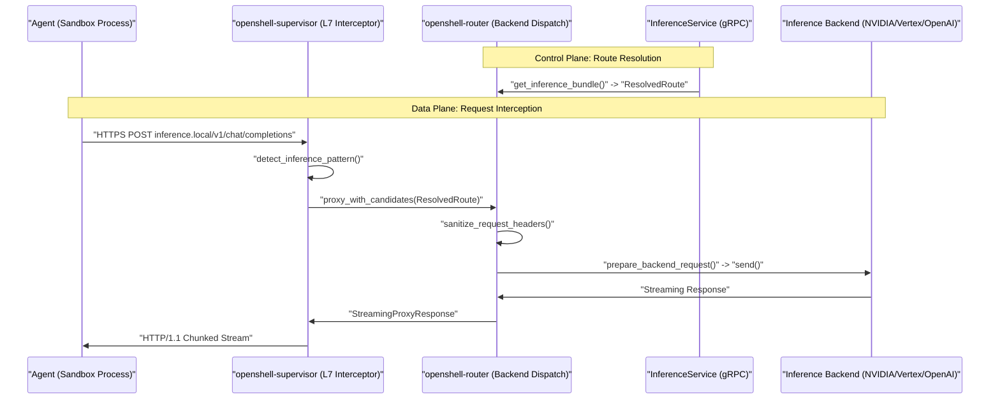

<!-- source: DeepWiki mcp.deepwiki.com · repo NVIDIA/OpenShell · page 10 Advanced Features and Examples · fetched 2026-10-26 -->

# Advanced Features and Examples

Relevant source files

The following files were used as context for generating this wiki page:

- [docs/about/overview.mdx](docs/about/overview.mdx)
- [docs/extensibility/drivers.mdx](docs/extensibility/drivers.mdx)
- [docs/extensibility/isolation-backends.mdx](docs/extensibility/isolation-backends.mdx)
- [docs/how-it-works/inference.mdx](docs/how-it-works/inference.mdx)
- [docs/how-it-works/policies/default-policy.mdx](docs/how-it-works/policies/default-policy.mdx)
- [docs/how-it-works/policies/overview.mdx](docs/how-it-works/policies/overview.mdx)
- [docs/how-it-works/providers/profiles.mdx](docs/how-it-works/providers/profiles.mdx)
- [docs/index.mdx](docs/index.mdx)
- [docs/index.yml](docs/index.yml)
- [docs/kubernetes/ingress.mdx](docs/kubernetes/ingress.mdx)
- [docs/security/best-practices.mdx](docs/security/best-practices.mdx)

This page documents OpenShell's advanced capabilities that extend beyond basic sandbox creation and policy enforcement. These features enable specialized workflows including inference routing, file synchronization, GPU acceleration, community-driven environments, and the experimental VM runtime.

## Overview

OpenShell provides nine categories of advanced features:

| Feature | Purpose | Primary Interface |
|---------|---------|-------------------|
| **Inference Routing** | Privacy-aware LLM API interception via `inference.local`. | `openshell inference set` |
| **File Synchronization** | Bidirectional file transfer and automatic workspace syncing. | `openshell sandbox upload/download` |
| **GPU Support** | Hardware acceleration for local inference and compute workloads. | `--gpu` flag on sandbox create |
| **Custom and Community Sandbox Images** | Pre-built agent environments and custom container support (BYOC). | `--from` flag on sandbox create |
| **Examples & Tutorials** | Reference implementations for complex agent workflows. | `examples/` directory |
| **Cloud Provider Integrations** | Native support for AWS SigV4, Google Vertex AI, and Azure. | `openshell provider create` |
| **Agent Launcher System** | Manifest-driven agent deployment and lifecycle. | `scripts/agents/run.sh` |

Sources: [docs/how-it-works/inference.mdx:11-24]()

---

## Inference Routing (inference.local)

OpenShell provides transparent inference routing, allowing sandboxed processes to interact with LLM providers without directly handling credentials. This is achieved through a special internal endpoint, `inference.local`, which intercepts and mediates LLM API calls. For details, see [Inference Routing (inference.local)](#10.1).

### Inference Routing Architecture

Title: Inference Interception and Routing Flow

The `openshell-supervisor` acts as an L7 interceptor, detecting inference patterns and forwarding them to the `openshell-router`. The router then sanitizes requests, injects credentials from the gateway's provider store, and dispatches them to the appropriate remote inference backend. This process supports various protocols like OpenAI Chat Completions, Anthropic Messages, and Vertex AI.

Sources: [docs/how-it-works/inference.mdx:11-24]()

---

## File Sync, Port Forwarding and Services

OpenShell provides robust mechanisms for interacting with the sandbox filesystem and network. This includes bidirectional file transfer, automatic workspace synchronization, and TCP port forwarding for accessing services running inside the sandbox. For details, see [File Sync, Port Forwarding and Services](#10.2).

### Sync Capabilities
*   **Manual Transfer**: Use `openshell sandbox upload` and `openshell sandbox download` commands to move specific directories or files between the host and sandbox.
*   **Automatic Workspace Sync**: The `--sync` flag on `openshell sandbox create` automatically streams local workspace files into the new sandbox using a tar-over-SSH mechanism.
*   **Port Forwarding**: TCP port forwarding allows host applications to connect to services running within the sandbox.

Sources: [docs/how-it-works/providers/profiles.mdx:28-29]()

---

## GPU Support

OpenShell enables GPU-accelerated workloads within sandboxes by integrating with the NVIDIA Container Toolkit and the Kubernetes RuntimeClass system. This allows agents to leverage powerful hardware for tasks like local inference and compute-intensive operations. For details, see [GPU Support](#10.3).

### GPU Orchestration
When GPU support is requested during sandbox creation (e.g., via the `--gpu` flag), OpenShell performs the following:
1.  **Driver Detection**: Validates the presence of NVIDIA drivers and the container toolkit on the host.
2.  **Resource Allocation**: Configures the compute driver (Docker, Podman, or Kubernetes) to expose GPU devices to the sandbox container.
3.  **Filesystem Enrichment**: For GPU-enabled sandboxes, additional read-only and read-write paths related to NVIDIA drivers and CUDA are added to the sandbox's filesystem policy at runtime. For example, `/dev/nvidiactl`, `/dev/nvidia-uvm`, and numbered `/dev/nvidia<N>` device nodes are granted read-write access.
4.  **VM Support**: For VM-backed sandboxes, VFIO passthrough can be used, which requires host IOMMU support and root privileges.

Sources: [docs/how-it-works/policies/default-policy.mdx:89-102]()

---

## Custom and Community Sandbox Images

OpenShell supports using custom and community-provided container images for sandboxes, allowing users to bring their own environments (BYOC - Bring Your Own Container) or leverage pre-built images tailored for specific agent workflows. For details, see [Custom and Community Sandbox Images](#10.4).

### Image Resolution and Customization
*   **BYOC Support**: The `--from` flag on `openshell sandbox create` allows users to specify any Docker-compatible image from a registry.
*   **Image Resolution**: OpenShell resolves image names to their full registry paths.
*   **Custom Image E2E Coverage**: The system ensures that custom images can be used end-to-end, including policy application and credential injection.

---

## Examples and Tutorials

The `examples/` directory within the OpenShell codebase provides a rich set of demonstrations and tutorials for various advanced features and common use cases. These examples serve as practical guides for implementing complex agent workflows. For details, see [Examples and Tutorials](#10.5).

### Key Examples
*   **Policy Quickstart**: Demonstrates how to define and apply basic policies.
*   **Multi-Agent Notepad**: An example showcasing collaboration between multiple agents within sandboxes.
*   **Jupyter Sandbox**: Setting up a Jupyter environment within a secure sandbox.
*   **Agent-Driven Policy Management**: Examples of agents proposing and managing policy changes.
*   **Local Inference**: Demonstrations of running inference locally within a sandbox.
*   **SPIFFE Token Grant/Exchange**: Examples of secure identity and credential exchange using SPIFFE.
*   **Transparent TCP Redis**: Demonstrates transparent network mediation for services like Redis.
*   **Policy Advisor CTF**: A Capture The Flag (CTF) exercise to explore the Policy Advisor's capabilities.

Sources: [docs/how-it-works/policies/overview.mdx:99-102](), [docs/how-it-works/inference.mdx:98-102]()

---

## Cloud Provider Integrations

OpenShell provides deep integration with major cloud providers, enabling secure credential injection and routing for services like LLMs, object storage, and compute. This includes support for AWS, Google Cloud, and a flexible YAML registry for provider definitions. For details, see [Cloud Provider Integrations](#10.6).

### Native Integrations
*   **AWS SigV4 Signing**: Support for AWS Signature Version 4 for services like Bedrock and S3, ensuring secure authentication.
*   **Google Cloud Credential Injection**: Integration with Google Cloud for credential management and metadata injection, including Vertex AI routing.
*   **`providers/` YAML Registry**: A declarative system for defining provider profiles, including credentials, endpoints, and policy rules. These profiles can be imported and managed via `openshell profile` commands.

Sources: [docs/how-it-works/providers/profiles.mdx:10-27](), [docs/how-it-works/inference.mdx:25-27]()

---

## Agent Launcher System (scripts/agents)

The `scripts/agents` directory houses a manifest-driven system for launching and managing AI agents within OpenShell sandboxes. This system simplifies the deployment and lifecycle management of agents. For details, see [Agent Launcher System (scripts/agents)](#10.7).

### Core Components
*   **`agent.yaml`**: A declarative manifest file that defines the agent's requirements, environment variables, and startup commands.
*   **`run.sh`**: A unified launcher script that orchestrates sandbox creation, provider injection, and agent execution based on the `agent.yaml` manifest.
*   **Runtime Harnesses**: Scripts and configurations that provide the necessary environment for agents to run.
*   **Run Modes**: Different modes of operation for agents, such as interactive or automated.
*   **Gator Review Agent**: A reference agent implementation that demonstrates automated code review capabilities.

Sources: [docs/extensibility/drivers.mdx:28-33]()

---

