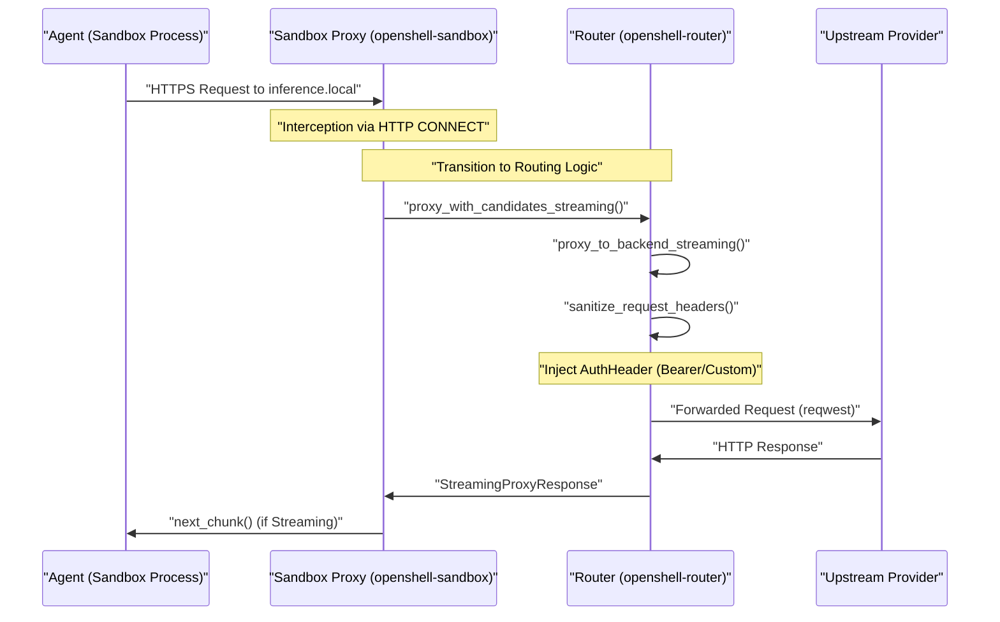
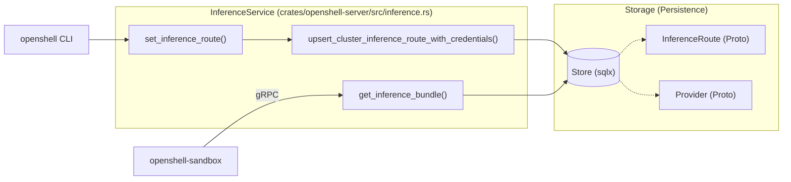

<!-- source: DeepWiki mcp.deepwiki.com · repo NVIDIA/OpenShell · page 10.1 Inference Routing (inference.local) · fetched 2026-10-26 -->

# Inference Routing (inference.local)

Relevant source files

The following files were used as context for generating this wiki page:

- [docs/about/overview.mdx](docs/about/overview.mdx)
- [docs/extensibility/drivers.mdx](docs/extensibility/drivers.mdx)
- [docs/extensibility/isolation-backends.mdx](docs/extensibility/isolation-backends.mdx)
- [docs/how-it-works/inference.mdx](docs/how-it-works/inference.mdx)
- [docs/how-it-works/policies/default-policy.mdx](docs/how-it-works/policies/default-policy.mdx)
- [docs/how-it-works/policies/overview.mdx](docs/how-it-works/policies/overview.mdx)
- [docs/how-it-works/providers/profiles.mdx](docs/how-it-works/providers/profiles.mdx)
- [docs/index.mdx](docs/index.mdx)
- [docs/index.yml](docs/index.yml)
- [docs/kubernetes/ingress.mdx](docs/kubernetes/ingress.mdx)
- [docs/security/best-practices.mdx](docs/security/best-practices.mdx)
- [examples/jupyter-sandbox/README.md](examples/jupyter-sandbox/README.md)
- [examples/jupyter-sandbox/demo.ipynb](examples/jupyter-sandbox/demo.ipynb)
- [examples/jupyter-sandbox/policy.yaml](examples/jupyter-sandbox/policy.yaml)

This document explains OpenShell's transparent inference interception system, which allows sandboxed processes to send inference API requests to a special virtual hostname (`inference.local`) that is automatically routed to configured backend providers. This enables sandboxes to access LLM inference services without exposing real API credentials or endpoints.

For general network policy enforcement, see [L4 and L7 Enforcement (7.4)](). For application-layer inspection of regular HTTPS traffic, see [HTTP CONNECT Proxy and L7 Inspection (6.5)]().

## Purpose and Architecture

The inference routing subsystem provides a local, privacy-preserving interface for LLM inference APIs inside sandboxed environments. Instead of hardcoding real provider endpoints and credentials, sandboxed code sends requests to `https://inference.local/v1/chat/completions` (or other standard paths). The sandbox proxy intercepts these connections, strips user-provided credentials, detects the inference protocol, and forwards requests to a configured backend with injected provider credentials.

**Key components:**

| Component | Location | Purpose |
|-----------|----------|---------|
| `inference.local` virtual host | `crates/openshell-server/src/inference.rs` | Hardcoded canonical name for the managed inference route [crates/openshell-server/src/inference.rs:43-43]() |
| `InferenceService` | `crates/openshell-server/src/inference.rs` | Gateway control plane for managing routes [crates/openshell-server/src/inference.rs:33-35]() |
| `InferenceProviderProfile` | `crates/openshell-core/src/inference.rs` | Registry of provider-specific API shapes and auth styles [crates/openshell-core/src/inference.rs:46-62]() |
| `openshell-router` crate | `crates/openshell-router/src/` | Data plane logic for request transformation and forwarding [crates/openshell-router/src/lib.rs:33-36]() |

Sources: [crates/openshell-server/src/inference.rs:33-43](), [crates/openshell-core/src/inference.rs:46-62](), [crates/openshell-router/src/lib.rs:33-36]()

## Interception and Detection

Requests targeting `inference.local` are intercepted by the sandbox proxy. The system uses pattern matching to identify the specific inference protocol being used.

### Detection Patterns
The system matches incoming HTTP requests against a list of known API shapes. [crates/openshell-supervisor-network/src/l7/inference.rs:64-141]()

| Protocol | Method | Path | Response Framing |
|----------|--------|-----------|------------------|
| `openai_chat_completions` | POST | `/v1/chat/completions` | Streaming [crates/openshell-supervisor-network/src/l7/inference.rs:66-72]() |
| `openai_completions` | POST | `/v1/completions` | Streaming [crates/openshell-supervisor-network/src/l7/inference.rs:73-79]() |
| `openai_responses` | POST | `/v1/responses` | Streaming [crates/openshell-supervisor-network/src/l7/inference.rs:80-86]() |
| `openai_embeddings` | POST | `/v1/embeddings` | Buffered [crates/openshell-supervisor-network/src/l7/inference.rs:87-93]() |
| `anthropic_messages` | POST | `/v1/messages` | Streaming [crates/openshell-supervisor-network/src/l7/inference.rs:94-100]() |
| `model_discovery` | GET | `/v1/models` | Buffered [crates/openshell-supervisor-network/src/l7/inference.rs:101-109]() |
| `model_discovery` | GET | `/v1/models/*` | Buffered [crates/openshell-supervisor-network/src/l7/inference.rs:110-116]() |
| `aws_bedrock_invoke` | POST | `/model/*/invoke` | Buffered [crates/openshell-supervisor-network/src/l7/inference.rs:133-139]() |

Sources: [crates/openshell-supervisor-network/src/l7/inference.rs:64-141]()

### Data Plane Flow (Natural Language to Code)

The following diagram maps the logical flow of a request to the specific Rust functions and modules responsible for execution.

**Inference Data Plane Execution**

Sources: [crates/openshell-router/src/lib.rs:105-144](), [crates/openshell-router/src/backend.rs:126-169](), [crates/openshell-router/src/backend.rs:106-114]()

## Control Plane (Gateway)

The Gateway manages the lifecycle of inference configurations via the `Inference` gRPC service. [crates/openshell-server/src/inference.rs:66-154]()

### Configuration and Validation
When `set_inference_route` is called, the gateway:
1. **Resolves Provider**: Fetches the `Provider` and `Workspace` from the `Store`. [crates/openshell-server/src/inference.rs:107-110]()
2. **Verifies Endpoint**: If verification is enabled, it calls `verify_backend_endpoint` to probe the upstream. [crates/openshell-server/src/inference.rs:112-123](), [crates/openshell-router/src/lib.rs:10-10]()
3. **Persists Route**: Saves the `InferenceRoute` with a monotonic version increment. [crates/openshell-server/src/inference.rs:125-140]()

### Bundle Delivery
Sandboxes retrieve the active configuration via `get_inference_bundle`. The server resolves all provider-specific details (endpoints, keys, protocols) into a `GetInferenceBundleResponse` containing `ResolvedRoute` objects. [crates/openshell-server/src/inference.rs:67-91](), [proto/inference.proto:167-173]()

**Gateway Entity Mapping**

Sources: [crates/openshell-server/src/inference.rs:66-141](), [proto/inference.proto:148-173](), [crates/openshell-server/src/inference.rs:113-123]()

## Privacy Router (Request Transformation)

The `openshell-router` crate implements the transformation logic that strips sandbox credentials and injects gateway-managed ones. [crates/openshell-router/src/backend.rs:126-169]()

### Header Sanitization
The `sanitize_request_headers` function enforces a strict allowlist. It explicitly strips:
- `authorization`
- `x-api-key`
- `host`
- `content-length`
- Hop-by-hop headers (e.g., `connection`, `keep-alive`, `proxy-authenticate`, `proxy-authorization`, `proxy-connection`) [crates/openshell-router/src/backend.rs:171-185]()

It also performs provider-specific stripping, such as removing `anthropic-beta` for Vertex AI Anthropic routes. [crates/openshell-router/src/backend.rs:151-154]()

### Response Framing
The router distinguishes between `Streaming` and `Buffered` responses to ensure reliability. [crates/openshell-supervisor-network/src/l7/inference.rs:26-40]()
- **Streaming**: Used for token streams (SSE). [crates/openshell-supervisor-network/src/l7/inference.rs:26-36]()
- **Buffered**: Used for JSON objects (embeddings, models). [crates/openshell-supervisor-network/src/l7/inference.rs:37-40]()

Sources: [crates/openshell-router/src/backend.rs:126-185](), [crates/openshell-supervisor-network/src/l7/inference.rs:26-40]()

## Provider Profiles

The `InferenceProviderProfile` in `openshell-core` defines how to interact with different backends. [crates/openshell-core/src/inference.rs:46-62]()

| Provider Type | Auth Style | Default Headers | Passthrough Headers |
|---------------|------------|-----------------|---------------------|
| `openai` | `Bearer` | None | `openai-organization`, `x-model-id` [crates/openshell-core/src/inference.rs:89-98]() |
| `anthropic` | `Custom("x-api-key")` | `anthropic-version: 2023-06-01` | `anthropic-version`, `anthropic-beta` [crates/openshell-core/src/inference.rs:100-109]() |
| `nvidia` | `Bearer` | None | `x-model-id` [crates/openshell-core/src/inference.rs:158-167]() |
| `google-vertex-ai` | `Bearer` | None | None [crates/openshell-core/src/inference.rs:146-156]() |
| `aws-bedrock` | `None` (Bridge) | None | None [crates/openshell-core/src/inference.rs:29-30]() |

Sources: [crates/openshell-core/src/inference.rs:89-167](), [crates/openshell-core/src/inference.rs:29-30]()

## Troubleshooting and Limits

- **Response Size**: The router caps buffered response bodies at 32 MB to prevent unbounded memory allocation. [crates/openshell-router/src/backend.rs:14-14]()
- **Timeouts**: The default per-route timeout is 60 seconds. [crates/openshell-router/src/config.rs:12-12]()
- **Mocking**: For development, routes with the `mock://` scheme return canned responses based on the protocol (e.g., `openai_chat_completions` returns a valid OpenAI-shaped JSON). [crates/openshell-router/src/mock.rs:7-49]()
- **Credential Interception**: OpenShell prevents agents from leaking credentials by scanning for reserved markers like `openshell:resolve:env:` in outbound traffic. [crates/openshell-core/src/secrets.rs:10-15](), [crates/openshell-core/src/secrets.rs:31-37]()

Sources: [crates/openshell-router/src/backend.rs:14-14](), [crates/openshell-router/src/config.rs:12-12](), [crates/openshell-router/src/mock.rs:7-49](), [crates/openshell-core/src/secrets.rs:10-37]()

---

