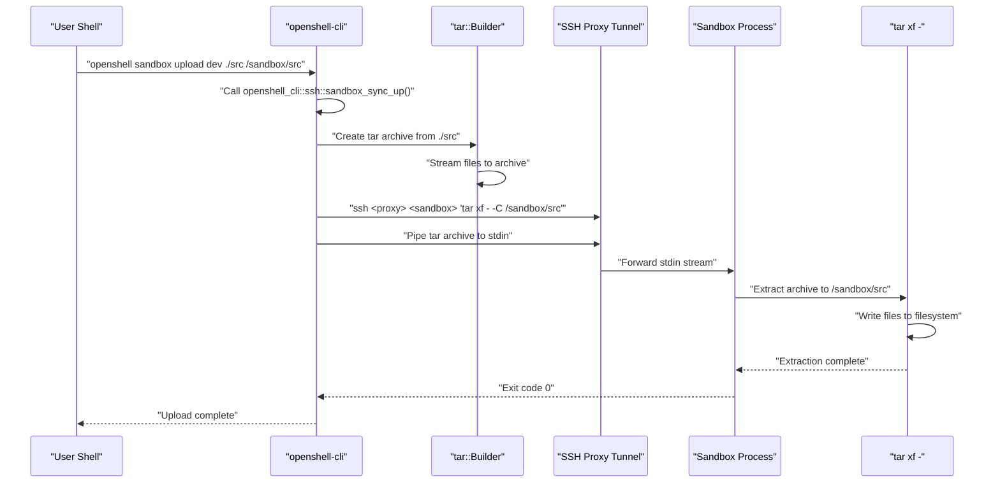
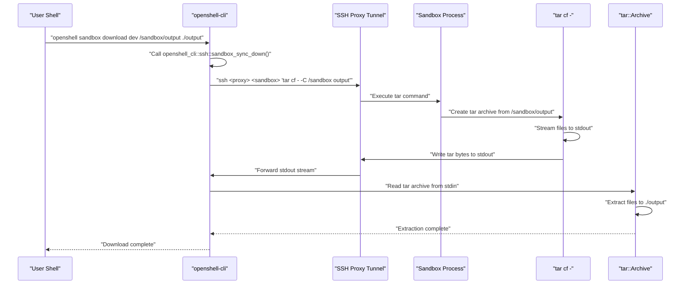
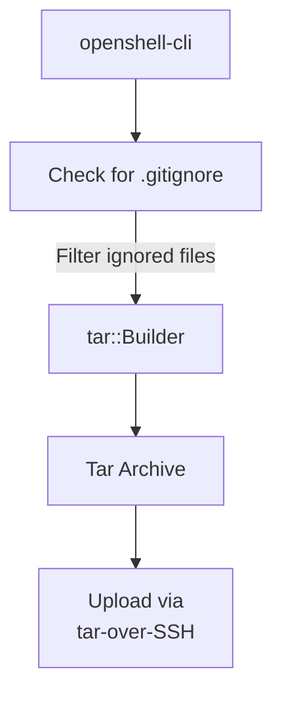
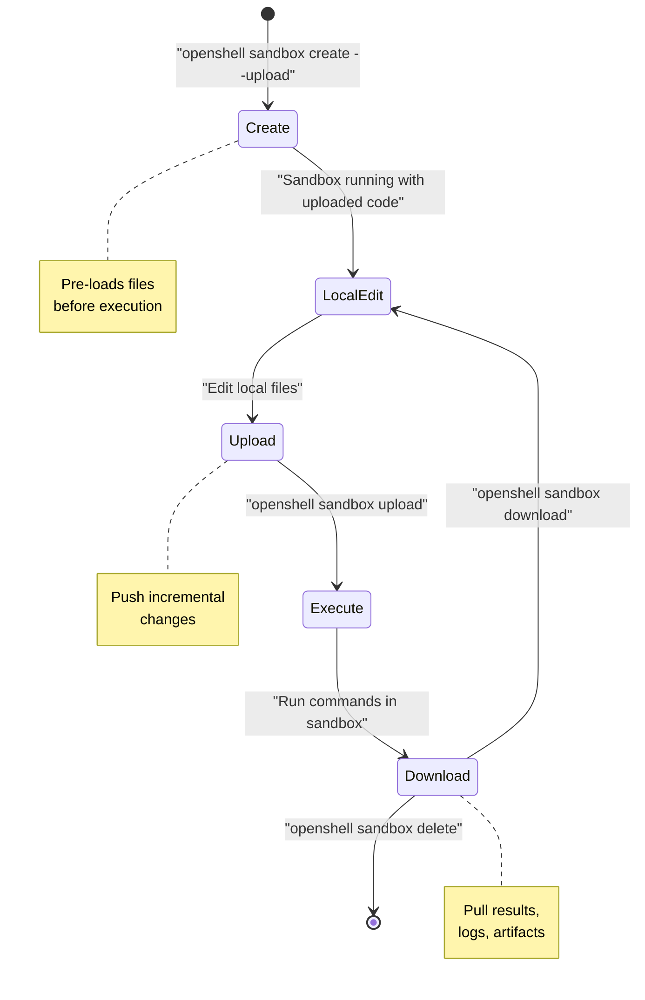
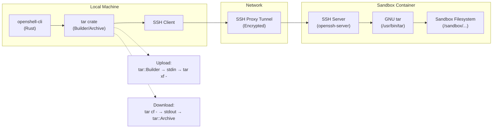

<!-- source: DeepWiki mcp.deepwiki.com · repo NVIDIA/OpenShell · page 10.2 File Sync, Port Forwarding and Services · fetched 2026-10-26 -->

# File Sync, Port Forwarding and Services

<details>
<summary>Relevant source files</summary>

The following files were used as context for generating this wiki page:

- [crates/openshell-cli/tests/sandbox_upload_integration.rs](crates/openshell-cli/tests/sandbox_upload_integration.rs)
- [crates/openshell-conformance/src/scenarios/file_transfer.rs](crates/openshell-conformance/src/scenarios/file_transfer.rs)
- [docs/upgrade/0-1-0.mdx](docs/upgrade/0-1-0.mdx)
- [e2e/rust/tests/upload_create.rs](e2e/rust/tests/upload_create.rs)
- [examples/multi-agent-notepad/.gitignore](examples/multi-agent-notepad/.gitignore)
- [examples/multi-agent-notepad/README.md](examples/multi-agent-notepad/README.md)
- [examples/multi-agent-notepad/demo.sh](examples/multi-agent-notepad/demo.sh)
- [examples/multi-agent-notepad/policy.template.yaml](examples/multi-agent-notepad/policy.template.yaml)
- [examples/multi-agent-notepad/prompts/synthesis.md](examples/multi-agent-notepad/prompts/synthesis.md)
- [examples/multi-agent-notepad/prompts/worker.md](examples/multi-agent-notepad/prompts/worker.md)
- [examples/multi-agent-notepad/runner.sh](examples/multi-agent-notepad/runner.sh)

</details>


This document describes OpenShell's file synchronization system for transferring files between your local machine and remote sandboxes, as well as TCP port forwarding and service exposure. File sync enables uploading source code, configuration files, and data into a sandbox before execution, as well as downloading output artifacts, logs, and results after processing.

For information about sandbox creation and lifecycle, see [Sandboxes](3.1). For policy-based filesystem access control within sandboxes, see [Policy Language](7.1).

## Overview

OpenShell provides three mechanisms for file synchronization:

1.  **Explicit upload**: `openshell sandbox upload` pushes local files into a running sandbox.
2.  **Explicit download**: `openshell sandbox download` pulls files from a sandbox to your local machine.
3.  **Creation upload**: `--upload <local>:<dest>` flag on `openshell sandbox create` pre-loads files before the user command executes. [e2e/rust/tests/upload_create.rs:6-10]()

All file synchronization uses a **tar-over-SSH** transport mechanism that requires no external tools (like `rsync`) on the local machine. The sandbox base image provides GNU `tar` for archive extraction and creation.

Sources: [e2e/rust/tests/upload_create.rs:6-10]()

## Upload Command

### Basic Usage

The `upload` command pushes local files or directories into a running sandbox:

```bash
# Upload current directory to /sandbox
openshell sandbox upload <sandbox-name> .

# Upload specific directory to custom destination
openshell sandbox upload <sandbox-name> ./src /sandbox/src

# Upload single file
openshell sandbox upload <sandbox-name> ./config.yaml /sandbox/config.yaml
```

The `openshell sandbox upload` command is implemented by the `sandbox_sync_up` function in `crates/openshell-cli/src/ssh.rs`.

### Upload Flow Diagram



The upload operation:
1.  Calls `openshell_cli::ssh::sandbox_sync_up()` [crates/openshell-cli/src/ssh.rs:79]().
2.  Creates a tar archive of the local source path using Rust's `tar::Builder`. [crates/openshell-cli/Cargo.toml:65]()
3.  Opens an SSH connection to the sandbox via the gateway proxy tunnel. This is handled by the `ssh_base_command` function [crates/openshell-cli/src/ssh.rs:167]().
4.  Executes `tar xf - -C <destination>` inside the sandbox.
5.  Streams the tar archive bytes through the SSH tunnel's stdin.
6.  The sandbox's `tar` process extracts files to the target destination.

Sources: [crates/openshell-cli/src/ssh.rs:79](), [crates/openshell-cli/src/ssh.rs:167](), [crates/openshell-cli/Cargo.toml:65]()

## Download Command

### Basic Usage

The `download` command pulls files from a sandbox to your local machine:

```bash
# Download sandbox output to local directory
openshell sandbox download <sandbox-name> /sandbox/output ./output

# Download to current directory (destination defaults to .)
openshell sandbox download <sandbox-name> /sandbox/results
```

The `openshell sandbox download` command is implemented by the `sandbox_sync_down` function in `crates/openshell-cli/src/ssh.rs`.

### Download Flow Diagram



The download operation:
1.  Calls `openshell_cli::ssh::sandbox_sync_down()` [crates/openshell-cli/src/ssh.rs:79]().
2.  Opens an SSH connection to the sandbox via the proxy tunnel. This is handled by the `ssh_base_command` function [crates/openshell-cli/src/ssh.rs:167]().
3.  Executes `tar cf - -C <parent-dir> <basename>` inside the sandbox.
4.  The sandbox's `tar` process creates an archive and writes it to stdout.
5.  Streams tar bytes back through the SSH tunnel's stdout.
6.  Uses Rust's `tar::Archive` to extract files to the local destination. [crates/openshell-cli/Cargo.toml:65]()

Sources: [crates/openshell-cli/src/ssh.rs:79](), [crates/openshell-cli/src/ssh.rs:167](), [crates/openshell-cli/Cargo.toml:65]()

## Creation Upload Flag

### Usage

The `--upload <local>:<remote>` flag on `openshell sandbox create` automatically transfers files into the sandbox before the user command executes. [e2e/rust/tests/upload_create.rs:6-10]()

```bash
# Create sandbox and upload current directory to /sandbox/data before running python
openshell sandbox create --upload .:/sandbox/data -- python main.py
```

The `sandbox create` command's `--upload` flag is handled by the `sandbox_sync_up_files` function [crates/openshell-cli/src/ssh.rs:79]() which is called within the `run::sandbox_create` function.

### Multiple Uploads

The CLI supports multiple `--upload` flags in a single command. [e2e/rust/tests/upload_create.rs:55-58]()

```bash
openshell sandbox create \
  --upload ./alpha:/sandbox/alpha \
  --upload ./beta:/sandbox/beta \
  -- sh -c "cat /sandbox/alpha/alpha/a.txt /sandbox/beta/beta/b.txt"
```

### Git Integration and Filtering

By default, `sandbox upload` and creation-time uploads respect `.gitignore` files if the source is within a Git repository. [crates/openshell-conformance/src/scenarios/file_transfer.rs:69]()



The sync mechanism:
1.  Discovers local files at the source path. [crates/openshell-conformance/src/scenarios/file_transfer.rs:141]()
2.  Filters out files matching `.gitignore` patterns unless explicitly disabled via `--no-git-ignore`. [crates/openshell-cli/tests/sandbox_upload_integration.rs:36-38]() This logic is encapsulated in the `SandboxUploadPlan` enum and its associated processing.
3.  Creates a tar archive containing the filtered file set.
4.  Uploads the archive to the target destination in the sandbox. [e2e/rust/tests/upload_create.rs:38-44]()

Sources: [e2e/rust/tests/upload_create.rs:1-113](), [crates/openshell-conformance/src/scenarios/file_transfer.rs:69](), [crates/openshell-cli/tests/sandbox_upload_integration.rs:36-38](), [e2e/rust/tests/upload_create.rs:38-44]()

## Iterative Development Workflow

### Example: Code-Test-Download Cycle

```bash
# 1. Create sandbox with initial code upload
openshell sandbox create --name dev --upload .:/sandbox

# 2. Make local changes to ./src
# ... edit files ...

# 3. Push changes to sandbox
openshell sandbox upload dev ./src /sandbox/src

# 4. Run tests inside sandbox
openshell sandbox connect dev
# (inside sandbox) pytest /sandbox/src

# 5. Pull test artifacts back
openshell sandbox download dev /sandbox/coverage ./coverage
```

### Workflow Diagram



Sources: [e2e/rust/tests/upload_create.rs:6-10]()

## Technical Implementation

### Tar-over-SSH Architecture

The synchronization logic is implemented in the `openshell-cli` (Rust) and leverages standard Unix utilities in the sandbox container.



The `openshell-cli` crate depends on the `tar` crate for archive operations [crates/openshell-cli/Cargo.toml:65](). The SSH client functionality is managed within `crates/openshell-cli/src/ssh.rs` [crates/openshell-cli/src/ssh.rs:1-2530](), which uses `std::process::Command` to invoke the local `ssh` binary [crates/openshell-cli/src/ssh.rs:173](). The `ProxyCommand` option for `ssh` is constructed by `openshell_core::forward::build_proxy_command` [crates/openshell-core/src/forward.rs:127-156]() to route SSH traffic through the OpenShell gateway.

Sources: [crates/openshell-cli/Cargo.toml:65](), [crates/openshell-cli/src/ssh.rs:1-2530](), [crates/openshell-cli/src/ssh.rs:173](), [crates/openshell-core/src/forward.rs:127-156]()

### End-to-End Verification

The synchronization system is verified through comprehensive E2E tests that exercise bidirectional transfers and multi-chunk SSH transport. [crates/openshell-conformance/src/scenarios/file_transfer.rs:20-25]()

The `SandboxGuard` harness in `openshell_e2e::harness::sandbox::SandboxGuard` facilitates these tests by managing sandbox lifecycles and providing helper methods for `upload` and `download` operations. [e2e/rust/tests/upload_create.rs:19]()

| Test Scenario | Verification Logic |
|-----------|---------|
| Directory round-trip | Nested files are verified for content integrity. [crates/openshell-conformance/src/scenarios/file_transfer.rs:178]() |
| Large file round-trip | 512 KiB random data is verified via SHA-256 checksum to exercise multi-chunk transport. [crates/openshell-conformance/src/scenarios/file_transfer.rs:18]() |
| Single-file round-trip | Verification of individual file payload persistence. [crates/openshell-conformance/src/scenarios/file_transfer.rs:178]() |
| Gitignore respect | Confirms tracked files arrive but ignored files do not. [crates/openshell-conformance/src/scenarios/file_transfer.rs:34-38]() |
| Creation-time upload | Validates that `--upload` lands files before the sandbox command runs. [e2e/rust/tests/upload_create.rs:6-10]() |

Sources: [crates/openshell-conformance/src/scenarios/file_transfer.rs:20-25](), [e2e/rust/tests/upload_create.rs:19](), [crates/openshell-conformance/src/scenarios/file_transfer.rs:178](), [crates/openshell-conformance/src/scenarios/file_transfer.rs:18](), [crates/openshell-conformance/src/scenarios/file_transfer.rs:34-38](), [e2e/rust/tests/upload_create.rs:6-10]()

## Limitations and Constraints

*   **SSH Tunnel Dependency**: Sync requires an active SSH tunnel. If the sandbox SSH server is unreachable, sync fails.
*   **No Incremental Sync**: Transfers are full archives; there is no delta-encoding or `rsync`-style incremental update.
*   **Tar Format**: Standard POSIX tar limitations apply, though extended headers are supported by the Rust `tar` crate.

Sources: [crates/openshell-cli/Cargo.toml:65]()

---

