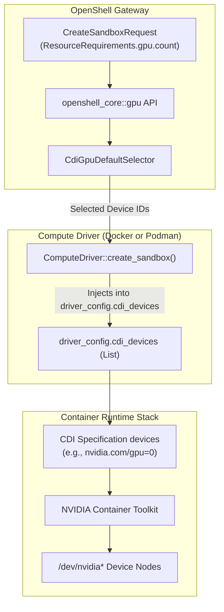
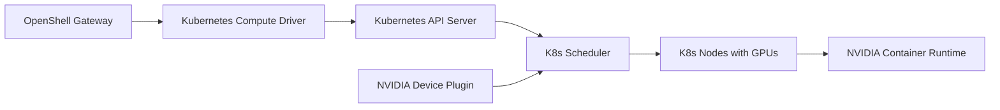
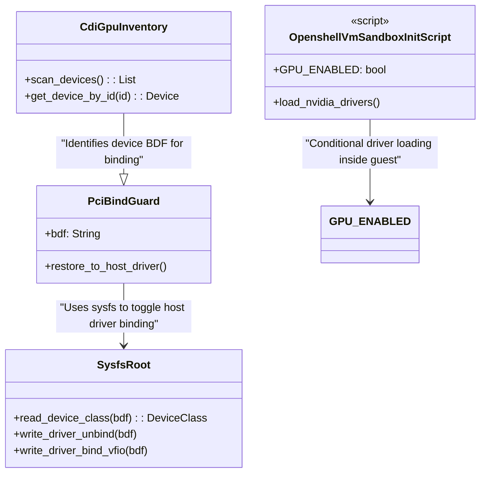

<!-- source: DeepWiki mcp.deepwiki.com · repo NVIDIA/OpenShell · page 10.3 GPU Support · fetched 2026-10-26 -->

# GPU Support

Relevant source files

The following files were used as context for generating this wiki page:

- [.github/workflows/cargo-deny.yml](.github/workflows/cargo-deny.yml)
- [.github/workflows/deb-package.yml](.github/workflows/deb-package.yml)
- [.github/workflows/e2e-docker-test.yml](.github/workflows/e2e-docker-test.yml)
- [.github/workflows/e2e-gpu-test.yaml](.github/workflows/e2e-gpu-test.yaml)
- [.github/workflows/helm-lint.yml](.github/workflows/helm-lint.yml)
- [.github/workflows/release-vm-kernel.yml](.github/workflows/release-vm-kernel.yml)
- [crates/openshell-core/src/driver_utils.rs](crates/openshell-core/src/driver_utils.rs)
- [crates/openshell-driver-docker/README.md](crates/openshell-driver-docker/README.md)
- [crates/openshell-driver-docker/src/lib.rs](crates/openshell-driver-docker/src/lib.rs)
- [crates/openshell-driver-docker/src/tests.rs](crates/openshell-driver-docker/src/tests.rs)
- [crates/openshell-driver-podman/README.md](crates/openshell-driver-podman/README.md)
- [crates/openshell-driver-podman/src/config.rs](crates/openshell-driver-podman/src/config.rs)
- [crates/openshell-driver-podman/src/container.rs](crates/openshell-driver-podman/src/container.rs)
- [crates/openshell-driver-podman/src/driver.rs](crates/openshell-driver-podman/src/driver.rs)
- [crates/openshell-driver-podman/src/main.rs](crates/openshell-driver-podman/src/main.rs)
- [e2e/policy-advisor/test.sh](e2e/policy-advisor/test.sh)
- [e2e/policy-advisor/wait-smoke.sh](e2e/policy-advisor/wait-smoke.sh)
- [e2e/rust/tests/credential_drivers.rs](e2e/rust/tests/credential_drivers.rs)
- [e2e/rust/tests/driver_config_volume.rs](e2e/rust/tests/driver_config_volume.rs)
- [e2e/rust/tests/gpu/workloads.rs](e2e/rust/tests/gpu/workloads.rs)
- [e2e/rust/tests/provider_auto_create.rs](e2e/rust/tests/provider_auto_create.rs)

OpenShell provides comprehensive GPU support for sandbox workloads, enabling AI agents to access host NVIDIA GPUs for local inference, fine-tuning, and accelerated computation. This support is implemented across container-based runtimes (Docker, Podman, Kubernetes) utilizing the NVIDIA Container Toolkit and CDI, and via experimental VFIO passthrough for VM-based runtimes.

## GPU Resource Selection and CDI

OpenShell uses the **Container Device Interface (CDI)** standard for deterministic and secure GPU device injection into containers. Unlike the traditional environment variable-based injection (`NVIDIA_VISIBLE_DEVICES`), CDI allows OpenShell compute drivers to select specific physical GPUs and map them explicitly into sandbox containers.

### CDI Components and Selection Logic

The selection logic is centralized in the `openshell-core` crate and shared across multiple compute drivers:

- **`CdiGpuInventory`** scans the host system to discover available CDI-qualified NVIDIA GPU devices and their properties [crates/openshell-core/src/gpu.rs:27-90]().

- **`CdiGpuDefaultSelector`** implements a device selection strategy, typically round-robin or using explicit device IDs specified by the sandbox or operator [crates/openshell-core/src/gpu.rs:159-162]().

- **`driver_gpu_requirements`** extracts the GPU resource requests (e.g., number of GPUs) from the sandbox's `ResourceRequirements` protobuf message [crates/openshell-core/src/gpu.rs:30-35]().

- **Validation functions** such as `validate_specific_gpu_device_request` ensure requested device IDs are valid and consistent [crates/openshell-core/src/gpu.rs:33]().

### Data Flow: GPU Request to Container Device Injection

This flow shows how a GPU request from sandbox creation propagates through the GPU inventory and selector in `openshell_core` to the compute driver, which then requests the appropriate devices via CDI to the NVIDIA Container Toolkit and ultimately the container runtime exposes the physical GPUs to the sandbox via device nodes.

**Sources:** 
- [crates/openshell-core/src/gpu.rs:27-90]()
- [crates/openshell-driver-docker/src/lib.rs:34-37]()
- [crates/openshell-driver-podman/src/driver.rs:19-22]()

## Docker and Podman Integration

OpenShell’s container compute drivers for Docker and Podman implement GPU device injection primarily via the NVIDIA Container Toolkit using CDI device requests.

### Docker Driver GPU Support

- The Docker driver uses the `bollard` Rust client to communicate with the Docker Engine API [crates/openshell-driver-docker/src/lib.rs:11-22]().

- GPU injection occurs via setting `DeviceRequest` entries in the Docker `HostConfig`, corresponding to the list of CDI device strings (e.g., `nvidia.com/gpu=0`) [crates/openshell-driver-docker/src/lib.rs:35-37]().

- The driver validates GPU resource requests by checking that explicit device requests match host inventory and that the request count is supported [crates/openshell-driver-docker/src/lib.rs:119-130]().

- Automatic selection of GPU devices if only a count is supplied uses a round-robin strategy implemented in `CdiGpuDefaultSelector`.

- Supervisor and workload containers are created with distinct isolation and network modes; the workload runs with `network_mode=none` and the supervisor has host network access to enable secure mediation [crates/openshell-driver-docker/README.md:25-101]().

### Podman Driver GPU Support

- The Podman driver manages GPU injection via the `cdi_devices` field in its `PodmanSandboxDriverConfig` which is deserialized from `driver_config` JSON inside the sandbox template [crates/openshell-driver-podman/src/container.rs:74-125]().

- The `cdi_devices` option takes a list of strings like `nvidia.com/gpu=all` or `nvidia.com/gpu=0` to request specific devices.

- Podman driver handles GPU device access with rootless and rootful modes. Rootless mode is supported on Linux using Podman's user namespaces and capabilities, delegating all GPU device access to the supervisor container running as root inside the sandbox pod [crates/openshell-driver-podman/README.md:3-125]().

- Resource admission enforces security policies restricting unsanctioned device or mount requests, optionally blocking untrusted bind mounts and unlabelable volumes [crates/openshell-driver-podman/src/container.rs:86-101]().

**Sources:**
- [crates/openshell-driver-docker/src/lib.rs:10-37]()
- [crates/openshell-driver-docker/README.md:20-101]()
- [crates/openshell-driver-podman/src/container.rs:74-125]()
- [crates/openshell-driver-podman/src/driver.rs:19-22]()
- [crates/openshell-driver-podman/README.md:3-125]()

## Kubernetes and RuntimeClass Integration

For Kubernetes workloads, OpenShell utilizes the Kubernetes `RuntimeClass` feature to leverage the NVIDIA Container Runtime for GPU scheduling and device injection.

- The Kubernetes cluster is configured with a RuntimeClass named `nvidia` which enables use of the NVIDIA GPU container runtime.

- The NVIDIA Device Plugin is installed (typically via Helm charts) and advertises `nvidia.com/gpu` resources to the Kubernetes scheduler.

- When a sandbox workload requests GPU resources in the pod spec (`resources.limits` for `nvidia.com/gpu`), the Kubernetes scheduler schedules the pod onto a GPU-enabled node.

- The Kubernetes driver in OpenShell annotates the sandbox PodSpec with GPU resource requests and attaches the `RuntimeClassName: "nvidia"` field to activate the NVIDIA runtime.

This approach leverages Kubernetes scheduling and the native NVIDIA runtime for GPU device management transparently.

**Sources:**
- [architecture/compute-runtimes.md:79-85]()
- [crates/openshell-driver-docker/README.md:88-88]()

## VM Driver and VFIO Passthrough

OpenShell’s experimental VM driver (`openshell-driver-vm`) supports GPU passthrough via VFIO for near-native performance by directly passing through PCIe GPU devices to the sandbox MicroVM.

### VFIO GPU Passthrough Overview

The VFIO lifecycle involves:

1. **Device Unbind:** The GPU PCI device is unbound from the host NVIDIA driver using sysfs unbind mechanisms.

2. **VFIO Binding:** The device is bound to the `vfio-pci` stub driver to enable secure passthrough.

3. **IOMMU Group:** The entire IOMMU group (all devices sharing DMA isolation boundaries) is identified and isolated for the VM.

4. **Mapping to VM:** The MicroVM root virtualization library (`libkrun` or Firecracker derivative) maps the GPU’s MMIO BARs (Base Address Registers) into the guest address space.

5. **Guest Setup:** Inside the VM guest, the `openshell-vm-sandbox-init.sh` script detects if GPU support is enabled through the `GPU_ENABLED` environment variable, and if so, loads the NVIDIA kernel drivers for the GPU to function correctly [crates/openshell-driver-vm/scripts/openshell-vm-sandbox-init.sh:34-35]().

### VFIO Passthrough Management Entities

This diagram depicts core classes and concepts involved in managing PCI devices for VFIO GPU passthrough from host to VM guest.

**Sources:**  
- [crates/openshell-core/src/gpu.rs:27-90]()  
- [crates/openshell-driver-vm/scripts/openshell-vm-sandbox-init.sh:34-35]()  
- [crates/openshell-driver-docker/src/lib.rs:34-37]()

## GPU End-to-End Workloads and Testing

OpenShell includes comprehensive E2E validation of GPU-enabled sandboxes:

- The `.github/workflows/e2e-gpu-test.yaml` workflow runs GPU test jobs on Linux AMD64 and ARM64 runners with NVIDIA GPUs [`.github/workflows/e2e-gpu-test.yaml:1-88`]().

- It uses docker-in-docker with NVIDIA runtime to check basic GPU availability (`nvidia-smi -L`) and launches GPU workloads built from `nvcr.io/nvidia/base/ubuntu` with the appropriate CDI device requests.

- GPU device selection, pod specs, and driver configurations are validated end-to-end to ensure the correct GPUs are exposed and accessible in the sandbox.

## Summary of GPU Configuration Across Drivers

GPU configuration and selection flow through OpenShell system components as follows:

| Feature                      | Docker / Podman Driver               | Kubernetes                         | VM Driver (Experimental)        |
|------------------------------|------------------------------------|----------------------------------|--------------------------------|
| Mechanism                    | CDI / NVIDIA Container Toolkit     | RuntimeClass `nvidia` + Device Plugin | VFIO Direct PCIe Passthrough    |
| Device Selection             | Round-robin / Explicit CDI Device IDs | Kubernetes GPU scheduler          | PCIe BDF Passthrough            |
| Isolation                   | Container & cgroups                 | Pod Security, cgroups & namespaces | Hardware (IOMMU support)         |
| Driver Configuration Access | `driver_config.cdi_devices` JSON     | Pod Spec `resources.limits.nvidia.com/gpu` | `vfio_pci_bdfs` list             |

Operator configurations live in `gateway.toml` under `openshell.drivers.<driver>` sections, which govern allowed GPUs, admission checks, and runtime device selection policies.

**Sources:**

- [crates/openshell-driver-docker/src/lib.rs:86-142]()
- [crates/openshell-driver-podman/src/config.rs:70-164]()
- [architecture/compute-runtimes.md:138-145]()
- [.github/workflows/e2e-gpu-test.yaml:1-87]()

---

This GPU support system enables secure, auditable, and efficient access to NVIDIA GPUs across multiple runtime backends, fitting the needs of AI agent workloads requiring hardware-accelerated computation in OpenShell sandboxes.

---

