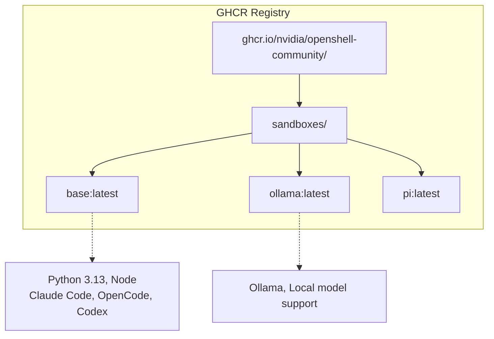
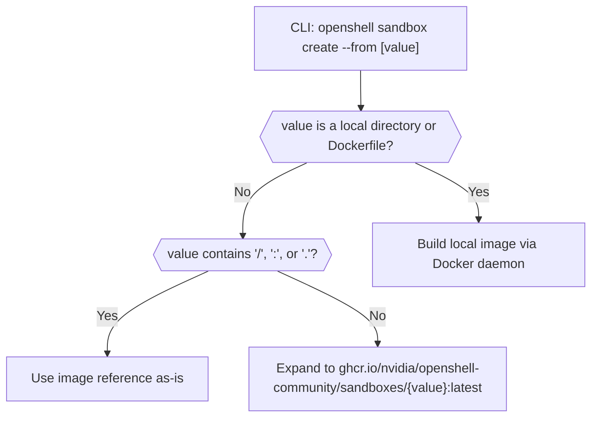
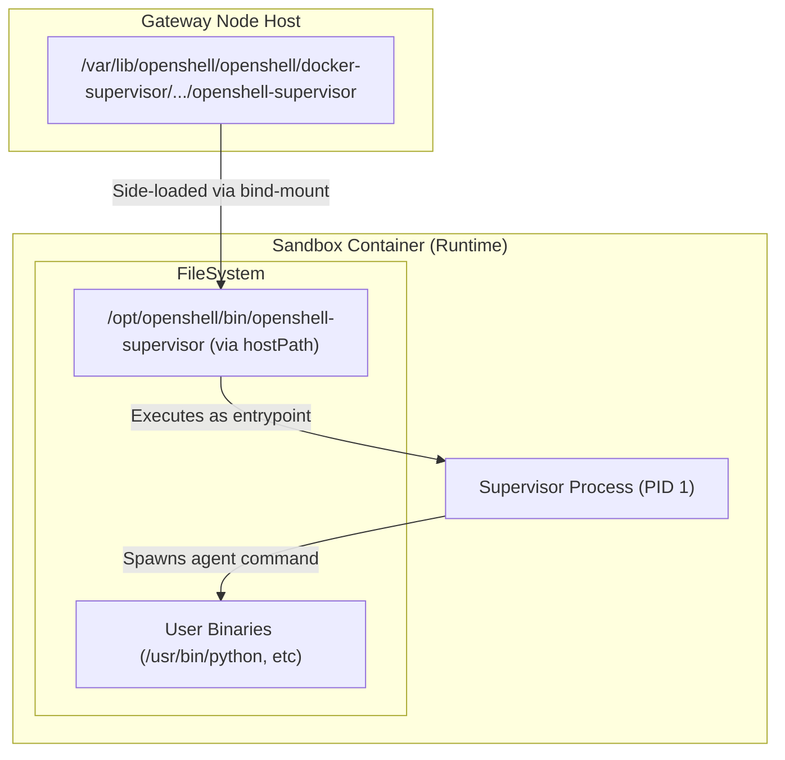

<!-- source: DeepWiki mcp.deepwiki.com · repo NVIDIA/OpenShell · page 10.4 Custom and Community Sandbox Images · fetched 2026-10-26 -->

# Custom and Community Sandbox Images

Relevant source files

The following files were used as context for generating this wiki page:

- [crates/openshell-supervisor-network/src/l7/rest/http_response.rs](crates/openshell-supervisor-network/src/l7/rest/http_response.rs)
- [crates/openshell-supervisor-network/src/proxy/relay.rs](crates/openshell-supervisor-network/src/proxy/relay.rs)
- [crates/openshell-supervisor-network/src/proxy/tests/compatibility.rs](crates/openshell-supervisor-network/src/proxy/tests/compatibility.rs)
- [deploy/docker/Dockerfile.gateway](deploy/docker/Dockerfile.gateway)
- [deploy/docker/Dockerfile.supervisor](deploy/docker/Dockerfile.supervisor)
- [e2e/rust/src/harness/mod.rs](e2e/rust/src/harness/mod.rs)
- [e2e/rust/tests/custom_image.rs](e2e/rust/tests/custom_image.rs)
- [e2e/rust/tests/forward_proxy_graphql_l7.rs](e2e/rust/tests/forward_proxy_graphql_l7.rs)
- [e2e/rust/tests/forward_proxy_l7_bypass.rs](e2e/rust/tests/forward_proxy_l7_bypass.rs)
- [e2e/rust/tests/host_gateway_alias.rs](e2e/rust/tests/host_gateway_alias.rs)
- [e2e/rust/tests/proxy_egress_pipeline.rs](e2e/rust/tests/proxy_egress_pipeline.rs)
- [examples/bring-your-own-container/Dockerfile](examples/bring-your-own-container/Dockerfile)
- [examples/bring-your-own-container/README.md](examples/bring-your-own-container/README.md)
- [scripts/lint-mermaid/package-lock.json](scripts/lint-mermaid/package-lock.json)
- [scripts/lint-mermaid/package.json](scripts/lint-mermaid/package.json)

This page documents OpenShell's community sandbox registry, image resolution system, and Bring Your Own Container (BYOC) capabilities. Community sandboxes are pre-built container images published to GHCR that provide ready-to-use execution environments for specific agents, tools, or workflows.

For information about sandbox architecture and the supervisor binary, see [6.1 Sandbox Architecture](). For policy enforcement within sandboxes, see [7. Policy System](). For GPU-enabled sandbox configuration, see [8.3 GPU Support]().

## Purpose and Scope

Custom and community sandbox images allow users to:

- **Pull pre-built images** from the community registry instead of building custom images.
- **Use specialized environments** optimized for specific agents such as Claude Code, OpenCode, and Ollama.
- **Bring custom containers** via explicit image references or local Dockerfiles.
- **Discover and share** sandbox configurations through the OpenShell-Community repository.

The `--from` flag on `openshell sandbox create` serves as the universal entry point for community catalog lookups, local directory builds, and direct container image references.

Sources:
- [examples/bring-your-own-container/README.md:39-40]()

## Community Registry Structure

The OpenShell Community registry is primarily hosted on GitHub Container Registry (GHCR) with a structured naming convention for discoverability and version management.

### Registry Hierarchy

### Image Naming Convention

| Component | Pattern | Example |
|-----------|---------|---------|
| **Registry Prefix** | `ghcr.io/nvidia/openshell-community/sandboxes` | `DEFAULT_COMMUNITY_REGISTRY` |
| **Path** | `/{name}` | `/base` |
| **Tag** | `:latest` | Applied automatically during expansion |

## Image Resolution Logic

The image resolution system expands bare sandbox names into fully-qualified container image references. If the input contains a `/`, `:`, or `.`, it is treated as a direct image reference or a local path; otherwise, it is expanded against the community registry.

### Resolution Decision Tree

Sources:
- [e2e/rust/tests/custom_image.rs:83-84]()

### Resolution Examples

| Input | Interpreted As | Resulting Image Resolution |
|-------|----------------|----------------------------|
| `base` | Community shorthand | `ghcr.io/nvidia/openshell-community/sandboxes/base:latest` |
| `./my-sandbox-dir` | Local directory | Build temporary image from local path |
| `my-registry.example.com/my-image:latest` | Full reference | `my-registry.example.com/my-image:latest` |

Sources:
- [e2e/rust/tests/custom_image.rs:83-84]()

## Bring Your Own Container (BYOC)

OpenShell allows running arbitrary container images. When a user provides a custom Dockerfile or a direct image reference, the system applies the same security and isolation layers as it does for standard images.

### BYOC Requirements

To ensure a custom image works correctly within an OpenShell sandbox, the following requirements should be met:

1.  **Entrypoint Overridden**: The image's `CMD` or `ENTRYPOINT` is replaced by the `openshell-supervisor` at runtime. The supervisor manages SSH access, network policy, and other sandbox features [examples/bring-your-own-container/README.md:46-49]().
2.  **Explicit Start Command**: Users must pass the application's start command after `--` in the CLI (e.g., `openshell sandbox create --from ./Dockerfile -- python app.py`) [examples/bring-your-own-container/README.md:49-49]().
3.  **Dependencies**: The image must include `iproute2` for network namespace management (veth pairs, IP assignment) [examples/bring-your-own-container/Dockerfile:11-12]().
4.  **Standard Base**: Use a standard Linux base image (e.g., `python:3.13-slim`); distroless or `scratch` images are not supported [examples/bring-your-own-container/README.md:80-81]().
5.  **Non-root User**: Declare a non-root OCI `USER` for Docker and Podman. This can be a named account (e.g., `app`), a numeric UID with a `passwd` entry, or a numeric `UID:GID` pair (e.g., `1500:1500`) [examples/bring-your-own-container/Dockerfile:29-29]().
6.  **Writable Workspace**: Prepare `/sandbox` as the workspace and ensure it is writable by the selected identity [examples/bring-your-own-container/README.md:77-78]().

Sources:
- [examples/bring-your-own-container/Dockerfile:11-12]()
- [examples/bring-your-own-container/Dockerfile:29-29]()
- [examples/bring-your-own-container/README.md:46-49]()
- [examples/bring-your-own-container/README.md:49-49]()
- [examples/bring-your-own-container/README.md:77-78]()
- [examples/bring-your-own-container/README.md:80-81]()

### Local Dockerfile Build Flow

When the CLI detects a Dockerfile path via the `--from` flag:
1.  **Build**: The CLI builds the image using the local container runtime (Docker or Podman) [e2e/rust/tests/custom_image.rs:83-84]().
2.  **Tag**: The image is tagged for the target gateway's compute driver.
3.  **Run**: The sandbox is created using the newly built image, injecting the supervisor binary.

Sources:
- [e2e/rust/tests/custom_image.rs:83-84]()

## Supervisor Side-Loading

The `openshell-supervisor` binary is side-loaded into the container at runtime. This ensures that custom images do not need to include OpenShell-specific binaries. The gateway extracts this binary from a supervisor image and caches it in the data directory.

The `openshell-supervisor` binary is built as a distroless image, `gcr.io/distroless/base-nossl-debian13`, ensuring a minimal runtime footprint [deploy/docker/Dockerfile.supervisor:11-11]().

Sources:
- [deploy/docker/Dockerfile.supervisor:11-11]()

## End-to-End Coverage for Custom Images

OpenShell includes comprehensive end-to-end tests to ensure that custom images function as expected with core sandbox features. These tests cover:

-   **Custom Image Creation**: Building a custom image from a `Dockerfile` and verifying its contents and user/group IDs [e2e/rust/tests/custom_image.rs:69-110]().
-   **User Identity Enforcement**: Confirming that the sandbox runs processes under the specified non-root user and group from the custom image [e2e/rust/tests/custom_image.rs:107-109]().
-   **Filesystem Isolation**: Verifying that the sandbox's filesystem policies (e.g., read-only paths like `/etc`) are correctly applied and that the custom image's marker files are accessible [e2e/rust/tests/custom_image.rs:102-105]().
-   **Workspace Management**: Testing that the OCI working directory is correctly set and that file uploads/downloads function as expected relative to this directory [e2e/rust/tests/custom_image.rs:112-149]().
-   **Network Policy Enforcement**: Ensuring that L7 policies (e.g., for REST or GraphQL) are enforced correctly for applications running in custom images [e2e/rust/tests/forward_proxy_l7_bypass.rs:96-146](), [e2e/rust/tests/forward_proxy_graphql_l7.rs:132-188](). This includes scenarios where policies are dynamically updated [crates/openshell-supervisor-network/src/proxy/relay.rs:144-157]().
-   **Provider Credential Injection**: Validating that provider credentials are correctly injected into the sandbox environment and resolved for network requests [e2e/rust/tests/host_gateway_alias.rs:150-186](), [e2e/rust/tests/proxy_egress_pipeline.rs:131-167]().

These tests use the `openshell_e2e::harness::sandbox::SandboxGuard` to manage sandbox lifecycles and `openshell_e2e::harness::container::ImageGuard` for building and cleaning up custom images [e2e/rust/tests/custom_image.rs:15-16]().

Sources:
- [crates/openshell-supervisor-network/src/proxy/relay.rs:144-157]()
- [e2e/rust/src/harness/mod.rs:13-13]()
- [e2e/rust/tests/custom_image.rs:15-16]()
- [e2e/rust/tests/custom_image.rs:69-110]()
- [e2e/rust/tests/custom_image.rs:102-105]()
- [e2e/rust/tests/custom_image.rs:107-109]()
- [e2e/rust/tests/custom_image.rs:112-149]()
- [e2e/rust/tests/forward_proxy_graphql_l7.rs:132-188]()
- [e2e/rust/tests/forward_proxy_l7_bypass.rs:96-146]()
- [e2e/rust/tests/host_gateway_alias.rs:150-186]()
- [e2e/rust/tests/proxy_egress_pipeline.rs:131-167]()

---

