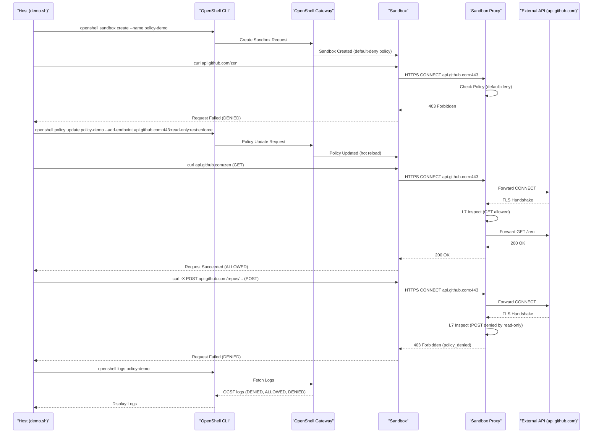
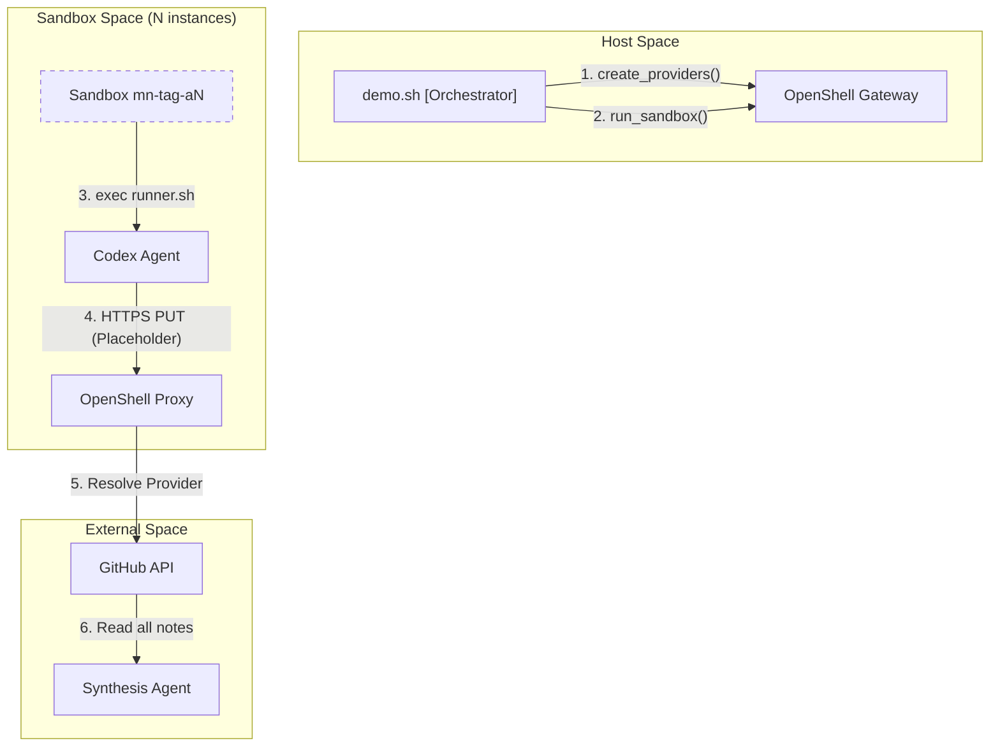
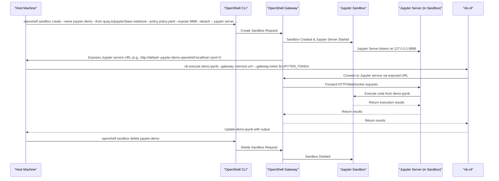
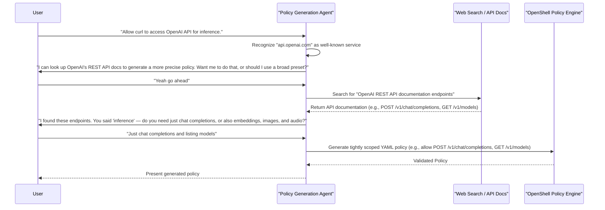
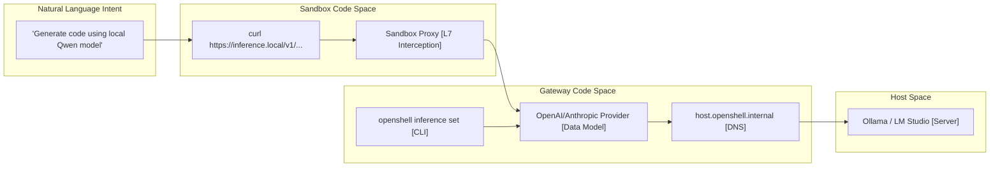
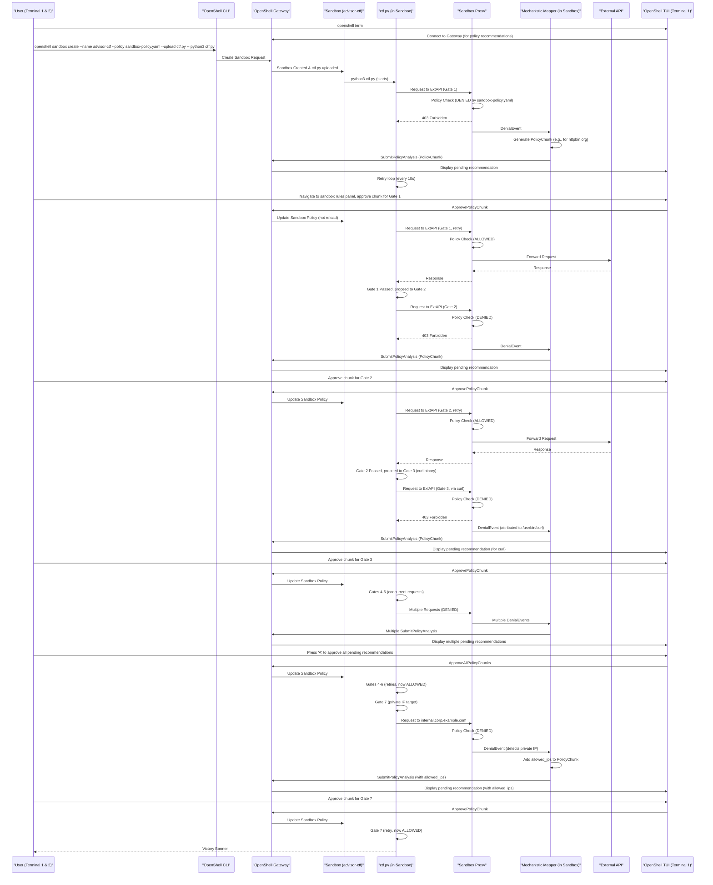

<!-- source: DeepWiki mcp.deepwiki.com · repo NVIDIA/OpenShell · page 10.5 Examples and Tutorials · fetched 2026-10-26 -->

# Examples and Tutorials

Relevant source files

The following files were used as context for generating this wiki page:

- [e2e/rust/tests/upload_create.rs](e2e/rust/tests/upload_create.rs)
- [examples/jupyter-sandbox/README.md](examples/jupyter-sandbox/README.md)
- [examples/jupyter-sandbox/demo.ipynb](examples/jupyter-sandbox/demo.ipynb)
- [examples/jupyter-sandbox/policy.yaml](examples/jupyter-sandbox/policy.yaml)
- [examples/multi-agent-notepad/.gitignore](examples/multi-agent-notepad/.gitignore)
- [examples/multi-agent-notepad/README.md](examples/multi-agent-notepad/README.md)
- [examples/multi-agent-notepad/demo.sh](examples/multi-agent-notepad/demo.sh)
- [examples/multi-agent-notepad/policy.template.yaml](examples/multi-agent-notepad/policy.template.yaml)
- [examples/multi-agent-notepad/prompts/synthesis.md](examples/multi-agent-notepad/prompts/synthesis.md)
- [examples/multi-agent-notepad/prompts/worker.md](examples/multi-agent-notepad/prompts/worker.md)
- [examples/multi-agent-notepad/runner.sh](examples/multi-agent-notepad/runner.sh)
- [examples/policy-advisor/README.md](examples/policy-advisor/README.md)
- [examples/policy-advisor/ctf.py](examples/policy-advisor/ctf.py)
- [examples/sandbox-policy-quickstart/README.md](examples/sandbox-policy-quickstart/README.md)
- [examples/sandbox-policy-quickstart/demo.sh](examples/sandbox-policy-quickstart/demo.sh)
- [examples/sandbox-policy-quickstart/policy.yaml](examples/sandbox-policy-quickstart/policy.yaml)
- [providers/pypi.yaml](providers/pypi.yaml)
- [scripts/smoke-test-network-policy.sh](scripts/smoke-test-network-policy.sh)
- [skills/generate-sandbox-policy/examples.md](skills/generate-sandbox-policy/examples.md)

This page catalogs the hands-on examples and step-by-step tutorials provided in the OpenShell repository. These resources demonstrate the platform's capabilities—ranging from basic network isolation to complex multi-agent orchestration and local inference routing.

The examples are located in the `examples/` directory, while formal tutorials are documented in `docs/get-started/tutorials/`.

## Policy Quickstart

The `examples/sandbox-policy-quickstart/` directory contains a quickstart guide and an automated demo script (`demo.sh`) to showcase OpenShell's network policy system [examples/sandbox-policy-quickstart/README.md:1-6](). This example demonstrates:
1.  **Default-Deny Networking**: How a newly created sandbox, by default, denies all outbound network traffic [examples/sandbox-policy-quickstart/demo.sh:86-91]().
2.  **Policy Enforcement**: An attempt to reach an external API (e.g., `api.github.com`) is blocked by the default policy [examples/sandbox-policy-quickstart/demo.sh:100-106]().
3.  **Policy Updates**: Adding a fine-grained, read-only L7 rule for `api.github.com` using `openshell policy update` [examples/sandbox-policy-quickstart/demo.sh:120-125](). This update is applied without restarting the sandbox.
4.  **L7 Enforcement**: Verifying that `GET` requests are allowed, while `POST` requests to the same endpoint are blocked by the L7 policy [examples/sandbox-policy-quickstart/demo.sh:129-147]().
5.  **Audit Logging**: How policy decisions (both `ALLOWED` and `DENIED`) are logged and can be inspected using `openshell logs` [examples/sandbox-policy-quickstart/demo.sh:111-116](), [examples/sandbox-policy-quickstart/demo.sh:152-158]().

The `policy.yaml` file in this example provides a complete policy that can be used with `openshell sandbox create --policy` to start a sandbox with the GitHub API rule already in place [examples/sandbox-policy-quickstart/policy.yaml:1-12]().

### Policy Quickstart Flow

The following diagram illustrates the sequence of actions and policy outcomes in the quickstart demo.

**Policy Quickstart Demo Flow**

Sources: [examples/sandbox-policy-quickstart/demo.sh:86-159](), [examples/sandbox-policy-quickstart/README.md:37-48](), [examples/sandbox-policy-quickstart/README.md:74-88](), [examples/sandbox-policy-quickstart/README.md:125-136](), [examples/sandbox-policy-quickstart/README.md:170-175]()

## Multi-Agent Shared Notepad

This example demonstrates the "Map/Reduce" pattern using multiple parallel sandboxes. $N$ worker agents (using the `base` image with Codex) perform research on a topic and write individual notes to a shared GitHub repository. A final synthesis agent reads these notes to produce a summary [examples/multi-agent-notepad/demo.sh:13-16](), [examples/multi-agent-notepad/demo.sh:41-50]().

### Key Implementation Details
- **Durable Memory**: Uses GitHub as a shared, versioned, and auditable notepad that survives individual sandbox lifecycles [examples/multi-agent-notepad/README.md:16-26]().
- **Concurrency Control**: The `runner.sh` script implements a retry loop to handle HTTP 409 conflicts when multiple agents commit simultaneously [examples/multi-agent-notepad/README.md:165-166]().
- **Credential Protection**: Real Codex and GitHub tokens are stored in the Gateway as `Providers`. The sandboxes only see provider placeholders (e.g., `DEMO_GITHUB_TOKEN`), which are resolved by the OpenShell proxy at the network boundary [examples/multi-agent-notepad/README.md:125-135]().

### Data Flow: Multi-Agent Coordination
The following diagram illustrates how the host orchestrator (`demo.sh`) manages the lifecycle and how agents interact with the shared resource.

**Multi-Agent Coordination Flow**

Sources: [examples/multi-agent-notepad/demo.sh:136-167](), [examples/multi-agent-notepad/README.md:125-135]()

## Jupyter Sandbox

The `examples/jupyter-sandbox/` demonstrates running a Jupyter notebook server within an OpenShell sandbox, exposing it locally, and executing a notebook on the sandboxed kernel [examples/jupyter-sandbox/README.md:1-3]().

### Key Implementation Details
- **Published Image**: Uses the `quay.io/jupyter/base-notebook` image, which includes Jupyter Server and a Python kernel [examples/jupyter-sandbox/README.md:26-27]().
- **Policy Configuration**: The `policy.yaml` defines filesystem access for the `jovyan` user and explicitly disables outbound network access for the Jupyter notebook for this demonstration [examples/jupyter-sandbox/policy.yaml:6-20]().
- **Service Exposure**: The `--expose 8888` flag makes the Jupyter server accessible from the host, and `--detach --no-tty` runs it as a background service [examples/jupyter-sandbox/README.md:25-30]().
- **Remote Kernel Execution**: The `nb-cli` tool is used to execute a local notebook (`demo.ipynb`) against the remote Jupyter kernel running inside the sandbox [examples/jupyter-sandbox/README.md:48-52]().

### Jupyter Sandbox Deployment and Interaction

**Jupyter Sandbox Flow**

Sources: [examples/jupyter-sandbox/README.md:25-52](), [examples/jupyter-sandbox/policy.yaml:6-20]()

## Agent-Driven Policy Management

The `skills/generate-sandbox-policy/examples.md` document provides various examples of how policies can be generated, ranging from minimal host-and-intent specifications to detailed L7 rules. This highlights how an agent (or user) can interact with the policy system.

### Key Policy Generation Examples
-   **L4 Pass-Through**: Allowing all traffic to specific hosts and ports (e.g., `api.anthropic.com:443`) without L7 inspection [skills/generate-sandbox-policy/examples.md:15-30]().
-   **Read-Only Preset**: Applying a `read-only` preset for REST APIs (e.g., `api.github.com:443`) to allow `GET`, `HEAD`, `OPTIONS` but block `POST`, `PUT`, `PATCH`, `DELETE` [skills/generate-sandbox-policy/examples.md:36-57]().
-   **Full Access Preset**: Granting `full` access to all HTTP methods on all paths for a given endpoint [skills/generate-sandbox-policy/examples.md:60-79]().
-   **Read-Write (No Deletes)**: Allowing `GET`, `HEAD`, `OPTIONS`, `POST`, `PUT`, `PATCH` but blocking `DELETE`, with an `audit` enforcement mode to log violations without blocking [skills/generate-sandbox-policy/examples.md:82-102]().
-   **Multiple Hosts, Same Access**: Applying the same access level to multiple hosts within a single policy rule [skills/generate-sandbox-policy/examples.md:105-128]().
-   **Auto-Discovery**: Demonstrates an agent workflow where it can query for API documentation to generate a tightly scoped policy (e.g., for OpenAI inference) instead of using broad presets [skills/generate-sandbox-policy/examples.md:131-175](). This shows the potential for intelligent policy generation.

### Policy Generation Workflow

**Agent-Driven Policy Generation**

Sources: [skills/generate-sandbox-policy/examples.md:131-175]()

## Private IP Routing

The Policy Advisor CTF example (discussed below) includes a gate that targets a host resolving to a private IP (e.g., `internal.corp.example.com:443`). This demonstrates how the mechanistic mapper automatically detects private IPs and includes `allowed_ips` in the proposed policy rule to enable the proxy's SSRF override, allowing the connection [examples/policy-advisor/README.md:60-65](), [examples/policy-advisor/README.md:124-127](). This is crucial for agents needing to access internal services securely.

## Local Inference Routing

These tutorials explain how to keep inference traffic private by routing `inference.local` calls to local backends on the gateway host.

### Ollama Integration
- **Ollama Sandbox**: A community image (`--from ollama`) that bundles Ollama and coding agents [docs/get-started/tutorials/inference-ollama.mdx:26-39]().
- **Host-Level Routing**: Routing sandbox traffic to a host-level Ollama server via `host.openshell.internal:11434` [docs/get-started/tutorials/inference-ollama.mdx:106-130]().
- **Inference Configuration**: Using `openshell inference set --provider ollama` to activate the transparent proxy route [docs/get-started/tutorials/inference-ollama.mdx:165-175]().

### LM Studio Integration
- **Multi-Protocol Support**: Configuring providers for both OpenAI-compatible (`/v1/chat/completions`) and Anthropic-compatible (`/v1/messages`) endpoints [docs/get-started/tutorials/local-inference-lmstudio.mdx:78-111]().
- **Transparent Interception**: Sandboxes call `https://inference.local`, and the OpenShell gateway handles the TLS termination and protocol translation to the local LM Studio instance [docs/get-started/tutorials/local-inference-lmstudio.mdx:154-187]().

Sources: [docs/get-started/tutorials/inference-ollama.mdx:151-163](), [docs/get-started/tutorials/local-inference-lmstudio.mdx:81-89]()

## Natural Language to Code Entity Space: Inference Routing
This diagram bridges the agent's request for inference (Natural Language) to the specific code entities and providers involved in the routing.

**Inference Routing Entity Mapping**

Sources: [docs/get-started/tutorials/inference-ollama.mdx:153-169](), [docs/get-started/tutorials/local-inference-lmstudio.mdx:84-89]()

## SPIFFE Token Grant/Exchange Demos

While not explicitly detailed in the provided file contents, OpenShell's architecture supports SPIFFE (Secure Production Identity Framework for Everyone) for workload identity. Demos would typically involve:
-   **Workload Attestation**: How sandboxes obtain cryptographically verifiable identities.
-   **Token Exchange**: How these identities can be exchanged for short-lived credentials to access other services.
-   **Policy Enforcement**: How policies can leverage SPIFFE IDs for fine-grained authorization.

## Transparent TCP Redis

OpenShell's network mediation capabilities extend to transparent TCP proxying. A demo for Redis would typically involve:
-   **Sandbox Connection**: A sandbox attempting to connect to a Redis instance.
-   **Transparent Proxy**: The OpenShell proxy transparently intercepts the TCP connection.
-   **Policy Enforcement**: Network policies can be applied to Redis traffic, allowing or denying connections based on source binary, destination, and potentially even protocol-level inspection if a Redis L7 inspector is implemented.
-   **Credential Injection**: Securely injecting Redis credentials (e.g., passwords) into the connection without exposing them to the sandbox filesystem.

## Policy Advisor CTF

The `examples/policy-advisor/` directory contains a Capture The Flag (CTF) exercise that walks users through OpenShell's policy recommendation pipeline in "Mechanistic Mode" [examples/policy-advisor/README.md:1-3]().

### How it Works
1.  **Request and Denial**: A Python script (`ctf.py`) attempts to reach several external endpoints. The sandbox proxy blocks these requests, emitting `DenialEvent`s [examples/policy-advisor/README.md:14-15]().
2.  **Denial Aggregation**: A `DenialAggregator` batches these events [examples/policy-advisor/README.md:16-17]().
3.  **Mechanistic Mapper**: The sandbox-side mechanistic mapper generates `PolicyChunk` proposals for each unique `(host, port, binary)` triple, including confidence scores and rationale. For private IPs, it automatically adds `allowed_ips` for SSRF override [examples/policy-advisor/README.md:18-23]().
4.  **Proposal Submission**: Proposals are submitted to the gateway via `SubmitPolicyAnalysis` [examples/policy-advisor/README.md:24-25]().
5.  **TUI Approval**: The user interacts with the `openshell term` TUI to see pending proposals and approve them [examples/policy-advisor/README.md:26-29]().
6.  **Policy Update**: Approved rules merge into the active sandbox policy, allowing subsequent retries to succeed [examples/policy-advisor/README.md:30-31]().

### Gates
The CTF includes 7 gates, demonstrating various policy scenarios:
-   **Sequential Approvals**: Gates 1-3 (e.g., `httpbin.org:443`, `ip-api.com:80`) require individual approvals [examples/policy-advisor/README.md:41-42]().
-   **Per-Binary Granularity**: Gate 3 uses `curl` to hit `ifconfig.me:80`, demonstrating how the proxy tracks the originating binary and generates separate rules [examples/policy-advisor/README.md:43-46]().
-   **Concurrent Denials**: Gates 4-6 fire concurrently, allowing the user to approve multiple recommendations at once using `[A]` in the TUI [examples/policy-advisor/README.md:47-49]().
-   **Private IP Handling**: Gate 7 targets a host resolving to a private IP, showcasing the automatic inclusion of `allowed_ips` by the mapper [examples/policy-advisor/README.md:50-53]().

### Quick Start
Users launch `openshell term` in one terminal and `openshell sandbox create --name advisor-ctf --policy examples/policy-advisor/sandbox-policy.yaml --upload examples/policy-advisor/ctf.py -- python3 -u /sandbox/ctf.py` in another to begin the challenge [examples/policy-advisor/README.md:80-94]().

### Policy Advisor CTF Flow

**Policy Advisor CTF Workflow**

Sources: [examples/policy-advisor/README.md:14-65](), [examples/policy-advisor/README.md:80-94]()

## Docs Tutorials

The `docs/get-started/tutorials/` directory contains a collection of tutorials covering various aspects of OpenShell.

### First Network Policy
This tutorial walks through L7 enforcement in under five minutes [docs/get-started/tutorials/first-network-policy.mdx:11-19]().
1.  **Default Deny**: Creating a sandbox with `--no-auto-providers` results in a `403 Forbidden` from the proxy when attempting to reach GitHub [docs/get-started/tutorials/first-network-policy.mdx:36-67]().
2.  **Audit Logs**: Users learn to use `openshell logs` to identify the `deny_reason` (e.g., "no matching network policy") [docs/get-started/tutorials/first-network-policy.mdx:74-88]().
3.  **Hot Reload**: Applying a YAML policy with `access: read-only` for `api.github.com` allows `GET` requests immediately without a sandbox restart [docs/get-started/tutorials/first-network-policy.mdx:92-125]().
4.  **L7 Enforcement**: The tutorial demonstrates that while `GET` is allowed, a `POST` request to the same host is blocked by the L7 proxy with a `policy_denied` error [docs/get-started/tutorials/first-network-policy.mdx:156-170]().

### GitHub Push Access Workflow
This tutorial demonstrates the iterative policy workflow: **Fail, Diagnose, Update, Verify** [docs/get-started/tutorials/github-sandbox.mdx:11-18]().
-   **Iterative Debugging**: The agent (Claude Code) identifies its own network denial by reading the sandbox logs and explaining the restriction to the user [docs/get-started/tutorials/github-sandbox.mdx:119-135]().
-   **Credential Injection**: Shows how to use `openshell provider create --type github` to safely inject tokens into the sandbox [docs/get-started/tutorials/github-sandbox.mdx:52-58]().

### VSCode Remote Sandbox

OpenShell supports a full IDE experience inside the sandbox using the VSCode Remote-SSH extension. The `examples/vscode-remote-sandbox.md` file provides instructions for setting this up.

-   **Automation**: The command `openshell sandbox create --editor vscode` automatically generates the necessary SSH configuration.
-   **SSH Proxy**: The connection uses `openshell ssh-proxy` as the `ProxyCommand`, allowing SSH traffic to be routed through the OpenShell gateway control plane.

Sources: [examples/vscode-remote-sandbox.md:1-6](), [examples/vscode-remote-sandbox.md:17-21](), [examples/vscode-remote-sandbox.md:43-50]()

### Docker Compose Gateway

The `docs/get-started/tutorials/docker-compose.mdx` tutorial guides users on how to run the OpenShell gateway as a Docker Compose service. This allows for easy deployment and management of the gateway and its associated components, including agent sandboxes like OpenClaw.

Sources: [docs/get-started/tutorials/index.mdx:40-45]()

## Summary of Cataloged Examples and Tutorials

| Resource | Purpose | Key Commands |
| :--- | :--- | :--- |
| **Policy Quickstart** | L7 read-only walkthrough | `openshell sandbox create`, `openshell policy update`, `openshell logs` |
| **Multi-Agent Notepad** | Parallel research via GitHub | `demo.sh`, `runner.sh` |
| **Jupyter Sandbox** | Running Jupyter in a sandbox | `openshell sandbox create --expose`, `nb execute` |
| **Agent-Driven Policy Management** | Generating policies from natural language | `openshell policy update` (conceptual) |
| **Private IP Routing** | Accessing internal services securely | `openshell rule approve` (via Policy Advisor CTF) |
| **Local Inference Routing** | Transparently routing LLM calls to local models | `openshell inference set` |
| **SPIFFE Token Demos** | Workload identity and secure credential exchange | (Conceptual) |
| **Transparent TCP Redis** | Applying policy to raw TCP traffic | (Conceptual) |
| **Policy Advisor CTF** | Iterative policy debugging and approval | `openshell term`, `openshell rule approve` |
| **Docs Tutorials** | General getting started and feature walkthroughs | Varies by tutorial |

Sources: [docs/get-started/tutorials/index.mdx:13-45](), [examples/sandbox-policy-quickstart/demo.sh:86-91](), [examples/policy-advisor/README.md]()

---

