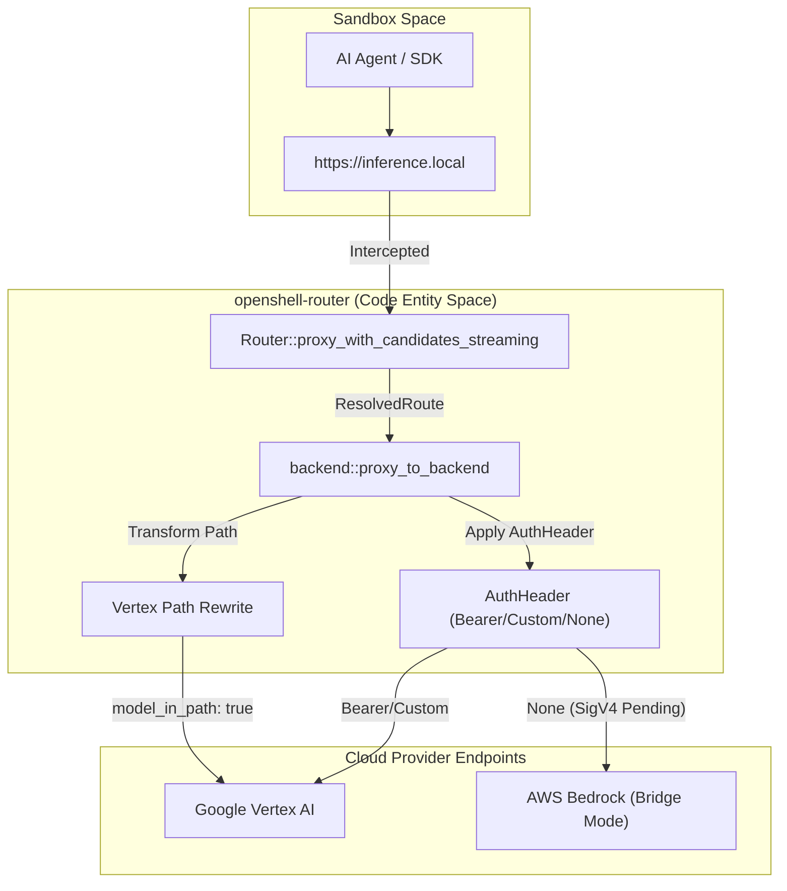
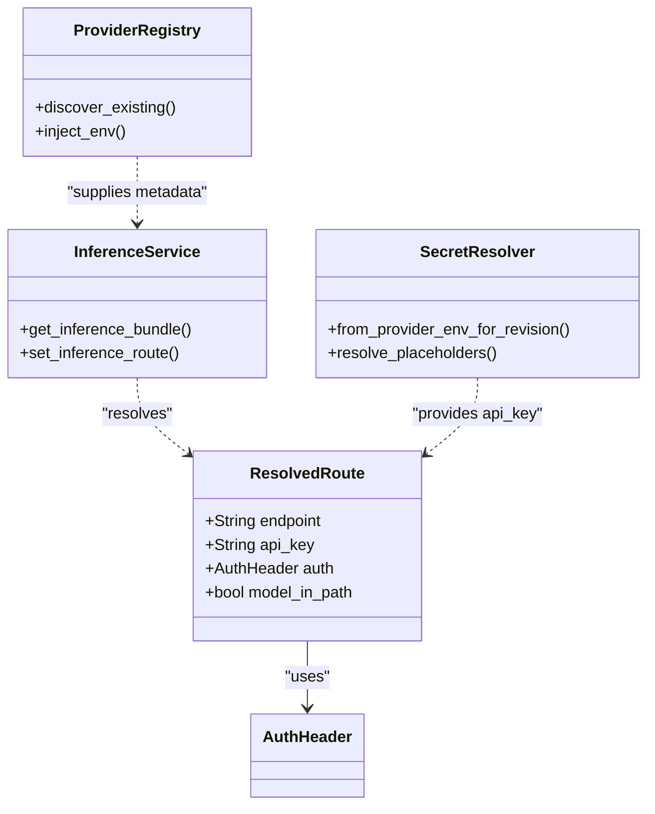

<!-- source: DeepWiki mcp.deepwiki.com · repo NVIDIA/OpenShell · page 10.6 Cloud Provider Integrations · fetched 2026-10-26 -->

# Cloud Provider Integrations

Relevant source files

The following files were used as context for generating this wiki page:

- [crates/openshell-core/src/google_cloud.rs](crates/openshell-core/src/google_cloud.rs)
- [crates/openshell-core/src/provider_credentials.rs](crates/openshell-core/src/provider_credentials.rs)
- [crates/openshell-isolation-interface/src/linux/socket_registry.rs](crates/openshell-isolation-interface/src/linux/socket_registry.rs)
- [crates/openshell-providers/src/lib.rs](crates/openshell-providers/src/lib.rs)
- [crates/openshell-providers/src/providers/mod.rs](crates/openshell-providers/src/providers/mod.rs)
- [crates/openshell-sandbox/src/network_broker.rs](crates/openshell-sandbox/src/network_broker.rs)
- [crates/openshell-supervisor-network/src/google_cloud_metadata.rs](crates/openshell-supervisor-network/src/google_cloud_metadata.rs)
- [crates/openshell-supervisor-network/src/lib.rs](crates/openshell-supervisor-network/src/lib.rs)
- [docs/how-it-works/providers/google.mdx](docs/how-it-works/providers/google.mdx)
- [e2e/python/Dockerfile.workload](e2e/python/Dockerfile.workload)
- [e2e/python/test_sandbox_providers.py](e2e/python/test_sandbox_providers.py)

OpenShell provides specialized integrations for major cloud providers to ensure secure, authenticated access to AI services and infrastructure from within sandboxed environments. These integrations handle complex credential signing (AWS SigV4), dynamic token injection (Google Cloud ADC), and protocol-aware routing (Vertex AI).

## Overview of Integration Components

The integration system bridges the gap between raw cloud credentials and the sandbox's local interfaces. It consists of three primary layers:

1.  **Provider Registry**: A centralized plugin system in `openshell-providers` that handles discovery of credentials from the host environment [crates/openshell-providers/src/lib.rs:102-125]().
2.  **Inference Routing**: The `inference.local` system that intercepts LLM calls and applies cloud-specific auth and path transformations [crates/openshell-server/src/inference.rs:43-57]().
3.  **Credential Resolver**: A security layer that manages secret placeholders, preventing raw keys from leaking into logs or persistent storage.

### Integration Data Flow

The following diagram illustrates how a request from a sandbox to `inference.local` is transformed into an authenticated cloud provider request using the internal routing logic.

**Diagram: Inference Request Transformation Flow**

Sources: [crates/openshell-router/src/lib.rs:61-99](), [crates/openshell-router/src/backend.rs:183-205](), [crates/openshell-core/src/inference.rs:16-30]()

---

## Credential Discovery and Injection

OpenShell uses a "placeholder" system to prevent raw secrets from ever being persisted in the sandbox specification or visible in cleartext within the sandbox environment unless explicitly resolved by the supervisor.

### Placeholder Visibility
Sandbox child processes see provider environment variables as placeholders rather than raw secrets.
*   **Placeholder Format**: `openshell:resolve:env:<KEY>` [e2e/python/test_sandbox_providers.py:41-48]()
*   **Resolution**: The `SecretResolver` manages these placeholders, ensuring that the `redacted_target` is used for logging while the `resolved` target is used for upstream forwarding.

### Provider Registry and Plugins
The `ProviderRegistry` manages different cloud and service plugins. Each plugin can discover credentials from the local environment and inject specific environment variables into the sandbox [crates/openshell-providers/src/lib.rs:59-79]().

| Provider ID | Discovery Strategy | Credential Env Vars |
| :--- | :--- | :--- |
| `google-vertex-ai` | `VertexProvider` | `GOOGLE_VERTEX_AI_TOKEN`, `VERTEX_AI_TOKEN` [crates/openshell-core/src/inference.rs:115-120]() |
| `anthropic` | `SPEC` | `ANTHROPIC_API_KEY` [crates/openshell-core/src/inference.rs:100-104]() |
| `openai` | `SPEC` | `OPENAI_API_KEY` [crates/openshell-core/src/inference.rs:89-93]() |
| `nvidia` | `SPEC` | `NVIDIA_API_KEY` [crates/openshell-core/src/inference.rs:158-162]() |
| `aws-bedrock` | `Generic` | `AWS_ACCESS_KEY_ID`, `AWS_SECRET_ACCESS_KEY` (deferred) [crates/openshell-core/src/inference.rs:87-88]() |

Sources: [crates/openshell-providers/src/lib.rs:107-125](), [crates/openshell-core/src/inference.rs:89-165]()

---

## Cloud Provider Specific Integrations

### Google Cloud Integration

The `google-cloud` provider enables sandboxes to access Google Cloud APIs (e.g., Cloud Storage, BigQuery, Vertex AI) with native GCP credentials. It achieves this by emulating the GCE metadata server and injecting credential placeholders.

#### Authentication Flows
OpenShell supports two primary authentication flows for Google Cloud:

1.  **Application Default Credentials (gcloud ADC)**:
    *   The gateway exchanges a refresh token for short-lived access tokens.
    *   Configured using `--from-gcloud-adc` or by manually providing `client_id`, `client_secret`, and `refresh_token` for the `oauth2-refresh-token` strategy [docs/how-it-works/providers/google.mdx:38-81]().
2.  **Service Account Key**:
    *   The gateway signs JWTs and exchanges them for access tokens using the `google-service-account-jwt` strategy.
    *   Requires `client_email` and `private_key` from a service account JSON key file [docs/how-it-works/providers/google.mdx:88-110]().

#### Configuration Keys
The following configuration keys can be set with `--config key=value` during provider creation:

| Key | Description | Example |
|-----|-------------|---------|
| `project_id` | GCP project ID | `my-project-123` |
| `region` | GCP region | `us-central1` |
| `service_account_email` | Optional SA email for metadata endpoint | `sa@proj.iam.gserviceaccount.com` |

Sources: [docs/how-it-works/providers/google.mdx:113-121](), [crates/openshell-core/src/google_cloud.rs:39-46]()

#### How it Works: GCE Metadata Server Emulation
When a sandbox starts with the `google-cloud` provider:
1.  The gateway mints a fresh GCP access token and stores it in the sandbox proxy's credential resolver [docs/how-it-works/providers/google.mdx:129-130]().
2.  The sandbox relays HTTP requests to the reserved `127.0.0.1:8174` metadata endpoint. The supervisor emulates the GCE instance metadata API and serves credential placeholders to GCP SDKs [docs/how-it-works/providers/google.mdx:131-134]().
    *   The `openshell-supervisor-network::google_cloud_metadata` module implements this emulation [crates/openshell-supervisor-network/src/google_cloud_metadata.rs:1-14]().
    *   The `METADATA_LOOPBACK_ADDR` constant defines the reserved loopback address [crates/openshell-core/src/google_cloud.rs:19]().
    *   Requests to this address are handled by `handle_forward_request` in the supervisor [crates/openshell-supervisor-network/src/google_cloud_metadata.rs:53-65]().
3.  When an SDK makes an API call, it sends the placeholder in the `Authorization` header. The sandbox proxy TLS-terminates the connection, resolves the placeholder to the real token, and forwards the request to GCP [docs/how-it-works/providers/google.mdx:135-138]().
4.  The gateway automatically refreshes tokens before expiry, and the proxy's resolver is updated atomically [docs/how-it-works/providers/google.mdx:139-141]().

Configuration values like `project_id`, `region`, and `service_account_email` are visible as environment variables inside the sandbox, but access tokens are never exposed directly [docs/how-it-works/providers/google.mdx:143-146]().

#### Injected Environment Variables
The `google-cloud` provider automatically injects several environment variables into the sandbox:

| Variable | Value | Purpose |
|----------|-------|---------|
| `GCE_METADATA_HOST` | `127.0.0.1:8174` | GCP SDK metadata discovery (supervisor emulator) |
| `GCE_METADATA_IP` | `127.0.0.1:8174` | Python `google-auth` ping detection |
| `METADATA_SERVER_DETECTION` | `assume-present` | Node.js `gcp-metadata` skip detection |
| `GCP_PROJECT_ID` | from `project_id` config | GCP SDK project |
| `GOOGLE_CLOUD_PROJECT` | from `project_id` config | Alternative project var |
| `CLOUD_ML_REGION` | from `region` config | GCP region |
| `GCP_LOCATION` | from `region` config | Alternative region var |

Sources: [docs/how-it-works/providers/google.mdx:167-175](), [crates/openshell-core/src/google_cloud.rs:29-35](), [crates/openshell-core/src/google_cloud.rs:73-86]()

### AWS SigV4 Signing for Bedrock/S3

OpenShell supports AWS SigV4 signing for services like Bedrock and S3. This is handled by the `openshell-supervisor-network::sigv4` module [crates/openshell-supervisor-network/src/lib.rs:23](). The supervisor intercepts requests to AWS endpoints and applies the necessary SigV4 headers using credentials managed by the gateway. This ensures that sandboxed applications can interact with AWS services without directly handling AWS access keys or secret keys.

### Vertex AI Routing

Vertex AI requires specialized handling because the model ID is often part of the URL path rather than the request body, and it uses Google Cloud IAM tokens.

*   **Endpoint Resolution**: The base URL is dynamically constructed using `VERTEX_AI_PROJECT_ID` and `VERTEX_AI_REGION` [crates/openshell-core/src/inference.rs:122-126](). These are derived from the provider's configuration [crates/openshell-providers/src/lib.rs:28-36]().
*   **Path Rewriting**: If `model_in_path` is true, the router embeds the model identifier into the URL [crates/openshell-router/src/config.rs:55-56]().
*   **Anthropic on Vertex**: Special logic strips `anthropic-beta` headers and `context_management` body fields which Vertex AI's strict Pydantic validation rejects [crates/openshell-router/src/backend.rs:85-93](), [crates/openshell-router/src/backend.rs:139-155]().

The `VertexProvider` plugin in `openshell-providers` is responsible for injecting Vertex-specific environment variables into the sandbox [crates/openshell-providers/src/lib.rs:94-95]().

---

## Implementation Details: Code Entities

The integration relies on the `InferenceService` to resolve bundles and the `Router` to execute the proxy logic.

**Diagram: Provider Management and Resolution**

Sources: [crates/openshell-server/src/inference.rs:67-91](), [crates/openshell-router/src/config.rs:40-60](), [crates/openshell-providers/src/lib.rs:102-125]()

### Inference Route Configuration
Users configure routing via gRPC, which persists `InferenceRouteConfig` objects in the store [proto/inference.proto:59-66]().
*   **Route Names**: Standard routes include `inference.local` (user-facing) and `sandbox-system` (internal) [crates/openshell-server/src/inference.rs:43-44]().
*   **Verification**: The server can synchronously verify the upstream endpoint before persisting the route [proto/inference.proto:84-85](), [crates/openshell-router/src/backend.rs:10-11]().

Sources: [crates/openshell-server/src/inference.rs:1-141](), [crates/openshell-router/src/backend.rs:1-182](), [proto/inference.proto:59-66]()

---

