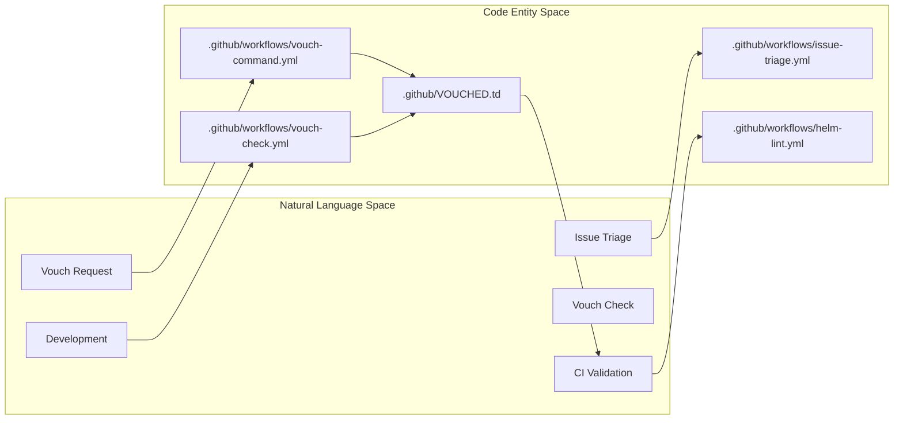
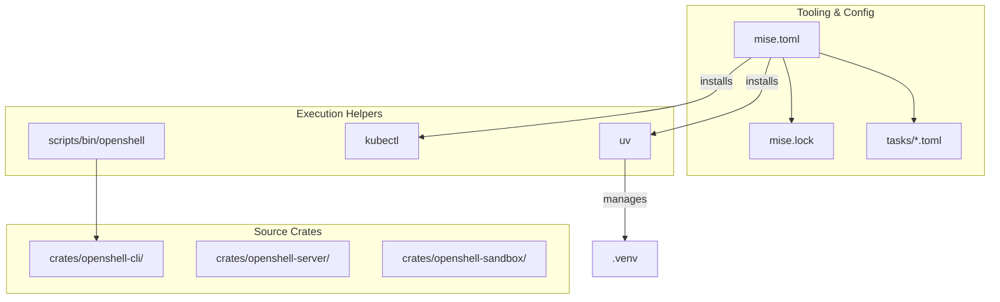

<!-- source: DeepWiki mcp.deepwiki.com · repo NVIDIA/OpenShell · page 11 Development & Contributing · fetched 2026-10-26 -->

# Development & Contributing

Relevant source files

The following files were used as context for generating this wiki page:

- [.agents/skills/build-from-issue/SKILL.md](.agents/skills/build-from-issue/SKILL.md)
- [.agents/skills/create-github-issue/SKILL.md](.agents/skills/create-github-issue/SKILL.md)
- [.agents/skills/create-github-pr/SKILL.md](.agents/skills/create-github-pr/SKILL.md)
- [.agents/skills/create-spike/SKILL.md](.agents/skills/create-spike/SKILL.md)
- [.agents/skills/fix-security-issue/SKILL.md](.agents/skills/fix-security-issue/SKILL.md)
- [.agents/skills/review-security-issue/SKILL.md](.agents/skills/review-security-issue/SKILL.md)
- [.agents/skills/sync-agent-infra/SKILL.md](.agents/skills/sync-agent-infra/SKILL.md)
- [.agents/skills/triage-issue/SKILL.md](.agents/skills/triage-issue/SKILL.md)
- [.github/ISSUE_TEMPLATE/bug_report.yml](.github/ISSUE_TEMPLATE/bug_report.yml)
- [.github/ISSUE_TEMPLATE/feature_request.yml](.github/ISSUE_TEMPLATE/feature_request.yml)
- [.github/PULL_REQUEST_TEMPLATE.md](.github/PULL_REQUEST_TEMPLATE.md)
- [AGENTS.md](AGENTS.md)
- [CONTRIBUTING.md](CONTRIBUTING.md)
- [README.md](README.md)

This page provides an overview of OpenShell's development model and contribution process. OpenShell is built **agent-first**: the project uses AI agents as primary contributors and designs systems to support both human and AI collaboration. This page introduces the contribution workflow, vouch system, development setup, and quality gates.

For specific development setup instructions, see [Development Environment and mise Tasks](#11.1). For details on agent skills and workflow automation, see [Agent-First Development Model and Skills](#11.2). For the RFC process, see [RFC Process](#11.5).

---

## Agent-First Development Philosophy

OpenShell is built with an agent-first approach: we design systems and use AI agents to implement them. This is not "vibe coding" — it's a deliberate architecture where agents are first-class contributors with specialized skills and workflow chains. [CONTRIBUTING.md:1-4](), [AGENTS.md:7-10]()

**The Critical Rule**: You must understand your code. Using AI agents to write code is not just acceptable, it's how this project works. But you must be able to explain what your changes do and how they interact with the rest of the system. If you can't, don't submit it. [CONTRIBUTING.md:5-9]()

This rule is enforced during code review. Submitting agent-generated code without understanding it — regardless of how clean it looks — wastes maintainer time and will result in your PR being closed. [CONTRIBUTING.md:9-9]()

**Key Documents**:
- [CONTRIBUTING.md:1-87]() — Human-facing contribution guide.
- [AGENTS.md:1-115]() — Agent-facing instructions (injected into agent context).

For more details, see [Agent-First Development Model and Skills](#11.2).

Sources: [CONTRIBUTING.md:1-87](), [AGENTS.md:1-115]()

---

## Contribution Workflow Overview

### Natural Language to Code Entity Mapping: Workflow Execution
This diagram bridges the high-level contribution stages to the specific GitHub Action files and scripts that execute them.

**Workflow States**:
1. **Vouch Request** — External contributors open a discussion requesting vouch approval. [CONTRIBUTING.md:25-25]()
2. **Issue Triage** — The `triage-issue` skill is used to assess community issues, validate technical claims, and prepare valid work for human disposition. [.agents/skills/triage-issue/SKILL.md:2-4]()
3. **Development** — Contributors work with agent skills to explore and implement. [CONTRIBUTING.md:15-17]()
4. **Vouch Check** — Automated check against `VOUCHED.td` to prevent spam from unvouched users. [CONTRIBUTING.md:31-31]()
5. **CI Run** — Workflows like `helm-lint.yml` run specialized linting and unit tests. [tasks/helm.toml:25-40]()

For detailed workflow sequences, see [Vouch System and PR Workflows](#11.3).

Sources: [CONTRIBUTING.md:15-25](), [.agents/skills/triage-issue/SKILL.md:2-4](), [tasks/helm.toml:25-40]()

---

## The Vouch System

OpenShell uses a **vouch system** for first-time contributors. This exists because AI makes it trivial to generate plausible-looking but low-quality contributions, and we can no longer trust by default. [CONTRIBUTING.md:21-23]()

**Vouch Process**:
1. **Request Vouch** — Contributor opens a Vouch Request discussion in their own words. [CONTRIBUTING.md:25-27]()
2. **Approval** — A maintainer comments `/vouch` if the request is approved. [CONTRIBUTING.md:28-28]()
3. **Automated Update** — The `vouch-command` workflow appends the username to `.github/VOUCHED.td`. [AGENTS.md:69-71]()
4. **PR Gate** — The `vouch-check` workflow auto-closes PRs from unvouched users. [CONTRIBUTING.md:31-31]()

For details on the vouch request process, see [Vouch System and PR Workflows](#11.3).

Sources: [CONTRIBUTING.md:21-32](), [AGENTS.md:69-71]()

---

## Development Environment Components

### Code Entity Mapping: Local Dev Stack
This diagram maps local development concepts to the specific configuration files and scripts used in the repo.

**Tool Management**: OpenShell uses [mise](https://mise.jdx.dev/) to manage development tools. `mise.toml` declares tool versions (e.g., Python, Rust, Go). Consistency is maintained via `mise.lock`. [mise.toml:21-39]()

**Task System**: Tasks are defined in `tasks/*.toml` (e.g., `tasks/ci.toml`) and included in the mise configuration. [mise.toml:75-76](), [tasks/ci.toml:1-80]()

For environment setup and mise task details, see [Development Environment and mise Tasks](#11.1).

Sources: [mise.toml](), [mise.lock](), [tasks/ci.toml]()

---

## Agent Skills Architecture

Agent skills live in `.agents/skills/`. Your agent's harness can discover and load them natively to assist with development tasks. [CONTRIBUTING.md:73-73](), [AGENTS.md:15-17]()

**Key Skills**:
- `triage-issue`: Assess and route community-filed issues. [.agents/skills/triage-issue/SKILL.md:2-4]()
- `build-from-issue`: Plan and implement work from a GitHub issue. [.agents/skills/build-from-issue/SKILL.md:2-4]()
- `create-spike`: Investigate a problem and produce a structured issue. [.agents/skills/create-spike/SKILL.md:2-4]()
- `create-github-issue`: Create well-structured GitHub issues. [.agents/skills/create-github-issue/SKILL.md:2-4]()
- `create-github-pr`: Create GitHub pull requests. [.agents/skills/create-github-pr/SKILL.md:2-4]()
- `openshell-cli`: CLI usage, sandbox lifecycle, provider management, and BYOC workflows. [CONTRIBUTING.md:81-81]()
- `debug-openshell-cluster`: Diagnose gateway deployment and health issues. [CONTRIBUTING.md:82-82]()

For a full catalog of skills, see [Agent-First Development Model and Skills](#11.2).

Sources: [CONTRIBUTING.md:73-93](), [AGENTS.md:15-17](), [.agents/skills/triage-issue/SKILL.md:2-4](), [.agents/skills/build-from-issue/SKILL.md:2-4](), [.agents/skills/create-spike/SKILL.md:2-4](), [.agents/skills/create-github-issue/SKILL.md:2-4](), [.agents/skills/create-github-pr/SKILL.md:2-4]()

---

## Testing and CI Pipeline

OpenShell employs a multi-tiered CI system to ensure quality across Rust and Python components.

**CI Gates**:
- **Task Runner**: `mise ci` runs the full suite of checks including linting, type checks, and tests. [tasks/ci.toml:68-71]()
- **Docker Build**: A dedicated CI runner image `ghcr.io/nvidia/openshell/ci:latest` contains all pre-installed development tools. [deploy/docker/Dockerfile.ci:6-90]()
- **mise Integration**: CI jobs use `mise install --locked` to ensure consistent tool versions across environments. [deploy/docker/Dockerfile.ci:81-81]()
- **CI Automation**: The `ci-image.yml` workflow manages the multi-arch build and merge of the CI runner image. [.github/workflows/ci-image.yml:1-108]()

Sources: [tasks/ci.toml:68-71](), [deploy/docker/Dockerfile.ci:6-90](), [.github/workflows/ci-image.yml:1-108]()

---

## RFC and Documentation Process

Substantial changes to the OpenShell architecture or policy system require a formal proposal.

**RFC Process**:
Proposed changes follow the RFC (Request for Comments) lifecycle. Agents can assist using the `create-rfc` skill. [CONTRIBUTING.md:92-92]() RFCs are managed in the `rfc/` directory. For details, see [RFC Process](#11.5).

**Documentation Guidelines**:
Documentation is published via a Fern-based pipeline. [AGENTS.md:62-62]() Updates are expected for any change affecting gateway configuration or user-facing CLI behavior. The `update-docs` skill helps automate these updates. [CONTRIBUTING.md:84-84]() For style guides and technical details, see [Documentation System](#11.4).

Sources: [CONTRIBUTING.md:84-92](), [AGENTS.md:62-62]()

---

## Project Structure

| Path | Components | Purpose |
|------|-----------|---------|
| `crates/openshell-cli/` | CLI binary | User-facing command-line interface. [AGENTS.md:32-32]() |
| `crates/openshell-server/` | Gateway server | Control-plane API and sandbox lifecycle. [AGENTS.md:33-33]() |
| `crates/openshell-sandbox/` | Sandbox runtime | Capability-free workload launcher, process identity, and seccomp-mediated I/O. [AGENTS.md:28-28]() |
| `crates/openshell-policy/` | Policy engine | Filesystem, network, and process constraints. [AGENTS.md:33-33]() |
| `python/openshell/` | Python SDK | Python bindings and CLI packaging. [AGENTS.md:62-62]() |
| `.agents/skills/` | Agent skills | Internal contributor and maintainer workflows. [AGENTS.md:16-17]() |
| `skills/` | Public skills | Installable workflows for using and operating OpenShell. [AGENTS.md:13-14]() |
| `deploy/` | Docker, Helm, K8s | Deployment manifests and CI configuration. [AGENTS.md:65-65]() |

Sources: [AGENTS.md:13-65]()

---

