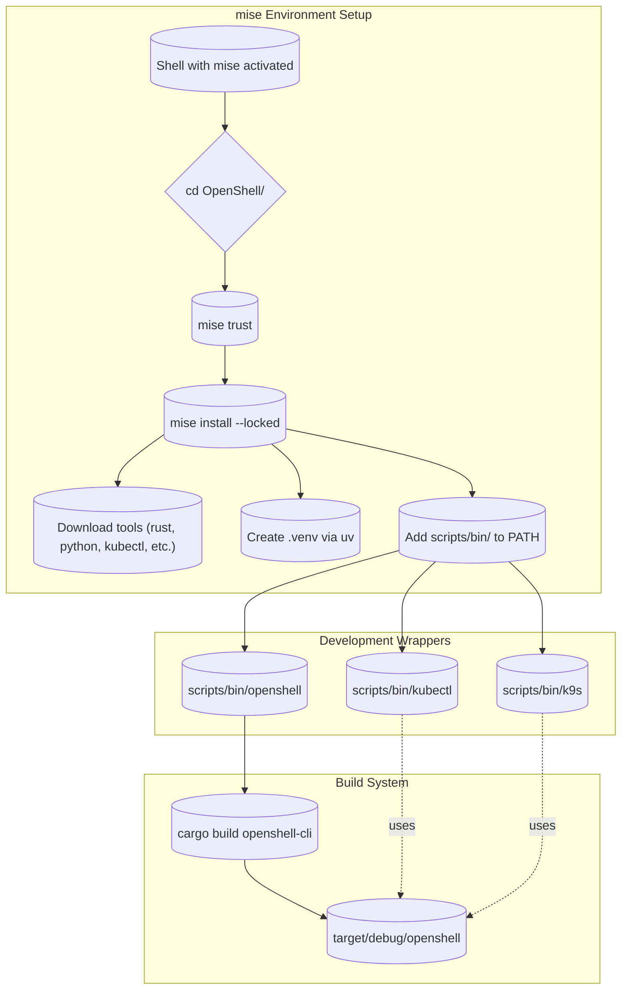
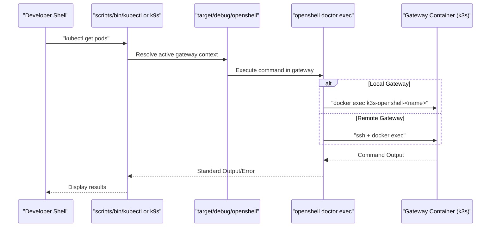

<!-- source: DeepWiki mcp.deepwiki.com · repo NVIDIA/OpenShell · page 11.1 Development Environment and mise Tasks · fetched 2026-10-26 -->

# Development Environment and mise Tasks

<details>
<summary>Relevant source files</summary>

The following files were used as context for generating this wiki page:

- [.agents/skills/watch-github-actions/SKILL.md](.agents/skills/watch-github-actions/SKILL.md)
- [.github/actions/build-rust-binary/action.yml](.github/actions/build-rust-binary/action.yml)
- [.github/actions/check-protobuf-compatibility/action.yml](.github/actions/check-protobuf-compatibility/action.yml)
- [.github/actions/setup-nix/action.yml](.github/actions/setup-nix/action.yml)
- [.github/actions/setup-rust/action.yml](.github/actions/setup-rust/action.yml)
- [.github/workflows/branch-checks.yml](.github/workflows/branch-checks.yml)
- [.github/workflows/build-binaries.yml](.github/workflows/build-binaries.yml)
- [.github/workflows/build-vm-driver.yml](.github/workflows/build-vm-driver.yml)
- [.github/workflows/ci-image.yml](.github/workflows/ci-image.yml)
- [.github/workflows/trivy-changes.yml](.github/workflows/trivy-changes.yml)
- [.github/workflows/trivy-scan.yml](.github/workflows/trivy-scan.yml)
- [.github/workflows/workflow-security.yml](.github/workflows/workflow-security.yml)
- [.gitignore](.gitignore)
- [crates/openshell-core/src/settings.rs](crates/openshell-core/src/settings.rs)
- [crates/openshell-ocsf/Cargo.toml](crates/openshell-ocsf/Cargo.toml)
- [crates/openshell-ocsf/src/enums/activity.rs](crates/openshell-ocsf/src/enums/activity.rs)
- [crates/openshell-ocsf/src/enums/device_type.rs](crates/openshell-ocsf/src/enums/device_type.rs)
- [crates/openshell-ocsf/src/enums/mod.rs](crates/openshell-ocsf/src/enums/mod.rs)
- [crates/openshell-ocsf/src/lib.rs](crates/openshell-ocsf/src/lib.rs)
- [crates/openshell-ocsf/src/objects/device.rs](crates/openshell-ocsf/src/objects/device.rs)
- [crates/openshell-ocsf/src/objects/metadata.rs](crates/openshell-ocsf/src/objects/metadata.rs)
- [crates/openshell-ocsf/src/validation/mod.rs](crates/openshell-ocsf/src/validation/mod.rs)
- [crates/openshell-ocsf/src/validation/schema.rs](crates/openshell-ocsf/src/validation/schema.rs)
- [crates/openshell-ocsf/tests/event_identity.rs](crates/openshell-ocsf/tests/event_identity.rs)
- [deploy/docker/Dockerfile.ci](deploy/docker/Dockerfile.ci)
- [docs/observability/ocsf-json-export.mdx](docs/observability/ocsf-json-export.mdx)
- [flake.nix](flake.nix)
- [mise.lock](mise.lock)
- [mise.toml](mise.toml)
- [pyproject.toml](pyproject.toml)
- [scripts/bin/openshell](scripts/bin/openshell)
- [tasks/ci.toml](tasks/ci.toml)
- [tasks/python.toml](tasks/python.toml)
- [tasks/rust.toml](tasks/rust.toml)
- [tasks/typescript.toml](tasks/typescript.toml)
- [uv.lock](uv.lock)

</details>


This page documents the prerequisites, tools, and initial configuration required to develop OpenShell. It covers `mise` installation, tool bootstrapping, the local `openshell` script wrapper, and specialized development tasks for gateway providers.

For guidance on the agent-first development philosophy and contribution workflows, see [Agent-First Development Model and Skills](#11.2). For details on the complete mise task system, see [Common Development Tasks](#common-development-tasks).

## Prerequisites

OpenShell development requires three system-level dependencies:

| Dependency | Minimum Version | Purpose |
|------------|----------------|---------|
| Docker | 20.10+ | Container runtime for gateway and cluster deployment |
| mise | 2026.9.9+ | Development tool manager and task runner [mise.toml:10]() |
| Git | 2.30+ | Version control and repository operations |

The `mise` tool manager bootstraps all other development dependencies including Rust, Python, kubectl, helm, protoc, and specialized build tools. All versions are pinned in `mise.toml` [mise.toml:21-45]() and locked in `mise.lock` [mise.lock:1-125]().

**Sources:** [mise.toml:10-45](), [mise.lock:1-125]()

## mise Installation and Activation

### Installing mise

```bash
# Install mise (macOS/Linux)
curl https://mise.run | sh
```

This installs `mise` to `~/.local/bin/mise`. The binary must be activated in your shell to modify `PATH` and environment variables. The project requires a minimum version of `2026.9.9` [mise.toml:10](). The CI environment uses this same version to ensure environment parity [deploy/docker/Dockerfile.ci:70-71]().

**Sources:** [mise.toml:10-10](), [deploy/docker/Dockerfile.ci:70-71]()

### Shell Activation

Add mise activation to your shell configuration:

```bash
# Fish
echo '~/.local/bin/mise activate fish | source' >> ~/.config/fish/config.fish

# Zsh
echo 'eval "$(~/.local/bin/mise activate zsh)"' >> ~/.zshrc

# Bash
echo 'eval "$(~/.local/bin/mise activate bash)"' >> ~/.bashrc
```

Restart your shell or source the configuration file. Verify activation by running `mise --version`.

## Initial Repository Setup

### One-Time Trust

The OpenShell repository includes `mise.toml` configuration that modifies `PATH` and sets environment variables. `mise` requires explicit trust before executing repository-local configurations:

```bash
cd /path/to/OpenShell
mise trust
```

This creates a trust marker for the repository. The trust check prevents malicious repositories from executing arbitrary code through `mise.toml`. This step is also performed in the CI container setup [deploy/docker/Dockerfile.ci:80-80]().

**Sources:** [deploy/docker/Dockerfile.ci:80-80]()

### Tool Installation

After trusting the repository, `mise` automatically installs all pinned tools on first use:

```bash
mise install
```

This reads `[tools]` in `mise.toml` and installs:

| Tool | Version | Purpose |
|------|---------|---------|
| `python` | 3.14.5 | Python SDK development and test execution [mise.toml:22]() |
| `rust` | 1.95.0 | Core Rust crate development [mise.toml:23]() |
| `kubectl` | 1.36.1 | Kubernetes cluster interaction [mise.toml:25]() |
| `uv` | 0.10.12 | Fast Python package management [mise.toml:26]() |
| `protoc` | 29.6 | Protocol buffer compilation [mise.toml:27]() |
| `go` | 1.26.7 | Support for Go-based tooling and SDKs [mise.toml:28]() |
| `helm` | 4.2.0 | Helm chart management and deployment [mise.toml:34]() |
| `sccache` | 0.16.0 | Distributed compilation caching [mise.toml:53]() |
| `syft` | 1.44.0 | SBOM generation [mise.toml:41]() |
| `zig` | 0.14.1 | Cross-compilation support [mise.toml:45]() |
| `k3d` | 5.8.3 | Local k3s-in-Docker (macOS only) [mise.toml:40]() |

**Sources:** [mise.toml:21-53](), [deploy/docker/Dockerfile.ci:81-81]()

### Environment Configuration

`mise` configures environment variables defined in `[env]` in `mise.toml`:

| Variable | Value | Purpose |
|----------|-------|---------|
| `PATH` | Prepends `scripts/bin/` | Makes `openshell`, `kubectl`, `k9s` wrappers available [mise.toml:59]() |
| `KUBECONFIG` | `{{config_root}}/kubeconfig` | Isolates cluster credentials to repo root [mise.toml:63]() |
| `UV_CACHE_DIR` | `{{config_root}}/.cache/uv` | Centralizes Python package cache [mise.toml:64]() |
| `RUSTC_WRAPPER` | `sccache` | Enables Rust compilation caching [mise.toml:68]() |
| `SCCACHE_DIR` | `{{config_root}}/.cache/sccache` | Local disk cache for sccache [mise.toml:69]() |

The `.venv` Python virtual environment is automatically created at the repository root and activated when inside the repository [mise.toml:60]().

**Sources:** [mise.toml:58-73]()

## Development Tool Flow

The following diagram maps the setup process to the resulting code entities and filesystem locations.

**Setup to Entity Mapping**


**Sources:** [mise.toml:58-64](), [deploy/docker/Dockerfile.ci:80-82]()

## The `openshell` Script Wrapper

The repository includes a wrapper script at `scripts/bin/openshell` that provides a seamless development CLI experience. This script is added to `PATH` by mise configuration [mise.toml:59]().

### Wrapper Behavior

When invoked, `scripts/bin/openshell`:
1. Detects if `target/debug/openshell` exists.
2. If missing or stale, it triggers a rebuild of the CLI component.
3. Executes `target/debug/openshell` with all provided arguments.

This ensures that developers always interact with the latest version of the code without needing manual build steps before every command.

**Sources:** [mise.toml:59-59]()

## Local Gateway Development

OpenShell provides scripts to run standalone gateways using different compute drivers for local manual testing. These are primarily invoked via `mise run`.

### Compute Driver Selection
The `tasks/scripts/gateway.sh` script handles auto-detection of the compute driver in the order: **Kubernetes -> Podman -> Docker**.

| Command | Driver | Description |
|---------|--------|-------------|
| `mise run gateway:docker` | Docker | Starts a gateway using `openshell-gateway` binary and Docker. |
| `mise run gateway:vm` | VM | Starts a gateway using the experimental libkrun-based MicroVM runtime. |
| `mise run gateway:podman` | Podman | Starts a gateway using Podman; requires `podman` service to be reachable. |

### Gateway Configuration and Metadata
When a local gateway is started, the scripts register metadata (endpoint, port, auth mode) in `~/.config/openshell/gateways/<name>/metadata.json`. They also update `~/.config/openshell/active_gateway` so the CLI automatically targets the new gateway.

**Sources:** No direct file citations for `tasks/scripts/gateway.sh`, `tasks/scripts/gateway-docker.sh`, `tasks/scripts/gateway-vm.sh` were provided in the given content.

## Cluster Debugging Helpers

OpenShell provides wrapper scripts in `scripts/bin/` that facilitate debugging the gateway's internal k3s cluster.

### kubectl and k9s Wrappers
`scripts/bin/kubectl` and `scripts/bin/k9s` are configured to point at the repository-local `KUBECONFIG` [mise.toml:63](). This allows developers to monitor pods and resource states within the OpenShell gateway cluster without interfering with global Kubernetes configurations.

### Debugging Architecture

**Cluster Debugging Flow**


**Sources:** [mise.toml:63-63]()

## Common Development Tasks

The mise task system provides standardized commands for development workflows, defined in `tasks/*.toml` [mise.toml:80]().

### Task Inclusion and Structure

The `mise.toml` file includes all task definitions from the `tasks/` directory [mise.toml:80](). This modular approach allows for organizing tasks by domain (e.g., `tasks/ci.toml`, `tasks/python.toml`, `tasks/rust.toml`).

**Mise Task System Overview**

```mermaid
graph TD
    A[".mise.toml"] --> B["task_config.includes = ['tasks/*.toml']"];
    B --> C["tasks/ci.toml"];
    B --> D["tasks/python.toml"];
    B --> E["tasks/rust.toml"];
    B --> F["tasks/typescript.toml"];

    C --> C1["ci: Run full checks"];
    C --> C2["lint: Run all linters"];
    C --> C3["build: Build project"];

    D --> D1["python:dev: Install Python SDK"];
    D --> D2["python:lint: Lint Python code"];
    D --> D3["python:format: Format Python code"];
    D --> D4["python:typecheck: Type check Python code"];
    D --> D5["python:proto: Generate Python protobuf stubs"];

    E --> E1["rust:check: Check Rust crates"];
    E --> E2["rust:lint: Lint Rust code"];
    E --> E3["rust:format: Format Rust code"];
    E --> E4["rust:deny: Check dependencies"];
    E --> E5["perf:seccomp: Compare TCP socket performance"];

    F --> F1["sdk:ts:typecheck: Type check TypeScript SDK"];
    F --> F2["sdk:ts:lint: Lint TypeScript SDK"];
    F --> F3["sdk:ts:format: Format TypeScript SDK"];
```


**Sources:** [mise.toml:80-80](), [tasks/ci.toml:1-81](), [tasks/python.toml:1-69](), [tasks/rust.toml:1-98](), [tasks/typescript.toml]()

### Helm and Kubernetes Tasks
| Task | Command | Purpose |
|------|---------|---------|
| `helm:lint` | `mise run helm:lint` | Lint the openshell Helm chart across variants. |
| `helm:test` | `mise run helm:test` | Run Helm chart unit tests using `helm-unittest`. |
| `helm:docs` | `mise run helm:docs` | Generate the Helm chart README from templates. |
| `helm:k3s:create` | `mise run helm:k3s:create` | Create a local k3s cluster with k3d. |
| `helm:skaffold:dev` | `mise run helm:skaffold:dev` | Iterative deployment to Kubernetes via Skaffold. |

**Sources:** No direct file citations for `tasks/helm.toml` were provided in the given content.

### Build and Quality Tasks
| Task | Command | Description |
|------|---------|-------------|
| `ci` | `mise run ci` | Run full checks: lint, compile, and tests [tasks/ci.toml:70]() |
| `build` | `mise run build` | Build workspace, Docker images, and Python wheels [tasks/ci.toml:7]() |
| `lint` | `mise run lint` | Run all linters (Rust, Python, Helm, Markdown, Proto) [tasks/ci.toml:54-67]() |
| `rust:check` | `mise run rust:check` | Fast compile check for all crates [tasks/rust.toml:10]() |
| `python:typecheck` | `mise run python:typecheck` | Type check Python code using `ty` [tasks/python.toml:61]() |
| `rust:deny:policy` | `mise run rust:deny:policy` | Check dependencies for license violations, bans, and source restrictions [tasks/rust.toml:65]() |
| `rust:verify:telemetry-off` | `mise run rust:verify:telemetry-off` | Verify telemetry emission code is compiled out with `--no-default-features` [tasks/rust.toml:68]() |
| `rust:verify:defaults-without-telemetry` | `mise run rust:verify:defaults-without-telemetry` | Verify the `defaults-without-telemetry` feature alias [tasks/rust.toml:85]() |
| `rust:verify:system-ca-roots` | `mise run rust:verify:system-ca-roots` | Verify system CA roots build mode compiles and excludes bundled Mozilla root crates [tasks/rust.toml:89]() |

**Sources:** [tasks/ci.toml:6-77](), [tasks/rust.toml:6-98](), [tasks/python.toml:6-69]()

## CI Environment Replication

The CI build environment is defined in `deploy/docker/Dockerfile.ci`. This image pre-installs all `mise` tools to ensure environment parity.

*   **System Dependencies:** Installs `libz3-dev` (for `openshell-prover`), `libssl-dev`, `musl-tools`, `clang`, and `zig` [deploy/docker/Dockerfile.ci:22-44]().
*   **Mise Sync:** The CI image installs `mise` [deploy/docker/Dockerfile.ci:71]() and runs `mise install --locked` using the same `mise.toml` and `mise.lock` files from the repository [deploy/docker/Dockerfile.ci:74-81]().
*   **Sccache:** CI leverages `sccache` for faster Rust builds [mise.toml:68-69]().

**Sources:** [deploy/docker/Dockerfile.ci:1-90](), [mise.toml:68-69]()

## Troubleshooting Setup Issues

### mise trust fails
If `mise trust` reports errors, ensure you are in the repository root. `mise` requires this trust step before it will load environment variables like `KUBECONFIG` [mise.toml:63]().

### sccache not working
Verify that `RUSTC_WRAPPER` is set to `sccache` [mise.toml:68](). You can check cache status with `sccache --show-stats`.

### Tool Version Mismatch
If a tool version differs from the documentation, run `mise install` to sync your local environment with `mise.toml` [mise.toml:21-45]().

**Sources:** [mise.toml:1-80]()

---

