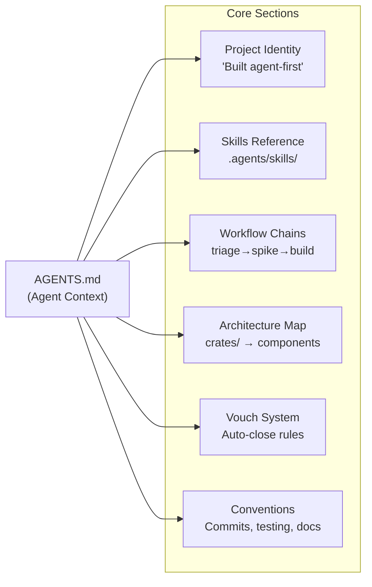
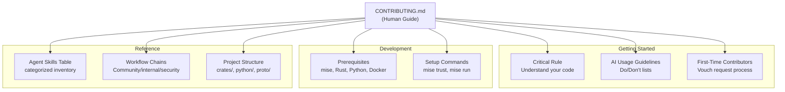
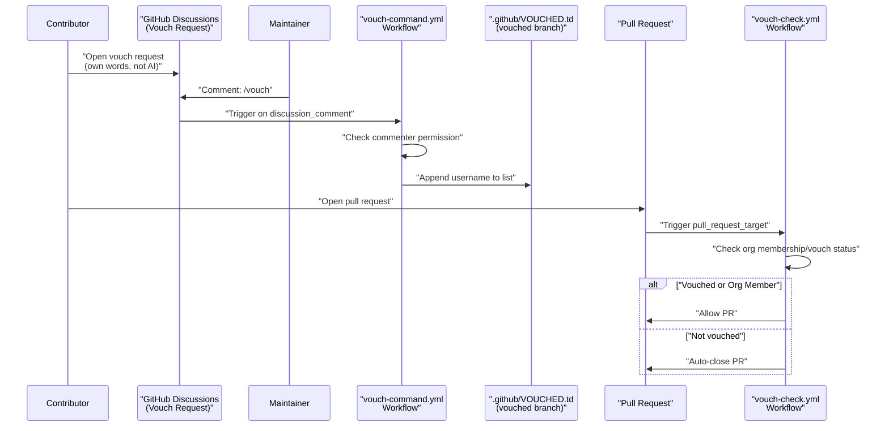
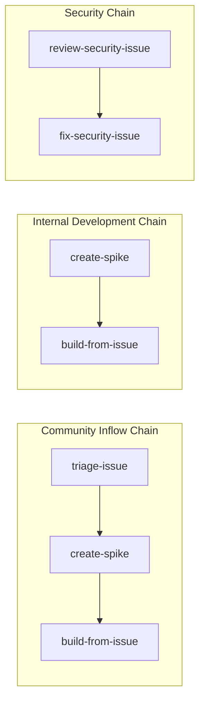
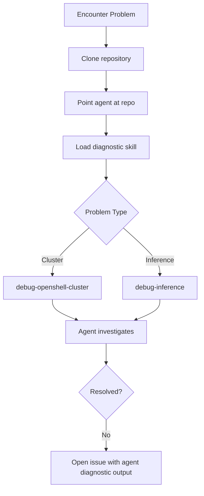

<!-- source: DeepWiki mcp.deepwiki.com · repo NVIDIA/OpenShell · page 11.2 Agent-First Development Model and Skills · fetched 2026-10-26 -->

# Agent-First Development Model and Skills

<details>
<summary>Relevant source files</summary>

The following files were used as context for generating this wiki page:

- [.agents/skills/build-from-issue/SKILL.md](.agents/skills/build-from-issue/SKILL.md)
- [.agents/skills/create-github-issue/SKILL.md](.agents/skills/create-github-issue/SKILL.md)
- [.agents/skills/create-github-pr/SKILL.md](.agents/skills/create-github-pr/SKILL.md)
- [.agents/skills/create-spike/SKILL.md](.agents/skills/create-spike/SKILL.md)
- [.agents/skills/fix-security-issue/SKILL.md](.agents/skills/fix-security-issue/SKILL.md)
- [.agents/skills/review-github-pr/SKILL.md](.agents/skills/review-github-pr/SKILL.md)
- [.agents/skills/review-security-issue/SKILL.md](.agents/skills/review-security-issue/SKILL.md)
- [.agents/skills/sync-agent-infra/SKILL.md](.agents/skills/sync-agent-infra/SKILL.md)
- [.agents/skills/triage-issue/SKILL.md](.agents/skills/triage-issue/SKILL.md)
- [.agents/skills/update-docs/SKILL.md](.agents/skills/update-docs/SKILL.md)
- [.claude/agents/principal-engineer-reviewer.md](.claude/agents/principal-engineer-reviewer.md)
- [.github/ISSUE_TEMPLATE/bug_report.yml](.github/ISSUE_TEMPLATE/bug_report.yml)
- [.github/ISSUE_TEMPLATE/feature_request.yml](.github/ISSUE_TEMPLATE/feature_request.yml)
- [.github/PULL_REQUEST_TEMPLATE.md](.github/PULL_REQUEST_TEMPLATE.md)
- [AGENTS.md](AGENTS.md)
- [CONTRIBUTING.md](CONTRIBUTING.md)
- [README.md](README.md)
- [docs/CONTRIBUTING.mdx](docs/CONTRIBUTING.mdx)

</details>


This document explains OpenShell's agent-first development philosophy, the distinction between `AGENTS.md` and `CONTRIBUTING.md`, the vouch system for trust management, agent skills infrastructure, and the critical rule that governs all contributions.

## Philosophy: Agent-First, Not Agent-Only

OpenShell is built **agent-first**. The project designs systems and uses agents to implement them — this is not "vibe coding" [AGENTS.md:9](). The distinction between agent-first and agent-only is fundamental to how the project operates.

**Agent-first means:**
- AI agents are the primary tool for code exploration, diagnostics, and implementation [CONTRIBUTING.md:15]().
- The `.agents/skills/` directory provides specialized capabilities that make agents effective [CONTRIBUTING.md:16]().
- Architecture is documented in machine-readable formats that agents can consume [AGENTS.md:3]().

**Agent-first is NOT agent-only:**
- Humans must understand every change they submit, even if an agent wrote it [CONTRIBUTING.md:7]().
- Design decisions are made by humans, implementation is accelerated by agents [AGENTS.md:9]().
- Quality gates enforce human comprehension, not just passing tests [CONTRIBUTING.md:9]().

**Philosophy and Process Flow**

```mermaid
graph TB
    subgraph "Agent-First Philosophy"
        DESIGN["Human: System Design<br/>Architecture Decisions"]
        AGENT_IMPL["Agent: Implementation<br/>Code Generation"]
        HUMAN_REVIEW["Human: Code Review<br/>Understanding Verification"]
        SUBMIT["Submit PR"]
    end
    
    subgraph "Agent-Only (Explicitly Rejected)"
        AUTO_GEN["Agent Generates Code"]
        AUTO_SUBMIT["Auto-Submit PR"]
        STYLE1["❌ No Human Understanding Required"]
    end
    
    DESIGN --> AGENT_IMPL
    AGENT_IMPL --> HUMAN_REVIEW
    HUMAN_REVIEW -->|"Can explain every line"| SUBMIT
    HUMAN_REVIEW -->|"Cannot explain"| AGENT_IMPL
    
    AUTO_GEN -.->|"Not allowed"| AUTO_SUBMIT
    AUTO_SUBMIT -.-> STYLE1
```


Sources: [CONTRIBUTING.md:3-20](), [AGENTS.md:1-10]()

## The Critical Rule

The project enforces one non-negotiable requirement:

> **You must understand your code.** [CONTRIBUTING.md:7]()

This means:
- You can use AI agents to write code (encouraged) [CONTRIBUTING.md:7]().
- You must be able to explain what your changes do without the agent open [CONTRIBUTING.md:18]().
- You must understand how your changes interact with the rest of the system [CONTRIBUTING.md:7]().
- Submitting code you cannot explain wastes maintainer time and results in PR closure [CONTRIBUTING.md:9]().
- Repeat offenders are blocked from the project [CONTRIBUTING.md:9]().

During review, maintainers will ask: **"Can you explain this code?"** If the answer is no, the PR is closed regardless of how clean it looks.

Sources: [CONTRIBUTING.md:5-10](), [CONTRIBUTING.md:13-20]()

## Dual Documentation Structure

OpenShell maintains two parallel entry points for contributors:

| File | Audience | Purpose | Key Sections |
|------|----------|---------|--------------|
| `AGENTS.md` | AI agents | Machine-readable instructions injected into agent context | Project identity, workflow chains, architecture map, conventions |
| `CONTRIBUTING.md` | Human developers | Human-readable guide with setup, workflow, and reference | Installation, agent skills table, PR process, commit conventions |

### AGENTS.md Structure

The `AGENTS.md` file is designed to be **injected into agent context on every interaction** [AGENTS.md:3](). It provides the structural knowledge agents need to operate correctly within the OpenShell ecosystem.

**AGENTS.md Content Architecture**


Sources: [AGENTS.md:1-10](), [AGENTS.md:29-66]()

### CONTRIBUTING.md Structure

The human guide includes the comprehensive agent skills table, detailed task reference, and practical examples. It assumes the reader is interacting with an agent and provides the information needed to direct that agent effectively.

**CONTRIBUTING.md for Humans**


Sources: [CONTRIBUTING.md:1-97]()

## Vouch System as Trust Infrastructure

The vouch system addresses the risk of low-quality, high-volume AI contributions. External contributors must be vouched before their PRs are accepted [CONTRIBUTING.md:23]().

**Vouch System Workflow**


Sources: [CONTRIBUTING.md:21-32](), [AGENTS.md:67-73]()

### Vouch System Components

- **Vouch Request**: Contributors must describe what they want to change in their own words; AI-generated requests are denied [CONTRIBUTING.md:27]().
- **VOUCHED.td**: A file on a dedicated branch that tracks trusted usernames [AGENTS.md:71]().
- **Bypass**: Org members and collaborators with push access bypass this check automatically [CONTRIBUTING.md:31]().

Sources: [CONTRIBUTING.md:25-31](), [AGENTS.md:67-73]()

## Agent Skills Infrastructure

Agent skills are self-contained workflow modules. They are categorized into public skills for using OpenShell and internal skills for developing it.

### Public Agent Skills (`skills/`)

These skills are designed for users of OpenShell and can be installed with `npx skills add NVIDIA/OpenShell` [README.md:57](). They reside in the `skills/` directory [README.md:60]() and do not require an OpenShell source checkout [CONTRIBUTING.md:86](). They rely on `openshell --help` and published documentation for information [CONTRIBUTING.md:86]().

| Skill | Purpose |
|---|---|
| `openshell-cli` | CLI usage, sandbox lifecycle, provider management, and BYOC workflows [CONTRIBUTING.md:81]() |
| `debug-openshell-cluster` | Diagnose gateway deployment and health issues [CONTRIBUTING.md:82]() |
| `debug-inference` | Diagnose attached-provider inference, native endpoints, and migration from the retired managed endpoint [CONTRIBUTING.md:83]() |
| `generate-sandbox-policy` | Generate YAML sandbox policies from requirements or API documentation [CONTRIBUTING.md:84]()

Sources: [README.md:53-60](), [CONTRIBUTING.md:75-87](), [AGENTS.md:15-16]()

### Contributor Agent Skills (`.agents/skills/`)

These skills are for internal development and maintenance of OpenShell. They are marked as `internal: true` in their `SKILL.md` metadata [CONTRIBUTING.md:89](), which prevents them from being publicly discovered by the Agent Skills CLI [CONTRIBUTING.md:89](). Repository-aware agent harnesses can load them natively [CONTRIBUTING.md:89]().

| Category | Skill | Purpose |
|---|---|---|
| Contributing | `create-spike` | Investigate a problem, produce a structured GitHub issue [CONTRIBUTING.md:94]() |
| Contributing | `create-rfc` | Create RFC proposals from the repository template [CONTRIBUTING.md:95]() |
| Issues, triage, labels, or feature proposals | `triage-issue` | Assess community issues, validate technical claims, request missing evidence, and prepare valid work for human disposition [.agents/skills/triage-issue/SKILL.md:1-3]() |
| Issues, triage, labels, or feature proposals | `build-from-issue` | Plan and implement work described in a GitHub issue, including verification, documentation, and a PR that closes the issue [.agents/skills/build-from-issue/SKILL.md:1-4]() |
| PR template, vouch behavior, or review conventions | `create-github-pr` | Create GitHub pull requests using the `gh` CLI [.agents/skills/create-github-pr/SKILL.md:1-4]() |
| PR template, vouch behavior, or review conventions | `review-github-pr` | Review a GitHub pull request for correctness, style, and adherence to project guidelines. |
| Security assessment or remediation | `review-security-issue` | Review a security issue, identify the vulnerability, assess its impact, and propose a remediation plan. |
| Security assessment or remediation | `fix-security-issue` | Implement an authorized fix for a reviewed security issue and open a PR that closes its issue [.agents/skills/fix-security-issue/SKILL.md:1-4]() |
| Published docs workflow | `update-docs-from-commits` | Scan recent git commits for changes that affect user-facing behavior, then draft or update the corresponding documentation pages [.agents/skills/update-docs/SKILL.md:1-4]() |
| Agent Infrastructure | `sync-agent-infra` | Reconcile contributor skills, `AGENTS.md`, `CONTRIBUTING.md`, issue and PR templates, and workflow references after repository workflow changes [.agents/skills/sync-agent-infra/SKILL.md:1-4]()

Sources: [CONTRIBUTING.md:88-95](), [AGENTS.md:17-18](), [.agents/skills/triage-issue/SKILL.md:1-3](), [.agents/skills/build-from-issue/SKILL.md:1-4](), [.agents/skills/create-github-pr/SKILL.md:1-4](), [.agents/skills/fix-security-issue/SKILL.md:1-4](), [.agents/skills/update-docs/SKILL.md:1-4](), [.agents/skills/sync-agent-infra/SKILL.md:1-4]()

### Agent Personas (`.agents/agents/`)

The `.agents/agents/` directory contains definitions for sub-agent personas, such as a "principal engineer reviewer" [AGENTS.md:70](). These personas can be used to guide agent behavior in specific roles.

For example, the `principal-engineer-reviewer` persona might define how an agent should approach code review, focusing on architectural impact, security, and maintainability.

Sources: [AGENTS.md:70]()

### Skill Discovery and Execution

```mermaid
graph TD
    A[Agent Harness] --> B{Load Skills}
    B --> C1[skills/ (Public)]
    B --> C2[.agents/skills/ (Internal)]
    C1 --> D1[SKILL.md (Public Skill Definition)]
    C2 --> D2[SKILL.md (Internal Skill Definition)]
    D1 --> E1[Execute Public Workflow]
    D2 --> E2[Execute Internal Workflow]
    E1 --> F[Interact with OpenShell CLI/APIs]
    E2 --> G[Interact with OpenShell Codebase/Tools]
```
Sources: [CONTRIBUTING.md:89](), [AGENTS.md:15-18]()

## Workflow Chains: Connecting Skills

Workflow chains define end-to-end sequences for common development patterns [AGENTS.md:15](). These pipelines are managed by human-applied labels or direct user requests [.agents/skills/build-from-issue/SKILL.md:19-30]().

**Workflow Chain Architecture**


Sources: [AGENTS.md:15-27](), [.agents/skills/build-from-issue/SKILL.md:34]()

### Chain Definitions

- **Community Inflow**: `triage-issue` → human disposition → `create-spike` → `build-from-issue` [AGENTS.md:19](). This chain starts with `triage-issue` [.agents/skills/triage-issue/SKILL.md:1-3]() to assess, validate, and route community-filed issues.
- **Internal Development**: `create-spike` → human disposition → `build-from-issue` [AGENTS.md:21](). The `create-spike` skill [.agents/skills/create-spike/SKILL.md:1-4]() investigates a problem and produces a structured GitHub issue. The `build-from-issue` skill [.agents/skills/build-from-issue/SKILL.md:1-4]() then plans and implements the work described in the issue.
- **Security**: `review-security-issue` → `fix-security-issue` [AGENTS.md:23](). The `review-security-issue` skill reviews a security issue, identifies the vulnerability, assesses its impact, and proposes a remediation plan. The `fix-security-issue` skill [.agents/skills/fix-security-issue/SKILL.md:1-4]() implements the authorized fix.
- **Policy Iteration**: `openshell-cli` → `generate-sandbox-policy` [AGENTS.md:25]().

Sources: [AGENTS.md:15-27](), [.agents/skills/triage-issue/SKILL.md:16-27](), [.agents/skills/create-spike/SKILL.md:1-4](), [.agents/skills/build-from-issue/SKILL.md:1-4](), [.agents/skills/fix-security-issue/SKILL.md:1-4]()

## Code Understanding as Quality Gate

The maintainer review process enforces code understanding through a specific verification pattern.

**Review Verification Steps:**
1. Maintainer asks: **"Can you explain this code?"**
2. Contributor must answer **without the agent open** [CONTRIBUTING.md:18]().
3. Explanation must cover what the change does and how it interacts with the system [CONTRIBUTING.md:7]().

Sources: [CONTRIBUTING.md:5-10](), [CONTRIBUTING.md:13-20]()

## Before Opening Issues: Agent Diagnostics Requirement

The project requires contributors to use agent skills for diagnostics before filing issues [CONTRIBUTING.md:41]().

**Issue Creation Requirement Flow**


Sources: [CONTRIBUTING.md:39-61](), [.github/ISSUE_TEMPLATE/bug_report.yml:8-30]()

### Summary: Agent-First in Practice

The agent-first development model creates a feedback loop that benefits both the project and contributors. Agents accelerate execution via specialized skills like `build-from-issue` [.agents/skills/build-from-issue/SKILL.md:1-4](), while humans ensure correctness and maintain accountability through mandatory understanding [CONTRIBUTING.md:7]().

Sources: [CONTRIBUTING.md:1-20](), [AGENTS.md:1-10](), [.agents/skills/sync-agent-infra/SKILL.md:8-25]()

---

