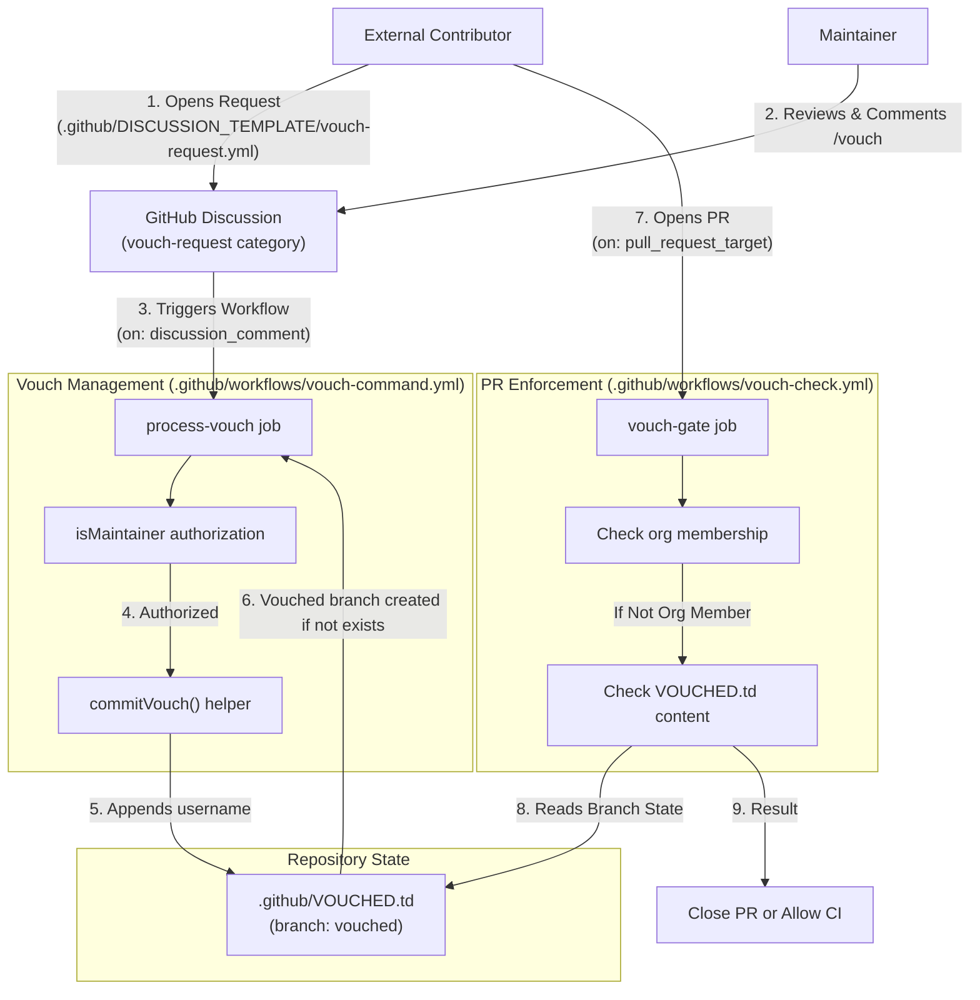
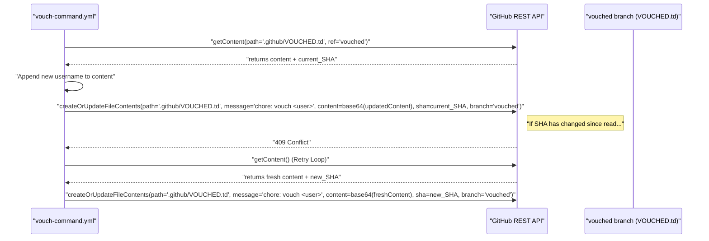
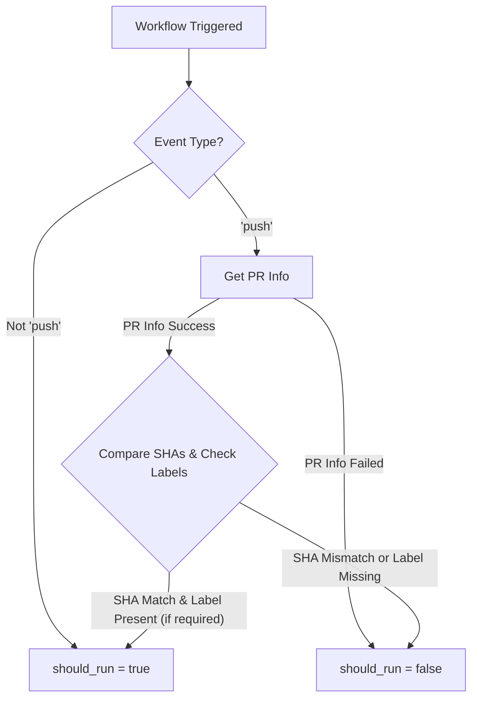
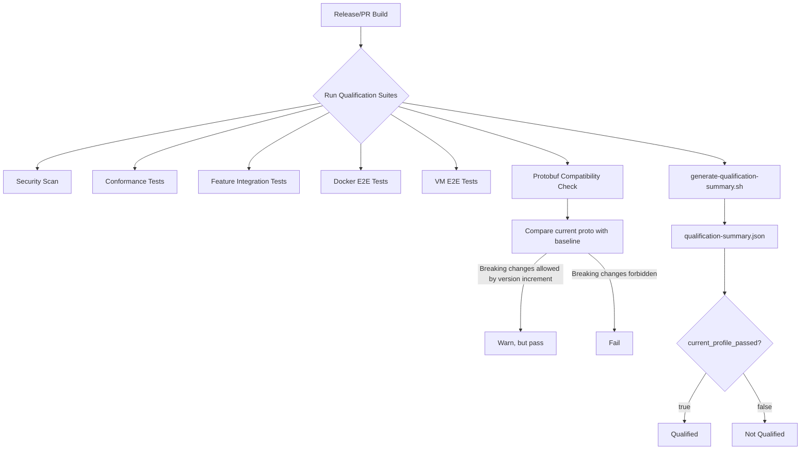

<!-- source: DeepWiki mcp.deepwiki.com · repo NVIDIA/OpenShell · page 11.3 Vouch System and PR Workflows · fetched 2026-10-26 -->

# Vouch System and PR Workflows

<details>
<summary>Relevant source files</summary>

The following files were used as context for generating this wiki page:

- [.github/CODEOWNERS](.github/CODEOWNERS)
- [.github/DISCUSSION_TEMPLATE/vouch-request.yml](.github/DISCUSSION_TEMPLATE/vouch-request.yml)
- [.github/ISSUE_TEMPLATE/config.yml](.github/ISSUE_TEMPLATE/config.yml)
- [.github/VOUCHED.td](.github/VOUCHED.td)
- [.github/actions/pr-gate/action.yml](.github/actions/pr-gate/action.yml)
- [.github/copy-pr-bot.yaml](.github/copy-pr-bot.yaml)
- [.github/workflows/issue-triage.yml](.github/workflows/issue-triage.yml)
- [.github/workflows/stale.yml](.github/workflows/stale.yml)
- [.github/workflows/vouch-check.yml](.github/workflows/vouch-check.yml)
- [.github/workflows/vouch-command.yml](.github/workflows/vouch-command.yml)
- [tasks/scripts/check_proto_compatibility.py](tasks/scripts/check_proto_compatibility.py)
- [tasks/scripts/generate-qualification-summary.sh](tasks/scripts/generate-qualification-summary.sh)
- [tasks/scripts/test-qualification-summary.sh](tasks/scripts/test-qualification-summary.sh)

</details>


This page documents the OpenShell project's vouch system, which manages contributions from external users, and other related PR workflows. It covers the vouch request process, the `/vouch` command, the `vouch-check` workflow, `CODEOWNERS` protection, issue triage automation, `copy-pr-bot` mirroring, and PR gates.

## Vouch System

The vouch system is a trust gate for first-time external contributors to the OpenShell project. It addresses a specific challenge in the AI-native development era: agent-assisted development makes it trivial to generate plausible-looking but low-quality or unsafe contributions at scale. The system requires external contributors to be explicitly approved by a maintainer before their pull requests are accepted for testing or review.

This document covers the vouch request process, the automated approval workflow, enforcement mechanisms, and the state management of the `VOUCHED.td` file. For the broader development philosophy, see [11.2 Agent-First Development Model and Skills]().

### Design Rationale

The vouch system enforces a human review checkpoint for first-time contributors while maintaining velocity for trusted contributors. It operates on a "Default Deny" principle for external PRs.

| Principle | Implementation |
|-----------|----------------|
| **Default Deny** | PRs from unvouched users are automatically closed [[.github/workflows/vouch-check.yml:107-112]]() |
| **Explicit Trust** | Maintainers must actively approve new contributors via the `/vouch` command [[.github/workflows/vouch-command.yml:19-20]]() |
| **Transparent Process** | Vouch requests are public GitHub Discussions [[.github/ISSUE_TEMPLATE/config.yml:3-8]]() |
| **Minimal Friction** | Once vouched, contributors bypass the gate for all future PRs [[.github/workflows/vouch-check.yml:79-82]]() |
| **Automatic Bypass** | Org members and bots (e.g., Dependabot) skip the gate [[.github/workflows/vouch-check.yml:18-41]](), [[.github/workflows/vouch-check.yml:52-55]]() |

Sources: [[.github/ISSUE_TEMPLATE/config.yml:3-8]](), [[.github/workflows/vouch-check.yml:12-113]]()

### Architecture Overview

The vouch system bridges the "Natural Language Space" (GitHub Discussions) to the "Code Entity Space" (GitHub Actions and the `VOUCHED.td` state file).

#### System Flow: Vouch Request to Enforcement



Sources: [[.github/DISCUSSION_TEMPLATE/vouch-request.yml:1-46]](), [[.github/workflows/vouch-command.yml:1-202]](), [[.github/workflows/vouch-check.yml:1-113]]()

### File Format: VOUCHED.td

The vouch database is a simple text file located at `.github/VOUCHED.td`. Crucially, this file is managed on a dedicated `vouched` branch to prevent contributors from vouching themselves by editing the file within their own PR branch [[.github/workflows/vouch-check.yml:57-59]]().

**Format specification:**
- One GitHub username per line.
- Case-insensitive matching.
- Lines starting with `#` are comments.
- Lines starting with `-` are ignored metadata.

| Property | Value |
|----------|-------|
| **Branch** | `vouched` [[.github/workflows/vouch-command.yml:89]]() |
| **Path** | `.github/VOUCHED.td` [[.github/workflows/vouch-command.yml:88]]() |
| **Parsing Logic** | Trim whitespace, filter empty lines, skip `#` and `-` [[.github/workflows/vouch-command.yml:134-139]]() |

Sources: [[.github/VOUCHED.td:1-11]](), [[.github/workflows/vouch-command.yml:88-89]](), [[.github/workflows/vouch-command.yml:134-139]](), [[.github/workflows/vouch-check.yml:57-59]]()

### Approval Workflow: vouch-command.yml

This workflow automates the addition of users to the vouch list when a maintainer approves a request. It is triggered by a `discussion_comment` event when the comment body is exactly `/vouch` [[.github/workflows/vouch-command.yml:3-5]](), [[.github/workflows/vouch-command.yml:19-20]]().

#### Authorization Logic
Only users with `admin`, `maintain`, or `write` permissions on the repository can successfully trigger the vouching process [[.github/workflows/vouch-command.yml:75]](). The `getCollaboratorPermissionLevel` API call is used to determine the commenter's permissions [[.github/workflows/vouch-command.yml:71-75]]().

```javascript
// Authorization check in .github/workflows/vouch-command.yml:68-75
let isMaintainer = false;
try {
  const { data } = await github.rest.repos.getCollaboratorPermissionLevel({
    owner: context.repo.owner,
    repo: context.repo.repo,
    username: commenter,
  });
  isMaintainer = ['admin', 'maintain', 'write'].includes(data.permission);
} catch (e) { ... }
```

#### Concurrent Write Handling
The workflow implements optimistic locking using the GitHub API's `sha` parameter to handle concurrent `/vouch` commands from different maintainers [[.github/workflows/vouch-command.yml:165-182]](). If a `409 Conflict` occurs, it re-reads the file and retries the commit [[.github/workflows/vouch-command.yml:169-182]]().



Sources: [[.github/workflows/vouch-command.yml:3-5]](), [[.github/workflows/vouch-command.yml:19-20]](), [[.github/workflows/vouch-command.yml:68-75]](), [[.github/workflows/vouch-command.yml:165-182]]()

### Enforcement Workflow: vouch-check.yml

The `vouch-check.yml` workflow acts as the gatekeeper for all incoming pull requests from external forks. It is triggered on `pull_request_target` events when a PR is `opened` or `reopened` [[.github/workflows/vouch-check.yml:3-5]]().

#### The Vouch Gate
The `vouch-gate` job executes on the `pull_request_target` event [[.github/workflows/vouch-check.yml:4]](). This context is required because it allows the workflow to access the repository's `vouched` branch while running in a secure context that the PR author cannot influence via their fork's code.

| Check Step | Entity/Logic | Source |
|------|--------------|--------|
| **Org Membership** | `github.rest.orgs.checkMembershipForUser` | [[.github/workflows/vouch-check.yml:28-31]]() |
| **Bot Bypass** | `authorType === 'Bot'` | [[.github/workflows/vouch-check.yml:52-55]]() |
| **List Verification** | `usernames.some(name => name.toLowerCase() === author.toLowerCase())` | [[.github/workflows/vouch-check.yml:72-74]]() |

If a contributor is not found in the `vouched` branch's `.github/VOUCHED.td` file, the PR is automatically closed with a comment directing them to the Vouch Request discussion category [[.github/workflows/vouch-check.yml:87-112]](). The comment includes a link to the `vouch-request` discussion template [[.github/workflows/vouch-check.yml:96]]().

Sources: [[.github/workflows/vouch-check.yml:3-5]](), [[.github/workflows/vouch-check.yml:43-112]]()

### Operational Management

#### Vouch Request Discussion Template
The `.github/DISCUSSION_TEMPLATE/vouch-request.yml` file defines the structure and content for new vouch requests. It prompts contributors to describe their intended changes and motivation, and explicitly states that AI-generated requests will be denied [[.github/DISCUSSION_TEMPLATE/vouch-request.yml:1-46]](). This template is linked from the `config.yml` for issue templates [[.github/ISSUE_TEMPLATE/config.yml:3-8]]().

#### Branch Initialization
The `vouch-command.yml` workflow is designed to be self-healing. If the `vouched` branch does not exist (e.g., in a new fork or environment), it will automatically create it from the repository's default branch before attempting the first vouch [[.github/workflows/vouch-command.yml:91-114]]().

Sources: [[.github/DISCUSSION_TEMPLATE/vouch-request.yml:1-46]](), [[.github/ISSUE_TEMPLATE/config.yml:3-8]](), [[.github/workflows/vouch-command.yml:91-114]]()

#### CODEOWNERS Protection
Manual edits to the vouch list are restricted. The `.github/CODEOWNERS` file ensures that any manual changes to the vouch state require explicit review from the core team, even if the user has general write access [[.github/CODEOWNERS:5-5]]().

```text
# .github/CODEOWNERS:5
.github/VOUCHED.td @NVIDIA/openshell-codeowners
```

Sources: [[.github/CODEOWNERS:5-5]]()

## PR Workflows

Beyond the vouch system, several other automated workflows manage Pull Requests and issues to maintain project quality and contributor experience.

### Issue Triage Automation

The `issue-triage.yml` workflow automatically labels newly opened issues from non-maintainers with `state:triage-needed` [[.github/workflows/issue-triage.yml:1-57]](). This helps the core team quickly identify issues that require initial review and categorization.

```mermaid
graph TD
    A[Issue Opened] --> B{Is Author a Maintainer?};
    B -- No --> C[Add Label "state:triage-needed"];
    B -- Yes --> D[No Action];
```
The `label-non-maintainer-issues` job checks the author's permission level using `github.rest.repos.getCollaboratorPermissionLevel` [[.github/workflows/issue-triage.yml:25-29]](). If the permission is not `admin`, `maintain`, or `write`, the label is applied [[.github/workflows/issue-triage.yml:31-34]](), [[.github/workflows/issue-triage.yml:47-57]]().

Sources: [[.github/workflows/issue-triage.yml:1-57]]()

### Stale Issues and Pull Requests

The `stale.yml` workflow automatically marks issues and pull requests as stale if they have been inactive for a specified period [[.github/workflows/stale.yml:1-62]](). This helps keep the issue tracker clean and focused on active work.

- **Stale Issue Label**: `state:stale` [[.github/workflows/stale.yml:18]]()
- **Days Before Issue Stale**: 14 days [[.github/workflows/stale.yml:21]]()
- **Exempt Issue Labels**: Issues with labels like `state:triage-needed`, `state:validated`, `state:accepted`, `roadmap` are exempt from being marked stale [[.github/workflows/stale.yml:27]]().
- **Stale PR Label**: `state:stale` [[.github/workflows/stale.yml:47]]()
- **Days Before PR Stale**: 14 days [[.github/workflows/stale.yml:50]]()

Currently, the workflow is configured to mark items as stale but not automatically close them, with `days-before-issue-close` and `days-before-pr-close` set to `-1` (dry-run mode) [[.github/workflows/stale.yml:22]](), [[.github/workflows/stale.yml:51]]().

Sources: [[.github/workflows/stale.yml:1-62]]()

### `copy-pr-bot` Mirroring

The `copy-pr-bot` is configured to automatically mirror pull requests from forks into the main repository. This is crucial for running CI/CD workflows that require access to secrets or protected resources, which are not available in `pull_request` events from forks.

The configuration for the bot is in `.github/copy-pr-bot.yaml` [[.github/copy-pr-bot.yaml:1-4]]().
- `enabled: true`: Activates the bot.
- `auto_sync_draft: false`: Draft PRs are not automatically synced.
- `auto_sync_ready: true`: Ready-for-review PRs are automatically synced.

When a PR is mirrored, it creates a special `pull-request/<N>` branch in the main repository, which then triggers workflows with `on: push` events.

Sources: [[.github/copy-pr-bot.yaml:1-4]]()

### PR Gates

The `.github/actions/pr-gate/action.yml` composite action provides a mechanism to control whether a workflow should run based on PR metadata, especially for `copy-pr-bot` mirrored pushes [[.github/actions/pr-gate/action.yml:1-7]]().

#### Purpose
This action ensures that workflows triggered by `copy-pr-bot` pushes (`pull-request/<N>` branches) only run if:
1. The pushed SHA still matches the head SHA of the original PR. This prevents running stale CI on outdated mirrored branches.
2. (Optionally) The original PR carries a specific `required_label`.

For non-`push` events (e.g., `workflow_dispatch`, `merge_group`), the gate always allows the workflow to run [[.github/actions/pr-gate/action.yml:43-47]]().

#### Outputs
- `should_run`: `true` if the workflow should proceed, `false` otherwise [[.github/actions/pr-gate/action.yml:16-18]]().
- `base_sha`: The target branch commit SHA for a mirrored PR [[.github/actions/pr-gate/action.yml:19-21]]().
- `labels_json`: A JSON array of PR label names for push-triggered mirror runs [[.github/actions/pr-gate/action.yml:22-24]]().

#### Logic
The action uses `nv-gha-runners/get-pr-info` to retrieve PR metadata for `push` events [[.github/actions/pr-gate/action.yml:29-32]](). It then compares `github.sha` (the SHA of the mirrored push) with the `head.sha` of the original PR [[.github/actions/pr-gate/action.yml:68]](). If a `required_label` is specified, it also checks for its presence in the PR's labels [[.github/actions/pr-gate/action.yml:60-64]]().



#### Example Usage
Workflows can use this gate to conditionally execute jobs. For instance, an E2E test workflow might only run if the PR has the `test:e2e` label and the mirrored branch is up-to-date.

```yaml
# Example workflow snippet using pr-gate
jobs:
  my_job:
    runs-on: ubuntu-latest
    steps:
      - uses: ./.github/actions/pr-gate
        id: pr_gate
        with:
          required_label: "test:e2e"
      - if: steps.pr_gate.outputs.should_run == 'true'
        run: echo "Running job because PR gate passed!"
```

Sources: [[.github/actions/pr-gate/action.yml:1-77]]()

### Qualification Profiles

The `generate-qualification-summary.sh` script and its test `test-qualification-summary.sh` are used to generate a JSON summary of the qualification status of a release or PR [[tasks/scripts/generate-qualification-summary.sh:1-91]](), [[tasks/scripts/test-qualification-summary.sh:1-47]](). This summary includes results from various test suites (security, conformance, E2E, protobuf compatibility) and determines if the current profile has passed.

The `check_proto_compatibility.py` script is a key part of the qualification process, ensuring that protobuf definitions maintain backward compatibility with previous stable releases, or explicitly allowing breaking changes for major version increments [[tasks/scripts/check_proto_compatibility.py:1-146]]().



The `generate-qualification-summary.sh` script collects results from environment variables like `SECURITY_RESULT`, `CONFORMANCE_RESULT`, etc., and aggregates them into a JSON output. The `current_profile_passed` field indicates if all required checks for the defined profile (e.g., `release-tag-v1`) have passed [[tasks/scripts/generate-qualification-summary.sh:31-42]](), [[tasks/scripts/generate-qualification-summary.sh:74]]().

Sources: [[tasks/scripts/generate-qualification-summary.sh:1-91]](), [[tasks/scripts/test-qualification-summary.sh:1-47]](), [[tasks/scripts/check_proto_compatibility.py:1-146]]()

---

