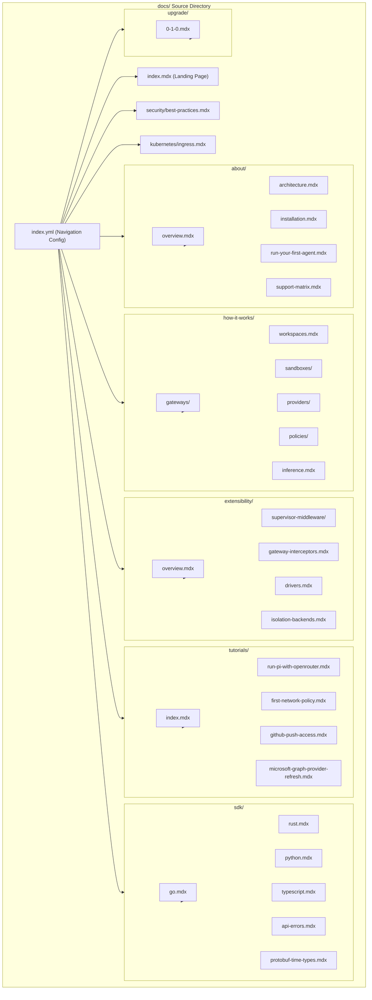
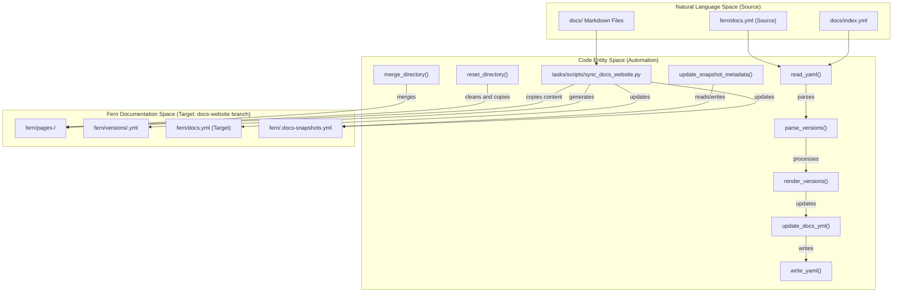
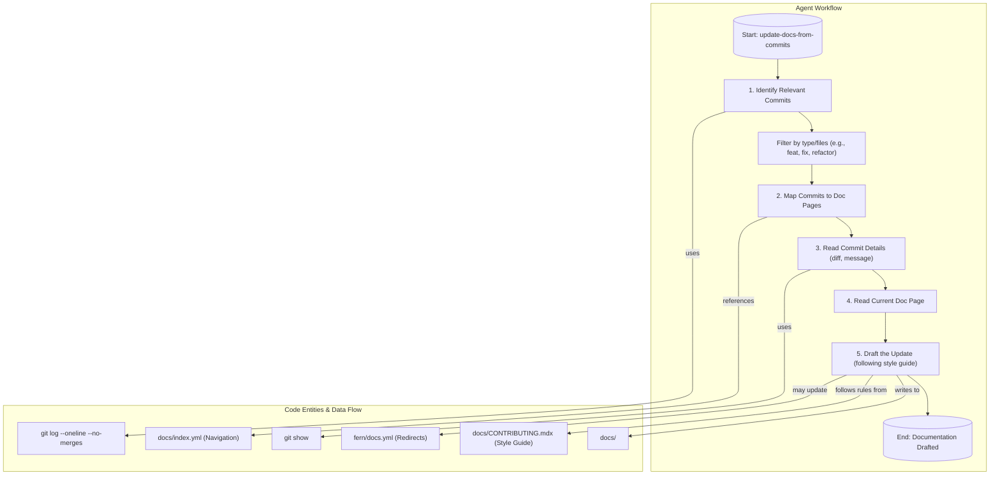

<!-- source: DeepWiki mcp.deepwiki.com · repo NVIDIA/OpenShell · page 11.4 Documentation System · fetched 2026-10-26 -->

# Documentation System

<details>
<summary>Relevant source files</summary>

The following files were used as context for generating this wiki page:

- [.agents/skills/update-docs/SKILL.md](.agents/skills/update-docs/SKILL.md)
- [.github/workflows/branch-docs.yml](.github/workflows/branch-docs.yml)
- [.github/workflows/publish-docs-website.yml](.github/workflows/publish-docs-website.yml)
- [.github/workflows/sync-docs.yml](.github/workflows/sync-docs.yml)
- [docs/CONTRIBUTING.mdx](docs/CONTRIBUTING.mdx)
- [docs/about/overview.mdx](docs/about/overview.mdx)
- [docs/extensibility/drivers.mdx](docs/extensibility/drivers.mdx)
- [docs/extensibility/isolation-backends.mdx](docs/extensibility/isolation-backends.mdx)
- [docs/how-it-works/inference.mdx](docs/how-it-works/inference.mdx)
- [docs/how-it-works/policies/default-policy.mdx](docs/how-it-works/policies/default-policy.mdx)
- [docs/how-it-works/policies/overview.mdx](docs/how-it-works/policies/overview.mdx)
- [docs/how-it-works/providers/profiles.mdx](docs/how-it-works/providers/profiles.mdx)
- [docs/index.mdx](docs/index.mdx)
- [docs/index.yml](docs/index.yml)
- [docs/kubernetes/ingress.mdx](docs/kubernetes/ingress.mdx)
- [docs/security/best-practices.mdx](docs/security/best-practices.mdx)
- [fern/README.md](fern/README.md)
- [fern/docs.yml](fern/docs.yml)
- [tasks/scripts/sync_docs_website.py](tasks/scripts/sync_docs_website.py)
- [tasks/scripts/sync_docs_website_test.py](tasks/scripts/sync_docs_website_test.py)

</details>


This page explains the structure, tooling, and style standards for OpenShell documentation. OpenShell uses a modern documentation stack based on **Fern** and **MyST Markdown** to provide a high-quality developer experience for both humans and AI agents. [`fern/docs.yml:1-7`](), [`docs/index.mdx:33-36`]()

## Documentation Structure

OpenShell documentation is organized into functional folders within the `docs/` directory, managed by a central navigation configuration. [`docs/index.yml:8-31`]()

### Directory Layout and Navigation

The site structure is defined in `docs/index.yml`, which maps folders and files to the sidebar hierarchy. [`docs/index.yml:8-31`]()


Sources: [`docs/index.mdx:1-126`](), [`docs/index.yml:1-141`](), [`docs/about/overview.mdx:1-65`](), [`docs/kubernetes/ingress.mdx:1-164`](), [`docs/security/best-practices.mdx:1-99`]()

### Fern Configuration

The global site configuration is managed in `fern/docs.yml`. This file controls the visual theme, branding, and URL routing. [`fern/docs.yml:6-44`]()

*   **Production URL:** `docs.nvidia.com/openshell` [`fern/docs.yml:8`]()
*   **Branding:** Uses NVIDIA dark/light logos and the `#76B900` accent color. [`fern/docs.yml:28-47`]()
*   **Version Management:** The "Dev" version points to the `docs/index.yml` navigation tree. [`fern/docs.yml:58-64`]()
*   **Redirects:** Handles legacy pathing and tutorial moves to ensure URL stability. [`fern/docs.yml:66-127`]()

Sources: [`fern/docs.yml:1-128`]()

## Content Standards

### MyST Markdown & MDX

Documentation is written in **MyST Markdown** (using `.mdx` extensions). This format supports rich components such as tabs, callouts, and steps. [`docs/index.mdx:10-11`]()

| Component | Usage |
|-----------|-------|
| `<Steps>` | Sequential walkthroughs with TOC integration. |
| `<Tabs>` | Switching between protocols (e.g., OpenAI vs Anthropic). |
| `<Note>` | Important information that shouldn't be missed. [`docs/about/overview.mdx:13-17`]() |
| `<Warning>` | Critical security or operational alerts. [`docs/index.mdx:134-146`]() |
| `<CommandTerminal>` | Custom component for animated CLI examples. [`docs/index.mdx:50`]() |

Sources: [`docs/index.mdx:10-11`](), [`docs/index.mdx:134-146`](), [`docs/about/overview.mdx:13-17`]()

### Frontmatter Requirements

Every page must include a YAML frontmatter block for metadata and SEO. It must also include the SPDX license header as YAML comments. [`docs/index.mdx:1-8`]()

```yaml
---
# SPDX-FileCopyrightText: Copyright (c) 2025-2026 NVIDIA CORPORATION & AFFILIATES. All rights reserved.
# SPDX-License-Identifier: Apache-2.0
title: "Page Title"
description: "One-sentence summary of the page."
keywords: "Generative AI, AI Agents, Sandboxing"
---
```
Sources: [`docs/index.mdx:1-8`](), [`docs/security/best-practices.mdx:1-9`]()

## Documentation Publishing Pipeline

OpenShell employs an automated pipeline to sync documentation from the source tree to a dedicated `docs-website` branch, which is then published via Fern. [`tasks/scripts/sync_docs_website.py:14-49`]()

### The Sync Process

The `sync_docs_website.py` script manages the transition of Markdown files into the Fern-compatible structure. It handles versioning by creating "snapshots" for different channels (e.g., `dev`, `latest`, or specific version tags). [`tasks/scripts/sync_docs_website.py:56-80`]()


Sources: [`tasks/scripts/sync_docs_website.py:1-692`](), [`fern/README.md:39-49`]()

### Key Functions and Logic

| Function | Role |
|----------|------|
| `sync_docs` | Orchestrates the copying of assets and docs into the target branch. [`tasks/scripts/sync_docs_website.py:228-265`]() |
| `prefix_navigation_paths` | Rewrites internal links in `index.yml` to be relative to the Fern versioned folders (e.g., prepending `../pages-dev/`). [`tasks/scripts/sync_docs_website.py:400-412`]() |
| `ordered_entries` | Logic to ensure the version selector displays "latest" then "dev" before other version tags. [`tasks/scripts/sync_docs_website.py:500-516`]() |
| `resolve_slug` | Validates channel types and ensures `version_slug` contains only safe characters `[A-Za-z0-9._-]`. [`tasks/scripts/sync_docs_website.py:67-81`]() |
| `reset_directory` | Safely replaces a documentation snapshot while preserving the `_components` directory if requested. [`tasks/scripts/sync_docs_website.py:119-124`]() |
| `read_snapshot_metadata` | Reads the `.docs-snapshots.yml` file to get current snapshot information. [`tasks/scripts/sync_docs_website.py:165-194`]() |
| `write_snapshot_metadata` | Writes updated snapshot information back to `.docs-snapshots.yml`. [`tasks/scripts/sync_docs_website.py:197-199`]()

Sources: [`tasks/scripts/sync_docs_website.py:1-692`]()

## CI/CD Workflows

### Branch Docs Preview
The `branch-docs.yml` workflow triggers on pull requests that modify documentation. [`.github/workflows/branch-docs.yml:3-11`]() When `FERN_TOKEN` is available, it publishes a Fern preview from the pull request checkout and adds the preview URL to the pull request. [`.github/workflows/branch-docs.yml:58-89`]()

### Sync Docs Website
Triggered manually via `workflow_dispatch` or by other release workflows, the `sync-docs.yml` workflow checks out the `docs-website` branch and runs `sync_docs_website.py`. [`.github/workflows/sync-docs.yml:6-36`](), [`.github/workflows/sync-docs.yml:169-202`]() It validates the generated structure using `fern check` before committing. [`.github/workflows/sync-docs.yml:204-214`]() The workflow uses a concurrency group `docs-website` to serialize runs, ensuring that only one documentation sync or publish operation is active at a time. [`.github/workflows/sync-docs.yml:103-106`]()

### Publish Docs Website
The `publish-docs-website.yml` workflow handles the final deployment. [`.github/workflows/publish-docs-website.yml:4-16`]()

*   **Preview Mode:** Generates a temporary preview URL using a specific ID. [`.github/workflows/publish-docs-website.yml:57-66`]()
*   **Production Mode:** Publishes to the live `docs.nvidia.com/openshell` domain. [`.github/workflows/publish-docs-website.yml:68-73`]()

Sources: [`.github/workflows/sync-docs.yml:1-254`](), [`.github/workflows/publish-docs-website.yml:1-74`](), [`.github/workflows/branch-docs.yml:1-90`]()

## Agent-Driven Documentation Updates

OpenShell is built agent-first, and this extends to documentation. The `update-docs-from-commits` skill in `.agents/skills/update-docs/` is the primary mechanism for agents to keep the technical reference in sync with code changes. [`.agents/skills/update-docs/SKILL.md:1-6`]()

### `update-docs-from-commits` Skill Workflow

This skill guides an agent through identifying relevant code changes and drafting documentation updates.


Sources: [`.agents/skills/update-docs/SKILL.md:1-123`]()

## Style Guide Summary

OpenShell follows a technical, direct style guide. The goal is to be specific and concise. [`docs/CONTRIBUTING.mdx:101-102`]()

1.  **Active Voice:** Describe system behavior directly (e.g., "The CLI creates a gateway"). [`docs/CONTRIBUTING.mdx:106`]()
2.  **Code-First:** Use backticks for all code entities, file paths, and CLI commands. [`docs/CONTRIBUTING.mdx:128`]()
3.  **No Superlatives:** Avoid marketing language like "powerful" or "seamless". [`docs/CONTRIBUTING.mdx:118`]()
4.  **Verified Examples:** All tutorial steps (e.g., `openshell sandbox create --from ollama`) must be tested against the current build.
5.  **Agent Awareness:** Documentation should include clear markers and instructions for AI agents, as they are first-class consumers of the repository. [`docs/CONTRIBUTING.mdx:11-20`]()

Sources: [`docs/CONTRIBUTING.mdx:1-135`]()

---

