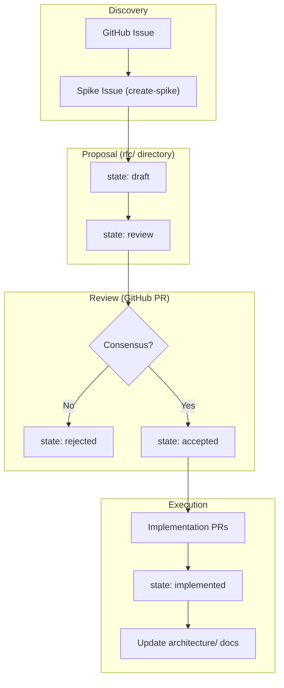
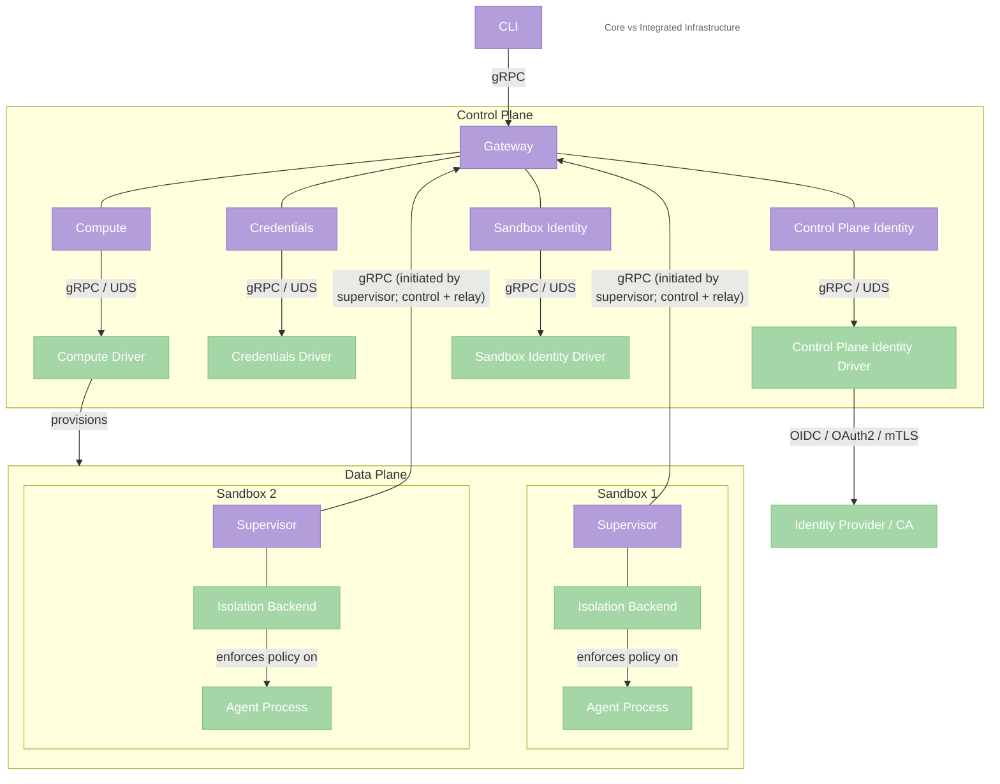
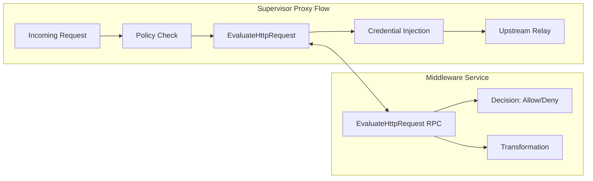
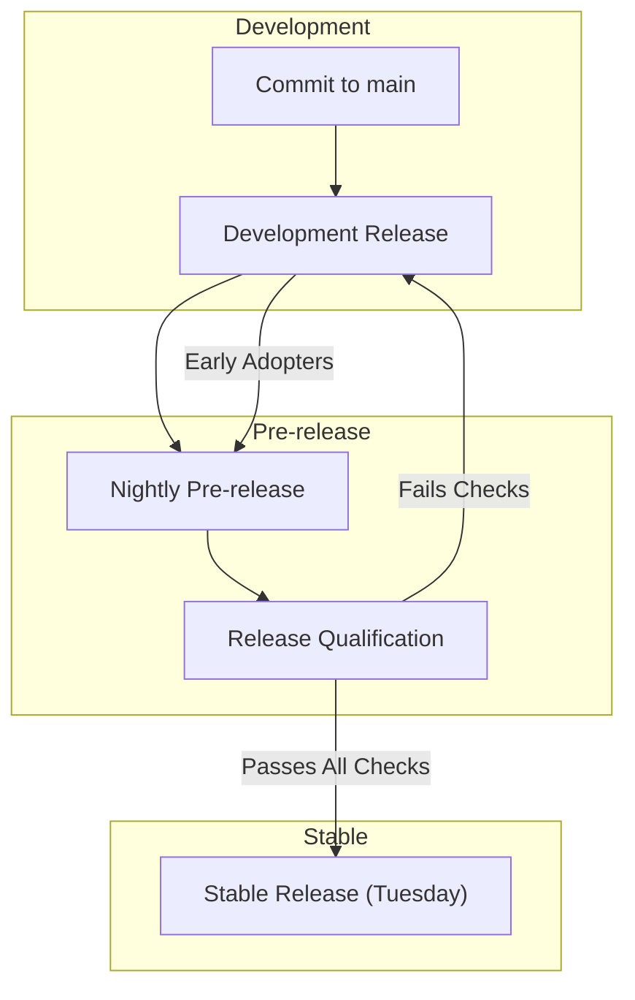

<!-- source: DeepWiki mcp.deepwiki.com · repo NVIDIA/OpenShell · page 11.5 RFC Process · fetched 2026-10-26 -->

# RFC Process

<details>
<summary>Relevant source files</summary>

The following files were used as context for generating this wiki page:

- [.agents/skills/create-rfc/SKILL.md](.agents/skills/create-rfc/SKILL.md)
- [.agents/skills/create-rfc/agents/openai.yaml](.agents/skills/create-rfc/agents/openai.yaml)
- [rfc/0000-template/README.md](rfc/0000-template/README.md)
- [rfc/0001-core-architecture/README.md](rfc/0001-core-architecture/README.md)
- [rfc/0002-agent-driven-policy-management/README.md](rfc/0002-agent-driven-policy-management/README.md)
- [rfc/0005-sandbox-proxy-egress-adapter/README.md](rfc/0005-sandbox-proxy-egress-adapter/README.md)
- [rfc/0005-sandbox-proxy-egress-adapter/current-shape.md](rfc/0005-sandbox-proxy-egress-adapter/current-shape.md)
- [rfc/0005-sandbox-proxy-egress-adapter/implementation-plan.md](rfc/0005-sandbox-proxy-egress-adapter/implementation-plan.md)
- [rfc/0005-sandbox-proxy-egress-adapter/technical-design.md](rfc/0005-sandbox-proxy-egress-adapter/technical-design.md)
- [rfc/README.md](rfc/README.md)

</details>


Substantial changes to OpenShell are proposed via the **Request for Comments (RFC)** process. This ensures that architectural decisions, API contracts, and cross-cutting system changes are documented, debated, and agreed upon before implementation begins [rfc/README.md:1-3]().

## Purpose and Scope

The RFC process is designed for changes that are significant enough to require stakeholder input or that affect multiple components of the system [rfc/README.md:3-4](). An RFC is created only when maintainers decide an originating GitHub issue needs a structured design review [rfc/README.md:5-5]().

**Use an RFC for:**
*   An architectural or design decision for the platform [rfc/README.md:35-35]().
*   Change to an API or command-line tool [rfc/README.md:36-36]().
*   Change to an internal API or tool [rfc/README.md:37-37]().
*   Add or change a company or team process [rfc/README.md:38-38]().
*   A design for testing [rfc/README.md:39-39]().

**Do NOT use an RFC for:**
*   Bug fixes [rfc/README.md:47-47]().
*   Small feature additions scoped to a single component (use a spike instead) [rfc/README.md:48-48]().
*   Documentation changes or dependency updates [rfc/README.md:50-51]().
*   Refactoring that doesn't change public interfaces [rfc/README.md:52-52]().

Sources: [rfc/README.md:31-54]()

## RFC Lifecycle

The lifecycle of a proposal moves from initial investigation to a formal document, then through a review period, and finally to implementation.

### Lifecycle Flow
"Natural Language States" to "Code Artifacts"

| Phase | Action | Code Entity / Location |
| :--- | :--- | :--- |
| **Investigation** | Explore feasibility | `create-spike` skill [.agents/skills/create-rfc/SKILL.md:24-25]() |
| **Creation** | Scaffold from template | `create-rfc` skill [.agents/skills/create-rfc/SKILL.md:1-4]() |
| **Proposal** | Create RFC folder | `rfc/NNNN-my-feature/` [rfc/README.md:101-107]() |
| **Review** | Open Pull Request | GitHub PR with `rfc` label [rfc/README.md:119-124]() |
| **Consensus** | Update Metadata | `state: accepted` in YAML [rfc/README.md:84-84]() |
| **Persistence** | Finalize Docs | `architecture/` directory [rfc/README.md:29-29]() |

### State Transitions

RFCs track their progress using a `state` field in their YAML front matter [rfc/README.md:57-68]().

| State | Description |
| :--- | :--- |
| `draft` | The RFC is being written and is not yet ready for formal review [rfc/README.md:82-82](). |
| `review` | Under active discussion in a pull request [rfc/README.md:83-83](). |
| `accepted` | The proposal has been accepted and is ready for implementation [rfc/README.md:84-84](). |
| `rejected` | The proposal was reviewed and declined [rfc/README.md:85-85](). |
| `implemented` | The idea has been entirely implemented [rfc/README.md:86-86](). |
| `superseded` | Replaced by a newer RFC [rfc/README.md:87-87](). |

### Process Diagram
The following diagram illustrates the transition from a Spike issue to an implemented RFC.

Title: RFC Lifecycle and State Machine

Sources: [rfc/README.md:78-133](), [rfc/README.md:22-29]()

## Directory Structure

Each RFC is self-contained within its own directory under `rfc/`. This allows for accompanying diagrams, mockups, or technical specifications to stay grouped with the proposal [rfc/README.md:101-109]().

```text
rfc/
├── 0000-template/
│   └── README.md
├── 0001-core-architecture/
│   └── README.md
├── 0002-agent-driven-policy-management/
│   └── README.md
├── 0003-gateway-configuration/
│   └── README.md
├── 0004-sandbox-resource-requirements/
│   └── README.md
├── 0005-sandbox-proxy-egress-adapter/
│   ├── README.md
│   ├── current-shape.md
│   ├── implementation-plan.md
│   └── technical-design.md
├── 0006-driver-config-passthrough/
│   └── README.md
├── 0009-supervisor-middleware/
│   ├── README.md
│   └── appendices/
├── 0010-gateway-interceptors/
│   └── README.md
├── 0011-multi-player-design/
│   └── README.md
├── 0013-native-windows-mxc/
│   └── README.md
└── 0014-release-stability/
    ├── README.md
    ├── build-matrix.md
    ├── release-qualification.md
    └── release-version-selection.md
```

### Metadata Format
Every RFC must begin with YAML front matter [rfc/README.md:57-68]():

```yaml
---
authors:
  - "@username"
state: draft
links:
  - https://github.com/NVIDIA/OpenShell/issues/NNN
---
```
Sources: [rfc/README.md:57-77](), [rfc/README.md:101-117]()

## Major Architectural RFCs

The following RFCs represent foundational decisions and active design work in the OpenShell platform:

### RFC 0001 - Core Architecture
Proposes a composable core architecture built around the **CLI**, **Gateway**, and **Supervisor** [rfc/0001-core-architecture/README.md:9-11](). It defines four internal subsystems for the gateway: compute, credentials, control-plane identity, and sandbox identity, each delegating to pluggable drivers [rfc/0001-core-architecture/README.md:13-14]().

Title: Core Architecture (RFC 0001)

Sources: [rfc/0001-core-architecture/README.md:33-103]()

### RFC 0002 - Agent-Driven Policy Management
Evolves the Policy Advisor into a workflow where agents can inspect current policy, draft narrow changes, and submit them for review via `policy.local` [rfc/0002-agent-driven-policy-management/README.md:10-18](). It introduces structured L7 REST deny responses and a sandbox-local HTTP API [rfc/0002-agent-driven-policy-management/README.md:44-50]().

### RFC 0003 - Gateway Configuration
Introduces a TOML-based configuration file (`gateway.toml`) that unifies settings for core options, TLS, OIDC, and drivers [rfc/0003-gateway-configuration/README.md:9-11](). It establishes a precedence order: CLI flags > Env Vars > TOML config > Defaults [rfc/0003-gateway-configuration/README.md:34-38]().

### RFC 0004 - Sandbox Resource Requirements
Documents the resource requirements model for sandboxes, defining how CPU, memory, and GPU resources are requested and allocated across different compute drivers.

### RFC 0005 - Sandbox Proxy Egress Adapter
This RFC proposes a design for a sandbox proxy egress adapter, which handles outbound network traffic from sandboxes, applying policies and potentially re-signing requests [rfc/0005-sandbox-proxy-egress-adapter/README.md:25-39](). It refactors sandbox egress around shared authorization, destination-validation, and relay boundaries [rfc/0005-sandbox-proxy-egress-adapter/README.md:25-27](). The proposal outlines a migration plan with several phases, starting with compatibility and moving towards unified adapter flows [rfc/0005-sandbox-proxy-egress-adapter/implementation-plan.md:1-8]().

Title: Unified Adapter Flow (RFC 0005)
```mermaid
flowchart TD
    User["Userland payload / harness"]

    subgraph ExplicitProxy["Explicit proxy listener"]
        ProxyBytes["HTTP proxy bytes"]
        IsConnect{"CONNECT request?"}
        Connect["CONNECT adapter"]
        Forward["Forward HTTP adapter"]
        ProxyBytes --> IsConnect
        IsConnect -- Yes --> Connect
        IsConnect -- No --> Forward
    end

    subgraph NativeTcp["Policy DNS + native TCP"]
        NameLookup["Userland DNS lookup"]
        PolicyDns["Policy DNS adapter"]
        DnsEligible{"Eligible native TCP<br/>policy endpoint?"}
        DnsDeny["Local DNS refusal<br/>no upstream lookup"]
        TrustedDns["Trusted upstream lookup<br/>and destination filtering"]
        DnsMapping["Synthetic IP + active mapping<br/>to validated real addresses"]
        DnsAnswer["Return synthetic IP"]
        NativeConnect["Userland connect(synthetic_ip:port)"]
        TcpAdapter["Transparent TCP adapter<br/>recover mapping"]
        NameLookup --> PolicyDns
```
Sources: [rfc/0005-sandbox-proxy-egress-adapter/README.md:128-152](), [rfc/0005-sandbox-proxy-egress-adapter/technical-design.md:23-40]()

### RFC 0006 - Driver Config Passthrough
Documents the design for passing infrastructure-specific configuration through the gateway to the underlying compute drivers without polluting the core `Sandbox` model.

### RFC 0009 - Supervisor Middleware
Introduces an extension system for hooks that can inspect, transform, and block operations [rfc/0009-supervisor-middleware/README.md:23-26](). The first implementation includes `HTTP_REQUEST/PRE_CREDENTIALS` and `WEBSOCKET_MESSAGE/PRE_CREDENTIALS` hooks [rfc/0009-supervisor-middleware/appendices/protocol-extensions.md:49-56]().

Title: Supervisor Middleware Hook Data Flow (RFC 0009)

Sources: [rfc/0009-supervisor-middleware/README.md:25-36](), [rfc/0009-supervisor-middleware/appendices/protocol-extensions.md:49-56]()

### RFC 0010 - Gateway Interceptors
This RFC proposes a mechanism for gateway-side interceptors to modify or inspect requests and responses, enabling advanced features like auditing and custom routing.

### RFC 0011 - Multi-Player Design
This RFC outlines a multi-player design for OpenShell, enabling collaborative or multi-agent interactions within and across sandboxes.

### RFC 0013 - Native Windows MXC
This RFC details the design for native Windows 11 support using Microsoft Execution Containers (MXC), including how policies are mapped and network enforcement is handled without an in-sandbox supervisor.

### RFC 0014 - Release Stability
This RFC defines OpenShell's exit from alpha and establishes a predictable release cycle. It proposes development releases for every commit, nightly pre-releases, and qualified stable releases every Tuesday [rfc/0014-release-stability/README.md:19-21](). It also defines Stable and Experimental API maturity, compatibility, and versioning rules [rfc/0014-release-stability/README.md:21-23]().

Title: Release Cadence and Maturity (RFC 0014)

Sources: [rfc/0014-release-stability/README.md:19-80]()

Sources: [rfc/0001-core-architecture/README.md:7-16](), [rfc/0002-agent-driven-policy-management/README.md:10-20](), [rfc/0003-gateway-configuration/README.md:7-12](), [rfc/0009-supervisor-middleware/README.md:23-26](), [rfc/0014-release-stability/README.md:10-23]()

---

