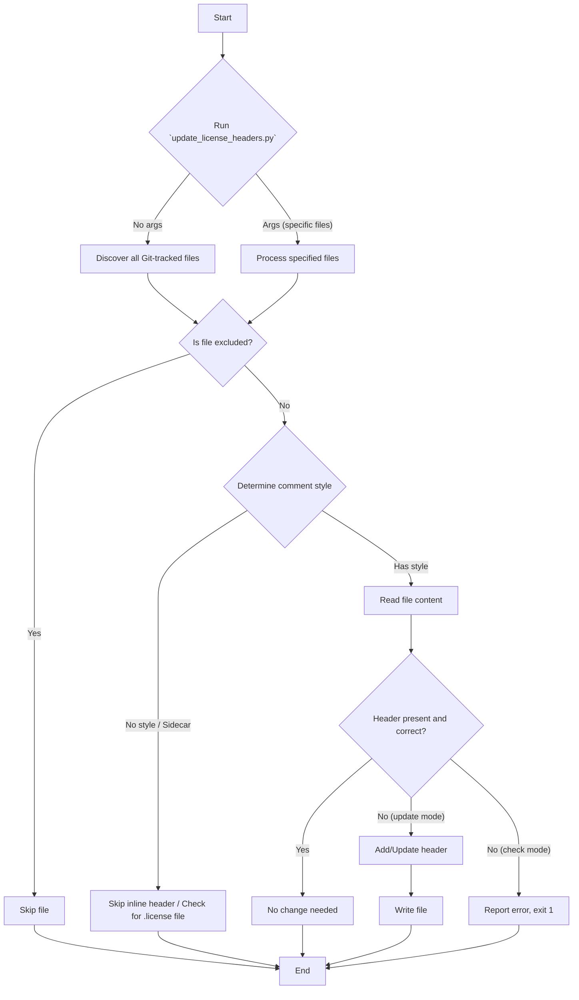
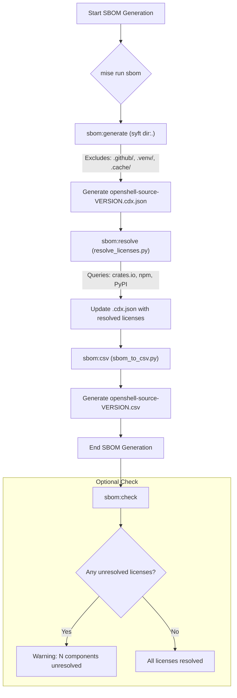
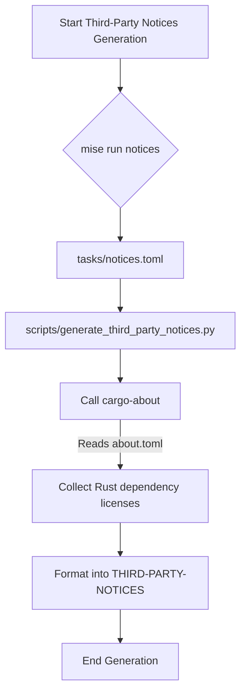

<!-- source: DeepWiki mcp.deepwiki.com · repo NVIDIA/OpenShell · page 11.6 Licensing, SBOM and Third-Party Notices · fetched 2026-10-26 -->

# 11.6. Licensing, SBOM and Third-Party Notices

Relevant source files

The following files were used as context for generating this wiki page:

- [LICENSE](LICENSE)
- [THIRD-PARTY-NOTICES](THIRD-PARTY-NOTICES)
- [about.toml](about.toml)
- [crates/openshell-cli/src/output.rs](crates/openshell-cli/src/output.rs)
- [crates/openshell-core/build.rs](crates/openshell-core/build.rs)
- [crates/openshell-core/build_version.rs](crates/openshell-core/build_version.rs)
- [crates/openshell-tui/src/ui/splash.rs](crates/openshell-tui/src/ui/splash.rs)
- [deploy/deb/control.in](deploy/deb/control.in)
- [deploy/deb/control.in.license](deploy/deb/control.in.license)
- [deploy/deb/openshell-gateway.service](deploy/deb/openshell-gateway.service)
- [deploy/helm/openshell-workspace/templates/_helpers.tpl](deploy/helm/openshell-workspace/templates/_helpers.tpl)
- [deploy/sbom/resolve_licenses.py](deploy/sbom/resolve_licenses.py)
- [deploy/sbom/resolve_licenses_test.py](deploy/sbom/resolve_licenses_test.py)
- [deploy/sbom/sbom_to_csv.py](deploy/sbom/sbom_to_csv.py)
- [e2e/kubernetes/openbao-tls-values.yaml](e2e/kubernetes/openbao-tls-values.yaml)
- [scripts/generate_third_party_notices.py](scripts/generate_third_party_notices.py)
- [scripts/keycloak-realm.json.license](scripts/keycloak-realm.json.license)
- [scripts/lint-mermaid/lint-mermaid.mjs](scripts/lint-mermaid/lint-mermaid.mjs)
- [scripts/update_license_headers.py](scripts/update_license_headers.py)
- [tasks/notices.toml](tasks/notices.toml)
- [tasks/sbom.toml](tasks/sbom.toml)

This page details the tools and processes used within the OpenShell project to manage licensing, generate Software Bill of Materials (SBOMs), and produce third-party notices. This includes the license header enforcement, SBOM generation using `syft` and custom Python scripts, `cargo-about` for Rust dependency notices, and `cargo-deny` for policy enforcement.

## License Header Tooling

The project enforces the inclusion of SPDX license headers in source files. This is managed by the `scripts/update_license_headers.py` script [scripts/update_license_headers.py:1-17]().

The script identifies files based on their extensions and applies the appropriate comment style for the SPDX-FileCopyrightText and SPDX-License-Identifier tags [scripts/update_license_headers.py:38-56](). For files without standard extensions or specific cases like Dockerfiles, a `FILE_COMMENT_STYLES` dictionary is used [scripts/update_license_headers.py:59-61](). Some files, such as `deploy/deb/control.in` [deploy/deb/control.in:1-17](), do not support inline comments and instead use sidecar `.license` files, for example, `deploy/deb/control.in.license` [deploy/deb/control.in.license:1-2]().

The script can operate in two modes:
*   **Update mode**: Adds or updates headers on all source files [scripts/update_license_headers.py:9-10]().
*   **Check mode**: Verifies the presence of headers and exits with an error if any are missing. This is typically used in CI/CD pipelines or pre-commit hooks [scripts/update_license_headers.py:12-13]().

The `make_header` function [scripts/update_license_headers.py:107-119]() constructs the license header string based on the comment style. The script also includes logic to exclude certain directories and files from header enforcement, such as `target/` directories, `.git/`, and vendored dependencies [scripts/update_license_headers.py:75-100]().

**Diagram: License Header Update/Check Flow**
Sources: `scripts/update_license_headers.py`

## SBOM Generation

Software Bill of Materials (SBOMs) are generated for the OpenShell project using `syft` and a set of Python scripts. The process is orchestrated via `mise` tasks defined in `tasks/sbom.toml` [tasks/sbom.toml:1-91]().

The primary steps are:
1.  **Generation**: `syft` is used to scan the project directory and generate CycloneDX JSON SBOMs. This task is defined as `sbom:generate` [tasks/sbom.toml:15-39](). It excludes various development and build artifacts like `.github/`, `.venv/`, and `target/` directories. The version for the SBOM is dynamically retrieved using `tasks/scripts/release.py get-version --cargo` [tasks/sbom.toml:24]().
2.  **License Resolution**: Many components in the initial SBOM might have missing or hash-based licenses. The `deploy/sbom/resolve_licenses.py` script [deploy/sbom/resolve_licenses.py:1-20]() attempts to resolve these by querying public registries (crates.io, npm, PyPI) and using a list of known licenses [deploy/sbom/resolve_licenses.py:36-70](). This task is `sbom:resolve` [tasks/sbom.toml:41-45]().
3.  **CSV Export**: The resolved CycloneDX JSON SBOMs are then converted into a more human-readable CSV format by `deploy/sbom/sbom_to_csv.py` [deploy/sbom/sbom_to_csv.py:1-11](). This task is `sbom:csv` [tasks/sbom.toml:47-51]().
4.  **Advisory Check**: An optional `sbom:check` task [tasks/sbom.toml:53-91]() can be run to identify any remaining unresolved licenses. This check is advisory and does not block the build.

The `resolve_licenses.py` script uses a `ThreadPoolExecutor` for concurrent registry lookups and includes rate-limiting logic to avoid overwhelming public APIs [deploy/sbom/resolve_licenses_test.py:46-64](). It also maintains a `KNOWN_LICENSES` dictionary for packages that registries might not resolve directly [deploy/sbom/resolve_licenses.py:36-70]().

**Diagram: SBOM Generation Workflow**
Sources: `tasks/sbom.toml`, `deploy/sbom/resolve_licenses.py`, `deploy/sbom/sbom_to_csv.py`

## Third-Party Notices

The `THIRD-PARTY-NOTICES` file [THIRD-PARTY-NOTICES:1-137]() is automatically generated to comply with license requirements for included third-party software. This file lists all Rust dependencies and their associated licenses.

The generation process is managed by the `mise run notices` command, which executes the `tasks/notices.toml` task [tasks/notices.toml:1-10](). This task, in turn, calls `scripts/generate_third_party_notices.py` [scripts/generate_third_party_notices.py:1-10]().

The `generate_third_party_notices.py` script leverages `cargo-about` to collect license information for all Rust dependencies. `cargo-about` is configured via the `about.toml` file [about.toml:1-10](), which specifies how to handle various licenses and dependencies. The script then formats this information into the `THIRD-PARTY-NOTICES` file.

The `crates/openshell-core/build.rs` script [crates/openshell-core/build.rs:1-118]() is responsible for embedding build-time information, including the Git-derived version, into the compiled binaries. This version information is crucial for accurate SBOM and notice generation. The `git_version` function [crates/openshell-core/build.rs:91-108]() determines the version based on Git tags and commit metadata, following a "guess-next-dev" convention.

**Diagram: Third-Party Notices Generation Flow**
Sources: `THIRD-PARTY-NOTICES`, `tasks/notices.toml`, `scripts/generate_third_party_notices.py`, `about.toml`, `crates/openshell-core/build.rs`

## Cargo Deny Policy

`cargo-deny` is used to enforce license policies for Rust dependencies. It helps ensure that all dependencies adhere to the project's approved license list and do not introduce undesirable licenses. The `cargo-deny` configuration is typically found in a `deny.toml` file (not provided in the prompt, but implied by the mention of `cargo-deny policy`). This configuration specifies allowed licenses, disallowed licenses, and other policy rules.

`cargo-deny` checks are usually integrated into the CI/CD pipeline to prevent builds from succeeding if any license violations are detected. This provides an automated gate for license compliance.

Sources: *Implied by prompt, specific configuration file not provided.*

---

