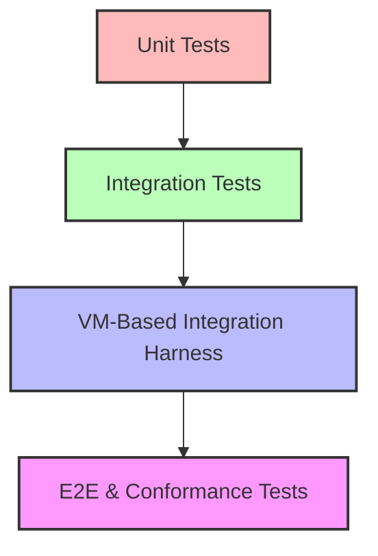

<!-- source: DeepWiki mcp.deepwiki.com · repo NVIDIA/OpenShell · page 12 Testing & Quality · fetched 2026-10-26 -->

# Testing & Quality

Relevant source files

The following files were used as context for generating this wiki page:

- [TESTING.md](TESTING.md)
- [e2e/rust/Cargo.toml](e2e/rust/Cargo.toml)
- [e2e/rust/e2e-docker.sh](e2e/rust/e2e-docker.sh)
- [e2e/rust/e2e-kubernetes.sh](e2e/rust/e2e-kubernetes.sh)
- [e2e/rust/e2e-podman.sh](e2e/rust/e2e-podman.sh)
- [e2e/rust/e2e-vm.sh](e2e/rust/e2e-vm.sh)
- [e2e/support/gateway-common.sh](e2e/support/gateway-common.sh)
- [e2e/with-docker-gateway.sh](e2e/with-docker-gateway.sh)
- [e2e/with-podman-gateway.sh](e2e/with-podman-gateway.sh)
- [tasks/test.toml](tasks/test.toml)

This page provides a high-level overview of the testing and quality assurance strategies employed in the OpenShell codebase. Our approach follows a test pyramid model, encompassing unit tests, integration tests, end-to-end (E2E) tests, and specialized conformance suites. This layered strategy ensures robustness, correctness, and adherence to specifications across various components and deployment environments.

## Test Pyramid Overview

The OpenShell testing strategy is structured as a pyramid, with a broad base of fast, isolated unit tests, a middle layer of integration tests, and a narrower top layer of comprehensive E2E and conformance tests. This structure optimizes for feedback speed and test coverage efficiency.

Sources: [TESTING.md:1-20]()

## E2E Test Suites

End-to-end (E2E) tests validate the complete OpenShell system, from CLI interaction to sandbox execution, across various compute drivers. These tests are critical for verifying the system's behavior in realistic deployment scenarios. The E2E suite includes both Rust and Python-based tests, and supports different gateway wrappers for Docker, Podman, VM, and Kubernetes environments. Specialized tests cover areas like MCP conformance, policy advisor functionality, and GPU-enabled sandboxes.

For details, see [E2E Test Suites](#12.1).
Sources: [tasks/test.toml:81-93](), [e2e/rust/Cargo.toml:18-40](), [e2e/with-docker-gateway.sh:1-35](), [e2e/with-podman-gateway.sh:1-31](), [e2e/rust/e2e-vm.sh:1-16](), [e2e/rust/e2e-kubernetes.sh:1-17]()

## Conformance Suites

The `openshell-conformance` crate defines a set of scenarios and tests to ensure that OpenShell implementations adhere to expected behavior and specifications. This suite is crucial for validating the core functionality and interoperability of the system, especially across different compute drivers and configurations. It includes tests for various drivers and features, and can be run via a dedicated conformance CLI.

For details, see [Conformance Suites](#12.2).
Sources: [tasks/test.toml:128-131](), [e2e/rust/e2e-docker.sh:21-21](), [e2e/rust/e2e-podman.sh:18-18](), [e2e/rust/e2e-kubernetes.sh:25-26]()

## VM-Based Integration Harness (tmachine, nix, ansible)

For more complex integration scenarios, OpenShell utilizes a VM-based integration harness. This harness, built around `tests/config.nix`, `tests/tmachine`, and Ansible playbooks, allows for testing OpenShell within disposable guest virtual machines. This setup is particularly useful for validating distro and package compatibility, as well as ensuring the correct interaction of OpenShell components in a full operating system environment.

For details, see [VM-Based Integration Harness (tmachine, nix, ansible)](#12.3).
Sources: [e2e/rust/e2e-vm.sh:1-166]()

## Unit Tests and Helm Chart Tests

Unit tests form the foundation of our testing pyramid, providing rapid feedback on individual components. Rust unit tests are typically co-located with the code using `#[cfg(test)]` modules, while integration tests reside in `crates/*/tests/`. Python unit tests follow a `*_test.py` naming convention and use mock-based patterns for isolated testing. Additionally, Helm chart tests ensure the correctness of our Kubernetes deployment configurations.

For details, see [Unit Tests and Helm Chart Tests](#12.4).
Sources: [tasks/test.toml:97-110](), [tasks/test.toml:111-116](), [TESTING.md:21-92]()

## Test Execution Flow

The `mise run test` command orchestrates the execution of various test suites, including Rust, Python, and TypeScript SDK tests, along with specialized checks for SBOM, `install.sh`, and documentation. The `mise run e2e` command focuses on end-to-end tests, typically spinning up a Docker-backed gateway for the test run.

```mermaid
graph TD
    A[("mise run test")] --> B["test:rust"]
    A --> C["test:python"]
    A --> D["sdk:ts:test"]
    A --> E["test:sbom"]
    A --> F["test:install-sh"]
    A --> G["test:build-env"]
    A --> H["test:gateway-pull-policy"]
    A --> I["test:e2e-image-overrides"]
    A --> J["test:gateway-config"]
    A --> K["test:packaging-assets"]
    A --> L["test:qualification-summary"]
    A --> M["test:codex-security-release-range"]
    A --> N["test:docs-website"]
    A --> O["test:docs-nav"]

    P[("mise run e2e")] --> Q["e2e:rust"]
    P --> R["e2e:python"]
    P --> S["e2e:mcp"]

    subgraph "Rust Test Execution"
        B --> B1["cargo test --workspace --exclude openshell-server"]
        B --> B2["cargo test -p openshell-server --features test-support"]
        B --> B3["cargo nextest run --config-file .config/nextest.toml --manifest-path examples/supervisor-middleware-content-guard/Cargo.toml"]
    end

    subgraph "Python Test Execution"
        C --> C1["uv run pytest python/"]
    end

    subgraph "E2E Rust Execution"
        Q --> Q1["e2e/rust/e2e-docker.sh"]
        Q1 --> Q2["e2e_run_openshell_conformance 'Docker'"]
        Q1 --> Q3["cargo test --manifest-path e2e/rust/Cargo.toml --features e2e-docker"]
    end

    subgraph "E2E Python Execution"
        R --> R1["e2e/with-docker-gateway.sh"]
        R1 --> R2["uv run pytest e2e/python"]
    end

    subgraph "E2E MCP Conformance"
        S --> S1["e2e/mcp-conformance.sh"]
    end
```

Sources: [tasks/test.toml:6-23](), [tasks/test.toml:81-83](), [tasks/test.toml:101-107](), [tasks/test.toml:115-115](), [tasks/test.toml:121-121](), [tasks/test.toml:149-149](), [tasks/test.toml:161-162]()

---

