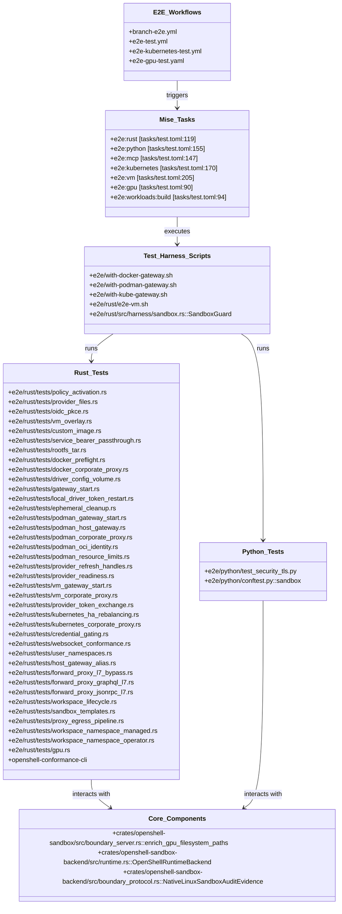

<!-- source: DeepWiki mcp.deepwiki.com · repo NVIDIA/OpenShell · page 12.1 E2E Test Suites · fetched 2026-10-26 -->

# E2E Test Suites

<details>
<summary>Relevant source files</summary>

The following files were used as context for generating this wiki page:

- [TESTING.md](TESTING.md)
- [crates/openshell-isolation-interface/src/contract.rs](crates/openshell-isolation-interface/src/contract.rs)
- [crates/openshell-isolation-interface/src/linux/seccomp_notify.rs](crates/openshell-isolation-interface/src/linux/seccomp_notify.rs)
- [crates/openshell-isolation-interface/src/linux/task_memory.rs](crates/openshell-isolation-interface/src/linux/task_memory.rs)
- [crates/openshell-isolation-interface/tests/backend_conformance.rs](crates/openshell-isolation-interface/tests/backend_conformance.rs)
- [crates/openshell-sandbox-backend/README.md](crates/openshell-sandbox-backend/README.md)
- [crates/openshell-sandbox-backend/src/boundary_protocol.rs](crates/openshell-sandbox-backend/src/boundary_protocol.rs)
- [crates/openshell-sandbox-backend/src/runtime.rs](crates/openshell-sandbox-backend/src/runtime.rs)
- [crates/openshell-sandbox-backend/src/runtime/tests/credential_renewal.rs](crates/openshell-sandbox-backend/src/runtime/tests/credential_renewal.rs)
- [crates/openshell-sandbox-backend/src/runtime/tests/flow_control.rs](crates/openshell-sandbox-backend/src/runtime/tests/flow_control.rs)
- [crates/openshell-sandbox-backend/src/runtime/tests/network_recovery.rs](crates/openshell-sandbox-backend/src/runtime/tests/network_recovery.rs)
- [crates/openshell-sandbox-backend/src/sandbox_auth.rs](crates/openshell-sandbox-backend/src/sandbox_auth.rs)
- [crates/openshell-sandbox/src/boundary_exec.rs](crates/openshell-sandbox/src/boundary_exec.rs)
- [crates/openshell-sandbox/src/boundary_server.rs](crates/openshell-sandbox/src/boundary_server.rs)
- [e2e/python/conftest.py](e2e/python/conftest.py)
- [e2e/python/test_security_tls.py](e2e/python/test_security_tls.py)
- [e2e/rust/Cargo.toml](e2e/rust/Cargo.toml)
- [e2e/rust/e2e-docker.sh](e2e/rust/e2e-docker.sh)
- [e2e/rust/e2e-kubernetes.sh](e2e/rust/e2e-kubernetes.sh)
- [e2e/rust/e2e-podman.sh](e2e/rust/e2e-podman.sh)
- [e2e/rust/e2e-vm.sh](e2e/rust/e2e-vm.sh)
- [e2e/rust/src/harness/output.rs](e2e/rust/src/harness/output.rs)
- [e2e/rust/src/harness/port.rs](e2e/rust/src/harness/port.rs)
- [e2e/rust/src/harness/sandbox.rs](e2e/rust/src/harness/sandbox.rs)
- [e2e/rust/tests/bypass_detection.rs](e2e/rust/tests/bypass_detection.rs)
- [e2e/rust/tests/docker_preflight.rs](e2e/rust/tests/docker_preflight.rs)
- [e2e/rust/tests/edge_tunnel_e2e.rs](e2e/rust/tests/edge_tunnel_e2e.rs)
- [e2e/rust/tests/forward_proxy_jsonrpc_l7.rs](e2e/rust/tests/forward_proxy_jsonrpc_l7.rs)
- [e2e/rust/tests/port_forward.rs](e2e/rust/tests/port_forward.rs)
- [e2e/rust/tests/sandbox_labels.rs](e2e/rust/tests/sandbox_labels.rs)
- [e2e/rust/tests/sandbox_lifecycle.rs](e2e/rust/tests/sandbox_lifecycle.rs)
- [e2e/support/gateway-common.sh](e2e/support/gateway-common.sh)
- [e2e/with-docker-gateway.sh](e2e/with-docker-gateway.sh)
- [e2e/with-podman-gateway.sh](e2e/with-podman-gateway.sh)
- [tasks/test.toml](tasks/test.toml)

</details>


This document describes the end-to-end (E2E) testing system that validates OpenShell's complete functionality in a CI environment. The E2E test workflow pulls freshly-built component images by SHA, bootstraps a local gateway using various compute drivers (Docker, Podman, Kubernetes, VM), and executes Python and Rust test suites to ensure system integrity.

## Workflow Structure

The E2E test system is orchestrated primarily through [.github/workflows/e2e-test.yml:1-128](), which is called by [.github/workflows/branch-e2e.yml:126-140]() for pull requests. Unlike simple unit tests, E2E tests require a functional gateway and supervisor image.

### PR CI and Label Gating
OpenShell uses self-hosted runners for GPU and ARM access. PRs from external contributors are mirrored to `pull-request/<N>` branches by `copy-pr-bot` before E2E tests can run [CI.md:9-11]().

Three opt-in labels trigger the suites:
- `test:e2e`: Runs standard Python, Rust, and MCP suites [.github/workflows/branch-e2e.yml:45-45](), [CI.md:17-18]().
- `test:e2e-gpu`: Runs GPU-specific tests on NVIDIA hardware [.github/workflows/branch-e2e.yml:46-46](), [CI.md:19-19]().
- `test:e2e-kubernetes`: Runs tests against High Availability (HA) and credential-driver scenarios [.github/workflows/e2e-kubernetes-test.yml:1-134](), [CI.md:20-22]().

**Sources:** [.github/workflows/branch-e2e.yml:1-78](), [.github/workflows/e2e-test.yml:1-128](), [CI.md:1-27]()

### E2E Test Workflow Execution Flow

The workflow follows a matrix strategy to validate different environments in parallel. Prebuilt artifacts (CLI and Gateway) are shared across jobs to reduce compilation overhead.

**E2E Build and Execution Flow**
```mermaid
graph TB
    subgraph "Build Phase (branch-e2e.yml)"
        buildGateway[build-gateway] -- "ghcr.io image" --> e2eTestYml[e2e-test.yml]
        buildSupervisor[build-supervisor] -- "ghcr.io image" --> e2eTestYml
        buildCli[build-cli] -- "Artifact" --> e2eTestYml
        buildConformance[build-conformance] -- "Artifact" --> e2eTestYml
    end

    subgraph "Matrix: E2E Suite (e2e-test.yml)"
        direction TB
        suitePython[suite: python]
        suiteRustDocker[suite: rust-docker]
        suiteMcp[suite: mcp]
        suiteOidcPython[suite: oidc-python]
        suiteKube[suite: kubernetes]
        suiteGpu[suite: gpu]
        suitePodman[suite: podman]
        suiteVm[suite: vm]
    end

    subgraph "Execution (with-docker-gateway.sh)"
        startEphemeralGatewayDocker[Start Ephemeral Gateway (Docker)]
        runCargoTestDocker[Run cargo test]
        cleanupContainersDocker[Cleanup Containers]

        suiteRustDocker --> startEphemeralGatewayDocker
        startEphemeralGatewayDocker --> runCargoTestDocker
        runCargoTestDocker --> cleanupContainersDocker
    end

    subgraph "Execution (with-podman-gateway.sh)"
        startEphemeralGatewayPodman[Start Ephemeral Gateway (Podman)]
        runCargoTestPodman[Run cargo test]
        cleanupContainersPodman[Cleanup Containers]

        suitePodman --> startEphemeralGatewayPodman
        startEphemeralGatewayPodman --> runCargoTestPodman
        runCargoTestPodman --> cleanupContainersPodman
    end

    subgraph "Execution (e2e-kubernetes-test.yml)"
        setupKindCluster[Set up kind cluster]
        runKubeE2E[Run Kubernetes E2E]

        suiteKube --> setupKindCluster
        setupKindCluster --> runKubeE2E
    end

    subgraph "Execution (e2e-vm.sh)"
        buildVmPrereqs[Build VM Prerequisites]
        startEphemeralGatewayVm[Start Ephemeral Gateway (VM)]
        runCargoTestVm[Run cargo test]
        cleanupVm[Cleanup VM]

        suiteVm --> buildVmPrereqs
        buildVmPrereqs --> startEphemeralGatewayVm
        startEphemeralGatewayVm --> runCargoTestVm
        runCargoTestVm --> cleanupVm
    end

    e2eTestYml -.-> suitePython
    e2eTestYml -.-> suiteRustDocker
    e2eTestYml -.-> suiteMcp
    e2eTestYml -.-> suiteOidcPython
    e2eTestYml -.-> suiteKube
    e2eTestYml -.-> suiteGpu
    e2eTestYml -.-> suitePodman
    e2eTestYml -.-> suiteVm

    buildGateway -.-> startEphemeralGatewayDocker
    buildGateway -.-> startEphemeralGatewayPodman
    buildGateway -.-> startEphemeralGatewayVm
    buildGateway -.-> setupKindCluster
    buildCli -.-> runCargoTestDocker
    buildCli -.-> runCargoTestPodman
    buildCli -.-> runCargoTestVm
    buildCli -.-> runKubeE2E
    buildConformance -.-> runCargoTestDocker
    buildConformance -.-> runCargoTestPodman
    buildConformance -.-> runCargoTestVm
    buildConformance -.-> runKubeE2E
```

**Sources:** [.github/workflows/e2e-test.yml:41-65](), [.github/workflows/branch-e2e.yml:79-111](), [tasks/test.toml:81-83](), [.github/workflows/branch-e2e.yml:108-131]()

## Test Environment Bootstrap

Tests are executed using wrapper scripts that manage the lifecycle of a standalone gateway. These scripts isolate CLI metadata from the developer's real configuration by setting `XDG_CONFIG_HOME` to an ephemeral work directory [e2e/with-kube-gateway.sh:99-100](), [e2e/with-podman-gateway.sh:141-142]().

### Compute Driver Scenarios
- **Docker**: The default driver used for smoke tests. The harness handles host-to-container path resolution for GitHub Actions [tasks/test.toml:119-122](). The `e2e/with-docker-gateway.sh` script manages the Docker gateway lifecycle, including sandbox container logging and cleanup [e2e/with-docker-gateway.sh:143-174]().
- **Podman**: Validates compatibility with Podman. The **Rootless** mode runs directly on the Ubuntu host to observe AppArmor and user namespace policies [.github/workflows/e2e-test.yml:129-137](), [tasks/test.toml:164-167](). The `e2e/with-podman-gateway.sh` script handles Podman-specific setup, including XDG configuration and network management [e2e/with-podman-gateway.sh:67-80](), [e2e/with-podman-gateway.sh:141-177]().
- **Kubernetes**: Uses `kind` (Kubernetes in Docker) to deploy the OpenShell Helm chart. Local images are loaded into `kind` nodes before `mise run e2e:kubernetes` is executed [.github/workflows/e2e-kubernetes-test.yml:111-134](), [tasks/test.toml:170-175]().
- **MicroVM**: Validates the `openshell-driver-vm` runtime using the VM compute driver [e2e/rust/e2e-vm.sh:1-415](). The `e2e/rust/e2e-vm.sh` script builds necessary VM components (libkrun, bundled supervisor) and manages the gateway lifecycle [e2e/rust/e2e-vm.sh:79-132]().

### High Availability (HA) and Database Scenarios
The `test:e2e-kubernetes` label exercises multi-replica synchronization.
- **External PostgreSQL**: When `OPENSHELL_E2E_KUBE_DB_SCENARIOS=1` is set, the harness deploys an ephemeral PostgreSQL fixture and configures the gateway to use it via a Kubernetes Secret [e2e/with-kube-gateway.sh:32-35](), [e2e/with-kube-gateway.sh:150-170]().
- **Credential Drivers**: Tests backends like `kubernetes-secrets` and `vault` (using an OpenBao fixture) for secure provider credential storage [e2e/with-kube-gateway.sh:43-48](), [e2e/with-kube-gateway.sh:185-201]().

**Sources:** [e2e/with-kube-gateway.sh:1-201](), [tasks/test.toml:170-175](), [.github/workflows/e2e-kubernetes-test.yml:1-134](), [e2e/with-docker-gateway.sh:1-181](), [e2e/with-podman-gateway.sh:1-177](), [e2e/rust/e2e-vm.sh:1-415]()

## Python E2E Test Suite

The Python suite leverages the `openshell` SDK to perform high-level agent interactions and OIDC authorization flows.

### Implementation Details
- **Parallelism**: Uses `pytest-xdist` with a default of 5 parallel workers (`-n ${E2E_PARALLEL:-5}`) [tasks/test.toml:159-162]().
- **OIDC Testing**: Specialized jobs like `oidc-python` run against a Keycloak fixture to validate workspace authorization [.github/workflows/e2e-test.yml:53-55](), [tasks/test.toml:125-131]().
- **Environment**: Requires `python:proto` task to generate gRPC stubs before execution [.github/workflows/e2e-test.yml:119-121](), [tasks/test.toml:158-158]().
- **Sandbox Fixture**: The `sandbox` fixture from `e2e/python/conftest.py` provides a factory for creating and managing sandbox lifecycles within tests [TESTING.md:127-129]().
- **`exec_python`**: This utility serializes a Python callable using `cloudpickle`, sends it to the sandbox for execution, and returns the result. It requires specific patterns for closures or bound methods to avoid serialization issues [TESTING.md:137-169]().

**Sources:** [tasks/test.toml:155-162](), [.github/workflows/e2e-test.yml:50-55](), [TESTING.md:110-177](), [e2e/python/conftest.py]().

## Rust E2E Test Suite

The Rust suite ([e2e/rust/Cargo.toml]()) focuses on CLI conformance, protocol inspection, and security enforcement.

### Conformance and Protocol Testing
- **CLI Conformance**: The `e2e_run_openshell_conformance` function, sourced from `e2e/support/conformance.sh`, executes the `openshell-conformance` binary against the running gateway. This is a core part of Docker, Podman, and VM Rust E2E tests [e2e/rust/e2e-docker.sh:21](), [e2e/rust/e2e-podman.sh:72](), [e2e/rust/e2e-vm.sh:300]().
- **WebSocket Conformance**: Validates interactive terminal stability and L7 protocol handling [tasks/test.toml:140-145](), [e2e/rust/Cargo.toml:172-174]().
- **MCP Conformance**: Checks the Model Context Protocol implementation against the official `modelcontextprotocol/conformance` repository [.github/workflows/e2e-test.yml:100-109](), [tasks/test.toml:147-150]().
- **Policy Advisor E2E**: Tests mechanistic L4 smoke and proposal generation [tasks/test.toml:235]().
- **Sandbox Lifecycle**: Tests in `e2e/rust/tests/sandbox_lifecycle.rs` cover various aspects of sandbox management, including `exec` behavior, large output handling, and cleanup [e2e/rust/tests/sandbox_lifecycle.rs:115-207](). The `SandboxGuard` struct in `e2e/rust/src/harness/sandbox.rs` provides RAII-style cleanup for sandboxes created during tests [e2e/rust/src/harness/sandbox.rs:89-102]().

### GPU E2E Tests
GPU tests verify that the `NVIDIA_VISIBLE_DEVICES` injection and CDI (Container Device Interface) specs are correctly handled.
- **Workload Building**: Test images are built locally via `e2e:workloads:build` [tasks/test.toml:94-96]().
- **Execution**: Runs on native runners with GPU access, verifying device visibility within the sandbox [tasks/test.toml:90-92](), [e2e/rust/Cargo.toml:232-234](). The `e2e-gpu-test.yaml` workflow specifically targets GPU runners and performs Docker GPU prerequisite checks like `docker info --format '{{json .CDISpecDirs}}'` and `nvidia-smi -L` [.github/workflows/e2e-gpu-test.yaml:78-81]().
- **GPU Baseline Paths**: The `enrich_gpu_filesystem_paths` function in `crates/openshell-sandbox/src/boundary_server.rs` dynamically adds necessary filesystem paths for GPU devices to the sandbox policy based on detected hardware [crates/openshell-sandbox/src/boundary_server.rs:108-153]().

### Entity Mapping: Code to Test

**Code to E2E Entity Mapping**


**Sources:** [tasks/test.toml:81-235](), [.github/workflows/branch-e2e.yml:126-193](), [e2e/rust/Cargo.toml:1-245](), [e2e/rust/e2e-docker.sh:1-52](), [e2e/rust/e2e-podman.sh:1-104](), [.github/workflows/e2e-gpu-test.yaml:1-87](), [e2e/rust/tests/sandbox_lifecycle.rs:1-207](), [e2e/rust/src/harness/sandbox.rs:1-174](), [crates/openshell-sandbox/src/boundary_server.rs:108-153](), [crates/openshell-sandbox-backend/src/runtime.rs:75-106](), [crates/openshell-sandbox-backend/src/boundary_protocol.rs:105-168]().

## Disposable Linux VMs for Package Validation

The `nix/test-guest/` harness provides a robust system for booting and configuring disposable Linux virtual machines (VMs) via QEMU. This is crucial for validating OpenShell packages (DEB, RPM, Snap) across various distributions and configurations.

### Architecture and Components
The system leverages Nix, QEMU, and Ansible to manage VM lifecycles.
- `default.nix`: Assembles the guest and cache flake apps, selecting host architecture and acceleration, and exposing distro profiles and configuration playbooks [nix/test-guest/default.nix:59-84]().
- `run.sh`: Manages the disposable guest lifecycle, including cache lookup, cloud-image realization, cloud-init seed creation, QEMU startup, SSH readiness, Ansible execution, artifact installation, guest command execution, and cleanup [nix/test-guest/README.md:60-61]().
- `cache.sh`, `cache-lib.sh`, `cache-seal.sh`: Handle disk caching, identity, validation, and state removal before capture [nix/test-guest/README.md:62-64]().
- `distros/*.nix`: Define immutable base-image catalogs for various distributions like Ubuntu, CentOS, Fedora, and Rocky [nix/test-guest/README.md:65-66](), [nix/test-guest/default.nix:20-26]().
- `configuration/*.yml`: Ansible playbooks that layer optional capabilities (e.g., Docker, rootless Podman, SELinux, Snapd) onto a base guest [nix/test-guest/README.md:67-68](), [nix/test-guest/default.nix:28-33]().
- `provisioners/roles/*`: Per-run Ansible roles that set up the system after artifacts are installed, not part of the cached VM [nix/test-guest/README.md:69-70](), [nix/test-guest/default.nix:43-48]().

### Supported Distributions and Configurations
The `nix run .#test-guest -- --list` command can be used to list available distros and configurations [nix/test-guest/README.md:96-98]().
- **Distros**: Ubuntu 24.04, Ubuntu 26.04, CentOS Stream 10, Fedora 44, Rocky Linux 9 [nix/test-guest/README.md:75-79]().
- **Configurations**:
    - `docker`: Installs and configures Docker.
    - `podman-rootless`: Configures rootless Podman, supporting Fedora and Ubuntu 26.04+ [nix/test-guest/README.md:87-92]().
    - `selinux`: Installs tooling, enables enforcing mode, and verifies SELinux [nix/test-guest/README.md:132-141]().
    - `snapd`: Prepares `snapd` for local Snap lifecycle experiments on Ubuntu [nix/test-guest/README.md:81-85]().

### Usage
Users can boot an interactive VM, apply configurations, and install packages:
```bash
# Boot a base Ubuntu VM
nix run .#test-guest -- --distro ubuntu-24-04

# Apply Docker configuration
nix run .#test-guest -- --distro ubuntu-24-04 --with docker

# Install a .deb package
nix run .#test-guest -- --distro ubuntu-24-04 --install /path/to/openshell.deb

# Run a command inside the VM
nix run .#test-guest -- --distro rocky --with selinux -- getenforce
```
The `--copy` argument allows copying files to the guest, preserving permissions or setting a specific mode [nix/test-guest/run.sh:104-107](), [nix/test-guest/README.md:149-151]().

**Test Guest Harness Overview**
```mermaid
graph TD
    User[User/CI] --> NixRun["nix run .#test-guest -- ..."]
    NixRun --> RunScript[nix/test-guest/run.sh]

    subgraph "Guest VM Lifecycle (run.sh)"
        CacheLookup[Cache Lookup (cache.sh)]
        CloudImageRealization[Cloud Image Realization]
        CloudInitSeedCreation[Cloud-init Seed Creation]
        QEMUStartup[QEMU Startup]
        SSHReadiness[SSH Readiness]
        AnsibleExecution[Ansible Execution (configuration/*.yml)]
        ArtifactInstallation[Artifact Installation (--install, --copy)]
        GuestCommandExecution[Guest Command Execution]
        Cleanup[Cleanup]

        RunScript --> CacheLookup
        CacheLookup --> CloudImageRealization
        CloudImageRealization --> CloudInitSeedCreation
        CloudInitSeedCreation --> QEMUStartup
        QEMUStartup --> SSHReadiness
        SSHReadiness --> AnsibleExecution
        AnsibleExecution --> ArtifactInstallation
        ArtifactInstallation --> GuestCommandExecution
        GuestCommandExecution --> Cleanup
    end

    subgraph "Nix Store Catalogs (default.nix)"
        DistroCatalog[distros/*.nix]
        ConfigurationCatalog[configuration/*.yml]
        ProvisionerCatalog[provisioners/roles/*]

        RunScript --> DistroCatalog
        RunScript --> ConfigurationCatalog
        RunScript --> ProvisionerCatalog
    end

    DistroCatalog -- "Image URL, Hash, OS Info" --> CloudImageRealization
    ConfigurationCatalog -- "Ansible Playbooks" --> AnsibleExecution
    ProvisionerCatalog -- "Ansible Roles" --> ArtifactInstallation
```

**Sources:** [nix/test-guest/README.md:1-157](), [nix/test-guest/run.sh:1-247](), [nix/test-guest/default.nix:1-147]()

## CI Quality Gates

Status checks are aggregated in the `Required CI Gates` (documented in `CI.md`) to provide clear pass/fail feedback on PRs.

- **OpenShell / Branch Checks**: Basic validation of the mirror and unit tests [CI.md:104-104]().
- **OpenShell / E2E**: Aggregated result of standard Docker, Podman, and Rust/Python suites [CI.md:105-105]().
- **OpenShell / GPU E2E**: Tracking for specialized GPU runner jobs [CI.md:106-106]().
- **Label Help**: A bot provides instructions to maintainers when labels are applied, pointing to the specific run IDs for manual re-triggering [.github/workflows/e2e-label-help.yml:1-83]().

**Sources:** [CI.md:7-28](), [.github/workflows/branch-e2e.yml:18-77](), [.github/workflows/e2e-label-help.yml:37-81]()

---

