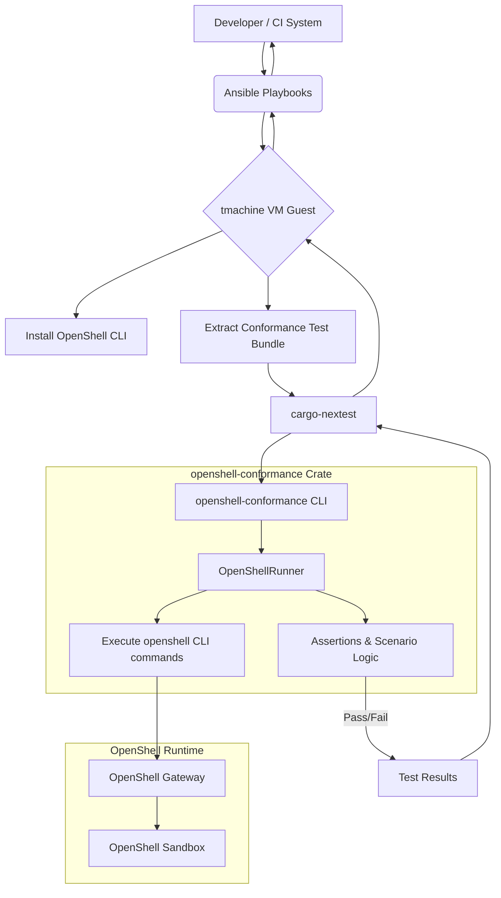

<!-- source: DeepWiki mcp.deepwiki.com · repo NVIDIA/OpenShell · page 12.2 Conformance Suites · fetched 2026-10-26 -->

# Conformance Suites

<details>
<summary>Relevant source files</summary>

The following files were used as context for generating this wiki page:

- [crates/openshell-cli/tests/sandbox_upload_integration.rs](crates/openshell-cli/tests/sandbox_upload_integration.rs)
- [crates/openshell-conformance/src/lib.rs](crates/openshell-conformance/src/lib.rs)
- [crates/openshell-conformance/src/scenarios/file_transfer.rs](crates/openshell-conformance/src/scenarios/file_transfer.rs)
- [crates/openshell-conformance/src/scenarios/mod.rs](crates/openshell-conformance/src/scenarios/mod.rs)
- [crates/openshell-conformance/src/scenarios/policy_behavior.rs](crates/openshell-conformance/src/scenarios/policy_behavior.rs)
- [crates/openshell-supervisor-network/src/policy_dns/mod.rs](crates/openshell-supervisor-network/src/policy_dns/mod.rs)
- [crates/openshell-supervisor-network/src/policy_dns/store.rs](crates/openshell-supervisor-network/src/policy_dns/store.rs)
- [crates/openshell-supervisor-network/src/policy_dns/wire.rs](crates/openshell-supervisor-network/src/policy_dns/wire.rs)
- [docs/upgrade/0-1-0.mdx](docs/upgrade/0-1-0.mdx)
- [e2e/policy-advisor/README.md](e2e/policy-advisor/README.md)
- [tests/ansible/playbooks/conformance/cli.yaml](tests/ansible/playbooks/conformance/cli.yaml)
- [tests/ansible/playbooks/features/provider-refresh/keycloak.yaml](tests/ansible/playbooks/features/provider-refresh/keycloak.yaml)
- [tests/suites/conformance/cli/tests/file_transfer.rs](tests/suites/conformance/cli/tests/file_transfer.rs)
- [tests/suites/conformance/cli/tests/policy_advisor.rs](tests/suites/conformance/cli/tests/policy_advisor.rs)
- [tests/suites/features/Cargo.lock](tests/suites/features/Cargo.lock)

</details>


This page details the `openshell-conformance` crate, which provides a framework for defining and executing portable conformance scenarios against the OpenShell CLI. It covers the structure of scenario definitions, the different types of test suites (conformance, drivers, features), and the command-line interface for running these tests. The conformance suite ensures that the OpenShell CLI and its underlying components behave as expected across various environments and configurations.

## `openshell-conformance` Crate

The `openshell-conformance` crate [crates/openshell-conformance/src/lib.rs:4-4]() offers reusable support for portable OpenShell CLI conformance scenarios. It defines the core structures and utilities for creating, running, and reporting on these scenarios.

### Scenario Definition

A conformance scenario is represented by the `Scenario` struct [crates/openshell-conformance/src/lib.rs:34-39](). Each `Scenario` has:
*   `name`: A unique identifier for the scenario.
*   `description`: A brief explanation of what the scenario tests.
*   `run`: An asynchronous function that executes the scenario logic using an `OpenShellRunner`.

The `scenarios()` function [crates/openshell-conformance/src/lib.rs:59-61]() returns a static slice of all compiled scenarios. Individual scenarios can be retrieved by name using the `scenario()` function [crates/openshell-conformance/src/lib.rs:64-66]().

**Scenario Examples:**

*   `SMOKE_SCENARIO`: Basic functionality check [crates/openshell-conformance/src/scenarios/smoke.rs]().
*   `SANDBOX_LIFECYCLE_SCENARIO`: Tests sandbox creation, deletion, and state transitions [crates/openshell-conformance/src/scenarios/sandbox_lifecycle.rs]().
*   `FILE_TRANSFER_SCENARIO`: Verifies file upload and download behavior, including Git filtering and path safety [crates/openshell-conformance/src/scenarios/file_transfer.rs:21-25](). This scenario further composes `FILE_TRANSFER_ROUND_TRIP_SCENARIO`, `FILE_TRANSFER_GIT_FILTERING_SCENARIO`, and `FILE_TRANSFER_PATH_SAFETY_SCENARIO` [crates/openshell-conformance/src/scenarios/file_transfer.rs:48-53]().
*   `MECHANISTIC_PROPOSAL_SCENARIO`, `NEW_HOSTNAME_PROPOSAL_SCENARIO`, `POLICY_LOCAL_SCENARIO`: These scenarios test policy-related behaviors, particularly around policy proposals and the `policy.local` API [crates/openshell-conformance/src/scenarios/policy_behavior.rs]().

Sources:
*   [crates/openshell-conformance/src/lib.rs:4-4]()
*   [crates/openshell-conformance/src/lib.rs:34-39]()
*   [crates/openshell-conformance/src/lib.rs:59-61]()
*   [crates/openshell-conformance/src/lib.rs:64-66]()
*   [crates/openshell-conformance/src/scenarios/file_transfer.rs:21-25]()
*   [crates/openshell-conformance/src/scenarios/file_transfer.rs:48-53]()
*   [crates/openshell-conformance/src/scenarios/mod.rs:11-17]()
*   [crates/openshell-conformance/src/scenarios/policy_behavior.rs]()
*   [crates/openshell-conformance/src/scenarios/sandbox_lifecycle.rs]()
*   [crates/openshell-conformance/src/scenarios/smoke.rs]()

### `OpenShellRunner`

The `OpenShellRunner` struct [crates/openshell-conformance/src/lib.rs:230-230]() is central to executing conformance scenarios. It manages the state and interactions with the OpenShell CLI.

**Key functionalities of `OpenShellRunner`:**

*   **Initialization:** `OpenShellRunner::new()` [crates/openshell-conformance/src/lib.rs:240-250]() sets up the runner, including resolving the OpenShell binary path and generating a unique run ID.
*   **Command Execution:** The `step()` method [crates/openshell-conformance/src/lib.rs:300-300]() creates a `CommandBuilder` for executing CLI commands. The `run()` method of `CommandBuilder` [crates/openshell-conformance/src/lib.rs:360-360]() executes the command and returns a `CommandResult` [crates/openshell-conformance/src/lib.rs:83-93]().
*   **Sandbox Management:** `track_sandbox()` [crates/openshell-conformance/src/lib.rs:280-280]() and `forget_sandbox()` [crates/openshell-conformance/src/lib.rs:284-284]() methods help manage sandbox lifecycles during tests, ensuring proper cleanup.
*   **Gateway Status Polling:** `poll_gateway_status()` [crates/openshell-conformance/src/lib.rs:440-440]() repeatedly checks the gateway's health until it's ready or a timeout occurs.
*   **Cleanup:** The `drop` implementation for `OpenShellRunner` [crates/openshell-conformance/src/lib.rs:500-500]() attempts to clean up any tracked sandboxes and the gateway.

**`CommandResult`**

The `CommandResult` struct [crates/openshell-conformance/src/lib.rs:83-93]() encapsulates the outcome of an OpenShell CLI command execution. It provides:
*   `success()`: Checks if the command exited successfully [crates/openshell-conformance/src/lib.rs:97-99]().
*   `exit_code()`: Returns the exit code [crates/openshell-conformance/src/lib.rs:101-103]().
*   `stdout()`, `stderr()`: Access to standard output and error streams [crates/openshell-conformance/src/lib.rs:105-109]().
*   `json()`: Deserializes stdout into a specified JSON type [crates/openshell-conformance/src/lib.rs:117-124]().
*   `require_success()`: Asserts command success, returning a diagnostic string on failure [crates/openshell-conformance/src/lib.rs:126-131]().

**`RunnerError`**

The `RunnerError` enum [crates/openshell-conformance/src/lib.rs:151-179]() defines various errors that can occur during scenario execution, such as binary unavailability, command spawning issues, timeouts, or invalid JSON responses.

### Data Flow for Scenario Execution

The following diagram illustrates the data flow when a conformance scenario is executed:

```mermaid
graph TD
    A[Test Runner (e.g., cargo-nextest)] --> B{openshell-conformance CLI}
    B --> C[OpenShellRunner::new()]
    C --> D[Generate Run ID]
    C --> E[Resolve openshell binary path]
    E --> F[Scenario::run(runner)]
    F --> G[OpenShellRunner::step(command)]
    G --> H[CommandBuilder::run(args)]
    H --> I[Execute openshell CLI command]
    I --> J[Capture stdout, stderr, exit status, elapsed time]
    J --> K[CommandResult]
    K --> L{Scenario Logic (assertions, further commands)}
    L -- Success/Failure --> M[Report Test Outcome]
    M --> N[OpenShellRunner::drop() (cleanup)]
    N --> O[Delete tracked sandboxes]
    N --> P[Stop gateway]

    subgraph OpenShellRunner
        C -- Manages --> G
        G -- Returns --> K
        K -- Used by --> L
        L -- Updates --> C
    end

    subgraph Conformance Crate
        B
        C
        D
        E
        F
        G
        H
        I
        J
        K
        L
        M
        N
        O
        P
    end
```
**Diagram: Conformance Scenario Execution Flow**

Sources:
*   [crates/openshell-conformance/src/lib.rs:83-93]()
*   [crates/openshell-conformance/src/lib.rs:97-99]()
*   [crates/openshell-conformance/src/lib.rs:101-103]()
*   [crates/openshell-conformance/src/lib.rs:105-109]()
*   [crates/openshell-conformance/src/lib.rs:117-124]()
*   [crates/openshell-conformance/src/lib.rs:126-131]()
*   [crates/openshell-conformance/src/lib.rs:151-179]()
*   [crates/openshell-conformance/src/lib.rs:230-230]()
*   [crates/openshell-conformance/src/lib.rs:240-250]()
*   [crates/openshell-conformance/src/lib.rs:280-280]()
*   [crates/openshell-conformance/src/lib.rs:284-284]()
*   [crates/openshell-conformance/src/lib.rs:300-300]()
*   [crates/openshell-conformance/src/lib.rs:360-360]()
*   [crates/openshell-conformance/src/lib.rs:440-440]()
*   [crates/openshell-conformance/src/lib.rs:500-500]()

## Conformance Test Suites

The OpenShell project utilizes several test suites to ensure conformance and quality across different aspects of the system. These suites often leverage the `openshell-conformance` crate for defining and running scenarios.

### Conformance Suite (`tests/suites/conformance/cli`)

This suite contains tests that directly use the `openshell-conformance` crate to verify core CLI behaviors.

*   **`tests/suites/conformance/cli/tests/file_transfer.rs`**: This file likely contains the actual test cases that invoke the `FILE_TRANSFER_SCENARIO` and its sub-scenarios, asserting their correct behavior.
*   **`tests/suites/conformance/cli/tests/policy_advisor.rs`**: This file likely contains test cases for policy-related scenarios, such as `MECHANISTIC_PROPOSAL_SCENARIO`, `NEW_HOSTNAME_PROPOSAL_SCENARIO`, and `POLICY_LOCAL_SCENARIO`. These tests validate the policy advisor's ability to generate and apply policy proposals.

The `tests/ansible/playbooks/conformance/cli.yaml` playbook [tests/ansible/playbooks/conformance/cli.yaml]() is responsible for running the conformance tests in a `tmachine` environment. It performs the following steps:
1.  **Installs dependencies**: Ensures `git` is available [tests/ansible/playbooks/conformance/cli.yaml:13-18]().
2.  **Prepares test directory**: Creates `/var/lib/openshell-conformance/tests` [tests/ansible/playbooks/conformance/cli.yaml:20-25]().
3.  **Extracts test bundle**: Unarchives the `openshell_conformance_test_bundle` into the test directory [tests/ansible/playbooks/conformance/cli.yaml:28-35](). This bundle is expected to contain `tests.tar.zst` [tests/ansible/playbooks/conformance/cli.yaml:40-47](), which is a `cargo-nextest` archive.
4.  **Resolves OpenShell CLI**: Finds the `openshell` binary path [tests/ansible/playbooks/conformance/cli.yaml:50-56]().
5.  **Runs tests with `cargo-nextest`**: Executes the tests from the archive, limiting to one test thread to avoid resource contention [tests/ansible/playbooks/conformance/cli.yaml:59-75](). The `OPENSHELL_BIN` environment variable is set to the resolved CLI path [tests/ansible/playbooks/conformance/cli.yaml:76-77]().
6.  **Reports results**: Shows diagnostics and gateway logs on failure [tests/ansible/playbooks/conformance/cli.yaml:83-105]().
7.  **Asserts success**: Fails the playbook if any conformance test fails [tests/ansible/playbooks/conformance/cli.yaml:110-113]().

Sources:
*   [tests/ansible/playbooks/conformance/cli.yaml:13-18]()
*   [tests/ansible/playbooks/conformance/cli.yaml:20-25]()
*   [tests/ansible/playbooks/conformance/cli.yaml:28-35]()
*   [tests/ansible/playbooks/conformance/cli.yaml:40-47]()
*   [tests/ansible/playbooks/conformance/cli.yaml:50-56]()
*   [tests/ansible/playbooks/conformance/cli.yaml:59-75]()
*   [tests/ansible/playbooks/conformance/cli.yaml:76-77]()
*   [tests/ansible/playbooks/conformance/cli.yaml:83-105]()
*   [tests/ansible/playbooks/conformance/cli.yaml:110-113]()
*   [tests/suites/conformance/cli/tests/file_transfer.rs]()
*   [tests/suites/conformance/cli/tests/policy_advisor.rs]()

### Driver-Specific Conformance

While not explicitly named "conformance suites" in the same way as the CLI conformance, various driver implementations have their own tests that ensure they conform to the expected behavior and interfaces. For example, the `crates/openshell-cli/tests/sandbox_upload_integration.rs` file [crates/openshell-cli/tests/sandbox_upload_integration.rs]() contains integration tests for the `sandbox upload` command, verifying aspects like Git filtering and path safety. These tests directly interact with the CLI and simulate different scenarios to ensure the driver's correct operation.

Sources:
*   [crates/openshell-cli/tests/sandbox_upload_integration.rs]()

### Feature-Specific Conformance

Certain features also have dedicated test suites to ensure their correct implementation and adherence to specifications. An example is the `tests/ansible/playbooks/features/provider-refresh/keycloak.yaml` playbook [tests/ansible/playbooks/features/provider-refresh/keycloak.yaml](). This playbook runs tests specifically for the Keycloak provider refresh functionality. Similar to the CLI conformance, it:
1.  **Installs dependencies**.
2.  **Prepares test directory**.
3.  **Extracts test bundle**: Unarchives `provider_refresh_keycloak_test_bundle` [tests/ansible/playbooks/features/provider-refresh/keycloak.yaml:33-39](), which is also expected to contain a `cargo-nextest` archive [tests/ansible/playbooks/features/provider-refresh/keycloak.yaml:43-50]().
4.  **Resolves OpenShell CLI**.
5.  **Runs tests with `cargo-nextest`**: Executes the tests, setting environment variables like `OPENSHELL_E2E_OIDC_ISSUER` for the Keycloak environment [tests/ansible/playbooks/features/provider-refresh/keycloak.yaml:62-77]().
6.  **Reports results** and **asserts success**.

Sources:
*   [tests/ansible/playbooks/features/provider-refresh/keycloak.yaml]()
*   [tests/ansible/playbooks/features/provider-refresh/keycloak.yaml:33-39]()
*   [tests/ansible/playbooks/features/provider-refresh/keycloak.yaml:43-50]()
*   [tests/ansible/playbooks/features/provider-refresh/keycloak.yaml:62-77]()

## Conformance CLI

The `openshell-conformance` binary provides a command-line interface for interacting with the conformance scenarios.

```bash
openshell-conformance <COMMAND>
```

**Available Commands:**

*   `list`: Lists all available conformance scenarios.
*   `run <SCENARIO_NAMES...>`: Executes one or more specified scenarios.
    *   `--openshell-bin <PATH>`: Specifies the path to the `openshell` CLI binary to be tested. This is crucial for the conformance suite to interact with the target CLI.

**Example Usage:**

To list all available scenarios:
```bash
openshell-conformance list
```

To run specific scenarios, for instance, the policy advisor related ones:
```bash
openshell-conformance run mechanistic-proposal new-hostname-proposal policy-local --openshell-bin target/debug/openshell
```
This command is mentioned in the `e2e/policy-advisor/README.md` [e2e/policy-advisor/README.md:61-63]() as a way to run policy-related conformance tests.

The conformance CLI is typically invoked within automated testing environments, such as `tmachine` (as seen in the Ansible playbooks), to ensure consistent and reproducible testing.

Sources:
*   [e2e/policy-advisor/README.md:61-63]()
*   [tests/ansible/playbooks/conformance/cli.yaml:59-75]()

## Relationship to E2E Tests

The conformance suites, particularly those using `openshell-conformance`, are a specialized form of end-to-end (E2E) testing. They focus on verifying the behavior of the OpenShell CLI and its interactions with the gateway and sandboxes against a defined set of scenarios.

The `e2e/policy-advisor/README.md` [e2e/policy-advisor/README.md]() explicitly mentions that the `mechanistic-proposal`, `new-hostname-proposal`, and `policy-local` conformance scenarios check draft generation for policy-related actions. This demonstrates how conformance scenarios contribute to the broader E2E testing strategy by providing focused, deterministic tests for critical functionalities.

The `tmachine` integration harness [12.3. VM-Based Integration Harness (tmachine, nix, ansible)]() is often used to execute these conformance tests in isolated virtual machine environments, ensuring that the tests run against a clean and controlled OpenShell installation.

Sources:
*   [e2e/policy-advisor/README.md]()
*   [e2e/policy-advisor/README.md:58-60]()
*   [tests/ansible/playbooks/conformance/cli.yaml]()
*   [tests/ansible/playbooks/features/provider-refresh/keycloak.yaml]()

## Conformance Test Architecture

The following diagram illustrates the overall architecture of how conformance tests are executed within the OpenShell ecosystem.


**Diagram: Conformance Test Architecture**

Sources:
*   [crates/openshell-conformance/src/lib.rs]()
*   [tests/ansible/playbooks/conformance/cli.yaml]()
*   [tests/ansible/playbooks/features/provider-refresh/keycloak.yaml]()

---

