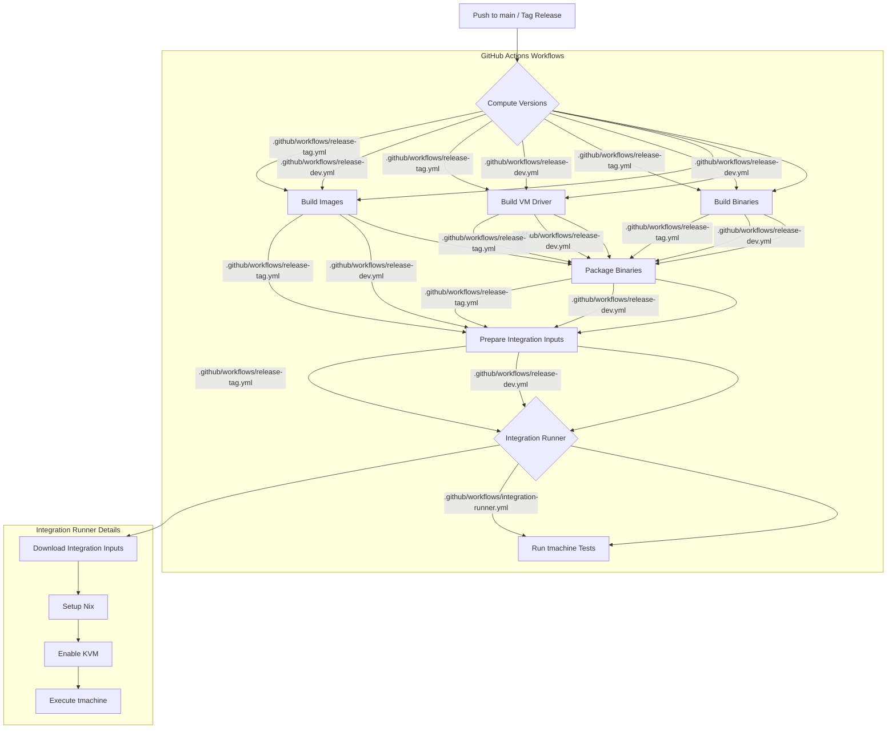

<!-- source: DeepWiki mcp.deepwiki.com · repo NVIDIA/OpenShell · page 12.3 VM-Based Integration Harness (tmachine, nix, ansible) · fetched 2026-10-26 -->

# VM-Based Integration Harness (tmachine, nix, ansible)

<details>
<summary>Relevant source files</summary>

The following files were used as context for generating this wiki page:

- [.github/workflows/branch-e2e.yml](.github/workflows/branch-e2e.yml)
- [.github/workflows/e2e-kubernetes-test.yml](.github/workflows/e2e-kubernetes-test.yml)
- [.github/workflows/integration-runner.yml](.github/workflows/integration-runner.yml)
- [.github/workflows/integration-test.yml](.github/workflows/integration-test.yml)
- [.github/workflows/prepare-integration-inputs.yml](.github/workflows/prepare-integration-inputs.yml)
- [.github/workflows/release-dev.yml](.github/workflows/release-dev.yml)
- [.github/workflows/release-tag.yml](.github/workflows/release-tag.yml)
- [CI.md](CI.md)
- [deploy/helm/openshell/ci/values-high-availability.yaml](deploy/helm/openshell/ci/values-high-availability.yaml)
- [e2e/rust/tests/local_driver_token_restart.rs](e2e/rust/tests/local_driver_token_restart.rs)
- [e2e/rust/tests/podman_resource_limits.rs](e2e/rust/tests/podman_resource_limits.rs)
- [flake.lock](flake.lock)
- [nix/test-guest/README.md](nix/test-guest/README.md)
- [nix/test-guest/cache.sh](nix/test-guest/cache.sh)
- [nix/test-guest/configuration/podman-rootful.yml](nix/test-guest/configuration/podman-rootful.yml)
- [nix/test-guest/configuration/podman-rootless.yml](nix/test-guest/configuration/podman-rootless.yml)
- [nix/test-guest/configuration/tasks/podman-common.yml](nix/test-guest/configuration/tasks/podman-common.yml)
- [nix/test-guest/default.nix](nix/test-guest/default.nix)
- [nix/test-guest/provisioners/roles/gateway-podman/tasks/development-gateway.yml](nix/test-guest/provisioners/roles/gateway-podman/tasks/development-gateway.yml)
- [nix/test-guest/provisioners/roles/gateway-podman/tasks/lifecycle.yml](nix/test-guest/provisioners/roles/gateway-podman/tasks/lifecycle.yml)
- [nix/test-guest/provisioners/roles/gateway-podman/tasks/main.yml](nix/test-guest/provisioners/roles/gateway-podman/tasks/main.yml)
- [nix/test-guest/run.sh](nix/test-guest/run.sh)
- [rust-toolchain.toml](rust-toolchain.toml)
- [tests/ansible/playbooks/drivers/podman/default-userns-baseline.yaml](tests/ansible/playbooks/drivers/podman/default-userns-baseline.yaml)
- [tests/ansible/playbooks/drivers/podman/tests.yaml](tests/ansible/playbooks/drivers/podman/tests.yaml)
- [tests/ansible/playbooks/drivers/podman/userns-profile.yaml](tests/ansible/playbooks/drivers/podman/userns-profile.yaml)
- [tests/ansible/playbooks/openshell-deb.yaml](tests/ansible/playbooks/openshell-deb.yaml)
- [tests/ansible/playbooks/openshell-rpm.yaml](tests/ansible/playbooks/openshell-rpm.yaml)
- [tests/ansible/playbooks/podman-rootful.yaml](tests/ansible/playbooks/podman-rootful.yaml)
- [tests/ansible/roles/openshell_packaged_gateway/tasks/main.yaml](tests/ansible/roles/openshell_packaged_gateway/tasks/main.yaml)
- [tests/ansible/roles/openshell_packaged_gateway/templates/gateway.toml.j2](tests/ansible/roles/openshell_packaged_gateway/templates/gateway.toml.j2)
- [tests/ansible/roles/tmachine_user_manager/tasks/main.yaml](tests/ansible/roles/tmachine_user_manager/tasks/main.yaml)
- [tests/config.nix](tests/config.nix)
- [tests/suites/drivers/podman/tests/default_userns.rs](tests/suites/drivers/podman/tests/default_userns.rs)

</details>


This page documents the VM-based integration harness used for testing OpenShell, focusing on `tests/config.nix`, `tests/tmachine`, Ansible playbooks and roles, Nix-based disposable guest environments (`nix/test-guest`), and the validation of distro-specific packages. This system provides a robust and reproducible environment for running integration tests against various operating systems and configurations, ensuring the stability and compatibility of OpenShell across different deployment scenarios.

## Overview of the VM-Based Integration Harness

The VM-based integration harness leverages Nix, QEMU, and Ansible to create, configure, and test disposable Linux virtual machines. This setup is crucial for validating OpenShell's behavior on different distributions, with various container runtimes (Docker, Podman), and with different installation methods (binaries, `.deb`, `.rpm`, Helm charts). The core components are:

*   **`tmachine`**: A Nix package that orchestrates the VM lifecycle, including image management, QEMU invocation, and SSH connectivity.
*   **Nix (`nix/test-guest`)**: Provides reproducible guest environments, manages dependencies, and defines the base VM images and configurations.
*   **Ansible**: Used for provisioning and configuring the guest VMs, installing OpenShell components, and running test suites within the VMs.

This harness is integrated into the CI/CD pipeline, particularly for release and development workflows, to perform conformance and feature-specific integration tests.

Sources:
- [nix/test-guest/README.md:1-8]()

### Integration with CI Workflows

The VM-based integration harness is a critical part of OpenShell's CI/CD process. It's invoked in various GitHub Actions workflows to ensure broad compatibility and stability.

**Release Workflows (`release-tag.yml`, `release-dev.yml`)**:
These workflows use the integration harness to run conformance tests against release candidates.
The `prepare-integration` job collects all necessary artifacts (binaries, images, packages) and uploads them as a single artifact.
The `conformance-integration` job then downloads these artifacts and executes the `tmachine` tests across a matrix of environments, installers, and test suites.

**Branch E2E Checks (`branch-e2e.yml`)**:
For pull requests, the `Branch E2E Checks` workflow can optionally trigger E2E suites, including those that utilize the VM-based harness. This allows for early detection of regressions or compatibility issues introduced by new features or changes.

**Manual Integration Tests (`integration-test.yml`)**:
A manual workflow allows developers to trigger specific integration tests with custom artifact runs and test matrices, providing flexibility for debugging and targeted testing.

The `integration-runner.yml` reusable workflow encapsulates the logic for setting up the Nix environment, enabling KVM access, downloading artifacts, and executing the `tmachine` command.

#### Diagram: CI Workflow Integration


Sources:
- [.github/workflows/release-tag.yml:1-181]()
- [.github/workflows/release-dev.yml:1-174]()
- [.github/workflows/branch-e2e.yml:1-113]()
- [.github/workflows/integration-runner.yml:1-91]()
- [.github/workflows/integration-test.yml:1-57]()
- [.github/workflows/prepare-integration-inputs.yml:1-166]()

## `tmachine` (tests/tmachine)

The `tmachine` Nix package is the core orchestrator for the VM-based integration tests. It's defined in `tests/tmachine` and called by `tests/config.nix`. It provides the capability to define virtual machines, their base images, and the setup and test playbooks to run on them.

The `tmachine` package is responsible for:
1.  **Machine Definitions**: Specifying base images for different distributions (e.g., Ubuntu, Fedora).
2.  **Environment Definitions**: Combining a machine with a set of Ansible playbooks for initial setup (e.g., installing Docker, Podman, K3s).
3.  **Installer Definitions**: Specifying how OpenShell components are installed (e.g., from `.deb`, `.rpm`, or raw binaries) and the artifacts required.
4.  **Test Suite Definitions**: Defining the Ansible playbooks that execute the actual tests within the configured VM.

The `tmachine` tool itself is a shell script wrapper around QEMU and Ansible, managing the VM lifecycle from boot to cleanup. It handles cloud-init for initial guest configuration, SSH connectivity, and artifact transfer.

Sources:
- [tests/config.nix:18-21]()
- [nix/test-guest/README.md:60-61]()

## Nix Disposable Guests (`nix/test-guest`)

The `nix/test-guest` directory defines the infrastructure for creating and managing disposable Linux VMs. It uses Nix flakes to ensure reproducibility and provides a command-line interface for interacting with these guests.

### Directory Structure

The `nix/test-guest` directory is structured as follows:
*   `default.nix`: Assembles the guest and cache flake applications, selecting host architecture, acceleration, and providing runtime tools. It exposes distro profiles and configuration playbooks as Nix-store catalogs. [nix/test-guest/README.md:59-60]()
*   `run.sh`: Manages the disposable guest lifecycle, including cache lookup, cloud-image realization, cloud-init seed creation, QEMU startup, SSH readiness, Ansible execution, artifact installation, guest command execution, and cleanup. [nix/test-guest/README.md:61-62]()
*   `cache.sh`: Ensures a prepared disk exists locally and can pull or push it as an OCI artifact. [nix/test-guest/README.md:63]()
*   `cache-lib.sh`: Defines deterministic cache identity and validation helpers. [nix/test-guest/README.md:64]()
*   `cache-seal.sh`: Removes per-instance state and zeroes free space before capturing a guest for caching. [nix/test-guest/README.md:65]()
*   `distros/`: Contains Nix expressions for defining immutable base-image catalogs (e.g., `ubuntu-24-04.nix`, `fedora.nix`). Each entry pins the image URL, hash, OS ID, version, and package family. [nix/test-guest/README.md:66-67]()
*   `configuration/`: Stores host-executed Ansible playbooks that layer optional capabilities onto a base guest (e.g., `docker.yml`, `podman-rootful.yml`, `selinux.yml`). [nix/test-guest/README.md:68-69]()
*   `provisioners/roles/`: Contains per-run Ansible roles that assemble a system from copied or installed artifacts. These run after artifact transfer and are not part of the prepared VM cache. [nix/test-guest/README.md:70-71]()

Sources:
- [nix/test-guest/README.md:28-71]()
- [nix/test-guest/default.nix:20-82]()

### Supported Configurations

The `nix/test-guest` system supports a matrix of Linux distributions and configurations:

| Distro           | Docker | Rootful Podman | Rootless Podman | SELinux | Package format |
| :--------------- | :----- | :------------- | :-------------- | :------ | :------------- |
| Ubuntu 24.04     | Yes    | Yes            | No              | No      | `.deb`         |
| Ubuntu 26.04     | Yes    | Yes            | Yes             | No      | `.deb`         |
| CentOS Stream 10 | No     | Yes            | No              | Yes     | `.rpm`         |
| Fedora 44        | No     | Yes            | Yes             | Yes     | `.rpm`         |
| Rocky Linux 9    | Yes    | Yes            | No              | Yes     | `.rpm`         |

The `podman-rootless` configuration is specifically designed for Fedora and Ubuntu 26.04+, configuring the necessary environment for rootless Podman, including AppArmor rules for Ubuntu and subordinate-ID utilities for Fedora. The `podman-rootful` configuration installs Podman and enables its system API socket.

Sources:
- [nix/test-guest/README.md:73-99]()

### Interactive VM Usage

Developers can interactively boot and configure VMs using the `nix run .#test-guest` command.
For example, to boot a base Ubuntu VM:
`nix run .#test-guest -- --distro ubuntu-24-04` [nix/test-guest/README.md:112]()

To apply the Docker configuration:
`nix run .#test-guest -- --distro ubuntu-24-04 --with docker` [nix/test-guest/README.md:116]()

The `--with` argument is repeatable, allowing multiple configurations to be applied. The `--provision` argument applies post-artifact system provisioners. The `--install` and `--copy` arguments facilitate transferring and installing artifacts into the guest. [nix/test-guest/run.sh:18-21]()

Sources:
- [nix/test-guest/README.md:107-138]()
- [nix/test-guest/run.sh:18-21]()

#### Diagram: `nix run .#test-guest` Flow

```mermaid
graph TD
    A[User executes nix run .#test-guest] --> B{Parse Arguments};
    B -- "--distro ubuntu-24-04" --> C[Select Base Image];
    B -- "--with docker" --> D[Select Configuration Playbooks];
    B -- "--provision gateway-podman" --> E[Select Provisioner Roles];
    B -- "--install /path/to/pkg.deb" --> F[Identify Packages for Installation];
    B -- "--copy src:dest" --> G[Identify Files for Copy];
    C --> H[Cache Lookup / Download Base Image];
    H --> I[Create Disposable Disk Overlay];
    I --> J[Generate Cloud-init Seed];
    J --> K[Start QEMU VM];
    K --> L[Wait for SSH Readiness];
    L --> M[Execute Configuration Playbooks (Ansible)];
    M --> N[Transfer and Install Packages/Files];
    N --> O[Execute Provisioner Roles (Ansible)];
    O --> P{Guest Command Specified?};
    P -- "Yes" --> Q[Execute Guest Command via SSH];
    P -- "No" --> R[Open Interactive SSH Session];
    Q --> S[Cleanup / Shutdown VM];
    R --> S;
```
Sources:
- [nix/test-guest/run.sh:71-239]()
- [nix/test-guest/README.md:61-62]()

## Ansible Playbooks and Roles

Ansible is extensively used within the `tmachine` harness for configuring guest VMs and executing tests. Ansible playbooks are stored under `tests/ansible/playbooks/` and roles under `tests/ansible/roles/`.

### Configuration Playbooks

These playbooks are used to set up the environment within the guest VM. Examples include:
*   `ansible/playbooks/docker.yaml`: Installs and configures Docker. [tests/config.nix:42]()
*   `ansible/playbooks/podman-rootful.yaml`: Configures rootful Podman. [tests/config.nix:65]()
*   `ansible/playbooks/podman-rootless.yaml`: Configures rootless Podman. [tests/config.nix:77]()
*   `ansible/playbooks/k3s.yaml`: Installs K3s for Kubernetes testing. [tests/config.nix:53]()
*   `ansible/playbooks/selinux.yaml`: Configures SELinux. [tests/config.nix:64]()
*   `ansible/playbooks/nextest.yaml`: Installs the `nextest` test runner. [tests/config.nix:41]()

These playbooks are referenced in `tests/config.nix` within the `environments` section, defining the initial state of a VM for a given test scenario.

Sources:
- [tests/config.nix:34-81]()
- [nix/test-guest/README.md:68-69]()

### Installer Playbooks

These playbooks handle the installation of OpenShell components based on the chosen installer type:
*   `ansible/playbooks/openshell-deb.yaml`: Installs OpenShell from a `.deb` package. [tests/config.nix:121]()
*   `ansible/playbooks/openshell-rpm.yaml`: Installs OpenShell from `.rpm` packages. [tests/config.nix:132]()
*   `ansible/playbooks/openshell.yaml` and `ansible/playbooks/gateway.yaml`: Install OpenShell from raw binaries. [tests/config.nix:107-108]()
*   `ansible/playbooks/openshell-k3s.yaml`: Deploys OpenShell using Helm charts on K3s. [tests/config.nix:87]()

These playbooks are defined in `tests/config.nix` under the `installers` section, specifying the artifacts they consume (e.g., `openshell_deb`, `openshell_rpm`, `openshell_cli_binary`, `openshell_helm_chart`).

Sources:
- [tests/config.nix:83-139]()

### Test Suite Playbooks

These playbooks execute the actual test suites within the configured VMs:
*   `ansible/playbooks/conformance/cli.yaml`: Runs the OpenShell CLI conformance tests. [tests/config.nix:151]()
*   `ansible/playbooks/conformance/policy-advisor.yaml`: Runs policy advisor conformance tests. [tests/config.nix:158]()
*   `ansible/playbooks/features/provider-refresh/keycloak.yaml`: Tests provider refresh functionality with Keycloak. [tests/config.nix:165]()
*   `ansible/playbooks/drivers/podman/e2e.yaml`: Runs Podman E2E tests. [tests/config.nix:173]()
*   `ansible/playbooks/drivers/podman/tests.yaml`: Runs specific Podman driver tests, often combined with user namespace configurations. [tests/config.nix:183]()

These playbooks are defined in `tests/config.nix` under the `testsuites` section, specifying the test bundles and other inputs they require.

Sources:
- [tests/config.nix:142-193]()

### Ansible Roles

Ansible roles encapsulate reusable automation content. Key roles include:
*   `tmachine_user_manager`: Manages users and SSH keys within the VM.
*   `openshell_packaged_gateway`: Configures and starts the OpenShell gateway when installed from packages. This role uses templates like `gateway.toml.j2` to generate configuration files.
*   `gateway-podman`: Configures the gateway to use Podman as a compute driver, handling both rootful and rootless modes. [nix/test-guest/provisioners/roles/gateway-podman/tasks/main.yml]()
*   `openshell-development`: Sets up a development environment for OpenShell.
*   `openshell-rpm`: Handles RPM package installation.

Sources:
- [nix/test-guest/provisioners/roles/gateway-podman/tasks/main.yml]()
- [nix/test-guest/README.md:70-71]()
- [tests/ansible/roles/openshell_packaged_gateway/templates/gateway.toml.j2]()
- [tests/ansible/roles/openshell_packaged_gateway/tasks/main.yml]()
- [tests/ansible/roles/tmachine_user_manager/tasks/main.yaml]()

#### Diagram: Ansible Execution Flow in `tmachine`

```mermaid
graph TD
    A[tmachine starts VM] --> B[SSH Connection Established];
    B --> C[Ansible Host (tmachine runner)];
    C --> D{Configuration Playbooks};
    D -- "e.g., docker.yaml, podman-rootful.yaml" --> E[VM Configured (e.g., Docker/Podman installed)];
    E --> F{Artifact Transfer};
    F -- "e.g., openshell.deb, openshell.rpm, openshell-cli" --> G[Artifacts on VM];
    G --> H{Installer Playbooks};
    H -- "e.g., openshell-deb.yaml, openshell-rpm.yaml" --> I[OpenShell Installed on VM];
    I --> J{Provisioner Roles};
    J -- "e.g., gateway-podman" --> K[OpenShell Components Configured/Started];
    K --> L{Test Suite Playbooks};
    L -- "e.g., conformance/cli.yaml, drivers/podman/e2e.yaml" --> M[Tests Executed on VM];
    M --> N[Test Results Collected];
    N --> O[VM Shutdown / Cleanup];
```
Sources:
- [nix/test-guest/run.sh:600-609]()
- [nix/test-guest/run.sh:611-619]()
- [nix/test-guest/run.sh:621-629]()
- [nix/test-guest/run.sh:631-639]()
- [nix/test-guest/run.sh:641-649]()
- [nix/test-guest/run.sh:651-659]()
- [nix/test-guest/run.sh:661-669]()
- [nix/test-guest/run.sh:671-679]()
- [nix/test-guest/run.sh:681-689]()
- [nix/test-guest/run.sh:691-699]()
- [nix/test-guest/run.sh:701-709]()
- [nix/test-guest/run.sh:711-719]()
- [nix/test-guest/run.sh:721-729]()
- [nix/test-guest/run.sh:731-739]()
- [nix/test-guest/run.sh:741-749]()
- [nix/test-guest/run.sh:751-758]()

## Distro and Package Validation

The VM-based harness is critical for validating OpenShell across different Linux distributions and package formats.

### Distro-Specific Testing

The `tests/config.nix` file defines various `environments` that combine a base machine (e.g., `ubuntu`, `fedora`) with specific setup playbooks. This allows testing OpenShell's compatibility with:
*   **Ubuntu (24.04, 26.04)**: With Docker, rootful Podman, rootless Podman (26.04 only), and K3s. [tests/config.nix:34-55]()
*   **Fedora (44)**: With rootful Podman, rootless Podman, and SELinux. [tests/config.nix:57-79]()
*   **CentOS Stream 10 / Rocky Linux 9**: With Docker (Rocky), rootful Podman, and SELinux. [nix/test-guest/README.md:73-79]()

Each environment ensures that OpenShell functions correctly within the specific ecosystem and its default configurations.

Sources:
- [tests/config.nix:34-81]()
- [nix/test-guest/README.md:73-79]()

### Package Format Validation

The `installers` section in `tests/config.nix` specifies how OpenShell is installed, enabling validation of:
*   **`.deb` packages**: Tested on Ubuntu environments. [tests/config.nix:118-127]()
*   **`.rpm` packages**: Tested on Fedora and other RPM-based environments. [tests/config.nix:129-139]()
*   **Raw binaries**: For direct installation and testing of compiled executables. [tests/config.nix:104-116]()
*   **Helm charts**: For Kubernetes deployments using K3s. [tests/config.nix:84-95]()

This comprehensive approach ensures that all official distribution methods for OpenShell are thoroughly tested in realistic VM environments.

Sources:
- [tests/config.nix:83-139]()

### Example: Podman Driver Testing

The `tests/config.nix` defines `testsuites` for Podman drivers, including `e2e-podman` and `driver-podman`. These suites use specific Ansible playbooks to configure Podman with different user namespace settings (`default-userns-baseline.yaml`, `userns-auto.yaml`, `userns-keep-id.yaml`, `userns-private.yaml`) and then run tests to validate OpenShell's interaction with these configurations. [tests/config.nix:172-193]() This ensures that the Podman compute driver works correctly under various isolation scenarios.

Sources:
- [tests/config.nix:172-193]()
- [tests/ansible/playbooks/drivers/podman/default-userns-baseline.yaml]()
- [tests/ansible/playbooks/drivers/podman/tests.yaml]()
- [tests/ansible/playbooks/drivers/podman/userns-profile.yaml]()
- [tests/suites/drivers/podman/tests/default_userns.rs]()
- [e2e/rust/tests/podman_resource_limits.rs]()

---

