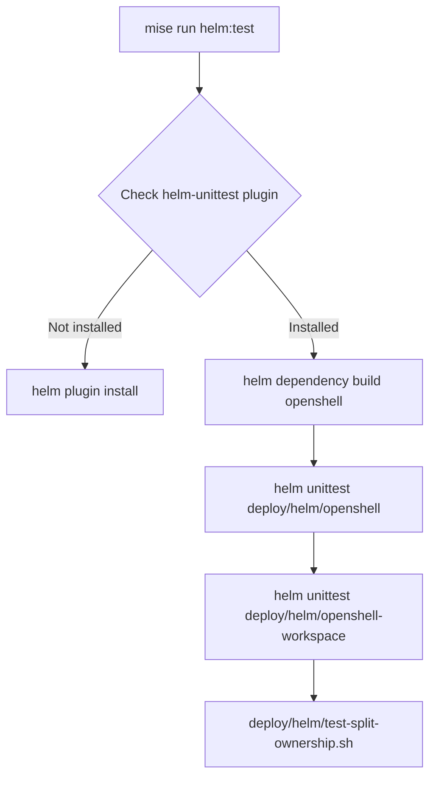

<!-- source: DeepWiki mcp.deepwiki.com · repo NVIDIA/OpenShell · page 12.4 Unit Tests and Helm Chart Tests · fetched 2026-10-26 -->

# 12.4 Unit Tests and Helm Chart Tests

<details>
<summary>Relevant source files</summary>

The following files were used as context for generating this wiki page:

- [.agents/skills/helm-dev-environment/SKILL.md](.agents/skills/helm-dev-environment/SKILL.md)
- [.config/nextest.toml](.config/nextest.toml)
- [crates/openshell-cli/tests/ensure_providers_integration.rs](crates/openshell-cli/tests/ensure_providers_integration.rs)
- [crates/openshell-cli/tests/mtls_integration.rs](crates/openshell-cli/tests/mtls_integration.rs)
- [crates/openshell-cli/tests/sandbox_name_fallback_integration.rs](crates/openshell-cli/tests/sandbox_name_fallback_integration.rs)
- [crates/openshell-server/src/grpc/mod.rs](crates/openshell-server/src/grpc/mod.rs)
- [crates/openshell-server/src/test_support.rs](crates/openshell-server/src/test_support.rs)
- [crates/openshell-server/tests/supervisor_relay_integration.rs](crates/openshell-server/tests/supervisor_relay_integration.rs)
- [deploy/helm/openshell/ci/values-gateway.yaml](deploy/helm/openshell/ci/values-gateway.yaml)
- [deploy/helm/openshell/ci/values-keycloak.yaml](deploy/helm/openshell/ci/values-keycloak.yaml)
- [deploy/helm/openshell/ci/values-skaffold.yaml](deploy/helm/openshell/ci/values-skaffold.yaml)
- [deploy/helm/openshell/ci/values-tls-disabled.yaml](deploy/helm/openshell/ci/values-tls-disabled.yaml)
- [proto/compute_driver.proto](proto/compute_driver.proto)
- [scripts/junit-to-html.xsl](scripts/junit-to-html.xsl)
- [tasks/helm.toml](tasks/helm.toml)
- [tasks/scripts/helm-k3s-local.sh](tasks/scripts/helm-k3s-local.sh)

</details>


This page details the unit testing strategy and Helm chart testing within the OpenShell project. It covers the configuration of `nextest` for Rust tests, the structure and purpose of server and CLI integration test crates, the `test_support` utilities for mocking and faking dependencies, and the methodology for testing Helm charts using `helm unittest`.

## Nextest Configuration

OpenShell uses `nextest` as its test runner for Rust-based tests. The `nextest.toml` configuration file [/.config/nextest.toml:1-32]() defines various profiles and settings for running tests, particularly for Continuous Integration (CI) and End-to-End (E2E) Kubernetes environments.

### CI Profile

The `ci` profile [/.config/nextest.toml:4-10]() is configured for general CI runs. Key settings include:
*   `fail-fast = false`: Ensures all tests run to completion even if some fail.
*   `status-level = "slow"`: Reports tests that exceed a certain duration as "slow".
*   `final-status-level = "fail"`: The overall test run fails if any test fails.
*   `failure-output = "immediate-final"`: Output for failing tests is shown immediately and again at the end.
*   `slow-timeout = { period = "30s", terminate-after = 4 }`: Tests running longer than 30 seconds are flagged as slow, and they are terminated after 4 times their `period` (i.e., 2 minutes).

### E2E Kubernetes Profile

The `e2e-kubernetes` profile [/.config/nextest.toml:12-18]() is tailored for E2E tests running in a Kubernetes environment. It has a longer `slow-timeout` period due to the nature of E2E tests:
*   `slow-timeout = { period = "60s", terminate-after = 5 }`: Tests running longer than 60 seconds are flagged as slow, and they are terminated after 5 times their `period` (i.e., 5 minutes).

### Test Groups

`nextest` supports test groups to manage concurrency. The `kubernetes-ha` test group [/.config/nextest.toml:23-24]() is defined with `max-threads = 1`. This is crucial for High Availability (HA) tests that modify shared Kubernetes resources, such as scaling and rolling gateway deployments. Running these tests concurrently would lead to conflicts and unreliable results.

An override [/.config/nextest.toml:26-28]() is configured to assign tests matching the regex `/gateway_(scale_and_rollout|pod_rolls)$/` to the `kubernetes-ha` group, ensuring they run serially.

### JUnit Report Output

The `e2e-kubernetes` profile also specifies a JUnit XML report output path [/.config/nextest.toml:31-32](). This allows CI systems to parse test results and display them in a standardized format. The path is relative to the profile store directory.

#### Nextest Configuration Overview
```mermaid
graph TD
    A[nextest.toml] --> B{Profile: ci}
    A --> C{Profile: e2e-kubernetes}
    B --> B1[fail-fast: false]
    B --> B2[status-level: slow]
    B --> B3[final-status-level: fail]
    B --> B4[failure-output: immediate-final]
    B --> B5[slow-timeout: 30s, terminate-after: 2m]

    C --> C1[fail-fast: false]
    C --> C2[status-level: slow]
    C --> C3[final-status-level: fail]
    C --> C4[failure-output: immediate-final]
    C --> C5[slow-timeout: 60s, terminate-after: 5m]
    C --> C6{Test Group: kubernetes-ha}
    C6 --> C6_1[max-threads: 1]
    C6 --> C6_2[Filter: /gateway_(scale_and_rollout|pod_rolls)$/]
    C --> C7[JUnit Report: results/e2e-kubernetes.xml]
```
Sources:
- /.config/nextest.toml:1-33

## Server and CLI Integration Test Crates

The OpenShell codebase includes dedicated integration test crates for both the server (`openshell-server`) and the CLI (`openshell-cli`). These tests focus on verifying the interaction between different components and the overall system behavior, often by setting up mock or fake environments.

### `openshell-cli` Integration Tests

The `openshell-cli/tests/` directory contains integration tests that validate the CLI's interaction with a running OpenShell gateway. These tests typically involve:
1.  **Setting up a mock OpenShell server**: A `TestOpenShell` struct [crates/openshell-cli/tests/sandbox_name_fallback_integration.rs:44-45]() implements the `OpenShell` gRPC service trait [crates/openshell-cli/tests/sandbox_name_fallback_integration.rs:49-50](). This mock server can be configured to respond in specific ways, allowing tests to isolate CLI behavior without needing a full gateway deployment.
2.  **Configuring TLS**: Tests often involve setting up TLS certificates for both the client and the mock server to simulate secure communication [crates/openshell-cli/tests/mtls_integration.rs:6-7]().
3.  **Running CLI commands**: The `openshell_cli::run` function [crates/openshell-cli/tests/sandbox_name_fallback_integration.rs:8]() is used to execute CLI commands programmatically, capturing their output and exit status.
4.  **Asserting outcomes**: Tests then assert that the CLI's output, exit code, or the state observed by the mock server matches the expected behavior.

Examples of CLI integration tests include:
*   `sandbox_name_fallback_integration.rs`: Tests how the CLI handles sandbox name resolution and fallbacks, verifying that the correct sandbox name is requested from the gateway [crates/openshell-cli/tests/sandbox_name_fallback_integration.rs:147-152]().
*   `mtls_integration.rs`: Verifies that the CLI correctly handles mTLS authentication with the gateway [crates/openshell-cli/tests/mtls_integration.rs:1-28]().
*   `ensure_providers_integration.rs`: Checks the CLI's behavior when ensuring required providers, including auto-creation, handling existing providers, and erroring on unrecognized names [crates/openshell-cli/tests/ensure_providers_integration.rs:1-7](). The `TestOpenShell` in this test includes a `ProviderState` [crates/openshell-cli/tests/ensure_providers_integration.rs:43-44]() to simulate provider management.

#### `openshell-cli` Integration Test Flow
```mermaid
graph TD
    A[Test Case] --> B{Setup Mock Gateway}
    B --> B1[TestOpenShell implements OpenShell gRPC]
    B --> B2[Configure TLS (CA, Server Cert, Client Cert)]
    B --> B3[Start Mock Gateway Server]
    B --> C{Execute CLI Command}
    C --> C1[Call openshell_cli::run()]
    C --> D{Assert Results}
    D --> D1[Check CLI Output]
    D --> D2[Check CLI Exit Code]
    D --> D3[Inspect Mock Gateway State]
```
Sources:
- crates/openshell-cli/tests/sandbox_name_fallback_integration.rs:8
- crates/openshell-cli/tests/sandbox_name_fallback_integration.rs:44-45
- crates/openshell-cli/tests/sandbox_name_fallback_integration.rs:49-50
- crates/openshell-cli/tests/sandbox_name_fallback_integration.rs:147-152
- crates/openshell-cli/tests/mtls_integration.rs:1-28
- crates/openshell-cli/tests/mtls_integration.rs:6-7
- crates/openshell-cli/tests/ensure_providers_integration.rs:1-7
- crates/openshell-cli/tests/ensure_providers_integration.rs:43-44

### `openshell-server` Integration Tests

The `openshell-server/tests/` directory contains integration tests for the gateway server. These tests often focus on specific gRPC paths and the interaction between the gateway and its internal components or external services like supervisors.

An example is `supervisor_relay_integration.rs` [crates/openshell-server/tests/supervisor_relay_integration.rs:1-17](), which tests the supervisor relay gRPC path. This test:
1.  **Sets up a minimal gateway server**: A `RelayGateway` struct [crates/openshell-server/tests/supervisor_relay_integration.rs:45-46]() implements the `OpenShell` gRPC service, but only the `relay_stream` method [crates/openshell-server/tests/supervisor_relay_integration.rs:113-117]() performs real work, while others are stubbed out.
2.  **Uses `SupervisorSessionRegistry`**: It directly interacts with the `SupervisorSessionRegistry` [crates/openshell-server/tests/supervisor_relay_integration.rs:46]() to simulate supervisor connections.
3.  **Simulates supervisor client**: A mock "supervisor" client is created using `OpenShellClient` [crates/openshell-server/tests/supervisor_relay_integration.rs:28]() to call the `relay_stream` endpoint.
4.  **Verifies wire contract**: The test ensures that the `RelayFrame` types (`Init` and `Data`) are correctly handled and that the bidirectional byte bridge functions as expected.

These tests are valuable for catching regressions in the gRPC wire layer that might be missed by unit tests and are too expensive to cover in full E2E tests.

Sources:
- crates/openshell-server/tests/supervisor_relay_integration.rs:1-17
- crates/openshell-server/tests/supervisor_relay_integration.rs:28
- crates/openshell-server/tests/supervisor_relay_integration.rs:45-46
- crates/openshell-server/tests/supervisor_relay_integration.rs:113-117

## `test_support` Utilities

The `crates/openshell-server/src/test_support.rs` module [crates/openshell-server/src/test_support.rs:1-5]() provides utilities and fixtures specifically designed for integration testing the OpenShell gateway. These utilities help in setting up controlled environments and mocking external dependencies.

Key components of `test_support`:

*   **`gateway_service_with_driver`**: This asynchronous function [crates/openshell-server/src/test_support.rs:48-76]() constructs a real in-memory gateway service. It allows specifying a `driver_name` to back the gateway, enabling tests to use either a generic "test" driver or a specific fake driver. It initializes the `Store` (using SQLite in memory), `ServerState`, `ComputeRuntime`, `SandboxIndex`, `SandboxWatchBus`, `TracingLogBus`, and `SupervisorSessionRegistry`.
*   **`authenticate_as_dev_user`**: A Tonic interceptor function [crates/openshell-server/src/test_support.rs:79-92]() that injects a `UserPrincipal` representing a "dev-user" with "openshell-admin" and "openshell-user" roles into the request extensions. This simplifies testing authenticated gRPC methods without needing a full authentication setup.
*   **`FakeComputeDriver`**: A mock implementation of the `ComputeDriver` gRPC service [crates/openshell-server/src/test_support.rs:124-125](). This fake driver allows tests to:
    *   **Control capabilities**: The `with_capabilities` method [crates/openshell-server/src/test_support.rs:143-147]() allows overriding the `GetCapabilitiesResponse` [crates/openshell-server/src/test_support.rs:154-177]() to simulate different driver features and test gateway admission logic.
    *   **Record calls**: It tracks all calls made to its gRPC methods in a `calls` vector [crates/openshell-server/src/test_support.rs:132](), enabling assertions on driver interactions.
    *   **Simulate sandbox state**: It maintains an internal `sandboxes` HashMap [crates/openshell-server/src/test_support.rs:131]() to simulate the state of sandboxes managed by the driver.
    *   **Customizable behavior**: Methods like `with_driver_name` [crates/openshell-server/src/test_support.rs:181-184]() and `with_driver_version` [crates/openshell-server/src/test_support.rs:186-188]() allow customizing the fake driver's reported identity.

These utilities are crucial for writing focused and efficient integration tests for the gateway, allowing developers to test specific logic paths without the overhead of deploying and managing real compute drivers or complex authentication systems.

#### `test_support` Components
```mermaid
graph TD
    A[test_support.rs] --> B[gateway_service_with_driver()]
    B --> B1[Creates in-memory Store]
    B --> B2[Initializes ServerState]
    B --> B3[Uses new_test_runtime() or new_test_runtime_for_driver()]

    A --> C[authenticate_as_dev_user()]
    C --> C1[Tonic Interceptor]
    C --> C2[Injects UserPrincipal (dev-user, admin, user roles)]

    A --> D[FakeComputeDriver]
    D --> D1[Implements ComputeDriver gRPC]
    D --> D2[Records calls (FakeComputeDriverCall enum)]
    D --> D3[Manages internal sandbox state]
    D --> D4[Customizable capabilities (with_capabilities())]
    D --> D5[Customizable driver info (with_driver_name(), with_driver_version())]
```
Sources:
- crates/openshell-server/src/test_support.rs:1-5
- crates/openshell-server/src/test_support.rs:48-76
- crates/openshell-server/src/test_support.rs:79-92
- crates/openshell-server/src/test_support.rs:124-125
- crates/openshell-server/src/test_support.rs:131
- crates/openshell-server/src/test_support.rs:132
- crates/openshell-server/src/test_support.rs:143-147
- crates/openshell-server/src/test_support.rs:154-177
- crates/openshell-server/src/test_support.rs:181-184
- crates/openshell-server/src/test_support.rs:186-188

## Helm Chart Tests

OpenShell uses `helm unittest` to validate its Helm charts (`openshell` and `openshell-workspace`). These tests ensure that the chart templates render Kubernetes manifests correctly under various configurations.

The `tasks/helm.toml` file [tasks/helm.toml:1-126]() defines `mise` tasks for managing Helm charts, including linting and testing.

### Running Helm Unit Tests

The `helm:test` `mise` task [tasks/helm.toml:57-68]() is responsible for executing the Helm unit tests. The workflow is as follows:

1.  **Install `helm-unittest` plugin**: It first checks if the `helm-unittest` plugin is installed and installs it if missing [tasks/helm.toml:60-62]().
2.  **Build dependencies**: `helm dependency build deploy/helm/openshell` [tasks/helm.toml:63]() ensures that all chart dependencies are fetched.
3.  **Run tests for `openshell` chart**: `helm unittest deploy/helm/openshell` [tasks/helm.toml:64]() executes the unit tests defined within the `openshell` chart.
4.  **Run tests for `openshell-workspace` chart**: `helm unittest deploy/helm/openshell-workspace` [tasks/helm.toml:65]() executes the unit tests for the workspace chart.
5.  **Run `test-split-ownership.sh`**: This script [tasks/helm.toml:66]() likely performs additional validation related to resource ownership or specific deployment scenarios.

### Helm Linting

The `helm:lint` `mise` task [tasks/helm.toml:35-54]() performs linting of the Helm charts. This involves:

1.  **Building dependencies**: Similar to testing, it first builds chart dependencies [tasks/helm.toml:38]().
2.  **Linting default values**: It lints the `openshell` chart with its default `values.yaml` [tasks/helm.toml:41-42]().
3.  **Linting CI variants**: It iterates through `deploy/helm/openshell/ci/values-*.yaml` files [tasks/helm.toml:44-50]() and lints the chart with each variant. These `ci/values-*.yaml` files represent different deployment configurations used in CI, such as `values-skaffold.yaml` [deploy/helm/openshell/ci/values-skaffold.yaml:1-19]() (for Skaffold-driven local image builds), `values-keycloak.yaml` (for Keycloak OIDC integration), and `values-tls-disabled.yaml` (for disabling TLS).
4.  **Linting `openshell-workspace` chart**: Finally, it lints the `openshell-workspace` chart [tasks/helm.toml:52]().

Linting ensures that the chart syntax is correct and follows best practices, and that templates render without errors under various value combinations.

### Helm Documentation Generation

The `helm:docs` task [tasks/helm.toml:6-11]() generates `README.md` files for the Helm charts using `helm-docs`. The `helm:docs:check` task [tasks/helm.toml:13-31]() verifies that these READMEs are up-to-date, failing if they are out of sync with the chart definitions.

### Local Kubernetes Development with Helm and Skaffold

The `tasks/helm.toml` also defines tasks for local Kubernetes development using `k3d` (Docker-backed k3s) and `Skaffold`. These tasks are described in detail in the `helm-dev-environment` skill [/.agents/skills/helm-dev-environment/SKILL.md:1-150]().

*   **`helm:k3s:create`**: Creates a local k3d cluster, merges its kubeconfig, applies agent-sandbox CRDs, installs an OTLP trace collector, and preloads the default sandbox image [tasks/helm.toml:95-96]().
*   **`helm:skaffold:dev`**: Runs Skaffold in development mode, rebuilding images and redeploying the Helm chart on file changes [tasks/helm.toml:71-72]().
*   **`helm:skaffold:run`**: Performs a one-shot Skaffold deploy and registers the local plaintext gateway with the CLI [tasks/helm.toml:76-77]().
*   **`helm:k3s:forward`**: Forwards ports for the OTLP collector, trace UI, and the local gateway [tasks/helm.toml:118-119]().

These tasks provide a robust local development environment for testing Helm chart deployments and the OpenShell gateway within a Kubernetes context.

#### Helm Chart Testing Workflow

Sources:
- tasks/helm.toml:1-127
- tasks/helm.toml:6-11
- tasks/helm.toml:13-31
- tasks/helm.toml:35-54
- tasks/helm.toml:38
- tasks/helm.toml:41-42
- tasks/helm.toml:44-50
- tasks/helm.toml:52
- tasks/helm.toml:57-68
- tasks/helm.toml:60-62
- tasks/helm.toml:63
- tasks/helm.toml:64
- tasks/helm.toml:65
- tasks/helm.toml:66
- tasks/helm.toml:71-72
- tasks/helm.toml:76-77
- tasks/helm.toml:95-96
- tasks/helm.toml:118-119
- deploy/helm/openshell/ci/values-skaffold.yaml:1-20
- /.agents/skills/helm-dev-environment/SKILL.md:1-150

---

