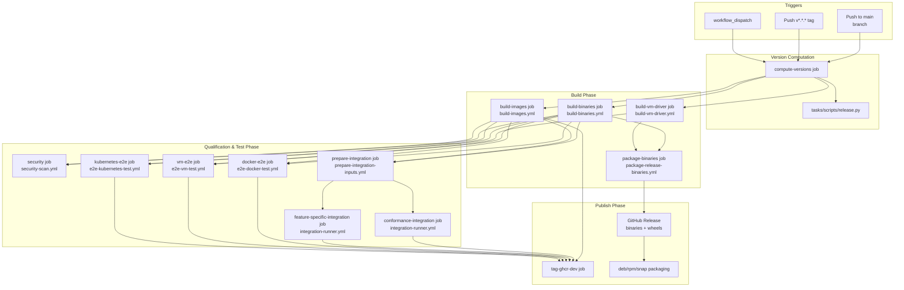

<!-- source: DeepWiki mcp.deepwiki.com · repo NVIDIA/OpenShell · page 13 Build & Release System · fetched 2026-10-26 -->

# Build & Release System

Relevant source files

The following files were used as context for generating this wiki page:

- [.github/workflows/branch-e2e.yml](.github/workflows/branch-e2e.yml)
- [.github/workflows/e2e-kubernetes-test.yml](.github/workflows/e2e-kubernetes-test.yml)
- [.github/workflows/integration-runner.yml](.github/workflows/integration-runner.yml)
- [.github/workflows/integration-test.yml](.github/workflows/integration-test.yml)
- [.github/workflows/prepare-integration-inputs.yml](.github/workflows/prepare-integration-inputs.yml)
- [.github/workflows/release-dev.yml](.github/workflows/release-dev.yml)
- [.github/workflows/release-tag.yml](.github/workflows/release-tag.yml)
- [CI.md](CI.md)
- [deploy/helm/openshell/ci/values-high-availability.yaml](deploy/helm/openshell/ci/values-high-availability.yaml)
- [tests/config.nix](tests/config.nix)

The build and release system automates the production, testing, and distribution of OpenShell artifacts across multiple platforms. It computes consistent version identifiers, builds Docker images, CLI binaries, and VM runtime assets for multiple architectures, runs end-to-end tests, and publishes artifacts to GHCR and GitHub Releases. The system supports two primary release channels: development builds (`:dev` tag) triggered on every `main` branch commit, and stable releases (`:latest` tag) triggered by Git tags.

For information about development workflows and contributor setup, see [Development & Contributing](#11). For deployment topologies that consume these artifacts, see [Gateway Architecture & Deployment](#5).

---

## Release Pipeline Overview

**Pipeline Execution Flow**

The release pipeline executes in several phases: version computation, build, qualification/test, and publish. Version computation runs once at workflow start using `tasks/scripts/release.py` to avoid race conditions [.github/workflows/release-tag.yml:28-31](). Build jobs run in parallel, producing binaries, VM drivers, and Docker images [.github/workflows/release-tag.yml:90-131](). The qualification and test phase includes security scans and various integration and E2E tests, which gate the release process. Finally, artifacts are published to GHCR, GitHub Releases, and package repositories.

Sources: [.github/workflows/release-dev.yml:1-198](), [.github/workflows/release-tag.yml:1-181]()

---

## Version Computation and Release Workflows

OpenShell uses a unified version computation system. The `tasks/scripts/release.py` script derives versions from Git metadata and transforms them for different toolchains. This script is central to ensuring consistent versioning across all artifacts. It handles stable releases, pre-releases, and development builds, adapting the version string to the specific requirements of Python, Cargo, npm, Docker, Debian, and RPM ecosystems.

### Version Formats

| Target | Flag | Example | Purpose |
|--------|------|---------|---------|
| Python | `--python` | `0.1.0.dev3` | PEP 440 compliant for `uv` and wheels |
| Cargo | `--cargo` | `0.1.0-dev.3` | SemVer for Rust crate manifests |
| npm | `--npm` | `0.1.0-dev.3.gabcdef` | SemVer 2.0 for TypeScript SDK |
| Debian | `--deb` | `0.1.0~dev3` | Apt-compatible versioning |
| RPM Version | `--rpm-version` | `0.1.0` | RedHat package versioning |
| RPM Release | `--rpm-release` | `0.dev.108.g152d05940` | RedHat package release identifier |

OpenShell maintains primary release workflows for continuous development and stable versioning. These workflows are defined as GitHub Actions and manage the entire lifecycle from code commit to artifact publication. They include `release-dev.yml` for `main` branch builds, `release-tag.yml` for official versioned releases, and other specialized workflows.

### Workflow Trigger Matrix

| Workflow | Trigger | Image Tag | Purpose |
|----------|---------|-----------|---------|
| `release-dev.yml` | Push to `main` | `:dev` | Continuous deployment of development builds |
| `release-tag.yml` | Push `v*.*.*` tag | `:latest`, `X.Y.Z` | Versioned stable releases |
| `release-auto-tag.yml` | Manual | N/A | Automated tagging for stable releases |
| `release-canary.yml` | Manual | N/A | Canary releases for testing |

For details, see [Version Computation and Release Workflows](#13.1).

Sources: [.github/workflows/release-tag.yml:41-52](), [.github/workflows/release-dev.yml:30-35](), [.github/workflows/release-dev.yml:3-6](), [.github/workflows/release-tag.yml:3-13]()

---

## Binary, Container and Package Builds

The build system produces a comprehensive suite of artifacts. Rust binaries are compiled natively or via `cargo zigbuild` for the target architecture, then staged in `deploy/docker/.build/prebuilt-binaries/` before being copied into minimal distroless or Alpine images. This approach ensures small, secure, and reproducible container images. The system leverages Buildx for multi-platform builds, allowing a single workflow to produce images for both `amd64` and `arm64` architectures.

### Build Artifacts

- **Binaries**: Static `openshell` CLI (musl), GNU-linked `openshell-gateway` (glibc 2.28), `openshell-conformance-cli`, and `openshell-driver-vm`. These are built for Linux (musl, glibc) and macOS.
- **Containers**: Gateway, Sandbox, and Supervisor images for `amd64` and `arm64`.
- **VM Assets**: Bundled `libkrun`, `gvproxy`, and kernel firmware for the VM runtime.
- **CI Images**: Specialized Docker images used for running CI jobs, defined in `ghcr.io/nvidia/openshell/ci`.

For details, see [Binary, Container and Package Builds](#13.2).

Sources: [.github/workflows/release-tag.yml:90-131](), [.github/workflows/release-dev.yml:62-103](), [.github/workflows/release-tag.yml:37]()

---

## Packaging and Distribution

Artifacts are distributed through multiple channels to ensure broad availability and ease of consumption.

- **GHCR**: Multi-arch container images are published to `ghcr.io/nvidia/openshell` with appropriate tags (e.g., `:dev`, `:latest`, `X.Y.Z`).
- **GitHub Releases**: Stable and development release assets, including CLI binaries, Python wheels, and VM runtimes, are attached to GitHub Releases.
- **Packaging**: Debian (`.deb`), RPM (`.rpm`), Snap (`.snap`), and Python Wheels (`.whl`) packages are built and published to their respective registries or channels. This includes integration with Packit for RPM distribution. Helm OCI charts are also packaged.
- **SDK Packages**: SDKs for various languages (Python, Go, TypeScript, Rust) are packaged and published to their respective package managers.

For details, see [Packaging and Distribution](#13.3).

Sources: [.github/workflows/release-tag.yml:175-177](), [.github/workflows/release-dev.yml:175-197]()

---

## CI Gates and Security Scanning

OpenShell's CI/CD pipeline incorporates robust gating mechanisms and security scanning to ensure code quality and integrity.

### CI Gates

- **Branch Checks**: Automatically run on mirrored pull request commits to internal `pull-request/<N>` branches.
- **Required CI Gates**: Posts PR-head statuses to verify the mirror exists, is current, and ran expected push-based workflows.
- **E2E Label Gating**: End-to-end test suites are opt-in, triggered by labels like `test:e2e`, `test:e2e-gpu`, and `test:e2e-kubernetes` [.github/workflows/branch-e2e.yml:86-93]().
- **Protobuf Compatibility Checks**: Ensures backward and forward compatibility of Protobuf API definitions using `buf` tooling [.github/workflows/release-tag.yml:710-711](), [CI.md:20-49]().

### Security Scanning

- **CodeQL**: Static analysis for code vulnerabilities.
- **Trivy**: Scans container images for known vulnerabilities.
- **cargo-deny**: Enforces Rust dependency policies, including license compliance and vulnerability checks.
- **zizmor**: A custom tool for security analysis.
- **Codex Security**: An external security scanning service.

The `security` job in release workflows performs these scans, with options to fail the build on findings from Codex Security or static analysis [.github/workflows/release-tag.yml:141-152]().

For details, see [CI Gates and Security Scanning](#13.4).

Sources: [CI.md:1-99](), [.github/workflows/release-tag.yml:133-153](), [.github/workflows/branch-e2e.yml:86-93]()

---

