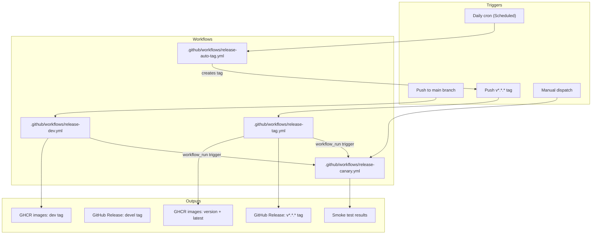
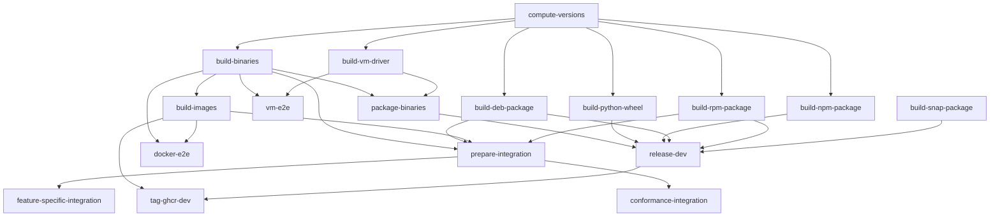
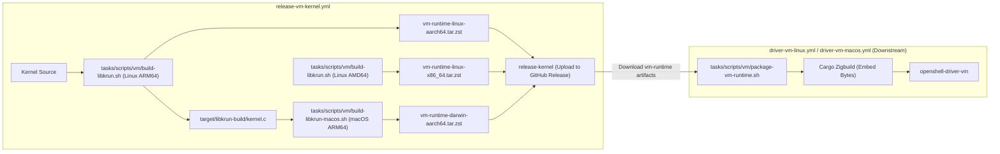

<!-- source: DeepWiki mcp.deepwiki.com · repo NVIDIA/OpenShell · page 13.1 Version Computation and Release Workflows · fetched 2026-10-26 -->

# Version Computation and Release Workflows

Relevant source files

The following files were used as context for generating this wiki page:

- [.agents/skills/test-release-canary/SKILL.md](.agents/skills/test-release-canary/SKILL.md)
- [.github/workflows/branch-e2e.yml](.github/workflows/branch-e2e.yml)
- [.github/workflows/e2e-kubernetes-test.yml](.github/workflows/e2e-kubernetes-test.yml)
- [.github/workflows/integration-runner.yml](.github/workflows/integration-runner.yml)
- [.github/workflows/integration-test.yml](.github/workflows/integration-test.yml)
- [.github/workflows/prepare-integration-inputs.yml](.github/workflows/prepare-integration-inputs.yml)
- [.github/workflows/release-auto-tag.yml](.github/workflows/release-auto-tag.yml)
- [.github/workflows/release-canary.yml](.github/workflows/release-canary.yml)
- [.github/workflows/release-dev.yml](.github/workflows/release-dev.yml)
- [.github/workflows/release-tag.yml](.github/workflows/release-tag.yml)
- [CI.md](CI.md)
- [crates/openshell-driver-vm/README.md](crates/openshell-driver-vm/README.md)
- [crates/openshell-driver-vm/src/driver.rs](crates/openshell-driver-vm/src/driver.rs)
- [crates/openshell-driver-vm/src/layer_applier.rs](crates/openshell-driver-vm/src/layer_applier.rs)
- [crates/openshell-driver-vm/src/main.rs](crates/openshell-driver-vm/src/main.rs)
- [crates/openshell-driver-vm/src/preparation.rs](crates/openshell-driver-vm/src/preparation.rs)
- [crates/openshell-driver-vm/tests/image_preparation.rs](crates/openshell-driver-vm/tests/image_preparation.rs)
- [crates/openshell-gateway/src/vm.rs](crates/openshell-gateway/src/vm.rs)
- [deploy/helm/openshell/ci/values-high-availability.yaml](deploy/helm/openshell/ci/values-high-availability.yaml)
- [docs/about/installation.mdx](docs/about/installation.mdx)
- [install.sh](install.sh)
- [nix/test-guest/scripts/snap-gateway-repro.sh](nix/test-guest/scripts/snap-gateway-repro.sh)
- [python/openshell/release_formula_test.py](python/openshell/release_formula_test.py)
- [python/release_tooling_test.py](python/release_tooling_test.py)
- [snap/hooks/post-refresh](snap/hooks/post-refresh)
- [snapcraft.yaml](snapcraft.yaml)
- [tasks/scripts/release.py](tasks/scripts/release.py)
- [tasks/scripts/test-install-sh.sh](tasks/scripts/test-install-sh.sh)
- [tasks/scripts/test-packaging-assets.sh](tasks/scripts/test-packaging-assets.sh)
- [tasks/scripts/test-snap-post-refresh-hook.sh](tasks/scripts/test-snap-post-refresh-hook.sh)
- [tests/config.nix](tests/config.nix)

This page documents the GitHub Actions workflows that orchestrate the OpenShell release process. It covers the primary release workflows: `release-dev.yml` (continuous deployment from main), `release-tag.yml` (stable versioned releases), `release-auto-tag.yml` (automated tagging), and `release-canary.yml` (release verification).

## Workflow Overview

OpenShell implements four interconnected workflows that automate the release pipeline from development commits to verified stable releases.

### Release Workflow Ecosystem
Title: Release Workflow Ecosystem

Sources: [.github/workflows/release-dev.yml:3-6](), [.github/workflows/release-tag.yml:3-12](), [.github/workflows/release-auto-tag.yml:6-9](), [.github/workflows/release-canary.yml:3-7]()

## Release Dev Workflow

The `release-dev.yml` workflow implements continuous deployment from the `main` branch. Every commit that passes CI triggers a full release pipeline that publishes development builds.

### Trigger Conditions
The workflow triggers automatically on every push to `main` and supports manual dispatch for ad-hoc builds [.github/workflows/release-dev.yml:3-6]().

### Job Orchestration
Title: Release Dev Job Pipeline

Sources: [.github/workflows/release-dev.yml:16-198]()

### Version Computation Job
The `compute-versions` job runs first to compute version identifiers once, preventing race conditions from concurrent git operations [.github/workflows/release-dev.yml:18-21](). It uses `tasks/scripts/release.py` to generate Python, Cargo, DEB, and RPM compatible version strings [.github/workflows/release-dev.yml:52-59](). The `--dev` flag is passed to `release.py` to indicate a development build [.github/workflows/release-dev.yml:52-58]().

### Component Build Jobs
The workflow calls specialized sub-workflows for major components:
*   `build-binaries`: Builds core binaries like CLI, gateway, sandbox, and conformance for various platforms [.github/workflows/release-dev.yml:63-71]().
*   `build-vm-driver`: Builds the VM driver binaries [.github/workflows/release-dev.yml:74-82]().
*   `package-binaries`: Packages the built binaries into release artifacts [.github/workflows/release-dev.yml:86-92]().
*   `build-images`: Builds Docker images for gateway, sandbox, and supervisor components [.github/workflows/release-dev.yml:96-102]().

### Integration and E2E Testing Jobs
*   `prepare-integration`: Prepares inputs for integration tests, including artifacts from binary and image builds [.github/workflows/release-dev.yml:105-114]().
*   `conformance-integration`: Runs conformance tests across different environments (Ubuntu Docker, Ubuntu K3s, Fedora Podman) using DEB and RPM installers [.github/workflows/release-dev.yml:116-132]().
*   `feature-specific-integration`: Runs feature-specific integration tests, such as provider-refresh tests on Fedora Podman [.github/workflows/release-dev.yml:134-149]().
*   `docker-e2e`: Runs E2E tests using the Docker driver [.github/workflows/release-dev.yml:151-162]().
*   `vm-e2e`: Runs E2E tests using the VM driver [.github/workflows/release-dev.yml:164-174]().

### GHCR Tagging Job
The `tag-ghcr-dev` job retags the SHA-tagged images for `gateway`, `sandbox`, and `supervisor` to `:dev` using `docker buildx imagetools create` [.github/workflows/release-dev.yml:176-196](). This is an atomic manifest operation that does not require rebuilding the image layers.

### Python Wheel Build Job
The `build-python-wheel` job builds the Python SDK wheel [.github/workflows/release-dev.yml:198]().

Sources: [.github/workflows/release-dev.yml:1-198](), [tasks/scripts/release.py:1-599]()

## Release Tag Workflow

The `release-tag.yml` workflow creates stable, versioned releases from git tags matching `v*.*.*` and excluding prerelease tags like `v*.*.*-pre.*` [.github/workflows/release-tag.yml:3-7](). It can also be triggered manually via `workflow_dispatch` by specifying a `tag` input [.github/workflows/release-tag.yml:7-12]().

### Version Resolution
The workflow resolves the release tag from the git ref (`github.ref_name`) or the manual `inputs.tag` [.github/workflows/release-tag.yml:22](). The `compute-versions` job then uses `tasks/scripts/release.py` to derive various version formats (Python, Cargo, NPM, DEB, RPM) and a `semver` output (e.g., `0.6.0`) by stripping the 'v' prefix from the tag [.github/workflows/release-tag.yml:41-49,80-86](). It also determines if the release is a prerelease based on the tag format (e.g., `v0.0.1-pre.1`) [.github/workflows/release-tag.yml:70-77]().

### Component Build Jobs
Similar to `release-dev.yml`, this workflow builds various components:
*   `build-binaries`: Builds core binaries [.github/workflows/release-tag.yml:90-99]().
*   `build-vm-driver`: Builds the VM driver, depending on `build-binaries` [.github/workflows/release-tag.yml:102-111]().
*   `package-binaries`: Packages the built binaries into release artifacts [.github/workflows/release-tag.yml:114-122]().
*   `build-images`: Builds Docker images for gateway, sandbox, and supervisor components [.github/workflows/release-tag.yml:124-132]().

### Security Scan
The `security` job performs security scans on the built images, failing the workflow if Codex Security findings are present (`fail-on-codex-findings: true`) [.github/workflows/release-tag.yml:134-153]().

### Integration Testing
*   `prepare-integration`: Prepares inputs for integration tests, including artifacts from binary and image builds [.github/workflows/release-tag.yml:155-164]().
*   `conformance-integration`: Runs conformance tests across different environments (Ubuntu Docker, Ubuntu K3s, Fedora Podman) using DEB and RPM installers [.github/workflows/release-tag.yml:166-181]().

### Image Tagging Strategy
The `tag-ghcr-release` job (not fully shown in the provided snippet, but implied by the `release-dev.yml` structure and common release practices) would apply two symbolic tags to the GHCR images: the specific version (e.g., `v0.6.0`) and `latest`. This ensures that the latest stable release is always accessible via the `latest` tag.

Sources: [.github/workflows/release-tag.yml:1-181](), [tasks/scripts/release.py:1-599]()

## Release Auto-Tag Workflow

The `release-auto-tag.yml` workflow automates the creation of patch versions. It is designed to run on a schedule (weekdays at 7 AM PDT) but is currently commented out and only triggers via `workflow_dispatch` [.github/workflows/release-auto-tag.yml:7-9]().

### Logic Flow
1.  **Determine Next Version**: The `create-tag` job checks out the repository and finds the latest `v*.*.*` tag using `git tag -l 'v*.*.*' --sort=-v:refname | head -1` [.github/workflows/release-auto-tag.yml:28-31](). It then parses the major, minor, and patch components and increments the patch number to propose the `next` tag (e.g., `v1.2.3` becomes `v1.2.4`) [.github/workflows/release-auto-tag.yml:46-50]().
2.  **Commit Check**: It skips tag creation if there are no new commits since the `latest` tag using `git rev-list "${latest}..HEAD" --count` [.github/workflows/release-auto-tag.yml:38-44]().
3.  **Tag Existence Check**: It verifies that the `next` tag does not already exist to prevent duplicates [.github/workflows/release-auto-tag.yml:51-54]().
4.  **Create and Push Tag**: If a new tag is determined and doesn't exist, it creates the tag locally and pushes it to the origin repository [.github/workflows/release-auto-tag.yml:60-63]().
5.  **Trigger Release**: Finally, it triggers the `release-tag.yml` workflow using the GitHub CLI (`gh workflow run`) with the newly created tag as an input, initiating the full stable release process for that version [.github/workflows/release-auto-tag.yml:66-72]().

Sources: [.github/workflows/release-auto-tag.yml:1-72]()

## Release Canary Workflow

The `release-canary.yml` workflow provides automated smoke testing for published releases across multiple platforms. It is triggered after `Release Dev` completes (via `workflow_run`) or via manual dispatch [.github/workflows/release-canary.yml:3-12](). The workflow sets `OPENSHELL_TELEMETRY_ENABLED` to `"false"` to prevent telemetry from test runs [.github/workflows/release-canary.yml:23]().

### Verification Matrix
Title: Canary Verification Matrix
| Platform | Runner | Logic |
| :--- | :--- | :--- |
| **macOS Homebrew** | `macos-latest-xlarge` | Ensures the VM driver is set, then installs OpenShell using `install.sh` (which leverages Homebrew on macOS) and runs `openshell status` [.github/workflows/release-canary.yml:26-41](). The `install.sh` script is fetched from the `head_sha` of the triggering `workflow_run` or `github.sha` [.github/workflows/release-canary.yml:36](). |
| **Ubuntu DEB** | `ubuntu-latest` | Ensures Docker is installed and running, configures the gateway to use the Docker driver, then installs OpenShell via `install.sh` and runs `openshell status` and a basic sandbox create/exec/delete test [.github/workflows/release-canary.yml:57-93](). |
| **Fedora RPM** | `linux-amd64-cpu8` | Starts a privileged `fedora:latest` Docker container with `systemd` as PID 1. It then installs the RPM package inside this container via `install.sh` (which detects RPM on Fedora) and tests the Podman driver by configuring `OPENSHELL_COMPUTE_DRIVER=podman` in `gateway.env` and running `openshell status` and a basic sandbox create/exec/delete test [.github/workflows/release-canary.yml:95-179](). The container is cleaned up in an `always()` step (not shown in snippet). |

Sources: [.github/workflows/release-canary.yml:1-179](), [install.sh:1-222](), [snapcraft.yaml:1-174]()

## VM Kernel Release Workflow

The `release-vm-kernel.yml` workflow is a decoupled, on-demand pipeline for building the custom Linux kernel and VMM components used by the VM driver. This workflow is triggered manually via `workflow_dispatch` (not shown in provided snippet, but implied by common GitHub Actions patterns).

Title: VM Runtime Data Flow

Sources: [crates/openshell-driver-vm/README.md:1-5]()

### Kernel Compilation
The workflow builds the `libkrunfw` and `libkrun` components for different platforms:
*   **Linux ARM64**: The `build-runtime-linux-arm64` job builds `libkrunfw` and `libkrun` from source on an ARM64 runner. It then packages the runtime into `vm-runtime-linux-aarch64.tar.zst` and uploads it as an artifact. Crucially, it also exports `kernel.c` (a C source file containing the ARM64 Linux kernel as a byte array) and `ABI_VERSION` for use by the macOS job.
*   **Linux AMD64**: The `build-runtime-linux-amd64` job performs a similar build for AMD64, packaging `vm-runtime-linux-x86_64.tar.zst`.
*   **macOS ARM64**: The `build-runtime-macos-arm64` job depends on `build-runtime-linux-arm64`. It downloads the `kernel.c` artifact and uses `tasks/scripts/vm/build-libkrun-macos.sh` to build `libkrunfw` and `libkrun` for macOS, incorporating the pre-built kernel. This significantly reduces the build time on macOS by avoiding a full kernel compilation.

### Artifact Packaging and Release
After all platform-specific runtimes are built, the `release-kernel` job collects these artifacts (`.tar.zst` files) and uploads them to a rolling "vm-runtime" GitHub Release.

### Artifact Consumption
Downstream workflows, such as `build-vm-driver` in `release-dev.yml` and `release-tag.yml`, will then download these pre-built runtime tarballs. The `tasks/scripts/vm/package-vm-runtime.sh` script (used in the kernel release workflow) and subsequent steps in the driver build workflows are responsible for staging and embedding these runtimes into the `openshell-driver-vm` binary. This ensures that the `openshell-driver-vm` binary includes the necessary kernel and VMM components for its target platform [crates/openshell-driver-vm/README.md:1-5]().

Sources: [crates/openshell-driver-vm/README.md:1-5]()

---

