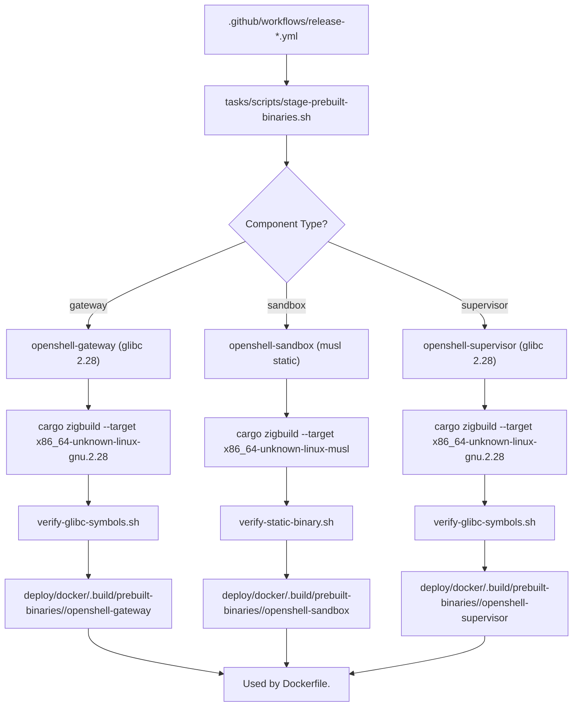
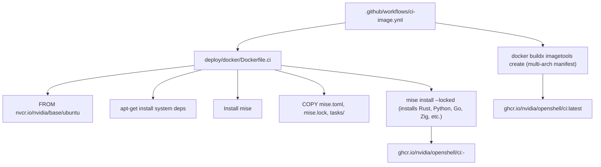
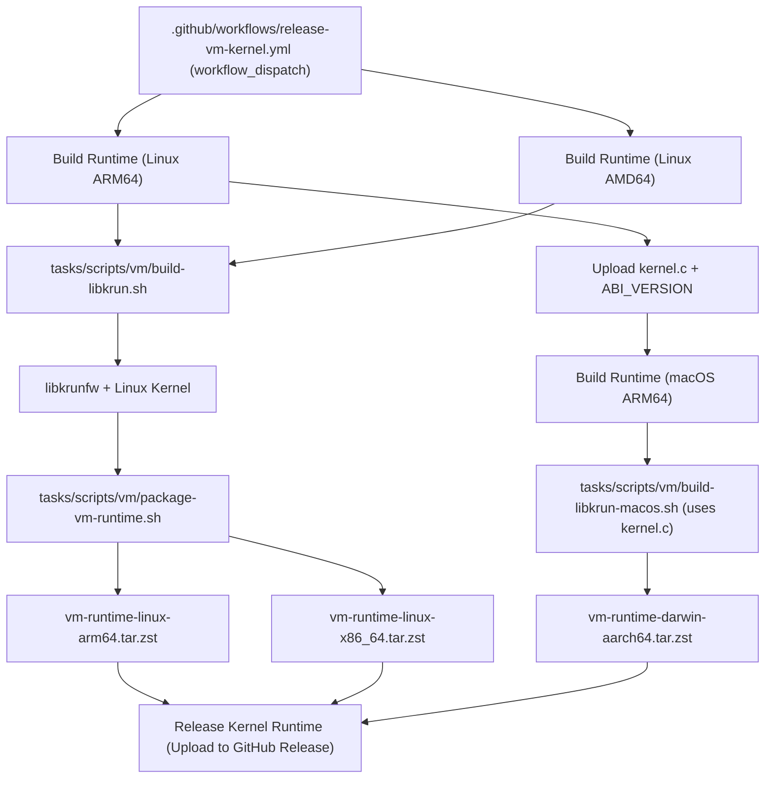

<!-- source: DeepWiki mcp.deepwiki.com · repo NVIDIA/OpenShell · page 13.2 Binary, Container and Package Builds · fetched 2026-10-26 -->

# Binary, Container and Package Builds

Relevant source files

The following files were used as context for generating this wiki page:

- [.github/actions/build-docker-image/action.yml](.github/actions/build-docker-image/action.yml)
- [.github/actions/release-helm-oci/action.yml](.github/actions/release-helm-oci/action.yml)
- [.github/actions/setup-buildx/action.yml](.github/actions/setup-buildx/action.yml)
- [.github/workflows/build-images.yml](.github/workflows/build-images.yml)
- [.github/workflows/cargo-deny.yml](.github/workflows/cargo-deny.yml)
- [.github/workflows/ci-image.yml](.github/workflows/ci-image.yml)
- [.github/workflows/deb-package.yml](.github/workflows/deb-package.yml)
- [.github/workflows/e2e-docker-test.yml](.github/workflows/e2e-docker-test.yml)
- [.github/workflows/e2e-gpu-test.yaml](.github/workflows/e2e-gpu-test.yaml)
- [.github/workflows/helm-lint.yml](.github/workflows/helm-lint.yml)
- [.github/workflows/release-vm-kernel.yml](.github/workflows/release-vm-kernel.yml)
- [.gitignore](.gitignore)
- [deploy/docker/Dockerfile.ci](deploy/docker/Dockerfile.ci)
- [deploy/docker/Dockerfile.gateway](deploy/docker/Dockerfile.gateway)
- [deploy/docker/Dockerfile.supervisor](deploy/docker/Dockerfile.supervisor)
- [mise.lock](mise.lock)
- [mise.toml](mise.toml)
- [pyproject.toml](pyproject.toml)
- [scripts/lint-mermaid/package-lock.json](scripts/lint-mermaid/package-lock.json)
- [scripts/lint-mermaid/package.json](scripts/lint-mermaid/package.json)
- [tasks/docker.toml](tasks/docker.toml)
- [tasks/scripts/docker-build-image.sh](tasks/scripts/docker-build-image.sh)
- [tasks/scripts/setup-zig-cc-wrapper.sh](tasks/scripts/setup-zig-cc-wrapper.sh)
- [tasks/scripts/stage-prebuilt-binaries.sh](tasks/scripts/stage-prebuilt-binaries.sh)
- [tasks/scripts/verify-static-binary.sh](tasks/scripts/verify-static-binary.sh)
- [uv.lock](uv.lock)

This page details the build processes for OpenShell's various artifacts, including Rust binaries, Docker container images, prebuilt binary staging, VM driver and kernel builds, and the creation of the CI image. It covers the tools and scripts used to produce these artifacts, focusing on cross-compilation, static verification, and multi-platform support.

## Rust Binary Builds

OpenShell's core components are written in Rust, and their compilation is a critical part of the build process. The system supports cross-compilation for different architectures and libc environments, ensuring compatibility across various deployment targets.

### Cross-Compilation with `zig` and `musl`

OpenShell leverages `cargo zigbuild` for robust cross-compilation, especially for targets requiring specific `libc` versions or static linking.

-   **`cargo zigbuild`**: This tool integrates with Zig's C/C++ toolchain to provide a consistent cross-compilation experience for Rust projects. It simplifies targeting different architectures and `libc` implementations (like `musl` and `glibc`). The `mise.toml` configuration includes `zig = "0.14.1"` and `"github:rust-cross/cargo-zigbuild" = "0.22.3"` to ensure these tools are available in the build environment [mise.toml:45-48]().
-   **`musl` for Static Binaries**: The `openshell-sandbox` binary is built against `musl` libc to produce a fully static executable. This is crucial for the sandbox environment, as it minimizes external dependencies and enhances portability. The `stage-prebuilt-binaries.sh` script explicitly sets `target_libc=musl` for the `sandbox` component [tasks/scripts/stage-prebuilt-binaries.sh:115-117]().
-   **`glibc` with Version Floor**: The `openshell-gateway` binary is built against `glibc` but with a specified minimum version (e.g., `glibc 2.28`). This ensures compatibility with a wide range of Linux distributions without requiring full static linking. The `stage-prebuilt-binaries.sh` script uses `cargo zigbuild` to enforce this `glibc` floor [tasks/scripts/stage-prebuilt-binaries.sh:110-112, 181-188](). A wrapper script `setup-zig-cc-wrapper.sh` is used to configure the `zig` C compiler for the specific `glibc` target [tasks/scripts/stage-prebuilt-binaries.sh:224-226]().

### Static Verification

After compilation, binaries undergo verification steps to ensure they meet specific requirements:

-   **`verify-static-binary.sh`**: For `musl`-linked binaries (like `openshell-sandbox`), this script checks that the binary is indeed statically linked, preventing accidental dynamic dependencies [tasks/scripts/stage-prebuilt-binaries.sh:241]().
-   **`verify-glibc-symbols.sh`**: For `glibc`-linked binaries (like `openshell-gateway`), this script verifies that the binary does not link against `glibc` symbols newer than the specified floor (e.g., 2.28) [tasks/scripts/stage-prebuilt-binaries.sh:239-240](). This ensures runtime compatibility on older Linux systems.

### Binary Staging

The `tasks/scripts/stage-prebuilt-binaries.sh` script is central to preparing Rust binaries for packaging and containerization.

-   It takes a component name (`gateway`, `sandbox`, `supervisor`, or `all`) and an architecture (`amd64`, `arm64`) as input [tasks/scripts/stage-prebuilt-binaries.sh:15-16, 86-98]().
-   It determines the appropriate Rust target triple (e.g., `x86_64-unknown-linux-musl`) and `libc` variant [tasks/scripts/stage-prebuilt-binaries.sh:27-44, 166]().
-   It invokes `cargo build` or `cargo zigbuild` with the correct target and features (e.g., `vendored-z3` for `openshell-gateway`) [tasks/scripts/stage-prebuilt-binaries.sh:176-177, 212-219]().
-   The compiled binaries are placed into a staging directory: `deploy/docker/.build/prebuilt-binaries/<arch>/` [tasks/scripts/stage-prebuilt-binaries.sh:167]().
-   The script also handles patching the workspace version in `Cargo.toml` if `OPENSHELL_CARGO_VERSION` is set, which is useful for release builds [tasks/scripts/stage-prebuilt-binaries.sh:130-141]().
-   `cargo-auditable` can be enabled via `OPENSHELL_AUDITABLE` to embed build information for supply chain security [tasks/scripts/stage-prebuilt-binaries.sh:202-207]().

#### Binary Staging Process

Sources: [mise.toml:45-48](), [tasks/scripts/stage-prebuilt-binaries.sh:1-284](), [tasks/scripts/verify-static-binary.sh](), [tasks/scripts/verify-glibc-symbols.sh](), [tasks/scripts/setup-zig-cc-wrapper.sh]()

## Docker Image Builds

OpenShell provides Docker images for its `gateway`, `sandbox`, and `supervisor` components. These images are built using a multi-stage approach, leveraging prebuilt Rust binaries.

### Build Process

The `tasks/scripts/docker-build-image.sh` script orchestrates the Docker image build process:

1.  **Component Selection**: It takes a target component (`gateway`, `sandbox`, `supervisor`) as an argument [tasks/scripts/docker-build-image.sh:98-135]().
2.  **Prebuilt Binary Check**: It first checks if the required prebuilt Rust binaries for the target component and architecture exist in `deploy/docker/.build/prebuilt-binaries/`. If not, and not in CI, it automatically calls `stage-prebuilt-binaries.sh` to build them [tasks/scripts/docker-build-image.sh:75-86]().
3.  **`Dockerfile` Selection**: It selects the appropriate `Dockerfile` (e.g., `deploy/docker/Dockerfile.gateway`) based on the component [tasks/scripts/docker-build-image.sh:109-130]().
4.  **Buildx Integration**: It uses `docker buildx build` for multi-platform builds, caching, and pushing to registries [tasks/scripts/docker-build-image.sh:201-211]().
    -   `--platform`: Specifies the target platform(s) (e.g., `linux/amd64`, `linux/arm64`) [tasks/scripts/docker-build-image.sh:203]().
    -   `--cache-from`/`--cache-to`: Configures BuildKit cache for faster builds [tasks/scripts/docker-build-image.sh:165-168]().
    -   `--provenance=mode=min --attest type=sbom`: Automatically generates and attaches an SPDX SBOM to the image [tasks/scripts/docker-build-image.sh:188]().
    -   `--output type=image,push=true`: Pushes the resulting image to the configured registry [tasks/scripts/docker-build-image.sh:190]().

### Component-Specific Dockerfiles

-   **`Dockerfile.gateway`**: Uses `nvcr.io/nvidia/distroless/cc-debian13` as its base image, providing a minimal environment with `glibc` for the `openshell-gateway` binary [deploy/docker/Dockerfile.gateway:11-12]().
-   **`Dockerfile.sandbox`**: Uses `nvcr.io/nvidia/distroless/static-debian13` as its base, suitable for the statically linked `openshell-sandbox` binary [deploy/docker/Dockerfile.sandbox:11-12]().
-   **`Dockerfile.supervisor`**: Uses `alpine:3.20` as its base, which includes `nftables` and `iptables` for network enforcement, and is compatible with `musl` builds [deploy/docker/Dockerfile.supervisor:11-15]().

### CI Image Creation

The CI image (`ghcr.io/nvidia/openshell/ci`) is a specialized Docker image used for running GitHub Actions workflows. It contains all necessary development tools and dependencies.

-   **`Dockerfile.ci`**: Defines the CI image. It starts from `nvcr.io/nvidia/base/ubuntu:noble-20251013` [deploy/docker/Dockerfile.ci:9]().
-   **Tool Installation**: It installs system dependencies via `apt-get` (e.g., `build-essential`, `clang`, `musl-tools`, `python3`) [deploy/docker/Dockerfile.ci:22-44]().
-   **`mise` Integration**: It installs `mise` and then uses `mise install --locked` to install all tools defined in `mise.toml` and `mise.lock` (e.g., `rust`, `python`, `go`, `kubectl`, `zig`, `cargo-zigbuild`) [deploy/docker/Dockerfile.ci:70-87](). This ensures a consistent and reproducible build environment across all CI jobs.
-   **Workflow**: The `.github/workflows/ci-image.yml` workflow builds and pushes this image to GHCR on changes to `Dockerfile.ci`, `mise.toml`, `mise.lock`, or `tasks/**` [.github/workflows/ci-image.yml:1-12](). It builds for both `amd64` and `arm64` architectures and creates a multi-arch manifest [.github/workflows/ci-image.yml:29-34, 100-108]().

#### CI Image Build Process

Sources: [deploy/docker/Dockerfile.ci:1-90](), [deploy/docker/Dockerfile.gateway:1-24](), [deploy/docker/Dockerfile.sandbox:1-22](), [deploy/docker/Dockerfile.supervisor:1-17](), [tasks/scripts/docker-build-image.sh:1-211](), [mise.toml:21-48](), [.github/workflows/ci-image.yml:1-108]()

## VM Driver and Kernel Builds

The `openshell-driver-vm` component relies on a custom-built Linux kernel and `libkrunfw` (kernel firmware) for its microVMs. These components are built and staged separately due to their complexity and infrequent changes.

### Workflow

The `.github/workflows/release-vm-kernel.yml` workflow is responsible for building and releasing these VM runtime components:

-   **Trigger**: It runs on `workflow_dispatch`, allowing manual triggering when kernel configurations or pins change [.github/workflows/release-vm-kernel.yml:18-19]().
-   **Linux Builds**:
    -   `build-runtime-linux-arm64` and `build-runtime-linux-amd64` jobs run on respective Linux runners [.github/workflows/release-vm-kernel.yml:37-40, 88-91]().
    -   They execute `tasks/scripts/vm/build-libkrun.sh` to compile `libkrunfw` and the Linux kernel from source [.github/workflows/release-vm-kernel.yml:56-57, 105-106]().
    -   The resulting runtime components are packaged into `.tar.zst` archives using `tasks/scripts/vm/package-vm-runtime.sh` [.github/workflows/release-vm-kernel.yml:59-63, 108-112]().
    -   The `build-runtime-linux-arm64` job also extracts `kernel.c` (a C source file containing the kernel as a byte array) and `ABI_VERSION` for use by the macOS build [.github/workflows/release-vm-kernel.yml:72-82]().
-   **macOS Build**:
    -   `build-runtime-macos-arm64` depends on `build-runtime-linux-arm64` to obtain the pre-built `kernel.c` [.github/workflows/release-vm-kernel.yml:127-128, 142-147]().
    -   It then uses `tasks/scripts/vm/build-libkrun-macos.sh` to compile `libkrunfw` and the kernel (from `kernel.c`) into a `.dylib` for macOS [.github/workflows/release-vm-kernel.yml:149-150](). This avoids a full kernel rebuild on macOS, significantly reducing build time.
    -   The macOS runtime is also packaged into a `.tar.zst` [.github/workflows/release-vm-kernel.yml:152-156]().
-   **Release**: The `release-kernel` job collects all packaged runtime tarballs and uploads them to a rolling "vm-runtime" GitHub Release [.github/workflows/release-vm-kernel.yml:168-174,179-265](). These artifacts are then consumed by other workflows when building the `openshell-driver-vm` binary.

#### VM Kernel and Driver Build Flow

Sources: [.github/workflows/release-vm-kernel.yml:1-265](), `tasks/scripts/vm/build-libkrun.sh`, `tasks/scripts/vm/package-vm-runtime.sh`, `tasks/scripts/vm/build-libkrun-macos.sh`

---

