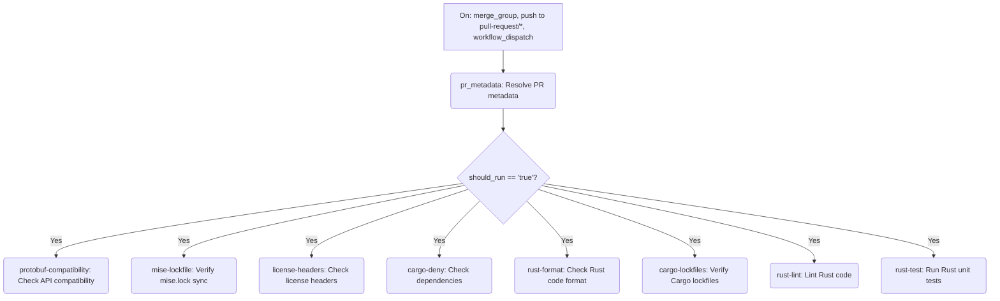
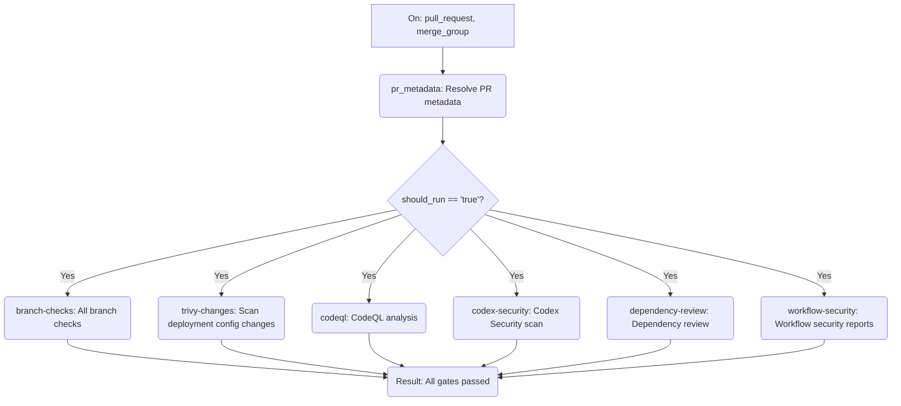
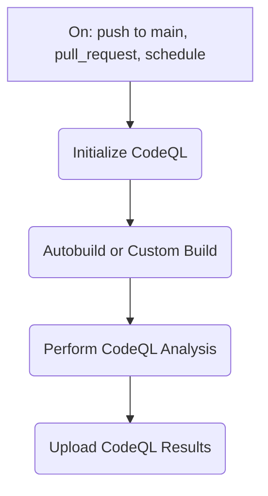
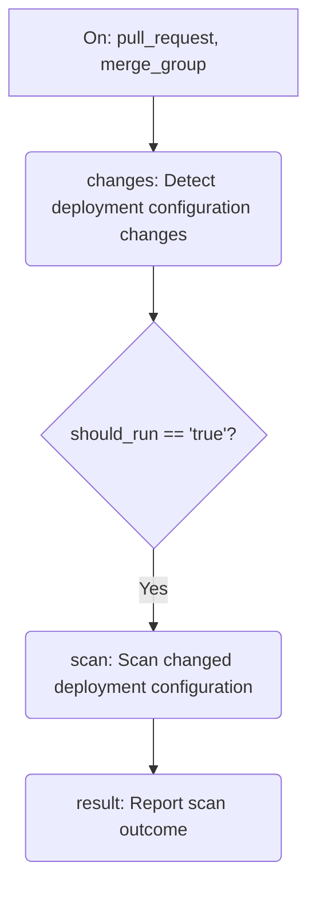
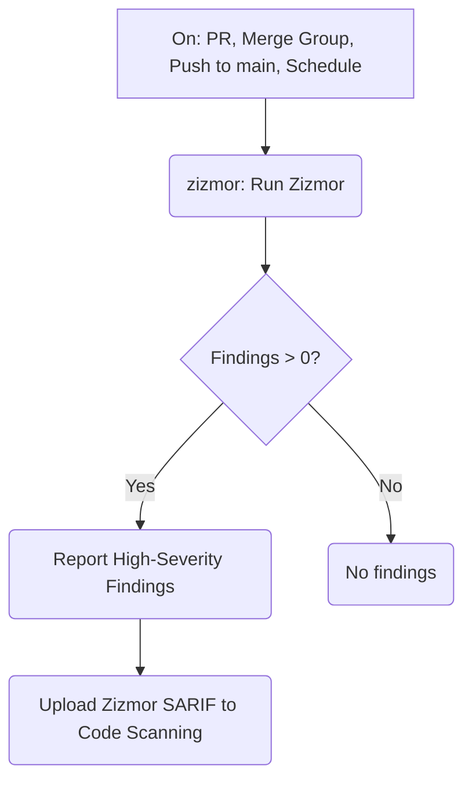
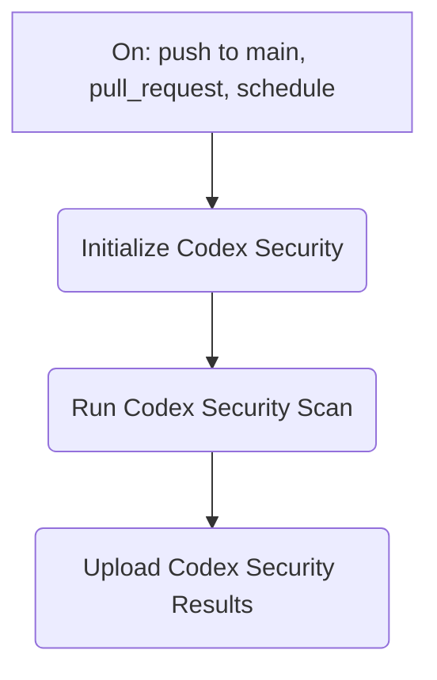

<!-- source: DeepWiki mcp.deepwiki.com · repo NVIDIA/OpenShell · page 13.4 CI Gates and Security Scanning · fetched 2026-10-26 -->

# CI Gates and Security Scanning

Relevant source files

The following files were used as context for generating this wiki page:

- [.agents/skills/watch-github-actions/SKILL.md](.agents/skills/watch-github-actions/SKILL.md)
- [.github/actionlint-matcher.json](.github/actionlint-matcher.json)
- [.github/actionlint-sarif-template.txt](.github/actionlint-sarif-template.txt)
- [.github/actionlint.yml](.github/actionlint.yml)
- [.github/actions/build-rust-binary/action.yml](.github/actions/build-rust-binary/action.yml)
- [.github/actions/check-protobuf-compatibility/action.yml](.github/actions/check-protobuf-compatibility/action.yml)
- [.github/actions/setup-nix/action.yml](.github/actions/setup-nix/action.yml)
- [.github/actions/setup-rust/action.yml](.github/actions/setup-rust/action.yml)
- [.github/codeql/codeql-config.yml](.github/codeql/codeql-config.yml)
- [.github/workflows/branch-checks.yml](.github/workflows/branch-checks.yml)
- [.github/workflows/build-binaries.yml](.github/workflows/build-binaries.yml)
- [.github/workflows/build-vm-driver.yml](.github/workflows/build-vm-driver.yml)
- [.github/workflows/codeql.yml](.github/workflows/codeql.yml)
- [.github/workflows/codex-security.yml](.github/workflows/codex-security.yml)
- [.github/workflows/dependency-review.yml](.github/workflows/dependency-review.yml)
- [.github/workflows/e2e-label-help.yml](.github/workflows/e2e-label-help.yml)
- [.github/workflows/required-ci-gates.yml](.github/workflows/required-ci-gates.yml)
- [.github/workflows/security-scan.yml](.github/workflows/security-scan.yml)
- [.github/workflows/trivy-changes.yml](.github/workflows/trivy-changes.yml)
- [.github/workflows/trivy-scan.yml](.github/workflows/trivy-scan.yml)
- [.github/workflows/workflow-security.yml](.github/workflows/workflow-security.yml)
- [.github/zizmor.yml](.github/zizmor.yml)
- [flake.nix](flake.nix)

This page details the Continuous Integration (CI) gates and security scanning processes implemented in the OpenShell codebase. These mechanisms ensure code quality, maintain API compatibility, and identify security vulnerabilities early in the development lifecycle.

## Branch Checks

The `branch-checks.yml` workflow defines a set of essential checks that run on pull requests and merge groups. These checks are crucial for maintaining code quality and consistency before merging changes into the main branch.

**Branch Checks Workflow Overview**

Sources: [.github/workflows/branch-checks.yml:1-203]()

### Protobuf Compatibility Checks

The `protobuf-compatibility` job ensures that changes to `.proto` files do not introduce breaking changes to the API. It uses the `check-protobuf-compatibility` action [flake.nix:145-151]() to compare the current branch's protobuf definitions against a baseline.

The baseline for comparison is determined by:
*   `github.event.merge_group.base_sha` for merge groups.
*   `needs.pr_metadata.outputs.base_sha` for pull requests.
*   The default branch for `workflow_dispatch` events [flake.nix:145-151](), [.github/workflows/branch-checks.yml:52-59]().

The `check-protobuf-compatibility` action executes a Python script `tasks/scripts/check_proto_compatibility.py` [flake.nix:143]() which leverages `buf` for compatibility checks. During `0.x` releases, minor train changes permit compatibility findings as warnings, while patch trains or no active train reject them. Compilation, baseline, and tool errors are always fatal [ .agents/skills/watch-github-actions/SKILL.md:142-152]().

Sources: [.github/workflows/branch-checks.yml:40-59](), [.github/actions/check-protobuf-compatibility/action.yml:1-25](), [flake.nix:145-151](), [tasks/scripts/check_proto_compatibility.py](), [ .agents/skills/watch-github-actions/SKILL.md:142-152]()

### `mise` Lockfile Verification

The `mise-lockfile` job verifies that `mise.lock` is synchronized with `mise.toml`. If `git diff --exit-code mise.lock` detects differences, the job fails, prompting developers to run `mise lock` locally and commit the changes [ .github/workflows/branch-checks.yml:78-83](). This ensures reproducible tool environments.

Sources: [.github/workflows/branch-checks.yml:61-83]()

### License Header Checks

The `license-headers` job uses `mise run license:check` to ensure all source files contain the correct SPDX license headers [ .github/workflows/branch-checks.yml:103](). This helps maintain legal compliance and proper attribution.

Sources: [.github/workflows/branch-checks.yml:86-104]()

### `cargo-deny` Dependency Audits

The `cargo-deny` job performs a comprehensive audit of Rust dependencies using `cargo deny check licenses bans sources` [ .github/workflows/branch-checks.yml:124](). This checks for:
*   **Licenses**: Ensures all dependencies use approved licenses.
*   **Bans**: Prevents the use of known problematic or insecure crates.
*   **Sources**: Verifies dependencies are pulled from trusted sources.

This job runs within a Nix development shell to ensure a consistent environment [ .github/workflows/branch-checks.yml:113]().

Sources: [.github/workflows/branch-checks.yml:105-125](), [flake.nix:50]()

### Rust Formatting and Linting

The `rust-format` job enforces consistent code style across the Rust codebase by running `cargo fmt --all -- --check` for the main workspace and specific example/e2e crates [ .github/workflows/branch-checks.yml:143-146]().

The `rust-lint` job performs static analysis using `cargo clippy --locked --workspace --all-targets -- -D warnings` [ .github/workflows/branch-checks.yml:198-201](). This identifies potential bugs, code smells, and enforces best practices, treating all linter warnings as errors (`-D warnings`). This job runs for `x86_64-linux`, `aarch64-linux`, and `aarch64-darwin` systems [ .github/workflows/branch-checks.yml:173-179]().

Sources: [.github/workflows/branch-checks.yml:126-201]()

### Cargo Lockfile Verification

The `cargo-lockfiles` job executes `tasks/scripts/check-cargo-lockfiles.sh` to verify the consistency of `Cargo.lock` files [ .github/workflows/branch-checks.yml:164](). This ensures that all Rust builds use the exact same dependency versions, preventing unexpected build failures or security regressions due to dependency drift.

Sources: [.github/workflows/branch-checks.yml:149-165]()

## Required CI Gates

The `required-ci-gates.yml` workflow aggregates the status of several critical checks, acting as a gatekeeper for merging pull requests. This workflow ensures that all necessary quality and security checks pass before code can be integrated.

**Required CI Gates Flow**

Sources: [.github/workflows/required-ci-gates.yml](), [.github/workflows/branch-checks.yml:1-203]()

## E2E Label Gating

The `e2e-label-help.yml` workflow provides guidance to maintainers when specific E2E labels (`test:e2e`, `test:e2e-gpu`, `test:e2e-kubernetes`) are applied to a pull request. Instead of automatically dispatching the E2E workflow, which would hide its status from the PR's Checks tab, it posts a comment explaining how to trigger or re-run the associated E2E tests.

This workflow checks:
*   If a mirror branch (`pull-request/<PR_NUMBER>`) exists and is up-to-date with the PR's head SHA [ .github/workflows/e2e-label-help.yml:61-64]().
*   If an existing E2E run for the current PR head SHA can be re-run [ .github/workflows/e2e-label-help.yml:72-74]().

Based on these checks, it instructs the maintainer to either:
*   Comment `/ok to test <SHA>` to create or refresh the mirror branch [ .github/workflows/e2e-label-help.yml:66-70]().
*   Re-run the "Branch E2E Checks" workflow from the GitHub Actions tab [ .github/workflows/e2e-label-help.yml:75-78]().

The comment also summarizes what the E2E suite will test and how its status will be reported [ .github/workflows/e2e-label-help.yml:44-57]().

Sources: [.github/workflows/e2e-label-help.yml:1-83]()

## Security Scanning

OpenShell employs several security scanning tools to identify vulnerabilities in code, dependencies, and deployment configurations.

### CodeQL

The `codeql.yml` workflow runs GitHub's CodeQL analysis on `push` to `main`, `pull_request`, and on a weekly schedule [ .github/workflows/codeql.yml:3-14](). It performs a comprehensive scan of the codebase for security vulnerabilities and coding errors.

**CodeQL Scan Process**

The workflow uses the `github/codeql-action/init` action to set up the CodeQL environment and `github/codeql-action/autobuild` for automatic build detection. For more complex projects, a custom build step can be defined [ .github/workflows/codeql.yml:30-40](). The results are then uploaded to GitHub Code Scanning using `github/codeql-action/upload-sarif` [ .github/workflows/codeql.yml:42-46]().

The CodeQL configuration is defined in `.github/codeql/codeql-config.yml`, which specifies the languages to analyze (Rust, Python, Go, JavaScript, TypeScript) and the security queries to run [ .github/codeql/codeql-config.yml:1-10]().

Sources: [.github/workflows/codeql.yml:1-46](), [.github/codeql/codeql-config.yml:1-10]()

### Trivy

Trivy is used to scan deployment configurations (Helm charts, Dockerfiles) and OCI images for vulnerabilities and misconfigurations.

The `trivy-changes.yml` workflow runs on `pull_request` and `merge_group` events to detect and scan only *changed* deployment configurations [ .github/workflows/trivy-changes.yml:6-9]().

**Trivy Changes Workflow**

The `changes` job identifies modifications to files like `deploy/docker/**`, `deploy/helm/**`, `.trivyignore.yaml`, and `flake.nix` [ .github/workflows/trivy-changes.yml:73-83](). If changes are detected, the `scan` job proceeds.

The `scan` job performs the following steps:
1.  **Checkout candidate and baseline**: It checks out both the candidate (PR head) and the baseline (PR base) revisions [ .github/workflows/trivy-changes.yml:99-110]().
2.  **Validate ignore policy**: Ensures the `.trivyignore.yaml` is valid [ .github/workflows/trivy-changes.yml:119]().
3.  **Scan baseline and candidate**: Scans both revisions using the *baseline* ignore policy to prevent new findings from being immediately ignored [ .github/workflows/trivy-changes.yml:134-149]().
4.  **Gate new findings**: The `gate-config-diff` script compares the scan results and rejects new `HIGH` or `CRITICAL` findings introduced by the change [ .github/workflows/trivy-changes.yml:151-153]().

The `trivy-scan.yml` workflow is a reusable workflow that can be called manually or by other workflows to perform scans of images and charts [ .github/workflows/trivy-scan.yml:10-20](). It supports scanning specific images and Helm charts, configurable severity levels, and SARIF output for GitHub Code Scanning [ .github/workflows/trivy-scan.yml:24-39]().

Sources: [.github/workflows/trivy-changes.yml:1-189](), [.github/workflows/trivy-scan.yml:1-210]()

### `cargo-deny`

As mentioned in the Branch Checks section, `cargo-deny` is used to enforce dependency policies, including license compliance, preventing the use of banned crates, and ensuring dependencies come from approved sources [ .github/workflows/branch-checks.yml:124](). This is a critical gate for supply chain security.

Sources: [.github/workflows/branch-checks.yml:105-125]()

### Zizmor

Zizmor is a tool used for identifying security vulnerabilities and misconfigurations in GitHub Actions workflows. The `workflow-security.yml` workflow runs Zizmor on `pull_request`, `merge_group`, `push` to `main`, and on a weekly schedule [ .github/workflows/workflow-security.yml:7-14]().

**Zizmor Scan Process**

The `zizmor` job runs `zizmor --offline --persona=regular --min-severity=high` to detect high-severity findings in the workflow definitions [ .github/workflows/workflow-security.yml:156-160](). It generates both JSON and SARIF reports [ .github/workflows/workflow-security.yml:162-170](). The workflow can be configured to fail on high-severity findings [ .github/workflows/workflow-security.yml:151]().

Sources: [.github/workflows/workflow-security.yml:129-199](), [.github/zizmor.yml]()

### Codex Security

The `codex-security.yml` workflow integrates Codex Security scanning into the CI pipeline. This workflow is typically triggered on `push` to `main`, `pull_request`, and on a weekly schedule [ .github/workflows/codex-security.yml:3-14]().

**Codex Security Scan Process**

The workflow uses the `codex-security/codex-security-action` to perform the scan [ .github/workflows/codex-security.yml:30-34](). The results are then uploaded to GitHub Code Scanning using `github/codeql-action/upload-sarif` [ .github/workflows/codex-security.yml:36-40]().

Sources: [.github/workflows/codex-security.yml:1-40]()

---

