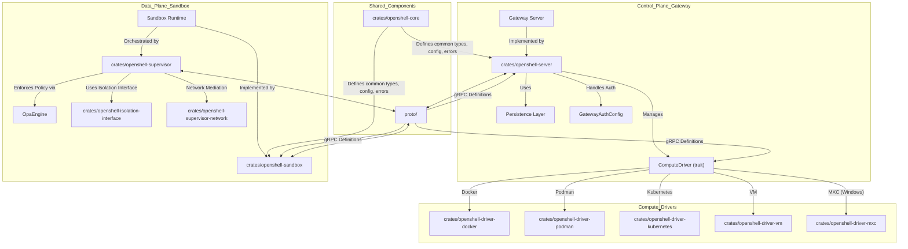
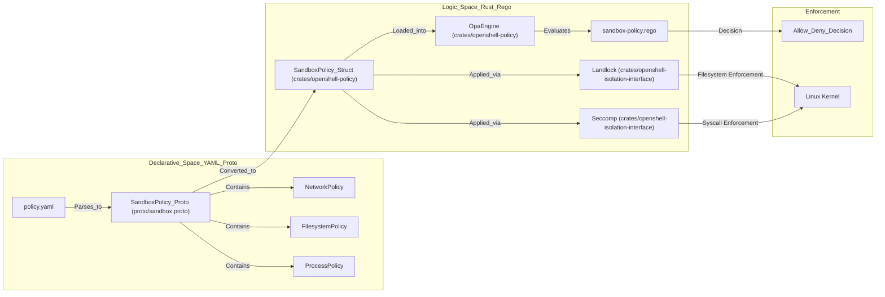

<!-- source: DeepWiki mcp.deepwiki.com · repo NVIDIA/OpenShell · page 14 Glossary · fetched 2026-10-26 -->

# Glossary

Relevant source files

The following files were used as context for generating this wiki page:

- [.agents/skills/build-from-issue/SKILL.md](.agents/skills/build-from-issue/SKILL.md)
- [.agents/skills/create-github-issue/SKILL.md](.agents/skills/create-github-issue/SKILL.md)
- [.agents/skills/create-github-pr/SKILL.md](.agents/skills/create-github-pr/SKILL.md)
- [.agents/skills/create-spike/SKILL.md](.agents/skills/create-spike/SKILL.md)
- [.agents/skills/fix-security-issue/SKILL.md](.agents/skills/fix-security-issue/SKILL.md)
- [.agents/skills/review-security-issue/SKILL.md](.agents/skills/review-security-issue/SKILL.md)
- [.agents/skills/sync-agent-infra/SKILL.md](.agents/skills/sync-agent-infra/SKILL.md)
- [.agents/skills/triage-issue/SKILL.md](.agents/skills/triage-issue/SKILL.md)
- [.github/ISSUE_TEMPLATE/bug_report.yml](.github/ISSUE_TEMPLATE/bug_report.yml)
- [.github/ISSUE_TEMPLATE/feature_request.yml](.github/ISSUE_TEMPLATE/feature_request.yml)
- [.github/PULL_REQUEST_TEMPLATE.md](.github/PULL_REQUEST_TEMPLATE.md)
- [AGENTS.md](AGENTS.md)
- [CONTRIBUTING.md](CONTRIBUTING.md)
- [README.md](README.md)
- [crates/openshell-core/src/grpc_client.rs](crates/openshell-core/src/grpc_client.rs)
- [crates/openshell-core/src/lib.rs](crates/openshell-core/src/lib.rs)

This page defines codebase-specific terms, jargon, and abbreviations used throughout OpenShell. It serves as a technical reference for onboarding engineers to understand the domain language and how it maps to specific code entities.

## Core System Entities

| Term | Definition | Code Pointer |
| :--- | :--- | :--- |
| **Gateway** | The control-plane API that coordinates sandbox lifecycles, manages providers, and acts as the authentication boundary. | [crates/openshell-server/src/lib.rs:27-28]() |
| **Sandbox** | An isolated runtime environment consisting of a container, a supervisor binary, and enforced egress routing. | [README.md:28]() |
| **Provider** | A named credential bundle (e.g., API keys) injected into sandboxes as environment variables at runtime. | [README.md:45]() |
| **Compute Driver** | An abstraction layer that allows the Gateway to orchestrate sandboxes across different backends (Docker, Podman, K8s, VM). | [AGENTS.md:49-54]() |
| **Supervisor** | The `openshell-supervisor` binary that runs as PID 1 inside the workload to prepare isolation and launch agent processes. | [AGENTS.md:29]() |

### Natural Language to Code Mapping: Architecture
The following diagram maps high-level system concepts to the specific Rust crates and Protobuf definitions that implement them.

**System Architecture Mapping**

Sources: [README.md:28-29](), [AGENTS.md:27-54](), [crates/openshell-core/src/lib.rs:63-69]()

---

## Technical Jargon & Implementation Terms

### Binary Identity Binding
The process of associating a network request with the specific binary on disk that initiated it. The proxy identifies the calling binary and checks trust-on-first-use identity to reject unauthorized processes.
*   **Implementation:** `openshell-binary-identity` crate provides shared trusted procfs executable identity resolution for isolation backends. [AGENTS.md:30]()
*   **Code Reference:** `crates/openshell-binary-identity/` [AGENTS.md:30]()

### CDI (Container Device Interface)
A specification for injecting container devices, primarily used for NVIDIA GPUs in container runtimes like Docker and Podman. OpenShell uses it to enable GPU support in sandboxes.
*   **Context:** Used for NVIDIA GPU discovery in Docker/Podman.
*   **Code Reference:** `gpu` module in `openshell-core` [crates/openshell-core/src/lib.rs:30]()

### Compute Driver
An abstraction layer that allows the Gateway to orchestrate sandboxes across different backends (Docker, Podman, K8s, VM, MXC). Each driver implements the `ComputeDriver` gRPC interface.
*   **Implementation:** `ComputeDriver` trait and its implementations.
*   **Code Reference:** `crates/openshell-driver-docker/`, `crates/openshell-driver-podman/`, `crates/openshell-driver-kubernetes/`, `crates/openshell-driver-vm/`, `crates/openshell-driver-mxc/` [AGENTS.md:49-54]()

### Credential Driver
A component responsible for managing and providing credentials to sandboxes. OpenShell supports various backends like encrypted database, Kubernetes Secrets, and Vault.
*   **Implementation:** In-process `CredentialDriver` backends.
*   **Code Reference:** `crates/openshell-driver-db-credstore/`, `crates/openshell-driver-kubernetes-secrets/`, `crates/openshell-driver-vault/` [AGENTS.md:46-48]()

### Gateway
The central control plane of OpenShell. It manages sandbox lifecycles, enforces policies, handles authentication, and provides APIs for client interaction.
*   **Implementation:** The `openshell-server` crate.
*   **Code Reference:** `crates/openshell-server/` [AGENTS.md:27]()

### Inference Routing (`inference.local`)
A transparent interception mechanism where sandboxed agents call a virtual host (`https://inference.local`). The proxy terminates TLS, strips sandbox-provided keys, and injects "real" provider credentials fetched from the gateway.
*   **Implementation:** Interception of `inference.local` for LLM calls.
*   **Code Reference:** `crates/openshell-supervisor-network/` handles proxying and L7 enforcement. [AGENTS.md:59]()

### Landlock (LSM)
A Linux Security Module used by OpenShell to provide unprivileged filesystem sandboxing. It allows the supervisor to restrict which file paths the agent process can read or write.
*   **Implementation:** `openshell-isolation-interface` defines the `IsolationBackend` trait, which Landlock implementations adhere to.
*   **Code Reference:** `crates/openshell-isolation-interface/` [AGENTS.md:31]()

### L7 Inspection / Relay
The layer of the proxy that performs deep packet inspection (DPI) on HTTP/HTTPS traffic. It handles TLS termination using an ephemeral CA to inspect request paths and methods, supporting REST, WebSocket, GraphQL, and MCP.
*   **Implementation:** `openshell-supervisor-network` is responsible for L7 enforcement.
*   **Code Reference:** `crates/openshell-supervisor-network/` [AGENTS.md:59]()

### Mechanistic Mapper
A sandbox-side component that observes L4 network denials and automatically generates suggested policy rules (proposals) to be reviewed by a human or an agent.
*   **Implementation:** Part of the policy system.
*   **Code Reference:** `proposals` module in `openshell-core` [crates/openshell-core/src/lib.rs:46]()

### MXC (Microsoft Execution Containers) Driver
The `openshell-driver-mxc` is a compute driver for Windows 11, leveraging Microsoft Execution Containers (AppContainer/IsolationSession) for sandbox isolation.
*   **Implementation:** In-process Windows AppContainer and isolation-session compute backend.
*   **Code Reference:** `crates/openshell-driver-mxc/` [AGENTS.md:54]()

### OCSF (Open Cybersecurity Schema Framework)
A standardized schema for security events. OpenShell uses OCSF for structured audit logging within sandboxes, allowing for easier integration with SIEM systems.
*   **Implementation:** `openshell-ocsf` crate provides event types, builders, and formatters.
*   **Code Reference:** `crates/openshell-ocsf/` [AGENTS.md:36]()

### OPA Generation (Open Policy Agent)
The process of generating Rego policies for the Open Policy Agent engine based on the declarative OpenShell policy schema.
*   **Implementation:** The `OpaEngine` in the supervisor evaluates Rego policies.
*   **Code Reference:** `crates/openshell-policy/` [AGENTS.md:33]()

### Policy Chunk
A granular piece of policy definition, often used in the context of draft policies or policy recommendations.
*   **Implementation:** Policies can be composed of multiple chunks.
*   **Code Reference:** `PolicyChunk` protobuf message [crates/openshell-core/src/grpc_client.rs:31]()

### Provider Profile
A configuration that defines how a specific provider's credentials should be managed and injected into a sandbox. It includes details like credential refresh mechanisms and environment variable injection.
*   **Implementation:** Managed by the gateway.
*   **Code Reference:** `GatewayProviderProfileSourceConfig` in `openshell-core` [crates/openshell-core/src/lib.rs:66]()

### Qualification Profile
A set of criteria or tests that a release or component must pass before being considered qualified for deployment. This is part of the release workflow.
*   **Context:** Used in release gating.
*   **Code Reference:** Implied by release workflows like `release-canary`.

### Sandbox
An isolated execution environment where AI agents run. It's governed by policies enforced at the kernel level and through network mediation.
*   **Implementation:** The `openshell-sandbox` crate is the capability-free workload launcher.
*   **Code Reference:** `crates/openshell-sandbox/` [AGENTS.md:28]()

### Supervisor
The `openshell-supervisor` binary that runs as PID 1 inside the sandbox. It's responsible for preparing isolation, launching agent processes, evaluating policies, managing credentials, and mediating network traffic.
*   **Implementation:** The `openshell-supervisor` crate.
*   **Code Reference:** `crates/openshell-supervisor/` [AGENTS.md:29]()

### tmachine
A VM-based integration harness used for testing OpenShell. It leverages Nix and Ansible to create disposable guest environments for validating distro and package compatibility.
*   **Context:** Used in the testing infrastructure.
*   **Code Reference:** `tests/tmachine`

### Vouch
A system used for managing contributions, especially from first-time contributors. It requires a maintainer to "vouch" for a contributor before their pull requests are accepted, mitigating risks from AI-generated code.
*   **Implementation:** Part of the contribution workflow.
*   **Code Reference:** `CONTRIBUTING.md:23-32` [CONTRIBUTING.md:23-32]()

---

## Code Entity Space: Policy & Logic

This diagram bridges declarative YAML policy concepts to the internal Rust structures and Rego logic used for enforcement.

**Policy Entity Mapping**

Sources: [AGENTS.md:33](), [crates/openshell-policy/src/lib.rs](), [crates/openshell-isolation-interface/src/lib.rs](), [crates/openshell-core/src/lib.rs:43]()

### Key Protobuf Messages
Located in `proto/`, these define the contract between Gateway and Sandbox:
*   **`CreateSandboxRequest`**: The specification for creating a new sandbox workload, used by compute drivers.
*   **`SandboxPolicy`**: The complete set of constraints (Network, Filesystem, Process).
*   **`DriverPlatformEvent`**: Events emitted by compute drivers to communicate platform status changes.

### Key Server & Sandbox Entities
*   **`AuthInterceptor`**: A Tonic gRPC interceptor that injects the sandbox bearer credential into outbound calls. [crates/openshell-core/src/grpc_client.rs:19]()
*   **`BoundGatewayListener`**: Manages the multiplexed gRPC/HTTP service ports.
*   **`OpaEngine`**: The engine responsible for evaluating Rego policies within the supervisor. [AGENTS.md:33]()
*   **`SandboxIndex`**: An in-memory sandbox correlation index used for tracking active workloads.
*   **`TracingLogBus`**: In-memory bus for structured audit and trace logs.

---

## Abbreviations

| Abbreviation | Full Term | Context |
| :--- | :--- | :--- |
| **BYOC** | Bring Your Own Container | Using custom images for sandboxes. |
| **LKG** | Last Known Good | The policy version the sandbox reverts to if a live update fails. |
| **TOFU** | Trust On First Use | Binary identity verification policy. |
| **OCSF** | Open Cybersecurity Schema Framework | Format for structured audit logging. |
| **netns** | Network Namespace | The Linux kernel feature used to isolate sandbox networking. |
| **CDI** | Container Device Interface | Used for NVIDIA GPU discovery in Docker/Podman. |
| **SigV4** | AWS Signature Version 4 | Protocol for signing AWS requests, supported via re-signing proxy. |
| **MXC** | Microsoft Execution Containers | Windows isolation technology used by `openshell-driver-mxc`. |

Sources: [crates/openshell-core/src/lib.rs:63-69](), [crates/openshell-core/src/grpc_client.rs:1-168](), [AGENTS.md:27-61]()