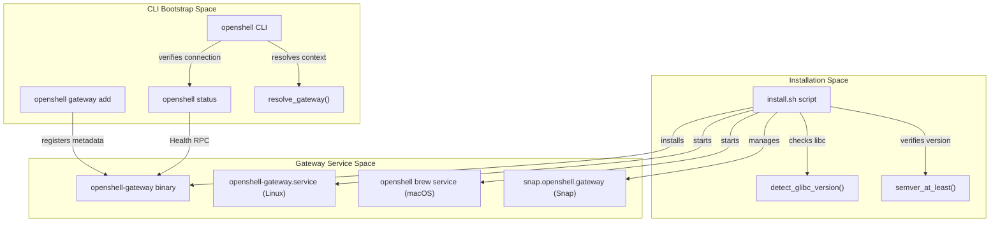
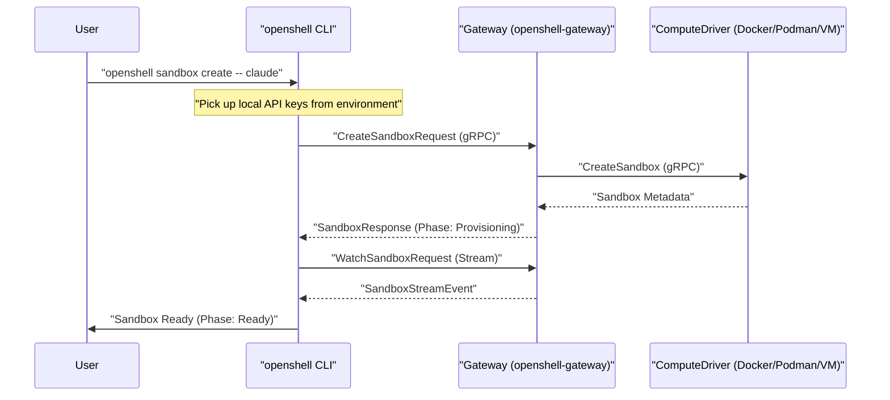

<!-- source: DeepWiki mcp.deepwiki.com · repo NVIDIA/OpenShell · page 2 Getting Started · fetched 2026-10-26 -->

# Getting Started

Relevant source files

The following files were used as context for generating this wiki page:

- [.agents/skills/test-release-canary/SKILL.md](.agents/skills/test-release-canary/SKILL.md)
- [.github/workflows/release-canary.yml](.github/workflows/release-canary.yml)
- [docs/about/installation.mdx](docs/about/installation.mdx)
- [install.sh](install.sh)
- [nix/test-guest/scripts/snap-gateway-repro.sh](nix/test-guest/scripts/snap-gateway-repro.sh)
- [snapcraft.yaml](snapcraft.yaml)
- [tasks/scripts/test-install-sh.sh](tasks/scripts/test-install-sh.sh)
- [tasks/scripts/test-packaging-assets.sh](tasks/scripts/test-packaging-assets.sh)

This section guides you through installing OpenShell and creating your first sandbox. OpenShell provides a secure, policy-governed runtime for AI agents by isolating them in sandboxed environments `[docs/sandboxes/manage-sandboxes.mdx:11-12]()`.

For detailed platform requirements and kernel dependencies, see [System Requirements](#2.3). For a comprehensive walkthrough of sandbox creation and agent interaction, see [Creating Your First Sandbox](#2.2). For details on the installation script and package managers, see [Installation](#2.1).

## Overview of Getting Started Flow

OpenShell consists of two primary runtime components: the **CLI** (the `openshell` binary) and the **Gateway** (the control plane managing sandbox lifecycles) `[docs/about/installation.mdx:11-23]()`. On local machines, the gateway typically runs as a background service (systemd or Homebrew) and manages sandboxes via Docker, Podman, or a MicroVM driver `[docs/about/installation.mdx:33-39]()`.

### Natural Language to Code Entity Space: Installation & Bootstrap

The following diagram maps the high-level installation and startup concepts to the specific code entities and scripts that implement them.

**Sources:** `[install.sh:171-197]()`, `[docs/about/installation.mdx:11-23]()`, `[docs/about/installation.mdx:43-57]()`, `[docs/about/installation.mdx:86-90]()`

## Installation Methods

The recommended way to install OpenShell is via the official installation script, which detects your OS and uses the native package manager (RPM, DEB, or Homebrew) `[install.sh:7-9]()`. Alternatively, users on supported Linux distributions can install via Snap `[docs/about/installation.mdx:86-90]()`.

### Supported Installation Targets

| Method | Platform | Details |
|--------|----------|---------|
| **Binary Script** | Linux / macOS | `curl -LsSf https://raw.githubusercontent.com/NVIDIA/OpenShell/main/install.sh | sh` installs packages and starts the gateway service; the script detects glibc version on Linux to ensure compatibility `[install.sh:171-218]()` |
| **Homebrew** | macOS (Apple Silicon) | Installs `openshell` CLI and starts a launchd service managed by Homebrew `[docs/about/installation.mdx:43-47]()` |
| **APT / DNF** | Ubuntu / Fedora | Linux distributive package installation (`.deb` or `.rpm`) installs the service as a systemd user service `[docs/about/installation.mdx:58-62]()` |
| **Snap** | Linux | Strict confinement snap package with Docker requirements, providing CLI, TUI, Prover, and Gateway as snap apps `[snapcraft.yaml:46-47]()`, `[docs/about/installation.mdx:105-111]()` |
| **Helm** | Kubernetes | Deploy gateway in a cluster with Helm charts, specifying version explicitly or using dev/pipeline tags `[docs/about/installation.mdx:145-147]()` |

The install script respects environment variables like `OPENSHELL_VERSION` (for version pinning) and `OPENSHELL_INSTALL_METHOD` (for selecting package type) `[install.sh:16-28]()`. To upgrade from older versions or migrate installation types, the installer includes guard logic and prompts `[install.sh:162-222]()`. The script also configures your PATH and manages gateway service start accordingly.

For package metadata validation and packaging artifacts tests, see relevant scripts in `tasks/scripts/` `[tasks/scripts/test-packaging-assets.sh:5-166]()`. Snap packaging strictly enforces confinement and dependencies listed in `snapcraft.yaml` `[snapcraft.yaml:1-174]()`. 

For detailed install instructions and setup of the service, see [Installation](#2.1).

## Creating Your First Sandbox

Once the gateway is running, users create sandboxes to run isolated agent workloads. Sandboxes are ephemeral, isolated runtime environments managed by the gateway and enabled by the compute drivers (Docker, Podman, VM) `[docs/sandboxes/manage-sandboxes.mdx:15-21]()`.

### Sandbox Creation Flow

The CLI facilitates sandbox creation by interacting with the gateway via gRPC, which in turn uses the configured compute driver to prepare the sandbox runtime.

Credentials for AI providers can be auto-detected and attached to sandboxes for access management `[crates/openshell-cli/src/run.rs:25-34]()`. This involves registering providers and credential profiles that relay authentication transparently inside the sandbox.

### Verifying Sandbox Security

The default sandbox policy strictly limits outbound access, enforcing a secure boundary. Verification steps:

1. Create sandbox: `openshell sandbox create --name demo` `[docs/sandboxes/manage-sandboxes.mdx:32-34]()`
2. Test blocked network access: `openshell sandbox exec -n demo -- curl https://api.github.com`
3. Attach provider credentials (`openshell provider create anthropic`) to enable access to services `[crates/openshell-cli/src/run.rs:25-34]()`
4. Connect interactively: `openshell sandbox connect demo` `[crates/openshell-cli/src/ssh.rs:77-79]()`

See the detailed tutorial in [Creating Your First Sandbox](#2.2) for a step-by-step walkthrough.

**Sources:** `[crates/openshell-cli/src/run.rs:46-63]()`, `[docs/sandboxes/manage-sandboxes.mdx:15-21]()`

## System Requirements Overview

OpenShell leverages modern OS and kernel features for sandbox isolation, networking, and security `[docs/about/installation.mdx:35-39]()`. Understanding system prerequisites ensures proper installation and runtime behavior.

| Requirement          | Minimum Version / Feature                | Notes                                     |
|----------------------|----------------------------------------|-------------------------------------------|
| **glibc**            | 2.28+                                  | Linux gateway and CLI packages require this minimum `[install.sh:171-218]()` |
| **Docker**           | 28.0 or later                          | Needed for Docker compute driver support `[docs/about/installation.mdx:38-39]()` |
| **Podman**           | 5.x                                   | Required for rootless Podman compute driver on Linux `[docs/about/installation.mdx:37]()`
| **macOS**            | Apple Silicon (arm64)                   | For Homebrew-managed gateway, requires Hypervisor.framework for VM driver `[install.sh:8-9]()` |
| **Kernel Features**  | Landlock, seccomp notify, namespaces    | Kernel security features for isolation (see [System Requirements](#2.3)) |
| **Service Support**  | systemd user services or launchd         | For managing the gateway background service |

For comprehensive details on each platform, runtime, and kernel configuration, see [System Requirements](#2.3).

## Next Steps

- **Installation:** Learn how to customize the install and verify your setup in [Installation](#2.1).
- **First Sandbox:** Follow the detailed tutorial to launch your first agent in [Creating Your First Sandbox](#2.2).
- **System Requirements:** Review detailed platform and driver requirements in [System Requirements](#2.3).

---

This page provides a high-level view to help you get going with OpenShell's installation, sandbox creation, and prerequisite review. For full details, please navigate to the child pages linked above.

**Sources:**  
- `[install.sh:1-222]()`  
- `[docs/about/installation.mdx:11-158]()`  
- `[snapcraft.yaml:1-174]()`  
- `[tasks/scripts/test-packaging-assets.sh:5-166]()`  
- `[crates/openshell-cli/src/run.rs:25-63]()`  
- `[docs/sandboxes/manage-sandboxes.mdx:11-34]()`

---

