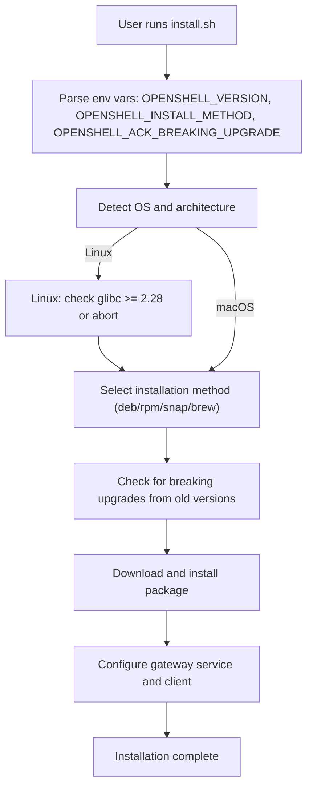
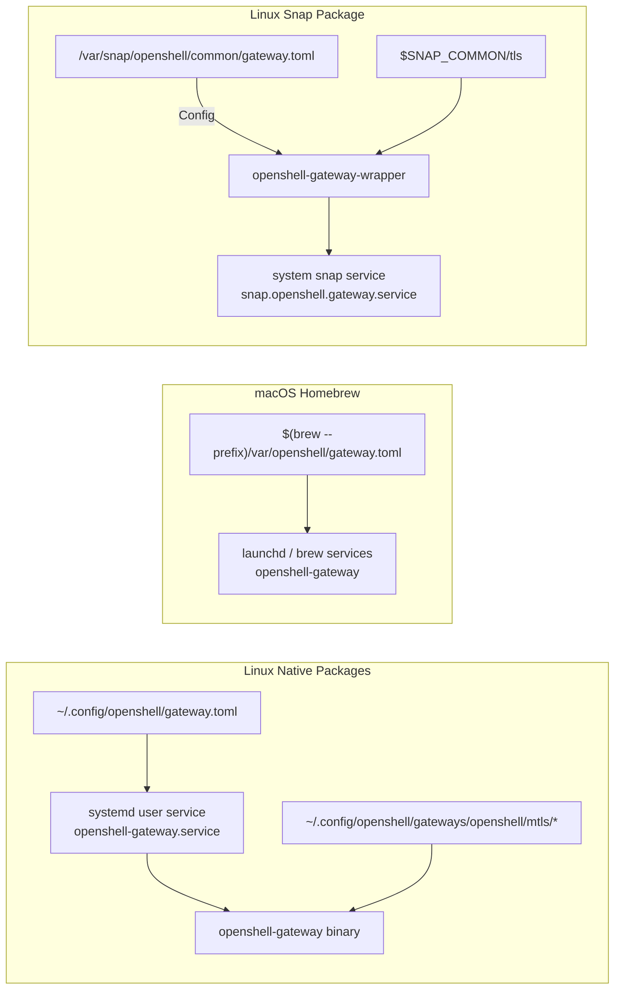
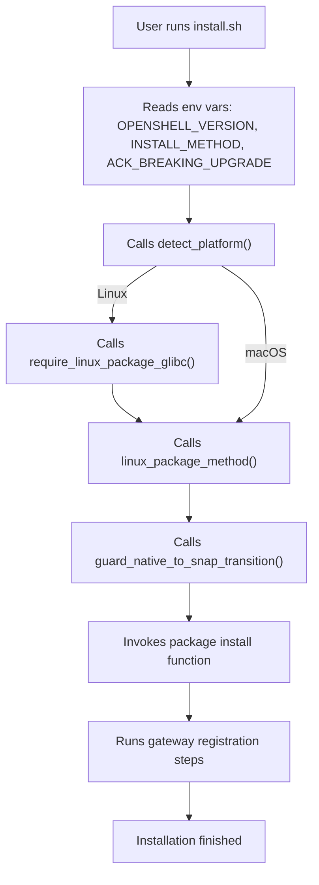
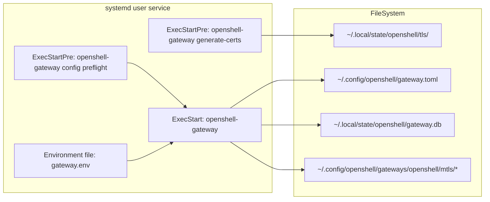

<!-- source: DeepWiki mcp.deepwiki.com · repo NVIDIA/OpenShell · page 2.1 Installation · fetched 2026-10-26 -->

# Installation

Relevant source files

The following files were used as context for generating this wiki page:

- [.agents/skills/test-release-canary/SKILL.md](.agents/skills/test-release-canary/SKILL.md)
- [.github/workflows/build-rpm.yml](.github/workflows/build-rpm.yml)
- [.github/workflows/package-release-binaries.yml](.github/workflows/package-release-binaries.yml)
- [.github/workflows/release-canary.yml](.github/workflows/release-canary.yml)
- [.github/workflows/rpm-package.yml](.github/workflows/rpm-package.yml)
- [.github/workflows/snap-package.yml](.github/workflows/snap-package.yml)
- [.packit.yaml](.packit.yaml)
- [deploy/rpm/CONFIGURATION.md](deploy/rpm/CONFIGURATION.md)
- [deploy/rpm/QUICKSTART.md](deploy/rpm/QUICKSTART.md)
- [deploy/rpm/TROUBLESHOOTING.md](deploy/rpm/TROUBLESHOOTING.md)
- [deploy/rpm/gateway.toml.default](deploy/rpm/gateway.toml.default)
- [docs/about/installation.mdx](docs/about/installation.mdx)
- [docs/about/support-matrix.mdx](docs/about/support-matrix.mdx)
- [docs/how-it-works/policies/prover.mdx](docs/how-it-works/policies/prover.mdx)
- [install.sh](install.sh)
- [nix/test-guest/cache-seal.sh](nix/test-guest/cache-seal.sh)
- [nix/test-guest/configuration/snapd.yml](nix/test-guest/configuration/snapd.yml)
- [nix/test-guest/scripts/snap-gateway-repro.sh](nix/test-guest/scripts/snap-gateway-repro.sh)
- [openshell.spec](openshell.spec)
- [snapcraft.yaml](snapcraft.yaml)
- [tasks/scripts/test-install-sh.sh](tasks/scripts/test-install-sh.sh)
- [tasks/scripts/test-packaging-assets.sh](tasks/scripts/test-packaging-assets.sh)

This page documents the OpenShell installation process, including the `install.sh` script mechanics, native package distribution (RPM/Debian/Homebrew/Snap), version selection environment variables, upgrade guards, and gateway service bootstrapping with PATH setup. For detailed platform and kernel requirements, see [System Requirements](2.3).

---

## Installation Methods

OpenShell supports multiple installation methods that target various platforms and packaging formats.

| Method | Command | Platform Support |
|--------|---------|------------------|
| **Unified Installer Script** | `curl -LsSf https://raw.githubusercontent.com/NVIDIA/OpenShell/main/install.sh \| sh` | Linux (glibc), macOS (Apple Silicon) [install.sh:1-100]() |
| **Homebrew Tap** | `brew install nvidia/openshell/openshell` | macOS (Apple Silicon) [install.sh:19-26]() |
| **Snap Package** | `sudo snap install openshell` | Linux (Ubuntu and other distros) [snapcraft.yaml:4-99]() |
| **RPM Package (Fedora/RHEL)** | `sudo dnf install openshell` | x86_64, aarch64 [docs/about/installation.mdx:59-61]() |
| **Debian Package (Ubuntu/Debian)** | `sudo apt install ./openshell.deb` | x86_64, aarch64 [docs/about/installation.mdx:61-63]() |

The recommended entry point for most users is the unified installer shell script (`install.sh`). This script auto-detects the host environment and picks the appropriate package type for installation, simplifying the process [install.sh:7-94]().

---

## `install.sh` Script Overview

The `install.sh` shell script implements a robust, cross-platform installer for OpenShell. It handles version selection, platform detection, native package selection, dependency verification, and installation orchestration.

**Details:**

- **Version Selection**:  
  The installer honors the `OPENSHELL_VERSION` environment variable to install a specific release.  
  - If unset, installs latest tagged release.  
  - Special values supported:  
    - `dev`: rolling development builds  
    - `pre`: latest prerelease requiring authenticated GitHub CLI session  
  [install.sh:16-39]()

- **Platform Detection**:  
  Uses `uname` and other heuristics to detect OS type and architecture, focusing on Linux x86_64/aarch64 and macOS Apple Silicon (arm64).  
  [install.sh:150-180]()

- **glibc Compatibility**:  
  On Linux, `install.sh` verifies glibc version via `ldd --version` or fallback `getconf GNU_LIBC_VERSION` and prohibits installation if glibc < 2.28 or if musl libc is detected.  
  This avoids runtime incompatibilities with the provided Debian or RPM packages.  
  [install.sh:161-220]()

- **Package Method Selection**:  
  Linux package method defaults to `.deb` on Debian/Ubuntu or `.rpm` on Fedora/RHEL unless overridden by `OPENSHELL_INSTALL_METHOD` environment variable (`deb`, `rpm`, or `snap`). The installer prefers native packages for release and prerelease versions, falling back to Snap for `dev` builds unless explicitly opted in.  
  Snap installs require a Docker Engine installed from the system packages, not the Docker snap.  
  [install.sh:229-282, 320-370]()

- **Upgrade Guard**:  
  Detects if an existing native (non-snap) OpenShell installation exists with version < 0.0.37 (breaking release). In such cases, installation with snap is blocked unless `OPENSHELL_ACK_BREAKING_UPGRADE=1` is set by the user acknowledging upgrade steps.  
  This prevents silent incompatible migrations [install.sh:285-315]().

- **Installation Execution**:  
  Downloads the selected package asset from the GitHub release artifacts and installs it using native package tools (`dpkg -i` for Debian, `dnf install` or `rpm -i` for RPM, or `brew install` for macOS) [install.sh:371-420]().

- **Gateway Registration and Setup**:  
  After installation, the gateway is configured and started automatically by the system package service manager or Homebrew services. Client certificates are registered so the CLI can communicate securely.  
  The installer manages environment variables and PATH adjustments as appropriate.  
  [install.sh:420-480]().

---

## Packaging Formats

### RPM and Debian Packages

OpenShell ships prebuilt `.rpm` and `.deb` packages for supported Linux distributions:

- The RPM package contains:
  - `openshell` CLI binary
  - `openshell-gateway` service binary
  - Standalone `openshell-prover` binary for local policy validation
  - Systemd user service unit (`openshell-gateway.service`) that launches the gateway in user context
  - Default gateway TOML configurations that are seeded on first startup
  - Migration script for config schema changes at upgrades

- The Debian package is similar, with appropriate control files and systemd units under `~/.config/openshell`.

Both package types declare requirements on Podman or Docker engines as runtime dependencies.  
[openshell.spec:40-180](), [docs/about/installation.mdx:89-102]()

---

### Snap Package

The Snap package (`openshell`) supports Linux across distributions with `snapd`:

- Contains `openshell` CLI, `openshell.term` terminal UI, standalone `openshell.prover`, and `openshell.gateway` service
- Runs gateway as a system snap service at port 17670
- Requires a system Docker daemon from system packages — Docker snap is incompatible
- Shipment includes the `openssh-client` binary to avoid relying on host ssh keys for sandbox session connectivity
- Uses strict confinement with plugs for `home`, `network`, `system-observe`, and `docker`
- Provides policy-enforced refresh that preserves active sandbox sessions via `refresh-mode: endure` setting
- Installation instructions include manually copying client TLS certificates for trusted users and registering the local gateway with the CLI

Snap packages do **not** migrate state or configuration from native Debian or RPM installs and require manual cleanup before migration.  
[snapcraft.yaml:4-174](), [docs/about/installation.mdx:105-134]()

---

### Homebrew Packaging (macOS)

For Apple Silicon macOS:

- The installer installs the release Homebrew formula `nvidia/openshell/openshell`.
- The formula includes CLI binaries, the `openshell-gateway` daemon, and the experimental VM runtime driver.
- The gateway runs as a Homebrew service bound to `https://localhost:17670`
- Configuration files are located either at `~/.config/openshell/gateway.toml` or the Homebrew global config path.
- Gateway client certificates are automatically handled by the Homebrew service lifecycle.

Homebrew taps provide a seamless user experience with service management integration.  
[install.sh:19-26](), [docs/about/installation.mdx:76-86]()

---

## Upgrade Guards and Version Selection

### Environment Variables Control

- `OPENSHELL_VERSION`:  
  Defines the release tag or special build to install (default latest stable).  
  Supported special values: `dev` (rolling development), `pre` (prerelease).  
  [install.sh:16-39]()

- `OPENSHELL_INSTALL_METHOD`:  
  On Linux, selects package format: `snap`, `deb`, or `rpm`. Defaults to native package selection based on distro.  
  [install.sh:230-260]()

- `OPENSHELL_ACK_BREAKING_UPGRADE`:  
  Must be explicitly set to `1` to acknowledge an upgrade from pre-v0.0.37 native installs to snap installs, preventing accidental state incompatibility.  
  [install.sh:285-315]()

### Upgrade Guard Mechanics

The script checks if there is an existing native `openshell` CLI binary with version less than the breaking release minimum (`0.0.37`), and if so, it refuses to proceed with snap installation unless the user acknowledges the upgrade manually.

This prevents silent transition issues to snaps with isolated state and TLS bundles.  
[install.sh:285-315]()

---

## Gateway Service Setup and PATH Configuration

The gateway service is bootstrapped differently depending on OS and package method:

| Platform | Service Manager | Service Type | Config Location | TLS and Client Certs |
|----------|-----------------|--------------|-----------------|---------------------|
| Linux (deb/rpm) | systemd user service | `openshell-gateway.service` | `~/.config/openshell/gateway.toml` | `~/.config/openshell/gateways/openshell/mtls/` with PKI generated on first start |
| macOS (Homebrew) | launchd via `brew services` | `openshell-gateway` Homebrew service | `~/.config/openshell/gateway.toml` or Homebrew prefix | Client certs auto-placed by Homebrew |
| Linux (Snap) | system snap service | `snap.openshell.gateway.service` | `/var/snap/openshell/common/gateway.toml` | TLS bundle at `$SNAP_COMMON/tls`, handled by snap wrapper |

**Key Points:**

- The **gateway service** user unit or service wrapper generates PKI (*mTLS*) certificates on first launch automatically via the command `openshell-gateway generate-certs`.
- Service execution includes a "config preflight" check to validate the gateway TOML before startup.
- Client certificates are stored in user home directories for native installs, enabling CLI zero-config mTLS authentication.
- The Snap package uses a gateway wrapper that overrides default TLS environment variables, isolates the package state, and carefully manages systemd service restart policies to avoid killing sandboxes during snap refresh.
- Environment variables such as `OPENSHELL_LOCAL_TLS_DIR` and `OPENSHELL_TELEMETRY_ENABLED` are injected into the service environment.
- The CLI installs in standard binary directories and updates the user's PATH automatically for immediate usage.

---

## Environment Variables Summary

| Variable                  | Usage Description                                            | Default Value / Behavior                              |
|---------------------------|--------------------------------------------------------------|------------------------------------------------------|
| `OPENSHELL_VERSION`       | Release tag or special build to install (`dev`, `pre`)       | Latest stable release if unset [install.sh:16-24]()  |
| `OPENSHELL_INSTALL_METHOD`| Package install method on Linux (`deb`, `rpm`, `snap`)       | Auto-detect native package manager [install.sh:230-260]() |
| `OPENSHELL_ACK_BREAKING_UPGRADE` | Acknowledge upgrade from pre-0.0.37 native installs      | Must be unset or `1` to allow snap install [install.sh:285-315]() |
| `OPENSHELL_DRIVERS`       | Compute driver override (e.g., `vm`, `docker`)                | Auto-detect [docs/about/installation.mdx:33]()       |
| `OPENSHELL_LOCAL_TLS_DIR` | Directory path for local TLS certificates                     | `~/.local/state/openshell/tls` by default             |
| `OPENSHELL_TELEMETRY_ENABLED` | Enable/disable anonymous telemetry                        | Enabled by default, can be disabled                    |

---

## Post-Installation Verification

After installation completes, verify the following:

| Checkpoint              | Command Example                                   | Notes                                |
|-------------------------|-------------------------------------------------|------------------------------------|
| Gateway service status  | `systemctl --user status openshell-gateway`     | Linux RPM/Debian packages           |
|                         | `brew services list`                             | macOS Homebrew                      |
|                         | `snap services openshell.gateway`                | Snap package                       |
| CLI connectivity         | `openshell status`                               | Should connect securely to gateway |
| Sandbox lifecycle example| Create/exec/delete a test sandbox via CLI       | Confirming sandbox driver integration  |
| Gateway logs             | `journalctl --user -u openshell-gateway -f`     | Real-time service logs on Linux     |
|                         | `brew services logs openshell`                   | macOS Homebrew                      |
|                         | `snap logs openshell.gateway`                     | Snap package                        |

---

## Diagrams Bridging Natural Language and Code Entities

### 1. Installation Workflow to Script Implementation

- `detect_platform` identifies OS and architecture.  
- `require_linux_package_glibc` verifies glibc version for Linux installs.  
- `linux_package_method` decides package format based on user input and system detection.  
- `guard_native_to_snap_transition` ensures safe upgrade path.  
- Installation invokes appropriate package manager commands.  
- Gateway registration adds the service and configures mTLS certs on first run.  
[install.sh:150-230, 285-315, 320-480]()

---

### 2. Gateway Service Startup Components

- The user service executes preflight and cert-generation before gateway daemon start.  
- Configuration is persisted and migrated under user home directory.  
- Client certificates enable secure CLI to gateway communication.  
[docs/about/installation.mdx:130-160](), [openshell.spec:120-160]()

---

## Summary

- **Installer**: The `install.sh` script provides a single command installation that auto-detects platform and suitable package for OpenShell.  
- **Packaging**: Packages exist as native Debian, RPM, Snap, and Homebrew formula.  
- **Versioning**: User-controlled environment variables allow pinning to dev, prerelease, or stable releases.  
- **Upgrade Safety**: Guards prevent silent incompatible transitions from native installs to snap.  
- **Service Setup**: The gateway runs as a systemd user service on Linux or a launchd service on macOS, with automatic PKI generation and config preflight validations.  
- **PATH & Certificates**: Installation ensures CLI usability with proper PATH and client certificate discovery for zero-config secure operation.

---

# References  
|| File | Lines | Description |  
|---|---------|------------------|-------------|  
|1|install.sh|1-480|Installer script: main mechanics, platform detection, glibc checking, package selection, upgrade guards, install calls|  
|2|docs/about/installation.mdx|1-158|Installation user guides, environment variables, gateway service details|  
|3|snapcraft.yaml|1-180|Snap package definition, confinement, apps included, gateway wrapper and refresh mode|  
|4|openshell.spec|1-160|RPM packaging spec, gateway service unit, config management|  
|5|tasks/scripts/test-install-sh.sh|1-198|Test coverage of glibc checks and package method selection, upgrade guard|  

Sources:  
[install.sh:1-480](), [docs/about/installation.mdx:1-158](), [snapcraft.yaml:1-174](), [openshell.spec:1-160](), [tasks/scripts/test-install-sh.sh:1-198]()

---

