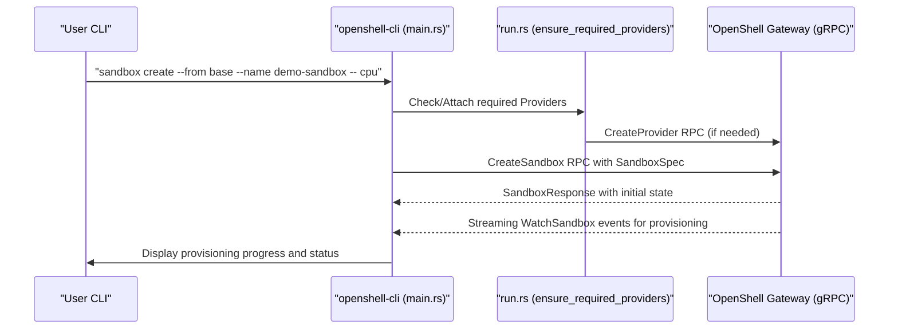
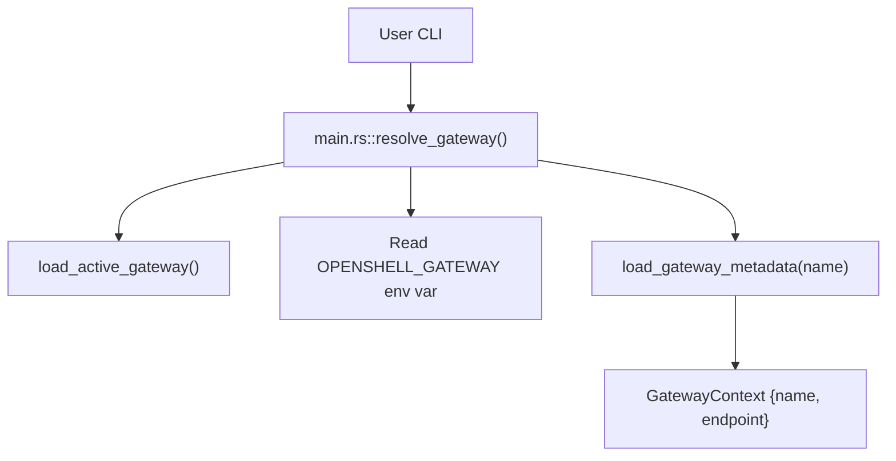
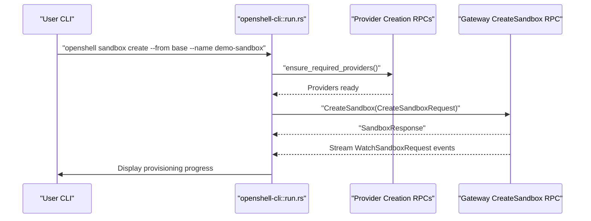

<!-- source: DeepWiki mcp.deepwiki.com · repo NVIDIA/OpenShell · page 2.2 Creating Your First Sandbox · fetched 2026-10-26 -->

# Creating Your First Sandbox

<details>
<summary>Relevant source files</summary>

The following files were used as context for generating this wiki page:

- [crates/openshell-cli/src/main.rs](crates/openshell-cli/src/main.rs)
- [crates/openshell-cli/src/run.rs](crates/openshell-cli/src/run.rs)
- [crates/openshell-cli/tests/provider_commands_integration.rs](crates/openshell-cli/tests/provider_commands_integration.rs)
- [crates/openshell-cli/tests/sandbox_create_lifecycle_integration.rs](crates/openshell-cli/tests/sandbox_create_lifecycle_integration.rs)
- [crates/openshell-server/src/compute/mod.rs](crates/openshell-server/src/compute/mod.rs)
- [crates/openshell-server/src/grpc/policy.rs](crates/openshell-server/src/grpc/policy.rs)
- [crates/openshell-server/src/grpc/provider.rs](crates/openshell-server/src/grpc/provider.rs)
- [crates/openshell-server/src/grpc/sandbox.rs](crates/openshell-server/src/grpc/sandbox.rs)
- [crates/openshell-server/src/storage_proto.rs](crates/openshell-server/src/storage_proto.rs)
- [examples/policy-advisor/README.md](examples/policy-advisor/README.md)
- [examples/policy-advisor/ctf.py](examples/policy-advisor/ctf.py)
- [examples/sandbox-policy-quickstart/README.md](examples/sandbox-policy-quickstart/README.md)
- [examples/sandbox-policy-quickstart/demo.sh](examples/sandbox-policy-quickstart/demo.sh)
- [examples/sandbox-policy-quickstart/policy.yaml](examples/sandbox-policy-quickstart/policy.yaml)
- [proto/openshell.proto](proto/openshell.proto)
- [providers/pypi.yaml](providers/pypi.yaml)
- [scripts/smoke-test-network-policy.sh](scripts/smoke-test-network-policy.sh)
- [sdk/go/proto/openshellv1/openshell.pb.go](sdk/go/proto/openshellv1/openshell.pb.go)
- [skills/generate-sandbox-policy/examples.md](skills/generate-sandbox-policy/examples.md)

</details>


This page provides a comprehensive technical walkthrough of creating your first OpenShell sandbox. It covers the full process: registering and selecting a gateway, creating a sandbox, configuring providers for credential injection, and interacting with the sandbox via the CLI.

This includes the core implementation behind command invocation, RPC invocations, data flow between components, and sandbox lifecycle tracking.

For installation steps, see [Installation](2.1). For sandbox architecture and policy enforcement internals, see [Sandbox System](6).

---

## Prerequisites

Before starting sandbox creation, ensure the following prerequisites:

- **OpenShell CLI Installed:** Confirm with `openshell --version`. The CLI codebase entrypoint is [`crates/openshell-cli/src/main.rs`](crates/openshell-cli/src/main.rs:1-187) and command implementations reside in [`run.rs`](crates/openshell-cli/src/run.rs:1-167).
- **Active Gateway Registered and Selected:** The gateway is the central control plane. You must have one added and selected in CLI state. The CLI resolves the active gateway via environment, config files, or CLI flags ([`main.rs:78-126`](crates/openshell-cli/src/main.rs:78-126)).
- **Compute Driver Setup:** The gateway must have a configured compute driver backend (Docker, Podman, Kubernetes, MicroVM, etc.) responsible for sandbox lifecycle ([`crates/openshell-server/src/compute/mod.rs`](crates/openshell-server/src/compute/mod.rs:1-175)).
- **Provider Credentials Ready:** Prepare credentials for providers (e.g., OpenAI or Anthropic API keys). These are securely stored, managed, and attached to sandboxes ([`crates/openshell-cli/src/run.rs:24-35`](crates/openshell-cli/src/run.rs:24-35)).

Sources: [crates/openshell-cli/src/main.rs:78-126](), [crates/openshell-cli/src/run.rs:24-35](), [crates/openshell-server/src/compute/mod.rs:1-175]()

---

## Gateway Registration & Selection

Gateways serve as the control plane for sandbox provisioning and management. The CLI must resolve which gateway to target for commands.

### Gateway Resolution Mechanism

The CLI resolves the active gateway through this priority order in [`main.rs`]():

1. `--gateway-endpoint` CLI flag with optional explicit gateway name.
2. `--gateway` CLI flag specifying registered gateway name.
3. `OPENSHELL_GATEWAY` environment variable.
4. Active gateway saved in `~/.config/openshell/active_gateway`.

The function `resolve_gateway()` implements this logic, returning a `GatewayContext` containing gateway name and endpoint URL. If a direct endpoint is provided, the CLI attempts to find a metadata record matching it or uses the raw URL as the name ([`main.rs:78-126`](crates/openshell-cli/src/main.rs:78-126)).

### Authentication Application

Before RPCs, the CLI applies authentication tokens based on gateway auth mode, supporting Cloudflare Access JWT or OIDC tokens, loading stored tokens transparently ([`main.rs:159-184`](crates/openshell-cli/src/main.rs:159-184)).

---

## Creating a Sandbox

The core user operation is `openshell sandbox create`, implemented primarily in [`run.rs`](crates/openshell-cli/src/run.rs), which calls the gateway’s `CreateSandbox` gRPC endpoint ([`proto/openshell.proto:47-54`](proto/openshell.proto:47-54)).

### Command Flow & Implementation

- The CLI starts parsing the `sandbox create` command.
- If an agent is specified on the command line, the CLI uses `ensure_required_providers()` to confirm required providers are registered and attached ([`run.rs:24-27`](crates/openshell-cli/src/run.rs:24-27)).
- The CLI sends a `CreateSandboxRequest` proto message to the gateway, specifying sandbox name, image, resource limits (CPU, memory, GPU), and environment.
- The gateway validates the sandbox spec and responds with the created sandbox info ([`proto/openshell.proto:47`](proto/openshell.proto:47)).
- The CLI watches sandbox provisioning progress via the `WatchSandboxRequest` stream, displaying interactive progress ([`run.rs:10-18`](crates/openshell-cli/src/run.rs:10-18)).

#### Example CLI command:

```bash
openshell sandbox create --from base --name demo-sandbox -- cpu
```

### Data Flow Diagram: User Command to Sandbox Creation



Sources: [crates/openshell-cli/src/main.rs:78-126](), [crates/openshell-cli/src/run.rs:24-35](), [proto/openshell.proto:47-54]()

---

## Provider Setup and Attachment

Providers supply credentials securely injected into sandbox environments.

### Provider Lifecycle During Sandbox Creation

- When the sandbox creation detects missing providers (e.g., for an LLM agent), it prompts or orchestrates provider creation from credentials.
- The CLI creates new provider records via `CreateProvider` RPC ([`proto/openshell.proto:213-230`](proto/openshell.proto:213-230)), handled by the gateway.
- Providers are attached to the sandbox via `AttachSandboxProvider` RPC to associate credentials with that sandbox session ([`proto/openshell.proto:124-131`](proto/openshell.proto:124-131)).
- Providers include types such as `anthropic`, `openai`, or custom environment key-value mappings.
- Provider creation and attachment details are managed within `run.rs` commands ([`run.rs:24-35`](crates/openshell-cli/src/run.rs:24-35)).

### Provider Data Structures

- `Provider` proto message contains credentials and configuration.
- Providers manage credential handles internally for refresh and security.
- Credential injection happens automatically inside sandbox environments on startup.

Sources: [crates/openshell-cli/src/run.rs:24-35](), [proto/openshell.proto:213-230](), [proto/openshell.proto:124-131]()

---

## Sandbox Provisioning Lifecycle and Status Tracking

The sandbox lifecycle phases are represented by the `SandboxPhase` enum, such as `PROVISIONING`, `READY`, `ERROR`, `DELETING` ([`proto/openshell.proto:92-132`](proto/openshell.proto:92-132)).

### State Machine of Sandbox Lifecycle

```mermaid
stateDiagram-v2
    [*] --> Provisioning : "CreateSandbox"
    Provisioning --> Ready : "SandboxPhase::READY"
    Provisioning --> Error : "SandboxPhase::ERROR"
    Ready --> Stopping : "StopSandbox"
    Stopping --> Stopped : "SandboxPhase::STOPPED"
    Stopped --> Starting : "StartSandbox"
    Starting --> Ready : "SandboxPhase::READY"
    Ready --> Deleting : "DeleteSandbox"
    Deleting --> [*]
```

- CLI monitors provisioning using gRPC streams (`WatchSandboxRequest`) to receive phase transitions.
- Error messages and detailed progress are extracted from sandbox conditions.
- Interactive CLI progress is managed via `ProvisioningDisplay` and status messages ([`run.rs:10-18`](crates/openshell-cli/src/run.rs:10-18)).

### Handling Provisioning Feedback

The CLI uses utilities like `handle_platform_progress_event()` to present interactive progress bars and status messages for end-user clarity ([`run.rs:11-16`](crates/openshell-cli/src/run.rs:11-16)).

Sources: [proto/openshell.proto:92-132](), [crates/openshell-cli/src/run.rs:10-18]()

---

## Connecting and Interacting with the Sandbox

Once `READY`, sandboxes are accessible for SSH, one-shot commands, and file sync.

### Connecting via SSH

The CLI facilitates interactive connections with the sandbox using an embedded SSH proxy client:

- The client calls `CreateSshSession` on the gateway, which returns a `SshRelayTarget` forwarding to the sandbox supervisor ([`proto/openshell.proto:198-200`](proto/openshell.proto:198-200), [`crates/openshell-cli/src/ssh.rs`](crates/openshell-cli/src/run.rs:94-118)).
- The CLI implements a local proxy (`sandbox_ssh_proxy`) that sets up a standard SSH client conn over this relay.
- Users may run `openshell sandbox connect <name>` for full login shell access.

### Executing Commands Without Persisted Terminal

`openshell sandbox exec` runs a command in the sandbox directly via the `ExecSandbox` streaming RPC ([`proto/openshell.proto:209-211`](proto/openshell.proto:209-211)).

### File Sync, Port Forwarding, and Services

The CLI supports syncing files up/down and port forwarding to sandbox services using commands wrapping gRPC methods ([`run.rs:97-98`](crates/openshell-cli/src/run.rs:97-98)).

---

## Summary Table of Key CLI Commands and Corresponding RPCs

| CLI Command         | RPC Method                          | Role                                                        |
|---------------------|-----------------------------------|-------------------------------------------------------------|
| `gateway add`       | `AddGateway` (gateway.proto)      | Register and store a gateway endpoint                      |
| `gateway select`    | N/A (local preference)             | Choose active gateway for CLI commands                      |
| `sandbox create`    | `CreateSandbox`                   | Provision new sandbox environment                            |
| `sandbox connect`   | `CreateSshSession`                | Establish interactive remote SSH session                    |
| `sandbox exec`      | `ExecSandbox`                    | Execute single command with streamed output                 |
| `provider create`   | `CreateProvider`                  | Register credential provider used for sandbox environment   |
| `sandbox provider attach` | `AttachSandboxProvider`         | Attach a provider to a sandbox’s environment                 |

Sources: [proto/openshell.proto:22-230](), [crates/openshell-cli/src/run.rs:24-35](), [crates/openshell-cli/src/ssh.rs:4-184]()

---

# Diagrams Bridging Natural Language to Code

### 1. Gateway Registration and CLI Gateway Context Resolution



### 2. Sandbox Creation Flow from CLI to Gateway RPC



---

This completes the detailed walkthrough for creating your first OpenShell sandbox, covering gateway registration, sandbox provisioning, provider setup, and CLI interaction.

Sources:  
- [crates/openshell-cli/src/main.rs:25-126]()  
- [crates/openshell-cli/src/run.rs:10-35]()  
- [proto/openshell.proto:23-230]()  
- [crates/openshell-server/src/compute/mod.rs:1-175]()  
- [crates/openshell-cli/src/ssh.rs:4-184]()

---

