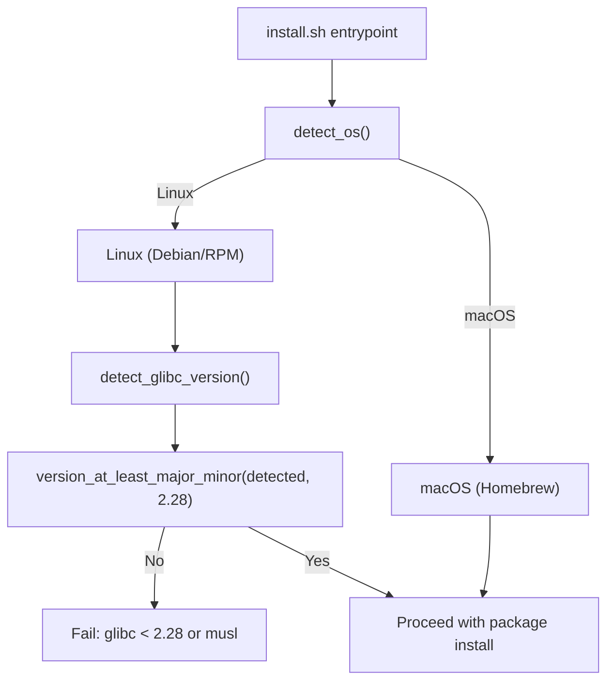
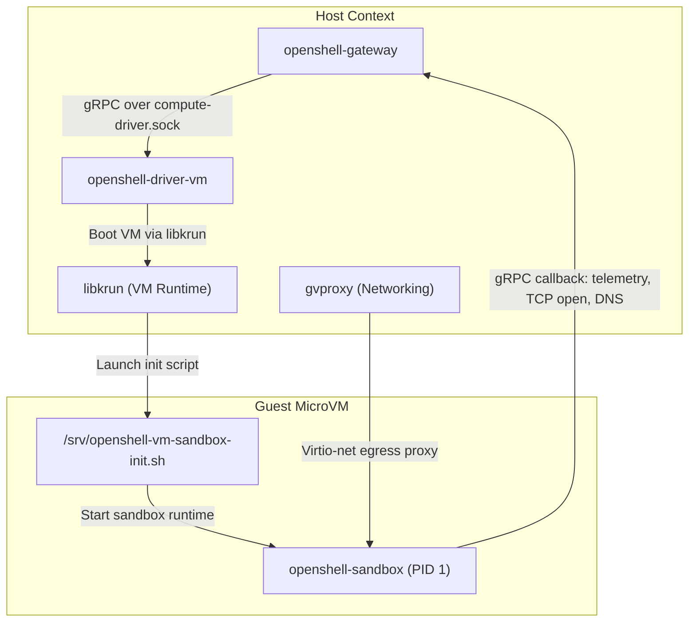
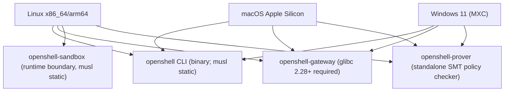
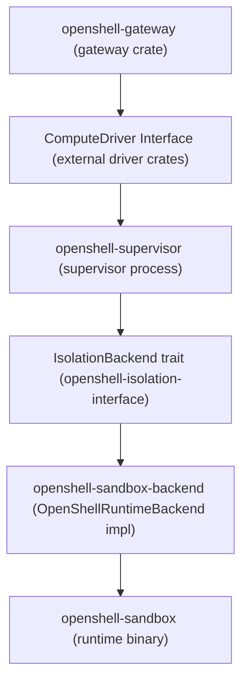

<!-- source: DeepWiki mcp.deepwiki.com · repo NVIDIA/OpenShell · page 2.3 System Requirements · fetched 2026-10-26 -->

# System Requirements

Relevant source files

The following files were used as context for generating this wiki page:

- [.github/workflows/snap-package.yml](.github/workflows/snap-package.yml)
- [docs/about/overview.mdx](docs/about/overview.mdx)
- [docs/about/support-matrix.mdx](docs/about/support-matrix.mdx)
- [docs/extensibility/drivers.mdx](docs/extensibility/drivers.mdx)
- [docs/extensibility/isolation-backends.mdx](docs/extensibility/isolation-backends.mdx)
- [docs/how-it-works/inference.mdx](docs/how-it-works/inference.mdx)
- [docs/how-it-works/policies/default-policy.mdx](docs/how-it-works/policies/default-policy.mdx)
- [docs/how-it-works/policies/overview.mdx](docs/how-it-works/policies/overview.mdx)
- [docs/how-it-works/policies/prover.mdx](docs/how-it-works/policies/prover.mdx)
- [docs/how-it-works/providers/profiles.mdx](docs/how-it-works/providers/profiles.mdx)
- [docs/index.mdx](docs/index.mdx)
- [docs/index.yml](docs/index.yml)
- [docs/kubernetes/ingress.mdx](docs/kubernetes/ingress.mdx)
- [docs/security/best-practices.mdx](docs/security/best-practices.mdx)

This page documents the platform, software, kernel, and hardware requirements for running OpenShell. It covers host system prerequisites, compute driver requirements (Docker, Podman, MicroVM, Kubernetes, and Windows MXC), kernel security features, as well as runtime dependencies and packaging considerations.

For installation instructions, see [Installation](2.1). For deployment topology options (local, remote, cloud), see [Gateway Deployment](5.1).

## Platform Support

OpenShell supports Linux, macOS, and Windows host systems. The CLI and container images are built for multiple architectures to enable deployment across developer workstations, cloud instances, and edge hardware. The main supported platforms are:

| Platform                      | Architecture            | Status       | Notes                                                         |
|-------------------------------|------------------------|--------------|---------------------------------------------------------------|
| Linux (Debian/Ubuntu)          | x86_64 (amd64)          | Supported    | Requires glibc >= 2.28 for gateway binaries                   |
| Linux (Debian/Ubuntu)          | aarch64 (arm64)         | Supported    | Common on ARM servers and edge devices                         |
| macOS                         | Apple Silicon (arm64)   | Supported    | Supports Hypervisor.framework for VM driver                    |
| Windows 11                   | x86_64                  | Supported    | Via MXC (Microsoft Execution Containers) driver               |

OpenShell's CLI binary for Linux is a static musl build and does **not** depend on glibc at runtime, making it lightweight and portable across Linux distributions. However, the `openshell-gateway` binary requires glibc version 2.28 or newer on Linux systems. Compatible Linux distributions include Ubuntu 20.04+, RHEL 8+, Rocky Linux 8+, Amazon Linux 2023+, and Fedora 32+.

### Platform Detection Logic in install.sh

The installation script performs detection of the host OS and libc version to determine installation feasibility and paths.

**Sources:** [architecture/build.md:78-95](), [install.sh:22-24,171-218](), [snapcraft.yaml:52-59](), [docs/about/installation.mdx:43-84]()

## Supported Compute Drivers

The OpenShell gateway supports multiple compute drivers responsible for sandbox lifecycle management. The choice of compute driver significantly affects system requirements and runtime guarantees.

| Compute Driver | System Requirements | Status |
|----------------|---------------------|--------|
| **Docker** | Docker Desktop or Docker Engine 28.0+ on the gateway host; Linux or Windows (WSL 2). | Supported |
| **Podman** | Linux with Podman 5.x+, cgroups v2, user socket access, rootless networking setup. | Supported |
| **MicroVM (VM)** | Host must support virtualization: Hypervisor.framework (macOS) or KVM (Linux). | Experimental |
| **Kubernetes** | Kubernetes cluster and Helm v3+; cluster config and permissions. | Supported |
| **Microsoft Execution Containers (MXC)** | Windows 11 with MXC support; integrated with Windows sandbox capabilities. | Supported |

### MicroVM Runtime Requirements

The MicroVM runtime uses the `openshell-driver-vm` compute driver with `libkrun` as the embedded VM runtime. Key requirements and components include:

- **Host Virtualization**: Uses native Hypervisor.framework on macOS or KVM on Linux.
- **Networking**: Uses `gvproxy` to provide virtio-net egress and loopback NAT inside the VM.
- **GPU Passthrough**: Supports VFIO-based GPU passthrough requires kernel support and host permissions to bind/unbind devices.
- **Sandbox-init**: Guest initialization script launches the sandbox runtime as PID 1 and enforces boundaries.
- **Sandbox Runtime**: The trusted workload boundary binary `openshell-sandbox` orchestrates agent process management and enforces isolation.

**Sources:** [docs/about/installation.mdx:31-41](), [crates/openshell-driver-vm/README.md:1-110, 143-146]()

## Kernel Security Features

OpenShell relies on Linux kernel security facilities to enforce sandbox isolation with defense in depth.

### Landlock LSM (Linux Security Module)

- Landlock enables sandbox processes (the `openshell-sandbox` runtime) to create fine-grained, user-level filesystem policies.
- Landlock restricts reads, writes, and mounts to declared paths, preventing unauthorized filesystem access.
- OpenShell requires Landlock ABI version 3 or higher for protected baseline paths.
- Policies are locked at sandbox creation and require sandbox recreation to modify.

### seccomp (Secure Computing Mode)

- seccomp filters used to restrict Linux syscalls that may lead to sandbox escapes or privilege escalation.
- OpenShell applies seccomp BPF filters at sandbox creation.
- With privilege dropping to a non-root user (`setuid`/`setgid`), seccomp adds a critical protection layer.

These kernel security features combined provide strong kernel-level guarantees for process, filesystem, and network isolation for workloads running inside sandboxes.

**Sources:** [docs/security/best-practices.mdx:23-36](), [docs/extensibility/isolation-backends.mdx:8-48]()

## Runtime Dependencies and Packaging

### Required Libraries and Binaries

- **glibc >= 2.28**: Required for gateway and non-static supervisor binaries on Linux. This requirement is enforced by install scripts and packaging metadata.
- **Static musl binaries**: The `openshell` CLI and `openshell-sandbox` runtime binaries are statically linked to musl for portability across Linux distros.
- **Snapd**: Required for Snap users; the Snap package connects to the Docker daemon via plugs and slots. Snap also bundles most dependencies.

### Packaging Formats Supported

| Package Type | Supported Platforms | Notes |
|--------------|---------------------|-------|
| DEB | Ubuntu, Debian | Packages require glibc >= 2.28 |
| RPM | RHEL, Fedora, Rocky | Same requirements as DEB |
| Snap | Linux (amd64, arm64) | Auto-updating; requires snapd and manual Docker slot connection |
| Homebrew | macOS (arm64) | Installs latest CLI and supervisor dependencies |

### Configuration File Discovery

The gateway and CLI search for `gateway.toml` configuration from multiple locations for flexibility:

| Location                    | Notes                       |
|-----------------------------|-----------------------------|
| `~/.config/openshell/gateway.toml` | User config on Linux/macOS    |
| `$SNAP_COMMON/gateway.toml`          | Snap specific config on Linux |
| `/opt/homebrew/var/openshell/gateway.toml` | Homebrew on macOS               |

### CI and Testing Dependencies

- **Mise** is used as the task runner for local and CI tasks.
- **Cargo Zigbuild** for cross-compilation to musl static targets used in packaging and release artifacts.

**Sources:** [install.sh:22-24,171-218](), [snapcraft.yaml:19-59](), [docs/about/installation.mdx:43-100](), [architecture/build.md:81-87,101-113]()

## Docker and Podman Specifics

### Docker

- Docker Desktop or Engine 28.0+ required on the gateway host for Linux or WSL2 Windows.
- Requires Docker socket access for the compute driver gRPC communication.
- Images and containers run with the `openshell-sandbox` runtime injected.
- GPU acceleration requires NVIDIA Container Toolkit and device plugin on the host.

### Podman

- Linux hosts only.
- Requires Podman 5.x or newer with rootless cgroups v2 support.
- The rootless networking setup is necessary to allow container ingress and egress.
- The compute driver communicates with Podman via its local socket.

These container runtimes provide the isolation foundation, with OpenShell applying additional kernel-enforced policy layers.

**Sources:** [docs/about/installation.mdx:36-38]()

## Diagrams Relating System Components to Code Entities

### Diagram 1: System Platform Support Corresponding Code Artifacts

**Sources:** [architecture/build.md:78-95](), [install.sh:22-24,171-218](), [docs/about/installation.mdx:43-84]()

### Diagram 2: Compute Driver and Isolation Backend Interaction in Code

**Explanation:**  
- The gateway orchestrates sandbox lifecycles and calls the compute driver.  
- The compute driver (Docker, Podman, Kubernetes, VM, MXC) manages resource creation and fencing.  
- The supervisor process manages policy enforcement and process lifecycle.  
- The `IsolationBackend` trait is the runtime abstraction interface implemented by `openshell-sandbox-backend`.  
- The sandbox backend communicates with the sandbox runtime binary within the workload boundary.

**Sources:** [docs/extensibility/isolation-backends.mdx:9-48](), [docs/about/installation.mdx:31-41]()

---

# Summary

OpenShell requires a Linux, macOS, or Windows host with specific architecture, kernel, and software dependencies to run the gateway, CLI, sandbox runtime, and policy prover. The choice of compute driver (Docker, Podman, Kubernetes, MicroVM, or MXC) imposes additional prerequisites such as container runtime versions, virtualization support, and cloud infrastructure.

Security features in the Linux kernel like Landlock and seccomp provide critical sandbox isolation. Packaging via deb/rpm/snap/homebrew installs these components with appropriate dependency handling. The static musl-compiled CLI and sandbox runtime enable portable deployment across supported Linux distros.  

For detailed configuration, policy enforcement, and sandbox lifecycle discussions, see the related pages in the documentation.

---

**Sources:**  
[architecture/build.md:78-95,101-113]()  
[install.sh:22-24,171-218]()  
[snapcraft.yaml:19-59]()  
[docs/about/installation.mdx:31-102]()  
[docs/extensibility/isolation-backends.mdx:9-48]()  
[crates/openshell-driver-vm/README.md:1-110,143-146]()  
[docs/security/best-practices.mdx:23-36]()

---

