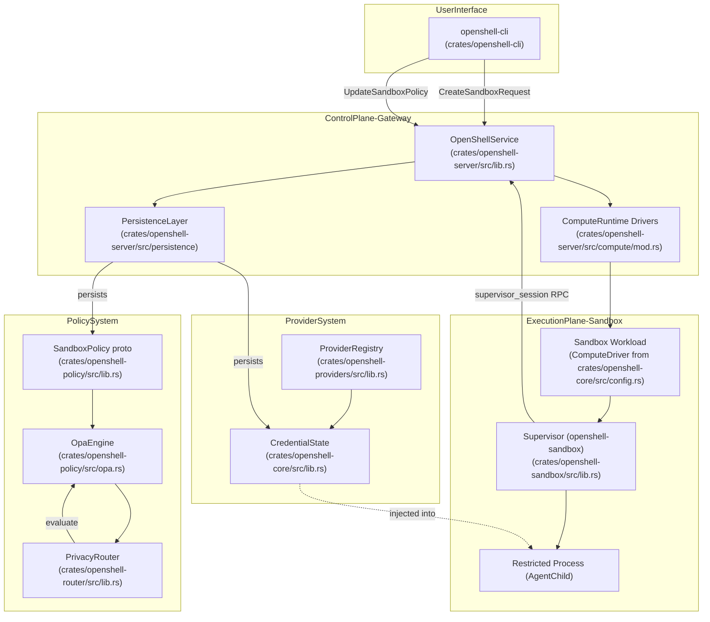
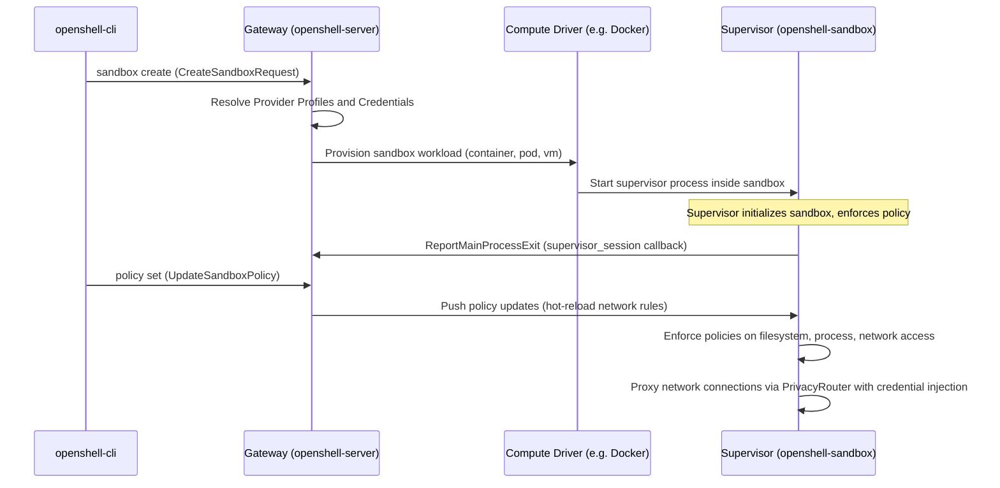

<!-- source: DeepWiki mcp.deepwiki.com · repo NVIDIA/OpenShell · page 3 Core Concepts · fetched 2026-10-26 -->

# Core Concepts

Relevant source files

The following files were used as context for generating this wiki page:

- [.agents/skills/build-from-issue/SKILL.md](.agents/skills/build-from-issue/SKILL.md)
- [.agents/skills/create-github-issue/SKILL.md](.agents/skills/create-github-issue/SKILL.md)
- [.agents/skills/create-github-pr/SKILL.md](.agents/skills/create-github-pr/SKILL.md)
- [.agents/skills/create-spike/SKILL.md](.agents/skills/create-spike/SKILL.md)
- [.agents/skills/fix-security-issue/SKILL.md](.agents/skills/fix-security-issue/SKILL.md)
- [.agents/skills/review-security-issue/SKILL.md](.agents/skills/review-security-issue/SKILL.md)
- [.agents/skills/sync-agent-infra/SKILL.md](.agents/skills/sync-agent-infra/SKILL.md)
- [.agents/skills/triage-issue/SKILL.md](.agents/skills/triage-issue/SKILL.md)
- [.github/ISSUE_TEMPLATE/bug_report.yml](.github/ISSUE_TEMPLATE/bug_report.yml)
- [.github/ISSUE_TEMPLATE/feature_request.yml](.github/ISSUE_TEMPLATE/feature_request.yml)
- [.github/PULL_REQUEST_TEMPLATE.md](.github/PULL_REQUEST_TEMPLATE.md)
- [AGENTS.md](AGENTS.md)
- [CONTRIBUTING.md](CONTRIBUTING.md)
- [README.md](README.md)

This page provides a high-level overview of the fundamental concepts that form the foundation of the OpenShell system: **sandboxes**, **gateways and workspaces**, **policies**, and **providers**. These components interact to create secure, isolated execution environments to run AI agents and manage their capabilities in a controlled manner.

Each concept will be introduced briefly here, with links to dedicated child pages for detailed technical information and operational specifics.

For getting started with practical use and CLI workflows, see [Getting Started](#2). For in-depth system architecture, refer to [Gateway Architecture & Deployment](#5) and [Sandbox System](#6).

---

## System Model

OpenShell adopts a **control plane / execution plane** architecture:

- The **Gateway** acts as the control plane managing sandboxes, policies, and access.
- **Sandboxes** provide isolated execution environments for workloads.
- **Policies** declare and enforce sandbox restrictions on filesystem, processes, and network.
- **Providers** handle credentials and secure injection into sandboxes.

The following diagram maps these natural language concepts to their respective code entities and components in the repository, bridging names from documentation to code references:

### High-Level System Architecture (Natural Language to Code Entities)

Sources: [crates/openshell-server/src/lib.rs:7-40](), [crates/openshell-core/src/config.rs:120-134](), [AGENTS.md:35-70](), [README.md:93]()

---

## The Four Core Concepts

### Sandboxes

A **sandbox** is an isolated runtime environment where AI agents or other workloads execute securely [README.md:19-26](). It is instantiated by compute drivers and supervised by the `openshell-sandbox` process, which enforces policy locally [AGENTS.md:28-29](). Sandboxes apply multiple layers of defense, including:

- **Supervisor:** The sandbox supervisor (`openshell-sandbox`) orchestrates sandbox processes and enforces egress routing consistent with declared policies.
- **Isolation Layers:** Filesystem, process, and network isolation use kernel-level primitives and are combined with sidecar proxies for network mediation.
- **Compute Drivers:** Multiple backends are supported, such as Docker, Podman, Kubernetes pods, VMs, and experimental Windows MXC containers.

Sandboxes are ephemeral and continuously enforced. Their lifecycle includes creation, running, completion, or error states, managed by the gateway [architecture/gateway.md:18-22]().

For an in-depth explanation, architecture diagrams, lifecycle phases, and use cases, see the child page: [Sandboxes](#3.1).

Sources: [README.md:19-26](), [AGENTS.md:28-29](), [architecture/gateway.md:18-22]()

---

### Gateways and Workspaces

The **gateway** is the central control plane managing sandboxes, policies, providers, and authentication [README.md:93](). It exposes a multiplexed gRPC and HTTP API and acts as a secure boundary for sandbox lifecycle operations and policy administration.

Key aspects include:

- **Multiplexed Server:** The gateway combines gRPC services for sandbox control, compute driver management, and policy enforcement on a single network port.
- **Compute Drivers Registry:** Multiple drivers (Docker, Podman, Kubernetes) are registered at startup and invoked to create sandbox workloads.
- **Workspaces:** The gateway supports workspace scoping to organize sandboxes, policies, and credentials by user or team boundaries.
- **High Availability:** Supports multi-replica deployment with peer relay for fault tolerance.

Persistence of domain state (sandboxes, policies, providers) is handled via a pluggable Store layer backed by SQLite or Postgres.

For more comprehensive technical detail, configuration schema, deployment strategies, and workspace behavior, see [Gateways and Workspaces](#3.2).

Sources: [crates/openshell-server/src/lib.rs:1-15](), [architecture/gateway.md:1-15, 28-35](), [README.md:93]()

---

### Policies

OpenShell enforces sandbox restrictions through a **declarative policy system**, written in YAML and represented internally with protobuf schemas [README.md:93](). Policies govern:

- **Filesystem Access:** Restricts which files and directories a sandbox’s process tree may read or write.
- **Network Access:** Controls outbound connections, destination hosts, and protocol-level rules.
- **Process Behavior:** Limits allowed syscalls and prevents privilege escalation.
- **Inference Controls:** Routes model API calls through vetted endpoints, adding credential injection and preventing data leaks.

Policies are designed to support both static (immutable, fixed at sandbox creation) and dynamic (hot-reloadable) components. Network and inference policies may update live without sandbox restarts.

The policy enforcement engine integrates with Open Policy Agent (OPA) through an `OpaEngine` wrapper and applies rules at the sandbox level.

Refer to the dedicated policy child page for language syntax, schema, enforcement layers, live-update mechanisms, validation, and formal verification: [Policies](#3.3).

Sources: [README.md:93](), [architecture/gateway.md:24-26](), [crates/openshell-policy/src/lib.rs]()

---

### Providers

**Providers** manage credential lifecycles and environment variable injection for sandboxes, enabling principle-of-least-privilege access to external services without exposing secrets directly.

Highlights include:

- **Credential Management:** The gateway resolves provider credentials and creates derivations for sandbox injection, ensuring sandbox-local scoped access.
- **Provider Registry:** Maintains a YAML-based registry of common cloud providers and integrations (e.g., AWS Bedrock, Google Vertex AI), defined with extensible profiles [AGENTS.md:53-53]().
- **Credential Refresh:** Handles periodic refreshes and secret rotation transparently to sandboxes.
- **Environment Injection:** Credentials and metadata are injected as environment variables or network-level identity tokens before outbound calls, implemented via the Privacy Router.

Providers work tightly with inference routing and network mediation to secure calls through approved endpoints, hiding underlying cloud secrets from sandboxed workloads.

For details on credential drivers, profiles, the YAML registry format, refresh workflows, and environment injection, see [Providers](#3.4).

Sources: [README.md:93](), [architecture/gateway.md:15-15](), [AGENTS.md:53-53]()

---

## Runtime Interaction Flow

The diagram below depicts how core components interact during the sandbox lifecycle and policy enforcement phases, mapping user commands to gateway APIs, compute driver actions, and sandbox supervision:

### Sandbox Creation and Policy Enforcement Flow

Sources: [architecture/gateway.md:28-35](), [README.md:79-93](), [crates/openshell-server/src/lib.rs:12-14]()

---

## Next Steps

- For a detailed understanding of sandbox internals and lifecycle, see [Sandboxes](#3.1).
- To learn about gateway deployment modes, workspace scoping, and multi-replica operation, see [Gateways and Workspaces](#3.2).
- For policy language, enforcement details, live updates, and formal verification, see [Policies](#3.3).
- To understand provider credential management, profiles, and registry management, see [Providers](#3.4).

Each child page dives deeper into its topic with diagrams, code references, and operational guidance for users and developers.

---

*End of section 3.*

# References

- [README.md:17-93]()
- [AGENTS.md:28-70]()
- [architecture/gateway.md:1-35]()
- [crates/openshell-server/src/lib.rs:1-40]()
- [crates/openshell-core/src/config.rs:120-134]()
- [crates/openshell-policy/src/lib.rs]()
- [crates/openshell-providers/src/lib.rs]()

---

