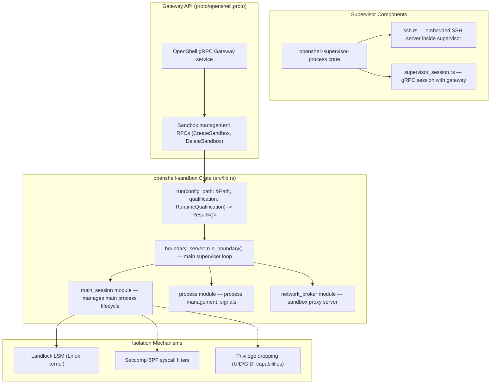
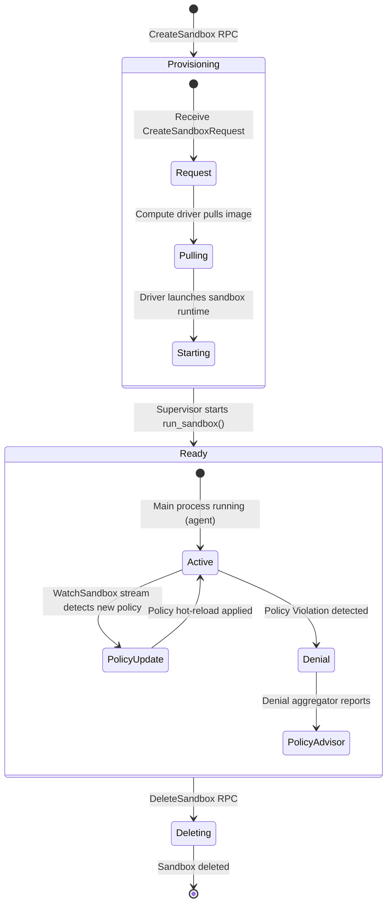
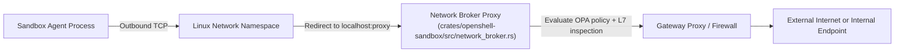

<!-- source: DeepWiki mcp.deepwiki.com · repo NVIDIA/OpenShell · page 3.1 Sandboxes · fetched 2026-10-26 -->

# Sandboxes

<details>
<summary>Relevant source files</summary>

The following files were used as context for generating this wiki page:

- [crates/openshell-cli/src/ssh.rs](crates/openshell-cli/src/ssh.rs)
- [crates/openshell-core/src/forward.rs](crates/openshell-core/src/forward.rs)
- [crates/openshell-sandbox/Cargo.toml](crates/openshell-sandbox/Cargo.toml)
- [crates/openshell-sandbox/src/lib.rs](crates/openshell-sandbox/src/lib.rs)
- [crates/openshell-sandbox/src/main.rs](crates/openshell-sandbox/src/main.rs)
- [crates/openshell-sandbox/src/process.rs](crates/openshell-sandbox/src/process.rs)
- [crates/openshell-sandbox/src/sandbox/linux/landlock.rs](crates/openshell-sandbox/src/sandbox/linux/landlock.rs)
- [crates/openshell-sandbox/src/sandbox/linux/mod.rs](crates/openshell-sandbox/src/sandbox/linux/mod.rs)
- [crates/openshell-server/src/supervisor_session.rs](crates/openshell-server/src/supervisor_session.rs)
- [crates/openshell-supervisor-process/Cargo.toml](crates/openshell-supervisor-process/Cargo.toml)
- [crates/openshell-supervisor-process/src/ssh.rs](crates/openshell-supervisor-process/src/ssh.rs)
- [crates/openshell-supervisor-process/src/ssh/peer_stream.rs](crates/openshell-supervisor-process/src/ssh/peer_stream.rs)
- [crates/openshell-supervisor-process/src/ssh/reconnect_tests.rs](crates/openshell-supervisor-process/src/ssh/reconnect_tests.rs)
- [crates/openshell-supervisor-process/src/supervisor_session.rs](crates/openshell-supervisor-process/src/supervisor_session.rs)
- [docs/how-it-works/sandboxes/overview.mdx](docs/how-it-works/sandboxes/overview.mdx)
- [e2e/python/test_sandbox_landlock.py](e2e/python/test_sandbox_landlock.py)
- [skills/openshell-cli/SKILL.md](skills/openshell-cli/SKILL.md)

</details>


**Purpose:** This page defines sandboxes as isolated execution environments, explains their architecture, lifecycle phases, and use cases in detail, and links to related concepts and technical components in the codebase.

For supervisor binary design, enforcement mechanisms, and network proxying, see [6. Sandbox System](). For policy configuration, see [7. Policy System](). For sandbox lifecycle control via gateways, see [3.2. Gateways and Workspaces]().

---

## What is a Sandbox?

A **sandbox** in OpenShell is the isolated runtime boundary where an AI agent or untrusted workload runs. Each sandbox combines strong *runtime isolation* with *policy controls* enforced by the kernel and userspace components:

- **Filesystem isolation** is enforced by Landlock LSM with explicit allow-lists on paths.
- **Process restrictions** use seccomp BPF syscall filters combined with privilege dropping.
- **Network mediation** is handled by an HTTP CONNECT proxy implementing policy evaluation and allowing transparent TCP interception.

The OpenShell sandbox abstraction is embodied primarily by the `openshell-sandbox` crate which manages sandbox startup, supervision, environment setup, credential injection, and enforcement [crates/openshell-sandbox/src/lib.rs:4-70]().

**Key characteristics:**

- **Two Trust Levels:** The `openshell-sandbox` supervisor starts as root to boot the environment then transitions to launching an unprivileged child process running the workload [crates/openshell-sandbox/src/lib.rs:64-70]().
- **Single-tenant:** Each sandbox operates in its own isolated network and process namespace [architecture/sandbox.md:47-47]().
- **Policy-driven:** Sandbox capabilities and access are restricted based on OpenShell policies which govern filesystem, process, and network rules [architecture/security-policy.md:1-6]().

---

## Sandbox Components and Code Mapping

This diagram maps the natural language sandbox concepts to the relevant code components in OpenShell, highlighting how responsibilities are distributed within the codebase.

### Sandbox Entity Mapping



| Component                 | Code Entity / Location                            | Responsibility                                          |
|---------------------------|--------------------------------------------------|--------------------------------------------------------|
| Sandbox runtime boundary   | `run()` in `crates/openshell-sandbox/src/lib.rs` [64-70]() | Entrypoint launching the authenticated boundary server. |
| Supervisor main loop       | `boundary_server::run_boundary()` [10-70]()      | Coordinates sandbox lifecycle, policy load, child process handling. |
| Main process session       | `main_session` module [16-37]()                   | Manages the sandbox agent main process lifecycle, signaling, and output. |
| Process management        | `process` module [3-210]()                        | Handles child processes, environment, signals, and user context.    |
| Network proxy server      | `network_broker` module [19-42]() (Linux only)   | Enforces sandbox network policy via HTTP CONNECT proxy.|
| Supervisor process runtime | `openshell-supervisor-process` crate             | Embedded SSH server, gRPC gateway session, SSH tunnel forwarding. |
| Linux kernel sandboxing   | Landlock LSM, seccomp syscall filtering [extern] | Kernel-level policy enforcement on paths and syscalls.|
| Gateway API               | `proto/openshell.proto`                           | Gateway gRPC APIs for sandbox creation, management, and session handling. |

Sources: [crates/openshell-sandbox/src/lib.rs:4-70](), [crates/openshell-sandbox/src/main.rs:48-166](), [crates/openshell-supervisor-process/src/ssh.rs:1-181](), [proto/openshell.proto:20-53]()

---

## Sandbox Lifecycle Phases

Sandboxes progress through a finely controlled lifecycle managed by the gateway and supervisor processes. The phases and key transitions are:

### Phases



### Detailed Flow

1. **Provisioning:** Triggered by CLI or API via `CreateSandbox` RPC to the gateway, which instructs the compute driver (Docker, Podman, Kubernetes, or VM) to pull the base image and launch a new sandbox container/pod [crates/openshell-cli/src/run.rs:48-63](), [proto/openshell.proto:47-53]().
   
2. **Startup:** The supervisor (`run_sandbox`) starts inside the new workload, loading sandbox policy and bootstrap config. It applies filesystem, network, and process restrictions [crates/openshell-sandbox/src/lib.rs:64-70](), [crates/openshell-sandbox/src/main.rs:62-166]().

3. **Running:** The supervisor launches the canonical sandbox command as an unprivileged user. It maintains a supervisor session back to the gateway for management calls and log streaming. Network proxying enforces per-request policy [crates/openshell-supervisor-process/src/supervisor_session.rs:1-188]().

4. **Policy Updates:** The supervisor polls `WatchSandbox` or receives push updates through calls, hot-reloading policy in the sandbox's OPA engine without restart [crates/openshell-sandbox/src/lib.rs:27-42]().

5. **Termination:** On `DeleteSandbox` API request, the supervisor shuts down child processes and the compute driver removes the sandbox. Resources are cleaned up and logs finalized [proto/openshell.proto:144-150]().

Sources: [proto/openshell.proto:47-150](), [crates/openshell-sandbox/src/lib.rs:60-70](), [crates/openshell-cli/src/run.rs:48-63](), [crates/openshell-supervisor-process/src/supervisor_session.rs:1-188]()

---

## Isolation Architecture

OpenShell utilizes a **defense-in-depth** sandboxing model combining multiple kernels and userland controls:

### Static (Kernel-Level) Enforcement (Locked at Sandbox Creation)

- **Filesystem:** Landlock Linux Security Module restricts access to exact path sets white-listed by policy. Paths for runtime CA certs and GPU devices are injected before locking [crates/openshell-sandbox/src/sandbox/linux/mod.rs]().

- **Process user:** The agent runs as an unprivileged user with cleared capabilities and restricted privileges. The supervisor handles user and HOME directory resolution on exec [crates/openshell-sandbox/src/process.rs:175-199]().

- **Seccomp:** BPF filters block dangerous syscalls and mediate on allowed syscalls like socket creation to prevent direct bypass of proxies [crates/openshell-sandbox/src/lib.rs:39-42]().

These static controls are irreversible during the sandbox lifetime and protect fundamental kernel boundaries.

---

### Dynamic Enforcement (Hot-Reloadable)

- **Network Policy:** The sandbox network broker proxies outbound TCP connections and evaluates destination addresses against the OPA policy engine that runs inside supervisor memory. This allows fine-grained, real-time allow/deny decisions [crates/openshell-sandbox/src/network_broker.rs]().

- **L7 Inspection:** The proxy terminates TLS for inspection of HTTP, WebSocket, and other application-layer protocols to enforce path and method restrictions [architecture/sandbox.md:79-82]().

- **Inference Routing:** Special domain prefixes route requests transparently and enable credential injection per provider profile [architecture/security-policy.md:18-18]().

Sources: [crates/openshell-sandbox/src/lib.rs:14-43](), [crates/openshell-sandbox/src/network_broker.rs]()

---

## Sandbox Network Isolation and Proxying

The sandbox enforces **egress network isolation** via transparent interception:

1. **Network Namespace:** Each sandbox has its own private network namespace, isolating it from the host and other sandboxes [architecture/sandbox.md:47-47]().

2. **Traffic Interception:** Outbound TCP connections are routed to the sandbox's HTTP CONNECT proxy listening on localhost inside the sandbox [crates/openshell-sandbox/src/lib.rs:19-19]().

3. **Binary Identity:** The proxy resolves the calling process's metadata and declared binary check-sums to enforce policy bindings [architecture/security-policy.md:43-43]().

4. **OPA Policy Decision:** The destination is checked against deny-lists and allow-lists, and layered with L7 inspection. Denials generate audit events and batch into recommendations [crates/openshell-sandbox/src/lib.rs:22-46]().

5. **Audit Logging:** Network and HTTP interactions are logged using OCSF event schema for downstream SIEM ingestion [crates/openshell-ocsf].

### Diagram: Sandbox Network Proxy Flow



Sources: [crates/openshell-sandbox/src/lib.rs:19-43](), [architecture/sandbox.md:47-60](), [architecture/security-policy.md:31-49]()

---

## Credential Injection and Security

Sandbox security includes careful management of provider credentials:

- **Injection:** The gateway injects provider credentials (like API tokens) into sandbox environment variables during the child process startup [crates/openshell-sandbox/src/process.rs:166-173]().

- **Provider Env Isolation:** Supervisor-only environment variables are stripped from the agent's environment to avoid leaking sensitive data [crates/openshell-sandbox/src/process.rs:135-143]().

- **Atomic Refresh:** Credential values are atomically updated inside the gateway and pushed to the sandbox dynamically, preventing stale or leaked credentials [architecture/sandbox.md:112-117]().

- **Proxy Resolution:** The sandbox network proxy resolves credentials dynamically on each request to providers, ensuring tokens are scoped and not accessible beyond allowed channels.

Sources: [crates/openshell-sandbox/src/process.rs:135-173](), [architecture/sandbox.md:13-14, 112-117]()

---

## Sandboxes in Practice: Use Cases and CLI

Typical sandbox use involves:

- Creating sandboxes from public or private images designed for AI workloads.
- Running agent commands interactively or in detached mode.
- Managing restart policies for fault tolerance.
- Attaching tools like SSH or openshell CLI to inspect or interact with running sandboxes.
- Uploading files for stateful execution.
- Requesting GPU and resource limits.

Example CLI sandbox creation command:

```shell
openshell sandbox create --from registry.example.com/your-org/claude-agent:latest --name claude --cpu 2 --memory 4Gi --gpu -- ./claude-agent
```

- The `openshell` CLI communicates with the gateway, which orchestrates runtime provisioning, and supervises the sandbox lifecycle.
- SSH access is available via the embedded supervisor SSH server inside the sandbox for secure terminal interaction [crates/openshell-cli/src/ssh.rs:1-170]().

Sources: [docs/how-it-works/sandboxes/overview.mdx:1-163](), [crates/openshell-cli/src/ssh.rs:1-170]()

---

# Summary

Sandboxes are the **isolated, secure, and policy-controlled execution containers** where OpenShell runs trusted and untrusted AI agent workloads. They provide:

- Fine-grained kernel-enforced isolation (Landlock, seccomp, privilege dropping).
- Dynamic userspace network mediation and policy enforcement.
- Credential injection and sweeping flow control.
- Lifecycle orchestration via gateways and supervisors.
- Secure interactive access through embedded SSH.

This layered architecture ensures a robust, auditable boundary for advanced AI use cases.

---

# References and Sources

- [crates/openshell-sandbox/src/lib.rs:1-70]()
- [crates/openshell-sandbox/src/main.rs:1-166]()
- [crates/openshell-sandbox/src/process.rs:1-210]()
- [crates/openshell-supervisor-process/src/ssh.rs:1-181]()
- [crates/openshell-supervisor-process/src/supervisor_session.rs:1-188]()
- [crates/openshell-cli/src/ssh.rs:1-170]()
- [proto/openshell.proto:20-53,47-150]()
- [docs/how-it-works/sandboxes/overview.mdx:1-163]()
- [architecture/sandbox.md:1-60]()
- [architecture/security-policy.md:1-49]()

---

