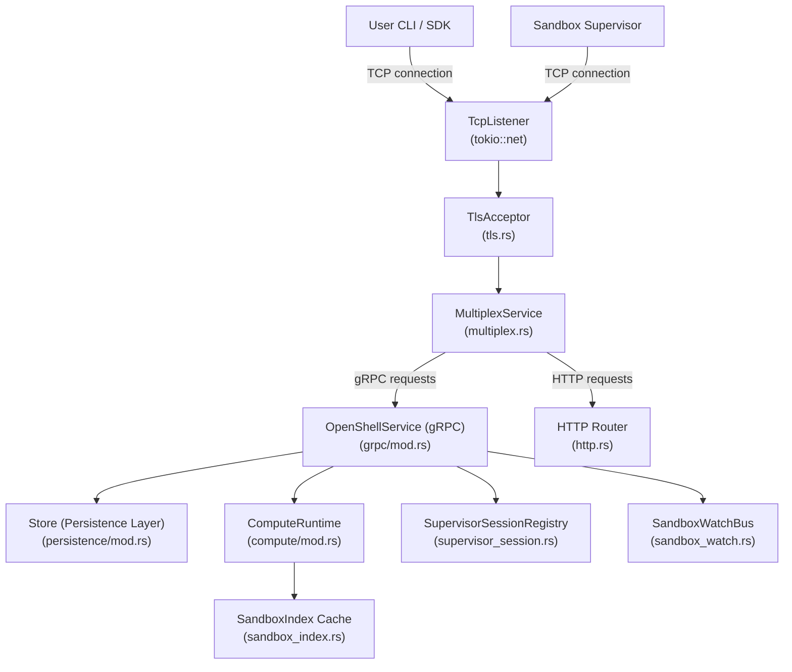
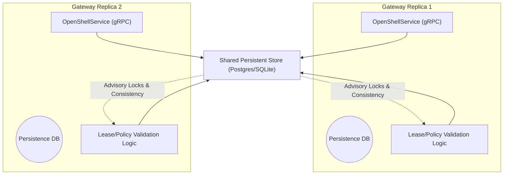
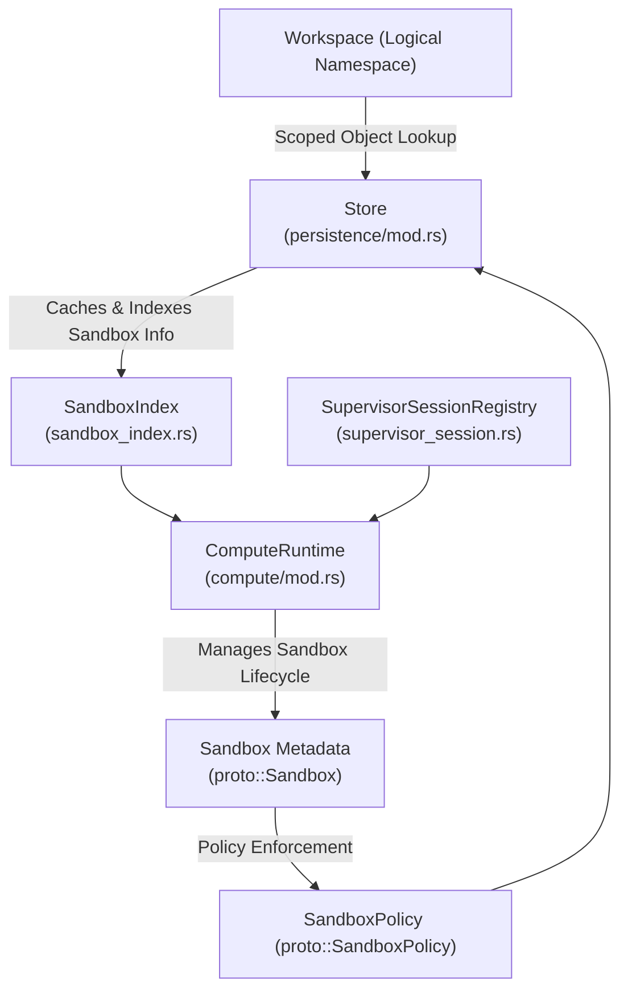

<!-- source: DeepWiki mcp.deepwiki.com · repo NVIDIA/OpenShell · page 3.2 Gateways and Workspaces · fetched 2026-10-26 -->

# Gateways and Workspaces

Relevant source files

The following files were used as context for generating this wiki page:

- [crates/openshell-core/src/config.rs](crates/openshell-core/src/config.rs)
- [crates/openshell-server/src/cli.rs](crates/openshell-server/src/cli.rs)
- [crates/openshell-server/src/config_file.rs](crates/openshell-server/src/config_file.rs)
- [crates/openshell-server/src/lib.rs](crates/openshell-server/src/lib.rs)
- [crates/openshell-server/src/multiplex.rs](crates/openshell-server/src/multiplex.rs)
- [crates/openshell-server/src/persistence/mod.rs](crates/openshell-server/src/persistence/mod.rs)
- [crates/openshell-server/src/persistence/postgres.rs](crates/openshell-server/src/persistence/postgres.rs)
- [crates/openshell-server/src/persistence/sqlite.rs](crates/openshell-server/src/persistence/sqlite.rs)
- [crates/openshell-server/src/persistence/tests.rs](crates/openshell-server/src/persistence/tests.rs)
- [crates/openshell-server/src/policy_store.rs](crates/openshell-server/src/policy_store.rs)
- [crates/openshell-server/src/provider_refresh.rs](crates/openshell-server/src/provider_refresh.rs)
- [docs/about/run-your-first-agent.mdx](docs/about/run-your-first-agent.mdx)
- [docs/how-it-works/gateways/configuration.mdx](docs/how-it-works/gateways/configuration.mdx)
- [docs/how-it-works/policies/advisor.mdx](docs/how-it-works/policies/advisor.mdx)
- [skills/debug-openshell-cluster/SKILL.md](skills/debug-openshell-cluster/SKILL.md)

## Purpose and Scope

This page details the **gateways** as the central control plane in OpenShell, clarifying their role in sandbox management, workspace scoping, and deployment modes. It explains how gateways orchestrate lifecycles, enforce security policies, handle multi-replica operation, and deliver scoped isolation through workspaces. The documentation includes architectural insights, key code entities, data flows, and diagrams bridging conceptual components with their code implementations.

**Sources:** [crates/openshell-server/src/lib.rs:4-50](), [docs/how-it-works/gateways/configuration.mdx:1-102](), [crates/openshell-core/src/config.rs:150-187]()

---

## Gateways as the Control Plane

A gateway is the core OpenShell server process (`openshell-gateway`) acting as the system control plane. It exposes a **multiplexed gRPC and HTTP API** that clients (CLI, SDKs, supervisors) use for operations ranging from sandbox lifecycle management to observability and policy enforcement.

**Control Plane Functions:**

- **Sandbox Orchestration**: The gateway creates, updates, and deletes sandboxes by invoking a pluggable **ComputeRuntime** interface that abstracts runtime-specific provisioning details (Docker, Podman, Kubernetes, MicroVMs) [crates/openshell-server/src/lib.rs:90-91](), [crates/openshell-core/src/config.rs:130-155]().

- **State Persistence**: It uses a durable **Store** abstraction (backed by SQLite or Postgres) to persist domain objects such as sandboxes, policies, and provider credentials, ensuring strong consistency and recoverability [crates/openshell-server/src/persistence/mod.rs:1-220](), [crates/openshell-server/src/lib.rs:33-34]().

- **Authentication & Authorization**: Facilitates multi-modal authentication including mTLS client certs, OIDC bearer tokens, JWTs minted by the gateway, and extension credentials. It manages identity, roles, and role-based access control enforcement through middleware and interceptors [crates/openshell-server/src/lib.rs:98-182](), [crates/openshell-server/src/multiplex.rs:40-50]().

- **Extension Support**: Supports extended gateway middleware and interceptor registration with secure short-lived credentials minted by the gateway for controlled extension invocation [crates/openshell-server/src/lib.rs:115-180]().

- **Supervisor Session Relay**: Manages long-lived gRPC supervisor sessions, enabling `exec`, `connect`, and service forwarding commands to reach sandboxes through secure relay protocols [crates/openshell-server/src/lib.rs:40-44]().

### Gateway Request Handling Pipeline

**Sources:** [crates/openshell-server/src/lib.rs:16-60](), [crates/openshell-server/src/multiplex.rs:5-80]()

---

## Workspace Scoping in OpenShell

### Workspaces as Isolation Scopes

Workspaces define **logical namespaces** under which sandboxes, policies, provider profiles, and credentials exist. They enable separation by teams, projects, or environments within the same gateway instance and help enforce scoped data access.

- Each persisted object (e.g., sandbox, provider) carries a workspace string label.
- Queries to the persistence layer always filter by workspace to ensure isolation.
- Workspaces are used in authorization decisions, restricting users and sandboxes to their permitted scope.

### Store Support for Workspaces

The Store abstraction supports filtered queries scoped to workspaces:

- `ObjectListQuery::Workspace(&str)`: Lists records within a single workspace.
- `ObjectListQuery::Scope(&str)`: More general scoped queries by owner or provider.
- Additional selectors combine workspaces with label selectors for fine-grained filtering [crates/openshell-server/src/persistence/mod.rs:130-160]().

Workspaces are fundamental for multi-tenancy and enable deployments to enforce data partitioning at the gateway level.

---

## Gateway Deployment Modes

OpenShell gateways support multiple deployment forms tailored to environment and scale.

| Mode                 | Description                                                                                                               | Auth & Driver Notes                                                                                                  |
|----------------------|---------------------------------------------------------------------------------------------------------------------------|----------------------------------------------------------------------------------------------------------------------|
| **Local Single-User** | Typical developer setup, running gateway locally with mTLS for local authentication.                                       | Uses Docker or Podman drivers for sandbox orchestration. Gateway listens on local loopback by default.                |
| **Cluster Shared**    | Multi-user shared deployments on Kubernetes or Cloud, using OIDC for user auth and mTLS for inter-service communication. | Uses Kubernetes compute driver with Namespaced supervisor Pods and shared Postgres backend for persistence.          |
| **Multi-Replica Cluster** | Gateways deployed as StatefulSet or Deployment with multiple replicas for high availability.                            | Uses database-backed synchronization with durable leases and advisory locking for consistent lease mastership.       |
| **Remote Access**     | Gateway accessed via SSH tunnels, with relay through supervisors for sandbox connect and command forwarding.                | Requires TLS and mTLS, with gateway issuing JWTs for sandbox supervisors and relays for CLI client commands.          |

### Multi-Replica Operation

In multi-replica setups, gateways coordinate through the persistent store to maintain lease ownership and avoid split brain:

- Leasing of sandbox resources uses optimistic concurrency with CAS (`put_if` semantics).
- Advisory locks or database-level locks serialize cross-object mutations.
- Gateway identity and replica name are injected via config to disambiguate replicas [crates/openshell-server/src/persistence/postgres.rs:30-130]().

---

## Multi-Replica Gateway Architecture Diagram

This design ensures that gateways share state consistently, prevent conflicting sandbox operations, and provide failover capabilities.

**Sources:** [crates/openshell-server/src/persistence/postgres.rs:117-135](), [docs/how-it-works/gateways/configuration.mdx:66-92]()

---

## Gateway Workspace and Sandbox Data Flow

The following diagram links natural language concepts of workspaces and sandboxes to their core persistence and runtime abstractions:

This flow outlines:

- Workspaces delimit object visibility and queries.
- Store provides consistent persistence of sandbox and policy objects.
- SandboxIndex caches active sandbox metadata for rapid access by the compute runtime.
- Supervisor sessions track active RPC streams establishing user-sandbox connectivity.
- ComputeRuntime uses this data to manage sandbox lifecycles and enforce policies.

**Sources:** [crates/openshell-server/src/lib.rs:38-44](), [crates/openshell-server/src/persistence/mod.rs:140-180](), [crates/openshell-core/src/config.rs:110-130]()

---

## Summary of Key Classes and Functions

| Concept                  | Code Entity / File                             | Role / Description                                                      |
|--------------------------|-----------------------------------------------|------------------------------------------------------------------------|
| Gateway Main Library      | `crates/openshell-server/src/lib.rs`          | Central server assembly: gRPC/HTTP multiplexing, extension auth, compute runtime init |
| CLI Interface and Config  | `crates/openshell-server/src/cli.rs`           | Parses CLI flags, env, config file precedence, instantiates gateway config |
| Gateway Configuration File| `docs/how-it-works/gateways/configuration.mdx` | TOML schema guide and precedence for gateway and drivers configuration   |
| Gateway Multiplex Service | `crates/openshell-server/src/multiplex.rs`    | Routes connections to gRPC or HTTP based on headers for API multiplexing |
| Persistence Store        | `crates/openshell-server/src/persistence/mod.rs` | Interfaces and implementations (SQLite/Postgres) for durable data storage |
| Workspace Enforcement     | `crates/openshell-server/src/persistence/mod.rs` | ObjectListQuery filters by workspace for isolation                      |
| Multi-Replica Coordination| `crates/openshell-server/src/persistence/postgres.rs` | Advisory locks and transaction logic ensuring safe concurrent gateway ops |
| ComputeRuntime Abstraction| `crates/openshell-server/src/lib.rs` line ~90 | Abstract runtime interface for sandbox creation and control             |
| Supervisor Session Registry| `supervisor_session.rs`                      | Tracking active sandbox-to-gateway RPC streams                          |

---

## Conclusion

Gateways are the pivotal control plane that allow OpenShell to deliver secure, multi-tenant sandbox orchestration with policy enforcement. Workspaces provide the core scoping mechanism to isolate and organize resources per project or team, while the persistence store guarantees durable, consistent state for cluster-wide coordination. Multi-replica gateways operate safely through database-backed locking and careful lease management, supporting high-availability deployments.

This architecture enables flexible deployment from local developer setups to large-scale, multi-user Kubernetes clusters, ensuring consistent operation as a secure AI agent runtime foundation.

---

**Sources:**  
- [crates/openshell-server/src/lib.rs:1-194]()  
- [crates/openshell-server/src/cli.rs:72-160]()  
- [crates/openshell-server/src/multiplex.rs:1-190]()  
- [crates/openshell-server/src/persistence/mod.rs:1-220]()  
- [crates/openshell-server/src/persistence/postgres.rs:1-135]()  
- [docs/how-it-works/gateways/configuration.mdx:1-102]()  
- [crates/openshell-core/src/config.rs:130-155]()

---

