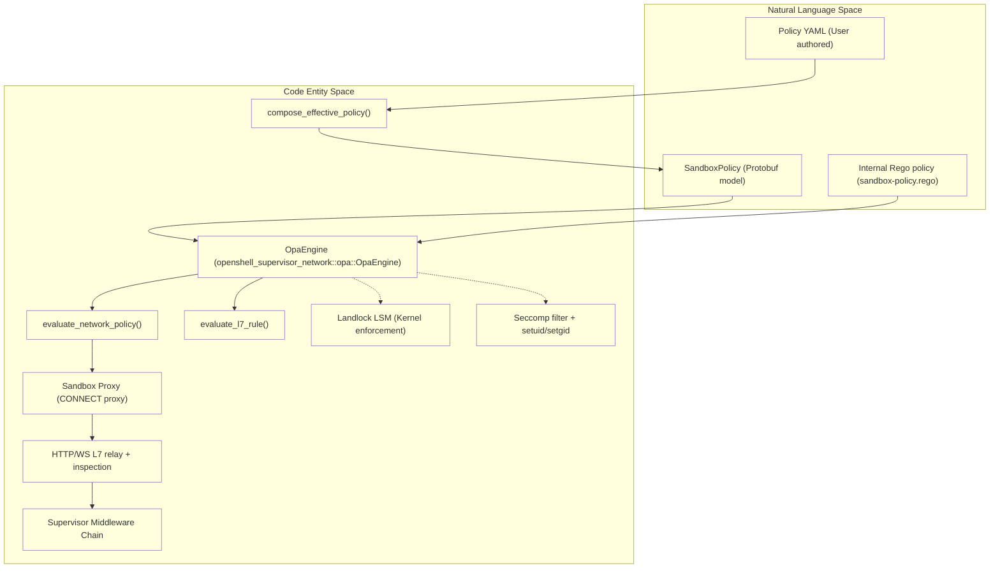
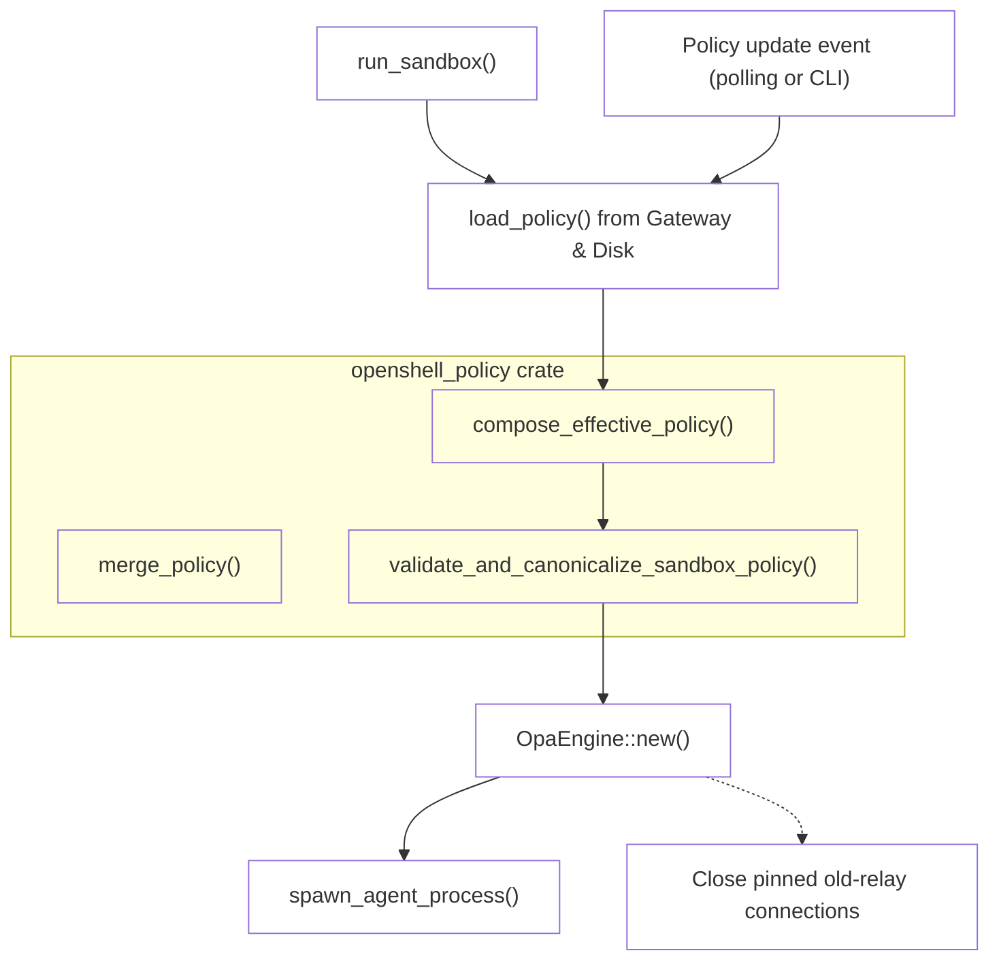

<!-- source: DeepWiki mcp.deepwiki.com · repo NVIDIA/OpenShell · page 3.3 Policies · fetched 2026-10-26 -->

# Policies

<details>
<summary>Relevant source files</summary>

The following files were used as context for generating this wiki page:

- [crates/openshell-core/src/net.rs](crates/openshell-core/src/net.rs)
- [crates/openshell-ocsf/src/format/shorthand.rs](crates/openshell-ocsf/src/format/shorthand.rs)
- [crates/openshell-ocsf/src/objects/http.rs](crates/openshell-ocsf/src/objects/http.rs)
- [crates/openshell-policy/src/lib.rs](crates/openshell-policy/src/lib.rs)
- [crates/openshell-policy/src/merge.rs](crates/openshell-policy/src/merge.rs)
- [crates/openshell-providers/src/profiles.rs](crates/openshell-providers/src/profiles.rs)
- [crates/openshell-sandbox/src/mechanistic_mapper.rs](crates/openshell-sandbox/src/mechanistic_mapper.rs)
- [docs/about/overview.mdx](docs/about/overview.mdx)
- [docs/extensibility/drivers.mdx](docs/extensibility/drivers.mdx)
- [docs/extensibility/isolation-backends.mdx](docs/extensibility/isolation-backends.mdx)
- [docs/how-it-works/inference.mdx](docs/how-it-works/inference.mdx)
- [docs/how-it-works/policies/default-policy.mdx](docs/how-it-works/policies/default-policy.mdx)
- [docs/how-it-works/policies/overview.mdx](docs/how-it-works/policies/overview.mdx)
- [docs/how-it-works/providers/profiles.mdx](docs/how-it-works/providers/profiles.mdx)
- [docs/index.mdx](docs/index.mdx)
- [docs/index.yml](docs/index.yml)
- [docs/kubernetes/ingress.mdx](docs/kubernetes/ingress.mdx)
- [docs/security/best-practices.mdx](docs/security/best-practices.mdx)
- [e2e/python/test_sandbox_policy.py](e2e/python/test_sandbox_policy.py)
- [proto/sandbox.proto](proto/sandbox.proto)

</details>


Policies in OpenShell are declarative YAML specifications that establish strict security boundaries for sandboxed AI agent environments. They govern filesystem access, network connectivity, process privileges, and syscall permissions, delivering a comprehensive defense-in-depth security model enforced at both the isolation kernel level and in the network proxy layer [[proto/sandbox.proto:19-36]](), [[crates/openshell-policy/src/lib.rs:4-10]](), [[docs/security/best-practices.mdx:12-34]]().

The policy system integrates static kernel-level constraints—enforced by Landlock LSM and seccomp filters—with a runtime-enforced dynamic network policy layer powered by an embedded **Open Policy Agent (OPA)** evaluation engine. This dual-layer enforcement ensures agent workloads operate with minimal privilege and tightly controlled interactions [[architecture/security-policy.md:12-33]](), [[crates/openshell-policy/src/lib.rs:35-80]]().

---

## Policy Structure

The core policy entity in OpenShell is the `SandboxPolicy` protobuf message, which consists of five main enforcement domains [[proto/sandbox.proto:21-36]]():

| Policy Domain       | What it Controls                                    | Enforcement Mechanism       | Changeable After Sandbox Creation? |
|---------------------|----------------------------------------------------|----------------------------|------------------------------------|
| **FilesystemPolicy** | Read/write access to host filesystem paths         | Landlock LSM (kernel-level) | No (immutable, sandbox restart needed) |
| **LandlockPolicy**   | Landlock compatibility and mode                     | Kernel ABI Enforcement      | No                                 |
| **ProcessPolicy**    | User and group identity for sandboxed processes    | `setuid`/`setgid`, seccomp  | No                                 |
| **NetworkPolicies**  | Outbound network connections and L7 inspection     | OPA engine + Sandbox Proxy  | Yes (dynamic hot-reload via gateway) |
| **NetworkMiddlewares** | Middleware configurations for HTTP/WS egress     | Middleware Chain + Proxy    | Yes                               |

### `SandboxPolicy` Protobuf Snapshot

```proto
message SandboxPolicy {
  uint32 version = 1;
  FilesystemPolicy filesystem = 2;
  LandlockPolicy landlock = 3;
  ProcessPolicy process = 4;
  map<string, NetworkPolicyRule> network_policies = 5;
  map<string, NetworkMiddlewareConfig> network_middlewares = 6;
}
```

Key notes:
- Network policies are keyed by unique rule names (e.g., `"gitlab"`, `"claude_code"`).
- Filesystem and process policies are static and locked at sandbox creation.
- Network-related policies and middlewares support live runtime updates [[proto/sandbox.proto:19-86]]().

**Sources:** [[proto/sandbox.proto:21-86]](), [[crates/openshell-policy/src/lib.rs:4-80]](), [[docs/security/best-practices.mdx:12-34]]()

---

## Policy Domains in Detail

### Filesystem Policy

Defines a path-based allowlist governing the sandbox's visible filesystem scope [[proto/sandbox.proto:39-46]]():

- `include_workdir`: Automatically include current working directory as writable.
- `read_only`: List of read-only directories (e.g., `/usr`, `/lib`).
- `read_write`: List of writable directories (e.g., `/sandbox`, `/tmp`).

The supervisor enriches this baseline with runtime-required paths and device nodes—especially critical for GPU workloads where `/proc` access and GPU device nodes need write permission [[crates/openshell-policy/src/lib.rs:35-80]](), [[docs/security/best-practices.mdx:31]]().

### Process Policy

Controls the Linux user and group identity that runs the sandboxed agent process [[proto/sandbox.proto:55-60]]():

- `run_as_user`: Username or UID, defaults to `"sandbox"`.
- `run_as_group`: Group name or GID, defaults to `"sandbox"`.

This policy prevents privilege escalation by dropping capabilities and forbidding root-level execution [[docs/security/best-practices.mdx:33]]().

### Landlock Policy

Specifies the compatibility mode for Landlock enforcement (e.g., `best_effort` or `hard_requirement`) to cope with kernel versions or deployment environments [[proto/sandbox.proto:49-52]]().

### Network Policies

The dynamic portion of the policy, network policies govern outbound connections per binary identity with fine-grained restrictions [[proto/sandbox.proto:63-169]]().

- **NetworkPolicyRule**: Associates a named rule with multiple **endpoints + binaries** each.
- **Endpoints**: 
  - Hostname or glob pattern (case-insensitive).
  - One or more ports.
  - Optional protocol for L7 inspection (`"rest"`, `"websocket"`, `"graphql"`, `"json-rpc"`, `"mcp"`, etc.).
  - TLS mode and enforcement behavior.
  - Optional allowed IP ranges, overriding default SSRF protections.
- **Binaries**: List of executable path globs authorized to connect.

The sandbox proxy enforces network policy by intercepting TCP connects transparently and consulting the OPA engine for allow/deny decisions at connection establishment and optionally at L7 request inspection [[crates/openshell-policy/src/lib.rs:35-70]](), [[docs/security/best-practices.mdx:38-93]]().

### Network Middleware

Policies can include reusable HTTP/WS middleware configuration blocks, applied dynamically to traffic flows matching endpoint selectors. This enables extensible request transformations, protocol mediation, and credential injection on proxied connections [[proto/sandbox.proto:73-86]]().

---

## Policy Enforcement Architecture

Policies are split into two principal enforcement layers:

- **Static Enforcement (Kernel Level)**:
  - Landlock LSM restricts filesystem visibility and mutation.
  - Seccomp filters and user/group ID restrictions limit process syscall access and privilege.
  - Locked at sandbox creation time.

- **Dynamic Enforcement (Runtime Level)**:
  - Sandbox Proxy (CONNECT proxy) intercepts all sandbox outbound TCP traffic.
  - OPA engine evaluates network policies per connection.
  - L7 protocol relay inspects and enforces HTTP/GraphQL/MCP/JSON-RPC rules.
  - Middleware chain can modify and enforce network egress behavior.
  - Supports live policy reload without restarting sandbox [[architecture/security-policy.md:12-33]](), [[crates/openshell-policy/src/lib.rs:37-69]]().

### Diagram: High-Level Policy Enforcement Flow



**Sources:** [[crates/openshell-policy/src/lib.rs:20-69]](), [[crates/openshell-sandbox/src/lib.rs:111-130]](), [[proto/sandbox.proto:20-86]](), [[docs/security/best-practices.mdx:12-99]]()

---

## Policy Loading and Lifecycle

### Initialization and Composition

When a sandbox starts, the gateway-supplied policy and optional local YAML overlays are merged via `compose_effective_policy()` into a consolidated `SandboxPolicy` protobuf [[crates/openshell-policy/src/lib.rs:35-42]](). Included provider profiles and dynamic overlays are merged with merge semantics that preserve provider-owned rules and expand user overlays [[crates/openshell-policy/src/merge.rs:20-142]]().

The supervisor instantiates the `OpaEngine` from this policy, loading the Rego rules and embedded data, preparing it for runtime evaluation [[crates/openshell-sandbox/src/lib.rs:111-130]]().

### Runtime Hot Reload of Network Policies

Network policies and middleware configs support live runtime updates:

- The supervisor periodically polls the gateway for new policy versions.
- On receipt, the policy is validated to ensure no ambiguities or unsafe matches (e.g., endpoint conflicts, SSRF risks).
- If valid, the new policy generation replaces the previous active generation atomically.
- Earlier connections pinned to previous generations are closed to prevent stale authorization bypasses [[docs/security/best-practices.mdx:25-28]]().

**Diagram: Policy Loading and Hot Reload Flow**



**Sources:** [[crates/openshell-sandbox/src/lib.rs:111-130]](), [[crates/openshell-policy/src/lib.rs:35-42]](), [[docs/security/best-practices.mdx:12-28]]()

---

## Policy Validation and Safety Checks

OpenShell enforces rigorous validation to maintain policy safety and correctness:

- **Endpoint Ambiguity Checking:** Multiple network rules may not ambiguously cover the same endpoint with conflicting metadata or allowed IPs. Such ambiguities cause sandbox creation failures with detailed validation errors [[e2e/python/test_sandbox_policy.py:147-183]]().
- **SSRF Protections:** Loopback, link-local, and unspecified IP ranges are always blocked regardless of policy—ensuring agents cannot secretly route through internal or metadata services [[crates/openshell-core/src/net.rs:22-163]]().
- **Allowed IPs Control:** If specified in an endpoint, allowlist IP subnet matching replaces SSRF controls for that endpoint, preventing overly broad access [[proto/sandbox.proto:160-167]]().
- **Binary Identity Pinning:** Network access is scoped to binaries by glob paths that must match the sandbox-observed executable paths pinned by SHA256 digest at runtime. Missing or mismatched binaries cause connection denials [[docs/security/best-practices.mdx:80-93]]().

These validations run both at sandbox creation and on policy update and are key to fail-closed security [[crates/openshell-policy/src/merge.rs:30-142]]().

---

## Policy Recommendations and Advisor

To assist policy authors, the system includes a **Mechanistic Mapper** that analyzes network connection denial logs to auto-generate draft policies [[crates/openshell-sandbox/src/mechanistic_mapper.rs:1-181]]():

- Denials are grouped by `(host, port, binary)` tuples.
- Well-known ports get higher confidence scoring.
- Proposals exclude always-blocked destinations to avoid infinite loops.
- When L7 inspection was active during access attempts, detailed access method/path rules are drafted.
- Rules are suggested with minimal scope, allowing incremental safe expansions.

This baseline mapper complements the planned **Policy Advisor**, which provides richer, LLM-assisted contextual recommendations [[crates/openshell-sandbox/src/mechanistic_mapper.rs:1-181]]().

---

# Summary

OpenShell policies form the foundational blueprint to balance agent capabilities with rigorous security control. The architecture tightly integrates static kernel-level enforcement of filesystem and process constraints with a horizontally scalable and dynamically updateable network policy system built atop the OPA engine and CONNECT proxy.

Authoring policies involves defining YAML that maps to the `SandboxPolicy` protobuf, carefully scoping filesystem access, process identity, and network endpoints with associated binary restrictions. The system performs deep validation and uses runtime enforcement to prevent privilege escalation, unauthorized data exfiltration, and unsafe network interactions.

Dynamic network policies enable operators to evolve runtime behavior on-the-fly, supported by recommendation tooling that transforms denial telemetry into concrete policy proposals.

---

**Sources:**  
- [[proto/sandbox.proto:19-86]]()  
- [[crates/openshell-policy/src/lib.rs:1-172]]()  
- [[crates/openshell-policy/src/merge.rs:1-142]]()  
- [[crates/openshell-sandbox/src/lib.rs:111-130]]()  
- [[crates/openshell-sandbox/src/mechanistic_mapper.rs:1-181]]()  
- [[e2e/python/test_sandbox_policy.py:147-183]]()  
- [[docs/security/best-practices.mdx:12-99]]()  
- [[crates/openshell-core/src/net.rs:22-163]]()

---

