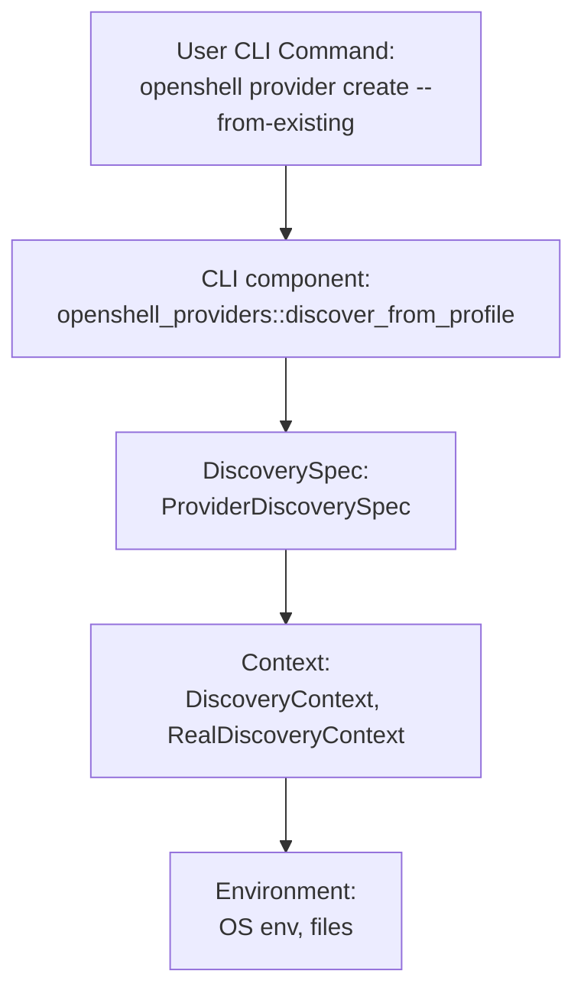
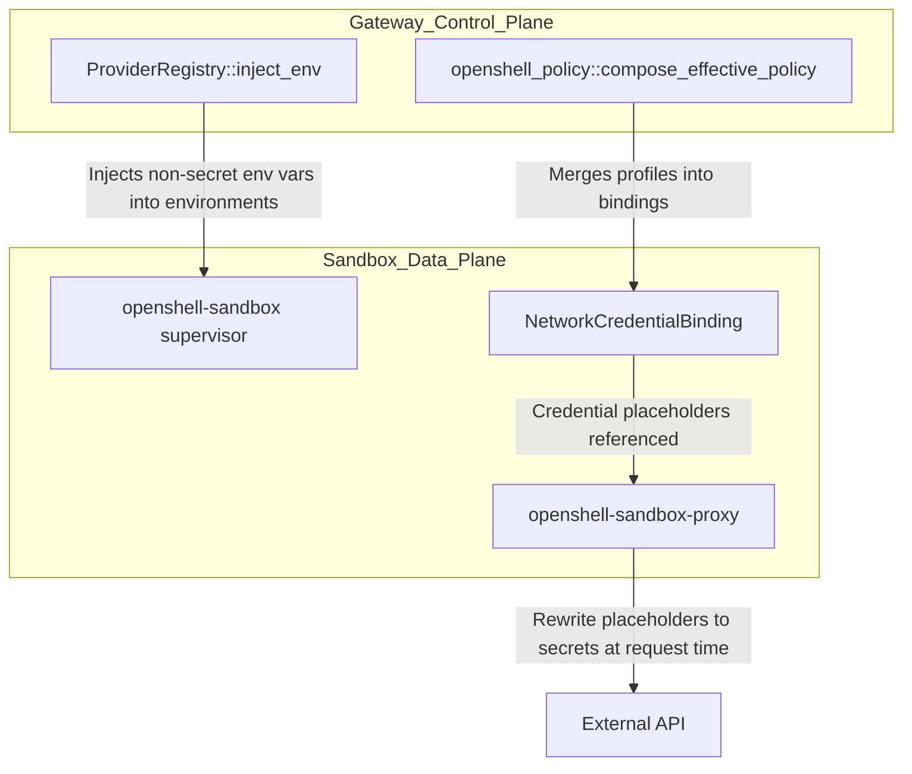

<!-- source: DeepWiki mcp.deepwiki.com · repo NVIDIA/OpenShell · page 3.4 Providers · fetched 2026-10-26 -->

# Providers

<details>
<summary>Relevant source files</summary>

The following files were used as context for generating this wiki page:

- [crates/openshell-core/src/google_cloud.rs](crates/openshell-core/src/google_cloud.rs)
- [crates/openshell-core/src/provider_credentials.rs](crates/openshell-core/src/provider_credentials.rs)
- [crates/openshell-isolation-interface/src/linux/socket_registry.rs](crates/openshell-isolation-interface/src/linux/socket_registry.rs)
- [crates/openshell-providers/src/lib.rs](crates/openshell-providers/src/lib.rs)
- [crates/openshell-providers/src/providers/mod.rs](crates/openshell-providers/src/providers/mod.rs)
- [crates/openshell-sandbox/src/network_broker.rs](crates/openshell-sandbox/src/network_broker.rs)
- [crates/openshell-server/src/provider_profile_sources.rs](crates/openshell-server/src/provider_profile_sources.rs)
- [crates/openshell-supervisor-network/src/google_cloud_metadata.rs](crates/openshell-supervisor-network/src/google_cloud_metadata.rs)
- [crates/openshell-supervisor-network/src/lib.rs](crates/openshell-supervisor-network/src/lib.rs)
- [docs/how-it-works/providers/google.mdx](docs/how-it-works/providers/google.mdx)
- [e2e/python/Dockerfile.workload](e2e/python/Dockerfile.workload)
- [e2e/python/test_sandbox_providers.py](e2e/python/test_sandbox_providers.py)

</details>


## Purpose and Scope

This page documents OpenShell's provider system, which centralizes credential management for external services such as Claude, GitLab, GitHub, NVIDIA, OpenAI, and cloud providers. Providers serve as named collections of credentials and configuration stored in the gateway's database and abstract the way credentials are injected into sandboxed workloads. This system secures secret handling by injecting placeholders and resolving them securely at runtime.

The page covers provider credential management, provider profiles (V2), the `providers/` YAML registry system, credential refresh workflows, and environment variable injection mechanics inside sandboxes.

Sources: [docs/sandboxes/manage-providers.mdx:11-13](), [crates/openshell-providers/src/profiles.rs:28-44]()

---

## What is a Provider?

A **provider** represents a named credential and configuration set for external services, maintained centrally in the gateway. Instead of scattering secrets across multiple sandboxes, providers enable defining them once and referencing them across many workloads.

**Key characteristics:**

| Property                  | Description                                                                                 | Source                                             |
|---------------------------|---------------------------------------------------------------------------------------------|----------------------------------------------------|
| **Storage**               | Persisted in the gateway store. Credential values are redacted in gRPC responses to avoid leakage. | [docs/sandboxes/manage-providers.mdx:160-160]()   |
| **Injection**             | Credentials are provided to sandboxes as environment variables or resolved at proxy time using placeholders. | [docs/sandboxes/manage-providers.mdx:160-160]()   |
| **Discovery**             | CLI supports automatic credential discovery from local environments using provider profiles. | [docs/sandboxes/manage-providers.mdx:34-42]()     |
| **Profiles**              | Declarative YAML profiles define provider types, endpoint and binary metadata, credential policies, and refresh strategies. | [crates/openshell-providers/src/profiles.rs:28-44]() |
| **Credential Refresh**    | Supports long-lived credential refresh (OAuth2 tokens, AWS STS tokens, etc.) managed by the gateway. | [docs/sandboxes/manage-providers.mdx:184-186]()   |

Sources: [docs/sandboxes/manage-providers.mdx:11-13](), [docs/sandboxes/manage-providers.mdx:160-160](), [crates/openshell-providers/src/profiles.rs:28-44]()

---

## Provider Profiles (Providers v2)

Providers v2 advances provider definitions into comprehensive profile-backed access bundles. A **provider profile** specifies:

- The credential schema (environment variable names, required flags, auth styles)
- API endpoint metadata (host, ports, protocol)
- Binaries authorized to use credentials
- Policy rules, including L7 enforcement rules
- Credential refresh profiles defining rotation strategies
- Discovery metadata for the CLI

These profiles use the `ProviderProfile` protobuf message mapped from YAML definitions loaded at gateway startup or imported interactively. This abstraction enables consistent credential injection and policy enforcement.

### Built-in Provider Profiles

The `openshell-providers` crate ships several built-in provider profiles embedded in the binary for popular services:

- **AWS (Bedrock/S3)**: Covers AWS services and supports AWS STS token refresh [crates/openshell-providers/src/profiles.rs:29-31]()
- **Claude Code**: Supports credential environment variables like `ANTHROPIC_API_KEY` and `CLAUDE_API_KEY` [crates/openshell-providers/src/profiles.rs:32-33]()
- **GitHub**: Provides REST and GraphQL API endpoints setup for `api.github.com` [crates/openshell-providers/src/profiles.rs:38-38]()
- **NVIDIA/OpenAI**: Major LLM providers with endpoint and binary definitions [crates/openshell-providers/src/profiles.rs:41-42]()

### Profile Structure

A profile contains:

- **Credentials**: Each credential is defined by variable names, required flag, environment injection keys, and HTTP auth styles (header, query parameter). Represented by `ProviderProfileCredential`.  
- **Token Grants**: Optional token exchange rules (e.g., OIDC to service token) described by `TokenGrantProfile`.
- **Refresh**: `CredentialRefreshProfile` defines how credentials are rotated automatically by the gateway.
- **Discovery**: Profiles include discovery rules used by the CLI or gateway to infer credentials from local environment.

Each profile is treated as a single canonical entity identified by an ID that the gateway resolves to apply for a sandbox session.

Sources: [crates/openshell-providers/src/profiles.rs:28-175](), [crates/openshell-providers/src/lib.rs:19-25]()

---

## Creating and Managing Providers

### Provider Creation & Discovery

Providers are created with the CLI command:

```bash
openshell provider create --name <provider-name> --type <provider-type> [options]
```

Providers can be created by:

- Discovering existing credentials from the local environment via profile-based rules.
- Manually specifying credential key-values with `--credential KEY=VALUE`.
- Using convenience flags like `--from-gcloud-adc` or `--from-oidc-token` to load provider-specific credential sources.

Example:

```bash
# Create a provider from discovered local environment credentials
openshell provider create --name my-claude --type claude --from-existing

# Create a provider with explicit credential
openshell provider create --name my-nvidia --type nvidia --credential NVIDIA_API_KEY=nvapi-example
```

Internally, discovery uses `openshell-providers` APIs (`discover_from_profile`) and the `ProviderRegistry` and `ProviderPlugin` abstraction to resolve credentials from environment variables or files.

Sources: [docs/sandboxes/manage-providers.mdx:34-42](), [crates/openshell-providers/src/lib.rs:72-86]()

### Discovery Process Mapping



This flow shows the user invokes the CLI, which calls discovery logic that uses a static specification matched with environment extraction context to locate credentials.

Sources: [crates/openshell-providers/src/lib.rs:18-19](), [crates/openshell-providers/src/lib.rs:54-57]()

---

## Provider Injection and Policy Composition

### Credential Injection Model

OpenShell employs a **placeholder and rewrite** approach for credential injection:

1. **Placeholder Injection**: Supervisor injects placeholders (e.g., `openshell:resolve:env:VAR_NAME`) instead of raw secrets into the sandbox environment. This prevents credential leakage via environment introspection.
2. **Provider-Specific Envs**: The `ProviderRegistry::inject_env` method allows provider plugins (e.g., Google Cloud, Vertex AI) to add non-secret environment variables such as project IDs and regions into the sandbox environment during startup.
3. **Proxy-Time Resolution**: The sandbox proxy inspects and rewrites outbound HTTP requests by detecting placeholders in headers or bodies and replacing them with real credentials just before transmission. This applies to websocket and REST protocols with credential rewrite enabled.
4. **Effective Policy Composition**: Provider profiles contribute endpoint and binary metadata that merges into the overall sandbox network policy for credential usage enforcement.

### Code Entity Mapping: Injection & Policy Composition



This diagram shows how provider profiles from the gateway control plane inject environment variables and define network policies that operate together with the sandbox supervisor's injection and proxy runtime rewriting.

Sources:  
- [crates/openshell-providers/src/lib.rs:105-112]()  
- [docs/sandboxes/manage-providers.mdx:67-70]()  
- [proto/sandbox.proto:97-101]()  
- [docs/sandboxes/policies.mdx:65-65]()  
- [crates/openshell-policy/src/lib.rs:35-38]()

---

## Credential Refresh and Expiry

Providers support gateway-managed **credential refresh** to maintain valid session tokens or short-lived credentials automatically without user intervention.

- **Refresh Strategies**: Profiles define refresh strategies such as OAuth2 refresh token, AWS STS token exchange, or Google service account JWT minting through `CredentialRefreshProfile` and related protobufs.
- **OIDC Token Use**: `--from-oidc-token` allows creating providers by exchanging a gateway-issued OIDC token for target credentials.
- **Expiry Tracking**: The system tracks credential expiry timestamps to proactively refresh credentials or notify users if credentials expire without automatic rotation configured.

Refreshing credentials updates the underlying `ProviderCredentialState` snapshot that the sandbox supervisor references when injecting placeholders and resolving credentials in the proxy.

Sources: [docs/sandboxes/manage-providers.mdx:65-186](), [crates/openshell-providers/src/profiles.rs:166-175]()

---

## Environment Variable Injection Mechanics

Provider plugins influence the sandbox environment by injecting additional environment variables during sandbox creation. For example, the Google Cloud provider injects variables like `GCP_PROJECT_ID` or `GOOGLE_CLOUD_PROJECT` to make project identifiers available inside the sandbox.

These injected environment variables are largely **non-secret configuration** data used by SDKs and tools inside the sandbox. Credentials remain injected as placeholders for safe proxy-time replacement.

For example, the Google Cloud provider follows this pattern:

- Injects loopback metadata endpoint environment variables (`GCE_METADATA_HOST=127.0.0.1:8174`) so SDKs find the metadata emulator inside the sandbox.
- Provides project and region IDs as environment variables.
- Leaves access tokens as placeholders resolved transparently by the proxy.

Sources include `openshell-providers` provider plugins and the Google Cloud shared constants module for environment keys.  

Sources: [crates/openshell-providers/src/lib.rs:74-80](), [crates/openshell-core/src/google_cloud.rs:14-86](), [docs/how-it-works/providers/google.mdx:161-175]()

---

## Credential Security and Policy Enforcement

- **Redaction**: Provider credential values are never returned raw via `list` or `get` RPCs. Only key names and metadata are exposed in structured output to prevent accidental secret leaks.  
- **Binary Identity Enforcement**: Provider profiles specify `NetworkBinary` entries which restrict credentials usage to specific binaries by path pattern, strengthening the security posture against unauthorized tool usage.  
- **SSRF Protections and Allowed IPs**: Policies contain explicit `allowed_ips` CIDRs to control where credentials can be used, preventing outbound SSRF attacks that abuse credentials for unintended hosts.  
- **Uninspected Credentials Reject**: By default, outbound connections requiring credentials are inspected and rewritten by the proxy. The policy field `allow_uninspected_credentials` must be explicitly enabled to bypass this safety check.

This layered model assures that credentials never enter a sandbox process in raw form, proxies must approve network requests, and policy enforces binary and network access constraints.

Sources:  
- [docs/sandboxes/manage-providers.mdx:160-160]()  
- [proto/sandbox.proto:124-131]()  
- [docs/sandboxes/policies.mdx:65-65]()

---

# Summary Diagram: Provider Credential Management Data Flow

```mermaid
flowchart LR
    UserCLI[User CLI: create/manage providers]
    GatewayStore[Gateway: Persistent Provider Store]
    ProviderProfiles[ProviderProfiles (YAML/protobuf records)]
    CredRefresh[Credential Refresh Manager]
    ProviderState[ProviderCredentialState Snapshot]
    Supervisor[Supervisor Process]
    SandboxEnv[Sandbox Environment Variables]
    Proxy[Sandbox Proxy Process]
    APIRequest[Outbound API Request]

    UserCLI --> GatewayStore
    GatewayStore --> ProviderProfiles
    ProviderProfiles --> CredRefresh
    CredRefresh --> ProviderState
    ProviderState -- Injects placeholders & non-secret env vars --> Supervisor
    Supervisor --> SandboxEnv
    SandboxEnv --> Proxy
    Proxy -- Resolves placeholders at runtime --> APIRequest
```

This diagram captures the lifecycle and flow of provider-managed credentials from user commands through gateway persistence, profile-driven refresh logic, supervisor injection, sandbox environment variables, and final proxy-time secret resolution for outbound API requests.

Sources:  
- [crates/openshell-core/src/provider_credentials.rs:18-136]()  
- [crates/openshell-providers/src/lib.rs:70-126]()  
- [docs/sandboxes/manage-providers.mdx:11-186]()  

---

# References and Further Reading

- [docs/sandboxes/manage-providers.mdx]() – User and developer guide for managing providers  
- `crates/openshell-providers` crate – Provider profile and discovery logic  
- `crates/openshell-core` crate – ProviderCredentialState implementation and Google Cloud constants  
- `docs/how-it-works/providers/google.mdx` – Detailed Google Cloud provider flow  
- `proto/sandbox.proto` – Protobuf definitions for provider and sandbox policies

---

# Notes

- Only the supervisor holds raw credentials. Sandboxed workloads see only placeholders.  
- Provider profiles unify many provider integration details for consistent injection and policy enforcement.  
- Credential refresh is automatic and supports common cloud OAuth2/AWS mechanisms.  
- Environment variable injection by provider plugins includes non-secret config for SDK convenience.  
- Provider lifecycle management includes creating, deleting, importing, and rotating credentials.

---

Sources:  
- [docs/sandboxes/manage-providers.mdx:11-190](), [crates/openshell-providers/src/lib.rs:70-126](), [crates/openshell-core/src/provider_credentials.rs:18-176](), [crates/openshell-providers/src/profiles.rs:28-175](), [docs/how-it-works/providers/google.mdx:1-176]()

---

