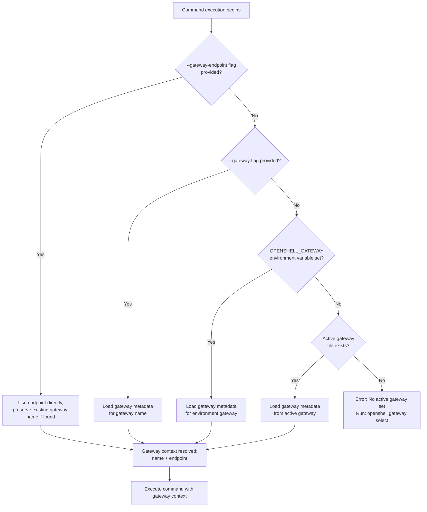

<!-- source: DeepWiki mcp.deepwiki.com · repo NVIDIA/OpenShell · page 4 CLI Reference · fetched 2026-10-26 -->

# CLI Reference

<details>
<summary>Relevant source files</summary>

The following files were used as context for generating this wiki page:

- [crates/openshell-bootstrap/src/oidc_token.rs](crates/openshell-bootstrap/src/oidc_token.rs)
- [crates/openshell-cli/src/color.rs](crates/openshell-cli/src/color.rs)
- [crates/openshell-cli/src/commands/common.rs](crates/openshell-cli/src/commands/common.rs)
- [crates/openshell-cli/src/commands/gateway.rs](crates/openshell-cli/src/commands/gateway.rs)
- [crates/openshell-cli/src/commands/mod.rs](crates/openshell-cli/src/commands/mod.rs)
- [crates/openshell-cli/src/commands/provider_readiness.rs](crates/openshell-cli/src/commands/provider_readiness.rs)
- [crates/openshell-cli/src/completers.rs](crates/openshell-cli/src/completers.rs)
- [crates/openshell-cli/src/lib.rs](crates/openshell-cli/src/lib.rs)
- [crates/openshell-cli/src/main.rs](crates/openshell-cli/src/main.rs)
- [crates/openshell-cli/src/oidc_auth.rs](crates/openshell-cli/src/oidc_auth.rs)
- [crates/openshell-cli/src/run.rs](crates/openshell-cli/src/run.rs)
- [crates/openshell-cli/src/test_utils.rs](crates/openshell-cli/src/test_utils.rs)
- [crates/openshell-cli/tests/cli_color_integration.rs](crates/openshell-cli/tests/cli_color_integration.rs)
- [crates/openshell-cli/tests/provider_commands_integration.rs](crates/openshell-cli/tests/provider_commands_integration.rs)
- [crates/openshell-cli/tests/sandbox_create_lifecycle_integration.rs](crates/openshell-cli/tests/sandbox_create_lifecycle_integration.rs)
- [crates/openshell-server/src/compute/mod.rs](crates/openshell-server/src/compute/mod.rs)
- [crates/openshell-server/src/grpc/policy.rs](crates/openshell-server/src/grpc/policy.rs)
- [crates/openshell-server/src/grpc/provider.rs](crates/openshell-server/src/grpc/provider.rs)
- [crates/openshell-server/src/grpc/sandbox.rs](crates/openshell-server/src/grpc/sandbox.rs)
- [crates/openshell-server/src/storage_proto.rs](crates/openshell-server/src/storage_proto.rs)
- [proto/openshell.proto](proto/openshell.proto)
- [sdk/go/proto/openshellv1/openshell.pb.go](sdk/go/proto/openshellv1/openshell.pb.go)

</details>


This page provides a comprehensive reference for the `openshell` command-line interface (CLI). It offers a high-level overview of the CLI structure, global flags, environment variables, gateway resolution and authentication, and links to detailed child pages for command groups.

This parent page focuses on the overall picture and how the components interact, deferring detailed command usage and examples to the child sections.

---

## CLI Structure

The `openshell` CLI is organized into command groups reflecting the core functional areas of OpenShell. These groups are implemented in the `crates/openshell-cli` crate, primarily configured within `src/main.rs`.

All commands have the general form:

```
openshell [GLOBAL FLAGS] <command> <subcommand> [COMMAND FLAGS]
```

### Primary Command Groups

| Command Group | Description | Alias | Child Page Link |
|---------------|-------------|-------|-----------------|
| `gateway` | Manage gateway lifecycle: add, list, use/select, login, info, status, remove. | `gw` | [Gateway Commands](#4.1) |
| `sandbox` | Manage sandboxes: create, connect, list, delete, exec, upload, download, forward. | `sb` | [Sandbox Commands](#4.2) |
| `policy` | Manage sandbox and global policies: set, get, list; and settings channels. | `pol` | [Policy and Settings Commands](#4.3) |
| `provider` | Manage provider credentials and profiles: create, list, refresh, readiness checks. | — | [Provider and Profile Commands](#4.4) |
| `doctor` | Gateway diagnostics and troubleshooting: logs, exec, check commands. | `dr` | [Diagnostics and Doctor Commands](#4.5) |
| `term` | Interactive terminal UI based on ratatui, supporting monitoring and management. | — | [Terminal UI (openshell term)](#4.6) |
| `logs` | View sandbox logs (standalone command). | `lg` | [Sandbox Commands](#4.2) |

Additional groups include `forward` (port forwarding), `inference` (routing), completions, and internal commands like `ssh-proxy` for SSH tunneling integration.

### Internal Command Hierarchy Mapping

```mermaid
graph TB
    CLI["openshell CLI"]

    CLI --> Gateway["gateway (gw)"]
    CLI --> Sandbox["sandbox (sb)"]
    CLI --> Policy["policy (pol)"]
    CLI --> Provider["provider"]
    CLI --> Doctor["doctor (dr)"]
    CLI --> Term["term"]
    CLI --> Logs["logs (lg)"]
    CLI --> Forward["forward (fwd)"]
    CLI --> Completions["completions"]
    CLI --> SshProxy["ssh-proxy"]

    Gateway --> GWAdd["add"]
    Gateway --> GWLogin["login"]
    Gateway --> GWInfo["info"]
    Gateway --> GWSelect["select"]
    Gateway --> GWRemove["remove"]

    Sandbox --> SBCreate["create"]
    Sandbox --> SBConnect["connect"]
    Sandbox --> SBList["list"]
    Sandbox --> SBDelete["delete"]
    Sandbox --> SBExec["exec"]
    Sandbox --> SBUpload["upload"]
    Sandbox --> SBDownload["download"]
    Sandbox --> SBForward["forward"]

    Policy --> PolSet["set"]
    Policy --> PolGet["get"]
    Policy --> PolList["list"]

    Provider --> ProvCreate["create"]
    Provider --> ProvList["list"]
    Provider --> ProvGet["get"]
    Provider --> ProvUpdate["update"]
    Provider --> ProvDelete["delete"]

    Doctor --> DocCheck["check"]
    Doctor --> DocLogs["logs"]
    Doctor --> DocExec["exec"]
```



**Sources:** [crates/openshell-cli/src/main.rs:345-503](), [crates/openshell-cli/src/run.rs:19-82]()

---

## Global Flags

Global flags affect all commands and must be placed before subcommands in the CLI invocation.

| Flag                     | Short | Environment Variable              | Description                                            |
|--------------------------|-------|---------------------------------|--------------------------------------------------------|
| `--gateway <name>`        | `-g`  | `OPENSHELL_GATEWAY`              | Specifies the gateway name to operate on               |
| `--gateway-endpoint <url>`| —     | `OPENSHELL_GATEWAY_ENDPOINT`     | Directly specify the gateway endpoint URL              |
| `--verbose`               | `-v`  | —                               | Increase verbosity (repeat for more verbosity)         |
| `--help`                  | `-h`  | —                               | Show help message                                      |
| `--version`               | `-V`  | —                               | Show CLI version                                       |

The verbosity flag supports multiple levels, e.g. `-v`, `-vv`, `-vvv`, controlling logging detail such as info, debug, and trace.

**Sources:** [crates/openshell-cli/src/main.rs:307-343]()

---

## Environment Variables

The CLI honors several environment variables for configuration and runtime control.

| Variable                    | Purpose                                                              |
|-----------------------------|----------------------------------------------------------------------|
| `OPENSHELL_GATEWAY`         | Sets the active gateway name (overridable by `--gateway` flag).     |
| `OPENSHELL_GATEWAY_ENDPOINT`| Sets direct endpoint URL for gateway connection.                    |
| `OPENSHELL_SANDBOX_POLICY`  | Path to the default sandbox policy YAML file.                       |
| `OPENSHELL_SSH_LOG_LEVEL`   | Log level for internal SSH commands (default is ERROR).             |
| `OPENSHELL_GATEWAY_INSECURE`| Allows insecure TLS connections for OIDC/gateway (not recommended). |
| `OPENSHELL_COMMUNITY_REGISTRY` | Overrides community image registry references (e.g., `base`).       |

These variables support flexible environment or CI system configuration.

**Sources:** [crates/openshell-cli/src/main.rs:101-105](), [crates/openshell-cli/src/ssh.rs:170-171]()

---

## Gateway Resolution and Context

Most CLI commands require a gateway context consisting of a gateway name and a gateway endpoint URL. The CLI resolves this context following a defined precedence:

1. The `--gateway-endpoint` flag: Directly specified endpoint URL.
2. The `--gateway` flag: Gateway name lookup.
3. The `OPENSHELL_GATEWAY` environment variable.
4. The active gateway saved in `~/.config/openshell/active_gateway`.

If no gateway is resolvable from these sources, the CLI errors and instructs the user to select or add a gateway.

### Gateway Resolution Flowchart



### Implementation Details

- The function `resolve_gateway(&Option<String>, &Option<String>) -> Result<GatewayContext>` performs the full resolution, returning a `GatewayContext` struct with `name` and `endpoint` fields.
- When the `--gateway-endpoint` is specified, the CLI attempts to preserve the gateway name by metadata matching. If no name is found, the endpoint string itself is used as the name.
- If no explicit endpoint is provided, resolution attempts `--gateway` flag, then `OPENSHELL_GATEWAY` env var, then the active gateway saved on disk.
- If none are present or metadata cannot be found, the CLI produces a user-facing error guiding gateway selection or registration.
- For commands that only need the gateway name string (like `gateway add`), `resolve_gateway_name` helper is available that skips endpoint resolution.

**Sources:** [crates/openshell-cli/src/main.rs:47-126](), [crates/openshell-cli/src/main.rs:143-152]()

---

## TLS and Authentication

The OpenShell CLI manages TLS options and credentials per gateway context via the `TlsOptions` struct [crates/openshell-cli/src/run.rs]. This enables mutual TLS (mTLS), edge token injection, or OIDC authentication as required by the gateway.

### Authentication Modes Supported

- **Cloudflare JWT:** For gateways using Cloudflare Access, the CLI loads an edge token stored locally and attaches it to the TLS options for bearer authentication.
- **OIDC (OpenID Connect):** For OIDC-authenticated gateways, the CLI loads stored OIDC tokens and transparently refreshes them when near expiry, ensuring uninterrupted authenticated access.

### How Authentication is Applied

The `apply_auth(tls: &mut TlsOptions, gateway_name: &str)` function applies stored credentials to the TLS options before making RPC calls:

- If the gateway metadata specifies `auth_mode` as `cloudflare_jwt`, the CLI loads the edge token or instructs the user to login.
- For `oidc` mode, the CLI loads and refreshes OIDC tokens or prompts login.
- If no authentication is configured, TLS options default to certificates without tokens.

Proper authentication setup is essential for authorized CLI operations and secure communication with the gateway.

**Sources:** [crates/openshell-cli/src/main.rs:159-204](), [crates/openshell-cli/src/run.rs:38-38]()

---

## SSH Integration and Port Forwarding

OpenShell integrates deeply with SSH to allow shell-like access into sandboxes and to enable port forwarding.

### SSH Proxy Command

- When the user runs `openshell sandbox connect`, CLI internally creates an SSH `ProxyCommand` invocation using `openshell ssh-proxy`.
- This command tunnels standard SSH traffic over gRPC streaming connections to the gateway and sandbox supervisor.
- This design lets standard SSH clients connect transparently through OpenShell gateways.

### Managing Port Forwards

The CLI manages background port forwards (tunnels) to sandboxes with dedicated commands:

- When a forward starts, the CLI registers its `PID`, associated sandbox ID, and bind address to allow tracking and cleanup.
- Helper functions scan running processes to find active forwarding tunnels and manage their lifecycle.

This allows users to seamlessly expose local or remote ports connected to sandbox services.

**Sources:** [crates/openshell-cli/src/ssh.rs:150-156](), [crates/openshell-cli/src/run.rs:74-82](), [crates/openshell-core/src/forward.rs:30-66]()

---

## Shell Completion

OpenShell CLI supports shell completions using the `clap_complete` crate.

### Context-Aware Completion Sources

The CLI features dynamic completions populated from:

- **Gateway names:** read from local gateway metadata cache.
- **Sandbox names:** queried live via `ListSandboxes` RPC from the resolved gateway.
- **Provider names:** queried via the gateway's provider listing RPC.

This dynamic behavior enables tab completion that reflects current registered gateways and sandboxes for ergonomic user experience.

**Sources:** [crates/openshell-cli/src/main.rs:6-8](), [crates/openshell-cli/src/main.rs:15-19]()

---

## Relationships Among CLI Core Entities

Below is a diagram bridging the natural language concepts to the core CLI code symbols and entities relevant in gateway resolution and authentication.

```mermaid
graph LR
    subgraph Natural Language Space
        G1[Gateway]
        S1[Sandbox]
        P1[Provider]
        C1[Credentials]
        T1[TLS & Auth Tokens]
    end
    
    subgraph Code Entities (openshell-cli/src/main.rs)
        GC[GatewayContext]
        RG[resolve_gateway()]
        RGN[resolve_gateway_name()]
        LA[get_gateway_metadata()]
        LAG[load_active_gateway()]
        LES[load_edge_token()]
        LOID[load_oidc_token()]
        TO[TlsOptions]
        AA[apply_auth()]
    end
    
    G1 ---|represented by| GC
    GC --- RG
    GC --- LA
    RG ---|reads| LA
    RG ---|reads| LAG
    RG ---|calls| AA
    AA --- TO
    AA --- LES
    AA --- LOID
    P1 ---|registered via| LA
    C1 --- LES
    C1 --- LOID
    T1 --- TO
    S1 ---|managed via| LA
```

**Title:** Gateway Resolution and Authentication Mapping

**Sources:** [crates/openshell-cli/src/main.rs:47-126](), [crates/openshell-cli/src/main.rs:159-204](), [crates/openshell-cli/src/run.rs:38-38]()

---

## Related Child Pages

This parent page introduces the CLI. The detailed usage, flags, arguments, behavior, examples, and error cases for each command group live in these child pages:

- **[Gateway Commands](#4.1)** — Management of gateways: add, list, use, login, info, status, select.
- **[Sandbox Commands](#4.2)** — Sandbox lifecycle operations: create, connect, list, delete, exec, sync, forward.
- **[Policy and Settings Commands](#4.3)** — Managing sandbox/global policies and settings.
- **[Provider and Profile Commands](#4.4)** — Provider credential and profile operations.
- **[Diagnostics and Doctor Commands](#4.5)** — Debugging and diagnostic tools.
- **[Terminal UI (openshell term)](#4.6)** — The interactive TUI with ratatui: screens, keybindings, and async workflows.

For installation and introductory usage, see [Installation](#2.1) and [Creating Your First Sandbox](#2.2).

---

This reference enables users to understand the CLI's overall architecture and prepare effectively for working with the fine-grained commands and workflows documented in child pages.

**Sources:**  
- [crates/openshell-cli/src/main.rs:1-187]()  
- [crates/openshell-cli/src/run.rs:1-167]()  
- [crates/openshell-cli/src/commands/gateway.rs:1-100]() (for command structure references)

---

